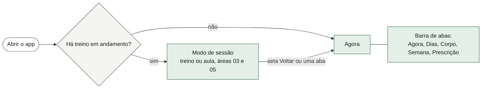
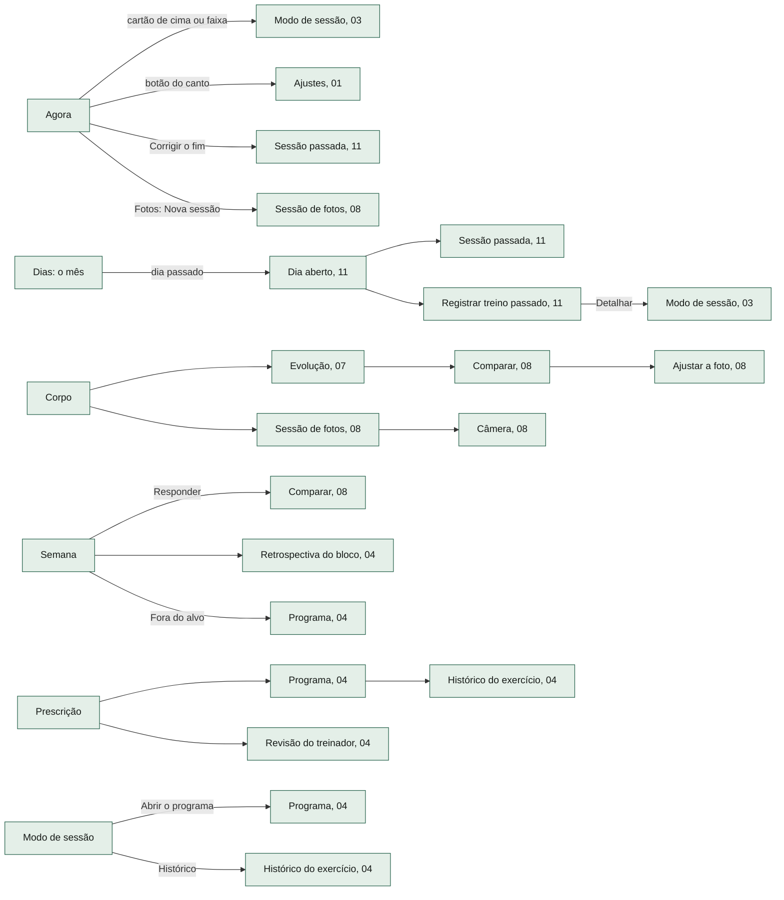
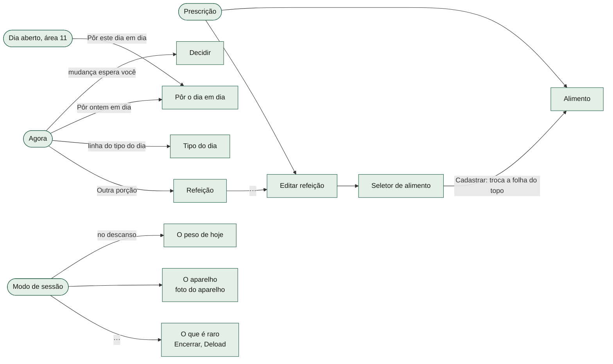
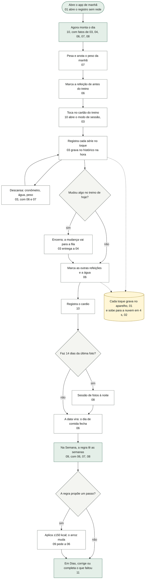
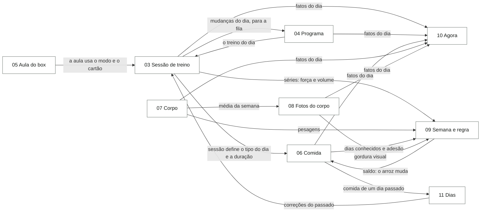

# 00 · Visão geral do Lastro

> Em uma frase: o mapa inteiro do app em um lugar só. Mostra as telas e os
> caminhos entre elas, um dia de uso de ponta a ponta, quem é dono de cada dado,
> como as onze áreas se ligam e como cada uma pode virar um serviço próprio.

Leitura feita no commit `8ec19a4` (14/10/2026). Este documento junta o que os
onze documentos de área trouxeram e não repete o detalhe deles. Para entender
uma funcionalidade a fundo, abra a área dela: cada uma tem o mesmo modelo de dez
seções (o que o usuário faz, mapa, um fluxo por funcionalidade, estados da
tela, dados, regras, ligações, proposta de serviço, riscos e índice técnico).

---

## 1. O app em um minuto

O Lastro registra o treino de musculação, a aula de box (HYROX), o cardio, a
comida, a água e o corpo (peso, medidas, bioimpedância e fotos). Ele também
executa as regras de dois profissionais, um treinador e um nutricionista, que
são agentes de IA do dono. O app não inventa conselho: aplica o que eles
prescreveram e mostra o que aconteceu.

- **Funciona sem rede.** O registro mora no aparelho. A nuvem (Supabase) é uma
  cópia que junta, campo a campo, o que cada aparelho fez.
- **Cinco abas**, cada uma com uma pergunta:
  - **Agora**: e agora?
  - **Dias**: o que aconteceu em cada dia, e o que falta dizer?
  - **Corpo**: como está o corpo, e o que eu registro hoje?
  - **Semana**: a semana andou para onde, e dá para mexer na comida?
  - **Prescrição**: o que foi prescrito, e o que eu mudo?
- **O treino não é aba, é um modo.** O modo de sessão ocupa a tela cheia e tem
  saída própria. Ele abre pelo cartão do Agora, pela faixa da sessão ou pela
  abertura do app quando há treino em andamento.
- **Ajustes** não é lugar: é o botão do canto do Agora. Lá ficam a conta, a
  sincronia, a cópia de segurança, os restaurar e o apagar tudo.

---

## 2. As onze áreas

| # | área | em uma frase | serviço proposto | tamanho |
|---|---|---|---|---|
| 01 | [Fundação e plataforma](01-fundacao.md) | abre o app sem rede, guarda e migra o registro, faz a cópia de segurança, desenha a casca (abas, telas cheias, folhas, avisos, Voltar) e instala o app no iPhone | **Plataforma**, em quatro módulos: Registro, Casca, Distribuição, Aparelho | 26 diagramas |
| 02 | [Sincronia e nuvem](02-sincronia.md) | mantém a cópia na nuvem e junta o que cada aparelho registrou, sem que um apague o outro | **Réplica** | 14 diagramas |
| 03 | [A sessão de treino](03-sessao-de-treino.md) | o treino em tela cheia, de pé na academia: série por série, o descanso, pular, trocar, a dor, as mudanças só de hoje, o fecho automático | **Sessão de Treino** | 27 diagramas |
| 04 | [Programa e prescrição de treino](04-programa.md) | o programa do treinador e o dele, a sequência, a revisão colada, a fila de mudanças que esperam decisão, o catálogo de exercícios, o histórico e quando subir carga | **Programa de Treino**, com o **Catálogo de Exercícios** como módulo que pode virar serviço próprio | 24 diagramas |
| 05 | [A aula do box](05-aula-do-box.md) | o dia que o box programa: nasce vazio, se monta com os movimentos da lousa, cada um na sua grandeza, e se registra rápido no fim | **Aula do Box** | 11 diagramas |
| 06 | [Comida](06-comida.md) | o plano do nutricionista, a comida de hoje no turno certo, o que ele comeu de verdade, a água, o dia que fecha num histórico, o pôr em dia, as compras | **Nutrição**, com três partes: Plano, Diário e Compras | 19 diagramas |
| 07 | [Corpo e medidas](07-corpo.md) | o peso da manhã, a cintura e as outras medidas de fita, a bioimpedância, a média da semana, o ritmo e a Evolução | **Medidas Corporais** | 12 diagramas |
| 08 | [Fotos do corpo](08-fotos-do-corpo.md) | as nove poses a cada 14 dias, a câmera do app, comparar duas sessões e a pergunta da gordura visual | **Acompanhamento Visual** | 14 diagramas |
| 09 | [A Semana e a regra do nutricionista](09-semana.md) | lê as semanas (peso, comida, força, séries) e aplica a regra calórica: dar, ou não, um passo de ±150 kcal que cai no arroz | **Regra Calórica**, com um módulo de **Leitura Semanal** só de leitura | 16 diagramas |
| 10 | [O Agora](10-agora.md) | a tela que abre o app: um cartão só no topo e, embaixo, como está o dia | **Agora**, um agregador sem dado próprio, e **Cardio**, o único dado que nasce no Agora | 18 diagramas |
| 11 | [Dias](11-dias.md) | o mês em células, três leituras do mês e o dia aberto, onde se corrige, apaga ou acrescenta o que ficou registrado | **Diário** | 17 diagramas |

São 198 diagramas no total. A cobertura foi conferida contra o inventário
mecânico do código ([_inventario.md](_inventario.md)):

| item do inventário | cobertos pelos onze documentos |
|---|---|
| pontos de entrada da tela (`CTX.*`) | 277 de 277 |
| funções de `src/main.jsx` | 446 de 446 |
| campos do dado guardado (`S.*`) | 34 de 34 |
| estado de tela (`view.*`) | 63 de 63 |
| telas, folhas e peças de interface | 67 de 68 (a que falta está na seção 8) |
| regras e funções do domínio e da infra | 416 de 435 (as 19 que faltam estão na seção 8) |

---

## 3. O mapa das telas

### 3.1 As abas e as telas cheias

As telas cheias tomam a tela inteira, sem a barra de abas, com "‹ Voltar" no
topo. Elas se empilham: o Voltar do sistema fecha uma camada por vez e devolve a
rolagem de onde se entrou (área 01).

De cada lugar, as telas cheias que ele abre. Uma tela que abre de mais de um
lugar aparece repetida, uma vez em cada caminho.

Faltam no desenho, para não poluir, as saídas das abas para outras abas: a
Semana leva ao Corpo ("Pesar hoje") e a Dias ("Pôr em dia"); a linha do peso do
Agora leva ao Corpo. A sessão de fotos também leva a Comparar no fim e a Ajustar
em cada pose. Tocar em qualquer aba fecha o modo de sessão sem encerrar a sessão
(área 03).

### 3.2 As folhas

Folhas são os painéis que sobem de baixo. Fecham pelo ×, pelo toque no véu,
pelo Voltar e pelo Esc, e empilham até três (a regra é de convenção: o código
não tem teto, ver a seção 9).

As folhas de comida (refeição, tipo do dia, editar refeição, seletor, alimento,
pôr o dia em dia) são da área 06; Decidir é da 04; as três do modo são da 03, e
o peso de hoje é da 07. A pilha e o Voltar são da 01.

### 3.3 O que aparece por cima de qualquer tela

- **Painel de pare**: a moldura única das ações que destroem dado ("Apagar o
  peso de 28/09" / "Deixar como está"). Área 01.
- **Aviso "Não guardei…"** quando o aparelho recusa gravar, e a faixa "Não
  guardado neste aparelho" depois de fechá-lo. Área 01.
- **Toast**: a faixa curta de retorno, que some em 3,6 s. Área 01.
- **"Gire o telefone"** fora do modo de sessão, com o telefone deitado. Área 01.
- **"O registro deste aparelho não abriu"** quando a leitura passa de 4 s ou dá
  erro. Área 01.

---

## 4. Um dia de uso, de ponta a ponta

O caminho de um dia comum, com a área que cuida de cada passo. Os horários e a
ordem são ilustração: o app não fixa rotina, tudo sai do plano e do turno que o
usuário declarou.

O que o desenho não mostra: se ele esquecer de encerrar, o app pergunta depois
de 1h30 sem série nova ("continuo treinando" / "já parei") e fecha a sessão
sozinho 10 minutos depois, na abertura seguinte ou na virada do dia; o Agora
pergunta então "Está certo / Corrigir o fim" (áreas 03 e 10). No dia da aula, o caminho do treino é o da área 05, dentro
do mesmo modo de sessão. Se o dia ficou sem marca de comida, o Agora oferece
"Pôr ontem em dia" (área 06).

---

## 5. O dado: quem é dono de cada campo

O registro inteiro é um objeto só, guardado no aparelho na chave `lastro-v1` e
regravado inteiro a cada mudança. A nuvem guarda uma linha por usuário com esse
mesmo objeto. Abaixo, o dono de cada campo, quem mais escreve nele e como ele
atravessa entre aparelhos.

Como ler a coluna da sincronia (área 02):
- **coleção**: os dois lados se unem pela chave de cada registro; no conflito,
  vence o carimbo mais novo; apagar deixa uma lápide que impede a volta.
- **documento**: vem inteiro do lado cujo registro foi gravado por último,
  qualquer que tenha sido a gravação (ver o risco D2 na seção 9).
- **mapa**: os dois lados se unem chave a chave.

### 5.1 Registro do que aconteceu

| campo | o que guarda | dono | também escreve | sincronia |
|---|---|---|---|---|
| `logs` | as séries de cada exercício, por sessão | 03 | 04 (correção pelo histórico), 05 (lista rápida da aula), 11 (correções do passado) | coleção `log:<exercício>:<sessão>:<posição>`, lápide, teto 500 por exercício |
| `done` | as presenças (cada sessão: início, duração, fim, pulados, nota da aula, lousa) | 03 | 05 (nota e lousa no fecho), 11 (lançar, corrigir, apagar) | coleção `done:<sessão>`, lápide, teto 3.000 |
| `cardio` | os cardios (modalidade, minutos, intensidade) | 10 | 11 (passado, corrigir, apagar) | coleção `cardio:<instante>`, carimbo `alt`, lápide, teto 200 |
| `body` | as 12 séries de medida: peso, cintura, 5 da bioimpedância, 5 outras de fita | 07 | — | coleção por grandeza, lápide, teto 400 por grandeza |
| `protocolo` | as sessões de foto do corpo (referência de cada pose, ajustes, nota) e a ordem das poses | 08 | — | sessões como coleção pela data; a ordem como documento; bytes pela 02 |
| `gordura` | as respostas à pergunta da gordura visual | 08 (coleta) | — | coleção `gordura:<data>`, lápide, teto 200; quem consome é a 09 |
| `dia` | a comida de hoje: marcas, porções, água, tipo do dia dito, turno, alta demanda | 06 | — | campo a campo se os dois lados estão na mesma data; senão, inteiro do lado mais novo |
| `comidaHist` | os dias de comida fechados, com o total congelado | 06 | — | coleção `comida:<data>`, campo a campo, teto 4.000 |
| `descanso` | os dias marcados como descanso | 11 | — | mapa por data, com lápide |
| `promoPendente` | as mudanças do dia que esperam decisão | 04 | 03 (cria no fecho da sessão) | coleção `promo:<sessão>`, lápide ao responder, teto 60 |
| `progLog` | o histórico de mudanças do programa | 04 | — | coleção, só cresce, teto 300 |

### 5.2 Prescrição e configuração

| campo | o que guarda | dono | também escreve | sincronia |
|---|---|---|---|---|
| `prog` | o programa dele (treinos, séries, faixas, descansos) | 04 | — | documento |
| `rot` | a sequência dos treinos | 04 | — | documento |
| `progTreinador` | o programa do treinador vindo da revisão colada | 04 | — | documento |
| `ex` | o catálogo dele por cima do catálogo do código (renomes, cadastros, arquivados) | 04 | 05 (movimentos do box cadastrados) | mapa, **sem lápide** |
| `aulas` | os modelos de aula do box | 05 | — | coleção `aula:<id>`, lápide, teto 60 |
| `comida` | o plano alimentar, a biblioteca de alimentos, os escondidos, a versão | 06 | 09 (o passo mexe no arroz) | documento |
| `cadencia` | a semana típica (dia de treino ou de descanso) | 06 | — | documento |
| `compras` | o que já foi comprado e o horizonte | 06 | — | documento |
| `ajuste` | o saldo de passos de ±150 kcal | 09 | 06 ("Restaurar o plano" zera) | documento |
| `ajusteHist` | o registro de cada passo | 09 | — | documento (é lista, mas funde como documento) |
| `perfManual` | a resposta manual sobre a força ("o app está cego") | 09 | — | documento |
| `carga` | o tipo de carga corrigido por exercício | 03 (candidato a ir para o Catálogo, 04) | — | mapa, **sem lápide** |
| `fotos` | a foto do aparelho de cada exercício (referência) | 03 (candidato a ir para o Catálogo, 04) | — | mapa pela versão, com lápide; bytes pela 02 |

### 5.3 Estado do momento (o que está em andamento)

| campo | o que guarda | dono | também escreve | sincronia |
|---|---|---|---|---|
| `sessao` | a sessão aberta | 03 | 11 (treino passado aberto por "Detalhar") | documento |
| `draft` | o rascunho de digitação do treino | 03 | 05 (lista rápida) | documento |
| `mods` | as mudanças só de hoje no treino (e a montagem da aula) | 03 | 05 (movimentos e medida do dia) | documento |
| `deload` | o interruptor de semana de deload | 03 | — | documento |
| `quadro` | o quadro colado da aula de hoje | 05 | 03 (consome no fecho) | o mais novo vence; vazio nunca vence |
| `lousa` | a foto da lousa de hoje (referência) | 05 | 03 (consome no fecho) | o mais novo vence; vazio nunca vence; os bytes não atravessam |

### 5.4 Controle do próprio registro

| campo | o que guarda | dono | sincronia |
|---|---|---|---|
| `plano` | a versão do formato (hoje 12), guarda das migrações | 01 | documento |
| `mtime` | o instante da última gravação; decide de que lado vêm os documentos | 01 escreve, 02 usa | documento |
| `export` | o instante do último backup | 01 | documento |
| `apagados` | as lápides ("isto morreu em T") | 02 (todas as áreas que apagam escrevem) | união, poda aos 90 dias |

### 5.5 Fora do registro

| onde | o que guarda | dono | viaja? |
|---|---|---|---|
| chave local `lastro-nuvem-v1` | a sessão de login | 02 | não |
| chave local `treino-sync-v1` | a contabilidade da sincronia deste aparelho (versão vista, pendência, fotos confirmadas) | 02 | não |
| chave local `lastro-descanso-v1` | o descanso que estava correndo | 03 | não |
| chave local `lastro-bancada-v1` | o aparelho simulado no computador | 01 | não |
| chave local `treino-eduardo-v1` | o registro do tempo em que o app se chamava "Treino"; lido, fundido e apagado na abertura | 01 | não |
| cache `lastro-<versão>` | os arquivos do app | 01 | não |
| cache `lastro-fotos` | os bytes das fotos de aparelho | 03 | sim, pelo bucket `aparelhos` (02) |
| cache `lastro-corpo` | os bytes das fotos do corpo, podado para as 4 sessões mais recentes | 08 | sim, pelo bucket `corpo` (02) |
| cache `lastro-lousa` | os bytes das fotos da lousa | 05 | **não**: nem nuvem, nem backup |
| cache `treino-fotos` | legado das fotos de aparelho, até a cópia para `lastro-fotos` | 03 | não |

---

## 6. Como as áreas se ligam

### 6.1 Os fluxos principais de dado

Toda área grava pela 01 e atravessa entre aparelhos pela 02; essas duas setas
ficam de fora do desenho para ele caber.

### 6.2 A matriz

Cada linha diz o que a área da linha **recebe** da área da coluna. O detalhe de
cada cruzamento está na seção 7 dos dois documentos.

| recebe ↓ de → | 01 | 02 | 03 | 04 | 05 | 06 | 07 | 08 | 09 | 10 | 11 |
|---|---|---|---|---|---|---|---|---|---|---|---|
| **01 Fundação** | | fusão da chave antiga | tela acesa, sessão aberta | catálogo | cache da lousa | folhas de comida | folha do peso | cache do corpo | saldo | lugar dos avisos | pares de apagar |
| **02 Sincronia** | gravar, abrir | | séries, sessões, fotos | programa, fila | modelos, quadro | dia, histórico | medidas | sessões de foto | passos, gordura | cardio | descanso |
| **03 Sessão** | gravar, pare, folhas | fusão | | treino do dia, regra do deload | quadro e lousa | refeição de antes, água | peso de hoje | | | portas 1 e 2 | treino passado |
| **04 Programa** | gravar, telas cheias | fusão | mudanças do dia, séries | | | tipo do dia | | | | lugar da decisão | |
| **05 Aula** | gravar, cache | fusão | modo, cartão, fecho | dia `HX`, catálogo | | | | | | cartão Aula | |
| **06 Comida** | gravar, folhas | fusão do dia | sessões, duração | próximo treino | | | peso semanal | | saldo, arroz | cartão, 14 dias | lançamento de hoje |
| **07 Corpo** | gravar, teclado | fusão | porta do descanso | | | plano de hoje | | seção As fotos | portas Pesar hoje | lugar da linha | |
| **08 Fotos** | gravar, telas cheias | bytes, poda | som e alarme | | | | peso e cintura | | janelas 10 a 28 dias | lugar da linha | |
| **09 Semana** | gravar, cópia | fusão | séries, sessões | alvo, retrospectiva | | dias fechados, plano | pesagens | gordura visual | | cardio | |
| **10 Agora** | casca, avisos | login expirou | sessão, fecho | fila, sequência | dia aberto | refeições, água | pesagens | sessões de foto | limiar de 11 dias | | sessão passada |
| **11 Dias** | gravar, pare, telas | fusão | presenças, régua | treino de cada letra | lousa | dia passado | | | | cardio de hoje | |

---

## 7. A proposta de serviços

### 7.1 Os serviços

Cada área termina com a proposta detalhada (seção 8): o que o serviço possui,
as operações como uma API, os eventos que emite e escuta. Resumo:

| serviço | possui | as operações mais importantes | eventos principais que emite |
|---|---|---|---|
| **Plataforma** (01) | o registro no aparelho, as migrações, o backup, a casca e a navegação, a distribuição como app instalado, o aparelho (tela acesa, retrato) | abrir, gravar, exportar, importar, apagar histórico; abrir destino, abrir folha, voltar, pare | registro gravado, gravação falhou, registro substituído, registro apagado |
| **Réplica** (02) | a conta, a linha na nuvem, os buckets, as lápides, a regra de fusão | entrar, sair, sincronizar, fundir (pura), subir e baixar bytes | sincronia concluída, chegou do outro aparelho, sessão de login expirou |
| **Sessão de Treino** (03) | a sessão aberta, o rascunho, as mudanças do dia, as séries da sessão, as presenças, o deload, o descanso | iniciar, registrar valor, pular, trocar, pausar, encerrar, fechar as vencidas | série registrada, sessão encerrada, mudanças aguardando decisão |
| **Programa de Treino** (04) | o programa, a sequência, o programa do treinador, o histórico de mudanças, a fila; o **Catálogo** dos exercícios | ler e editar o programa, próximo treino, ler e incorporar revisão, responder a fila, buscar no catálogo, progressão | programa mudou, revisão incorporada, mudança respondida |
| **Aula do Box** (05) | os modelos de aula, o quadro, a lousa, a montagem do dia; as regras de grandeza e ritmo | montar o dia, adicionar movimento, repetir a última aula, importar aula, fotografar a lousa, registrar rápido | movimento entrou, quadro colado, lousa fotografada, aula fechada |
| **Nutrição** (06) | o plano, a biblioteca, o dia de hoje, o histórico de dias, a semana típica, as compras | marcar refeição, porção, água, fechar o dia, pôr um dia em dia, editar o plano, aplicar o saldo no arroz, compras | refeição marcada, dia de comida fechado, plano mudou |
| **Medidas Corporais** (07) | as 12 séries de medida e as leituras derivadas (média da semana, ritmo, Evolução) | registrar medida, registrar bioimpedância, remover, médias semanais, ritmo, semana em curso | medida registrada, semana de peso mudou |
| **Acompanhamento Visual** (08) | as poses, as sessões de foto, os ajustes, as leituras de gordura visual, os bytes | abrir sessão, registrar foto, apagar, ajustar, comparar, responder a gordura, vencimento | foto registrada, sessão de fotos concluída, gordura visual respondida |
| **Regra Calórica** (09) | o saldo, o registro dos passos, a força manual; ao lado, a **Leitura Semanal** (só leitura) | avaliar (veredito), portões, aplicar passo, desfazer passo, tendência de força, adesão de 14 dias | passo aplicado, passo desfeito |
| **Agora** (10) | nenhum dado: só as regras de composição do dia | montar o Agora, o cartão de cima, a faixa | — |
| **Cardio** (10 e 11) | os cardios | registrar, listar, corrigir, apagar | cardio registrado, corrigido, apagado |
| **Diário** (11) | a marca de descanso e as leituras do mês | ler o mês, ler o dia, marcar descanso, lançar treino passado, corrigir e apagar o passado (pedindo a 03 e ao Cardio) | treino passado lançado, série passada corrigida, treino apagado |

### 7.2 Peças que hoje não têm um dono só

Os onze documentos apontaram o mesmo punhado de nós. Eles são o que precisa
ser desatado antes de qualquer serviço sair do lugar:

1. **O registro é um objeto global que todas as áreas mutam.** A normalização,
   a importação e o apagar tudo (01) conhecem todos os campos de todas as
   áreas; a fusão (02) conhece a forma de todas as coleções. Para separar, cada
   área precisaria declarar o seu campo: o padrão, a validação, se é registro
   ou prescrição e o contrato de fusão (chave, carimbo, teto, lápide ou
   documento).
2. **Os documentos dependem do carimbo do registro inteiro.** Um copo de água
   gravado num aparelho desatualizado decide de que lado vêm o programa, o
   plano, o saldo e a sessão aberta. Cada documento precisa do próprio carimbo.
   É também o risco de dado número 2 (seção 9).
3. **"O treino como aparece hoje"** (o programa, mais o catálogo, mais as
   mudanças do dia) é uma função só, usada por quase todas as áreas. Vira dois
   contratos: o programa resolvido (04) e as mudanças do dia por cima (03).
4. **O tipo do dia** (treino ou descanso) é calculado fora de todas as áreas, a
   partir das sessões, da sequência e do que ele disse no dia de comida, e é
   lido por 04, 06 e 10. Precisa de um dono só; o lugar natural é o Programa ou
   um serviço "Dia" próprio.
5. **O fim da sessão sabe demais.** Ele fecha a presença (03), carrega a fila
   (04) e consome o quadro e a lousa (05). Vira um evento "sessão encerrada"
   que 04 e 05 escutam.
6. **O passo de kcal mexe direto no plano.** A 09 escreve no arroz e fotografa
   o plano para desfazer; a 06 zera o saldo no "Restaurar o plano". Vira uma
   chamada "aplique o saldo N" da 09 para a 06, numa transação das duas.
7. **A aula não tem objeto próprio.** O dia da aula é a letra `HX` mais as
   mudanças do dia da musculação; quadro, lousa e mudanças são chaveados pela
   letra, não pela data.
8. **O cardio mora em duas áreas** (hoje no Agora, o passado em Dias).
9. **A casca tem quatro listas de destinos** que precisam concordar, e a pilha
   de folhas mora na seção de comida do código.
10. **As confirmações por caixa do sistema** (`confirm`, `prompt`) estão dentro
    das ações em 04 e 05. Um serviço devolveria "precisa confirmar" e deixaria a
    pergunta para a tela.
11. **O app é de um usuário só.** O registro local não é separado por conta, e
    a autoria (de quem é a prescrição) não existe no dado. A decisão de 21/09
    foi modelar para servidor desde já, com id de autor e de aluno; nenhum
    serviço proposto aqui tem esses ids ainda.

### 7.3 Peças comuns

Peças que não são de nenhuma área e que viram bibliotecas compartilhadas, não
serviços:

- **Formatação** (`src/dominio/formato.ts`): números (`fmtNum`, `fmtCarga`,
  `fmtInt`, `fmtK`, `fmtLitros`), períodos do dia (`Periodo`, `PERIODOS`,
  `periodoDe`), escape de texto para HTML (`escapeHTML`, `escAttr`) e a caixa
  da frase (`caixaDeFrase`). `fmtLitros` não tem chamador fora do arquivo.
- **Tipos do dado** (`src/dominio/tipos.ts` e vizinhos): `Cadencia`,
  `TipoCarga`, `IdEx`, `Serie`, `Mods`, `RascunhoEx`, a forma de cada campo.
- **Grandezas e ritmo** (`src/dominio/carga.ts`): metros, calorias,
  repetições, segundos; hoje junto das contas de musculação, usadas pela aula
  (05) e pelo histórico (04).
- **Cache das fotos de aparelho** (`src/infra/fotos.ts`): `CACHE_FOTOS`
  (`lastro-fotos`), `CACHE_FOTOS_LEGADO` (`treino-fotos`) e `migraCache`, que
  copia os bytes do cache antigo para o novo na abertura; a redução da imagem
  (`reduzPara`) é compartilhada com as fotos do corpo (08).
- **Peças de interface** (`src/ui/instrumento/`): régua, teclado, folha, pare,
  barra de abas, tela cheia e os primitivos. `BotaoEstado` (em
  `primitivos.jsx`) não é usado por nenhuma tela.

---

## 8. Itens do inventário que não pertencem a uma área

São os 19 itens de domínio e infra e a peça de interface que nenhum documento
de área citou. Todos estão descritos na seção 7.3 acima: `Cadencia`, `Periodo`,
`PERIODOS`, `fmtNum`, `fmtCarga`, `fmtInt`, `fmtLitros`, `fmtK`, `escapeHTML`,
`escAttr`, `caixaDeFrase`, `TipoCarga`, `IdEx`, `Serie`, `Mods`, `RascunhoEx`,
`CACHE_FOTOS`, `CACHE_FOTOS_LEGADO`, `migraCache` e `BotaoEstado`.

---

## 9. Riscos que apareceram na leitura

Os onze documentos registraram, sem consertar, mais de 200 riscos e dívidas
(seção 9 de cada um). Abaixo, os que tocam o **dado**, que é onde o cuidado é
maior. A marca de cada um diz o quanto foi verificado:
**reproduzido** (rodado no app ou na função), **pela leitura** (o código diz,
ninguém rodou) ou **a confirmar**.

**Todos os desta seção foram corrigidos em 15/10/2026**, cada um com um teste
que falhava no código anterior e passa no novo. A coluna "corrigido" diz o
commit. A seção 9 de cada área continua descrevendo o código como ele era na
leitura (commit `8ec19a4`); o que vale hoje para estes itens é esta tabela.

### 9.1 Perda ou corrupção de dado

| # | o risco | quando acontece | área | verificação | corrigido |
|---|---|---|---|---|---|
| D1 | Registrar uma série em outro treino da sequência, no meio da sessão, e voltar ao treino original apaga as séries que já estavam nele | tocar em outra letra na rotação durante a sessão e registrar | 03 §9.1 | reproduzido | `d8cdc8a` |
| D2 | Programa, plano de comida, saldo de kcal, registro dos passos e a sessão aberta voltam à versão de outro aparelho, em silêncio | editar num aparelho e gravar qualquer coisa (um copo de água) no outro, desatualizado, antes de sincronizar | 02 §9.6, 04 §9.20, 06 B16 | pela leitura | `2f2517f` |
| D3 | O peso tem teto de 400 medidas por grandeza, no próprio aparelho e na fusão: com pesagem diária, a mais antiga começa a sair sem aviso depois de uns 13 meses. O cardio tem teto de 200 | o tempo | 02 §9.14, 11 R8 | pela leitura (teto conferido no código) | `4955f83` |
| D4 | Refazer uma pose do corpo pode apagar a foto nova no outro aparelho: a lápide e a foto nova nascem no mesmo milissegundo, e a lápide vence o empate | refazer a pose com dois aparelhos sincronizados | 02 §9.1, 08 | reproduzido na função de fusão | `4955f83` |
| D5 | Corrigir uma medida de um dia passado pode sumir na próxima sincronia, pela mesma causa (mesma chave e mesmo milissegundo da lápide) | substituir o peso ou a bioimpedância de um dia passado | 07 §9 | a confirmar com teste | `4955f83` |
| D6 | O aparelho que tinha a foto velha sobe os bytes velhos por cima da nova (o nome do arquivo não tem versão) | trocar a foto do aparelho ou refazer uma pose num aparelho; o outro sincroniza | 02 §9.2 | pela leitura | `963a79e` |
| D7 | Um registro ilegível no aparelho é sobrescrito no primeiro toque (o aviso diz "mantido intacto") | o texto guardado corrompe; sem conta, perde-se tudo | 01 §9.1 | pela leitura | `f2bc28b` |
| D8 | O dia de comida fecha com o tipo que ele disse, não com o resolvido: num dia de treino em que ele não abriu a folha do tipo, o total congelado sai sem o pré-treino e o intra, e a adesão usa as refeições de descanso | o caminho mais comum: treinar sem tocar na folha do tipo do dia | 06 B1 | pela leitura | `5eeaefc` |
| D9 | "Tentar de novo" na correção de uma série passada grava 0 repetições quando o que falhou foi a carga ou o RIR | a gravação recusar durante uma correção em Dias | 11 R2 | pela leitura | `d2fd274` |
| D10 | Aceitar primeiro a troca de exercício faz perder a mudança de séries do mesmo exercício na fila | as duas mudanças na mesma posição, respondidas nessa ordem | 04 §9.1 | pela leitura | `a136641` |
| D11 | Responder a fila em dois aparelhos pode aplicar a mesma mudança duas vezes (num "adicionar", duplica o exercício) | responder mudanças da mesma sessão em aparelhos diferentes | 04 §9.21 | pela leitura | `a136641` |
| D12 | Uma mudança gravada enquanto o envio está em voo fica marcada como enviada | rede lenta; a última série do dia | 02 §9.4 | pela leitura | `2f2517f` |
| D13 | Apagar não atravessa em quatro lugares: voltar o nome do exercício ou o tipo de carga ao padrão, desfazer o ajuste de uma foto e corrigir a água para menos voltam pelo outro aparelho | dois aparelhos | 02 §9.7 e 9.8, 03 §9.4, 08 | pela leitura | `089d79c` |
| D14 | O quadro e a lousa de uma aula que não fechou vazam para a aula seguinte; com dois aparelhos, ressuscitam depois do fecho | colar o quadro e não registrar passada; ou fechar a aula com dois aparelhos | 05 R3 e R4 | reproduzido | `0a206a6` |
| D15 | Remover uma refeição do plano apaga a marca de hoje sem lápide, e o outro aparelho a traz de volta | dois aparelhos | 06 B7 | pela leitura | `5eeaefc` |
| D16 | As fotos do corpo nunca saem da nuvem: apagar a pose, a sessão ou tudo tira dos aparelhos, não do bucket | apagar fotos com conta | 02 §9.12 | pela leitura | `963a79e` |
| D17 | A importação de backup com a conta entrada une com a nuvem em vez de substituir | importar um backup antigo com conta | 01 §9.2, 02 §9.11 | a confirmar | `f2bc28b` (com conta, importar agora junta de propósito, sem perder o que não subiu, e o aviso diz isso) |

### 9.2 Regra que decide errado

| # | o risco | área | verificação | corrigido |
|---|---|---|---|---|
| R1 | A regra calórica pega as três últimas semanas válidas sem olhar se são recentes: três semanas pesadas há dois meses, e nada depois, dão "Comer mais 150 kcal" com o botão | 09 R1 | reproduzido na função | `a72a559` |
| R2 | A pergunta da gordura visual some dos caminhos guiados quando o par mais longo passa de 28 dias (a partir da 4ª sessão, a cada 14 dias); sem resposta, o corte por ganho rápido trava | 08 §9.2 | pela leitura | `a72a559` |
| R3 | "Restaurar o plano" zera o saldo sem marcar o passo como desfeito, e a Semana oferece o mesmo passo de novo sobre as mesmas semanas | 09 R5 | pela leitura | `a72a559` (o registro fecha o passo; oferecer de novo ficou, porque com o plano de volta à base a mesma evidência pede o mesmo passo) |
| R4 | Com o peso caindo, o texto da regra perde o sinal ("0,30 e 0,20 kg por semana, abaixo de 0,1") | 09 R2 | reproduzido na função | `a72a559` |

### 9.3 Tela que diz o que não aconteceu

Vários avisos de sucesso aparecem mesmo quando o aparelho recusou gravar (as
edições do programa e a fila, a bioimpedância, o cardio). Os detalhes estão em
04 §9.16, 07 §9 (item 3) e 10 §9 (item 4). Outros exemplos: o cartão "o treino
de antes" no Agora mostra o horário deslocado pela duração (03 §9.2, 10 §9.1);
"Corrigir →" no dia de comida fechado abre o editor permanente do plano (06 B8);
a linha do treino na comida de hoje chama uma aba que não existe mais (10 §9.2).

---

## 10. Índice

- Documentos de área: [01](01-fundacao.md), [02](02-sincronia.md),
  [03](03-sessao-de-treino.md), [04](04-programa.md), [05](05-aula-do-box.md),
  [06](06-comida.md), [07](07-corpo.md), [08](08-fotos-do-corpo.md),
  [09](09-semana.md), [10](10-agora.md), [11](11-dias.md).
- Inventário mecânico do código: [_inventario.md](_inventario.md).
- Regras do time e modelo dos documentos: [00-brief.md](00-brief.md).
- Coordenação e diário: [00-coordenacao.md](00-coordenacao.md).
- Arquivos centrais: `src/main.jsx` (o estado, as ações e o objeto de comandos
  `CTX` que as telas chamam), `src/dominio/` (as regras puras, testadas em
  `tests/dominio/`), `src/infra/` (armazenamento, nuvem, câmera e caches),
  `src/ui/` (as telas, as folhas e as peças), `src/sw.js` (o service worker).
  Os testes de fluxo (`tests/fluxo/`) rodam contra o app compilado em `dist/`.
