# 01 · Fundação e plataforma

> Em uma frase: é o chão que todas as outras partes pisam. Abre o app sem rede,
> guarda e migra o registro dentro do aparelho, faz e restaura a cópia de
> segurança, desenha a casca (abas, telas cheias, folhas, avisos, Voltar) e
> leva o app até o iPhone como aplicativo instalado.

Leitura feita no commit `8ec19a4` (linhas de `src/main.jsx` deste commit).
Observação de escopo: o pedido falava em "plano 2→7", mas as migrações vão
hoje do plano **1 ao 12** (`PLANO_ATUAL = 12`); o documento cobre as doze.

---

## 1. O que o usuário faz aqui

Quase tudo desta área é invisível quando dá certo. O que o usuário vê é a
moldura e os avisos de quando algo não deu.

**Abrir o app**
- **Abrir pelo ícone.** Aparece "Abrindo o registro… Lendo o registro deste
  aparelho. Não precisa de rede." enquanto o app lê o que está guardado. Some
  na primeira tela montada.
- **Cair onde estava.** Se havia treino em andamento, o app abre direto no
  modo de sessão; se não, abre no **Agora**. Se a sessão tinha vencido por
  inatividade, ela é fechada antes e um aviso curto diz "Fechei…" (a regra é
  da área 03).
- **"O registro deste aparelho não abriu."** Tela inteira, só quando a leitura
  não termina em 4 s ou dá erro. Diz que nada foi apagado e que a rede não é a
  causa. Botões **Tentar de novo** (recarrega) e **Ver o detalhe técnico**.
  Some sozinha se o registro acabar abrindo depois.

**Guardar (automático, sem botão de salvar)**
- Todo toque que muda dado grava o registro inteiro no aparelho. Digitação
  seguida (séries, por exemplo) espera 700 ms de calma antes de gravar. Sair do
  app, trocar de aplicativo ou bloquear a tela grava na hora o que estava
  esperando.
- **"Este aparelho não está guardando"** (no topo do Agora, área 10): quando o
  armazenamento do navegador não existe (aba privada antiga, bloqueio). Tudo
  funciona, mas vale só até fechar.

**Quando gravar falha**
- **Aviso "Não guardei…"**: abre por cima de tudo quando o aparelho recusa a
  gravação (cheio ou recusa). Diz o que não guardou ("a série 2", "o peso de
  hoje" ou "a última mudança"), a causa, que nada foi apagado, até quando o
  valor vale e, no meio de uma sessão, que a presença dela continua guardada.
  Botões: **Tentar de novo**, **Baixar uma cópia de segurança**, **Copiar o
  registro inteiro**, **Fechar este aviso**.
- **Faixa "Não guardado neste aparelho · …"** com **Tentar de novo**: fica
  depois que o aviso é fechado, até uma gravação dar certo.

**Cópia de segurança** (em Ajustes › A cópia de segurança)
- **Baixar arquivo JSON**: gera `lastro-AAAA-MM-DD.json` com o registro inteiro.
- **mostrar o json para copiar / esconder o texto**: mostra o mesmo conteúdo
  numa caixa de texto; **Copiar para a área de transferência**.
- **escolher arquivo json**: restaura um backup a partir de um arquivo.
- **Colar o texto do backup** → **Importar do texto**: restaura a partir de
  texto colado.
- **Cobrança "Cópia de segurança atrasada"** (no topo do Agora, área 10): com
  30 dias ou mais sem backup e ao menos uma sessão registrada.

**Apagar**
- **Apagar todo o histórico** (Ajustes › onde ficam seus dados): apaga o que
  foi registrado e mantém o que foi prescrito, depois de um painel de pare que
  conta o que sai. Vale para os outros aparelhos.

**O endereço vazio** (topo da Prescrição)
- **"Este endereço está vazio"**: aparece quando não há conta entrada nem
  registro nenhum. Oferece achar o que já existe antes de começar: **Na sua
  conta** (abre Ajustes), **Numa cópia de segurança** (importa um arquivo),
  **No ícone antigo da tela de início** (só orienta) e, por fim, **Começar com
  os dois** (o programa do treinador e o plano do nutricionista, que já vêm
  prontos). Sem rede, diz o que funciona offline.

**Ajustes** (botão ⚙ "Ajustes deste aparelho", no canto do cabeçalho do Agora)
- Tela cheia com quatro seções: **A sincronia** (área 02), **A cópia de
  segurança**, **O que dá para restaurar** (**Restaurar o programa do
  treinador**, área 04; **Restaurar o plano do nutricionista**, área 06) e
  **onde ficam seus dados** ("salvos em …", o resumo do acervo e **Apagar todo
  o histórico**).

**Navegar**
- **A barra de abas**: Agora, Dias, Corpo, Semana, Prescrição. Some enquanto o
  teclado do sistema está aberto (foco num campo).
- **Destinos de tela cheia**: tomam a tela inteira, sem barra de abas, com
  "‹ Voltar" no topo (programa, histórico, sessão passada, dia aberto,
  retrospectiva, lançamento de treino passado, Evolução, comparar, protocolo de
  fotos, ajuste de foto, câmera, revisão do treinador, Ajustes e o modo de
  sessão). O conteúdo de cada um é de outra área; a moldura é daqui.
- **Folhas**: painéis que sobem de baixo (refeição, seletor, editor, foto do
  aparelho, menu da sessão, peso rápido, pôr o dia em dia, decidir). Fecham
  pelo ×, pelo toque no véu, pelo Voltar e pelo Esc. Empilham até três.
- **Voltar do sistema, gesto de borda e Esc**: desfazem exatamente uma camada.
  Nunca fecham o app no meio de uma folha ou de um destino.
- **Posição de leitura**: sair de um destino devolve a rolagem de onde se
  entrou.

**Avisos transversais**
- **Painel de pare**: a moldura única das ações que destroem dado. A frase diz
  o que vai embora, o botão repete o verbo com o objeto ("Apagar o peso de
  28/09"), a saída é "Deixar como está" e o foco nasce nela.
- **Toast**: a faixa curta de retorno ("Sincronizado.", "Medida removida.").
  Some em 3,6 s.

**O aparelho**
- **Instalar na tela de início** (PWA): abre em tela cheia, sem rede depois da
  primeira abertura com internet. Não há aviso de "versão nova": o README manda
  fechar e abrir duas vezes.
- **Tela acesa durante o treino**: a tela não apaga enquanto a sessão corre
  (onde o sistema permite).
- **Só retrato**: deitado, fora do treino, o app cobre a tela com "Gire o
  telefone". No modo de sessão, deitado vira duas colunas (área 03).
- **Zoom**: o app tenta recusar a pinça e o toque duplo, e impede o zoom
  automático do Safari ao focar campo.
- **A bancada** (só no computador): o app aparece dentro de um iPhone
  simulado, com prateleira de aparelhos, girar e réguas. `?palco=0` desliga.

---

## 2. Mapa da área

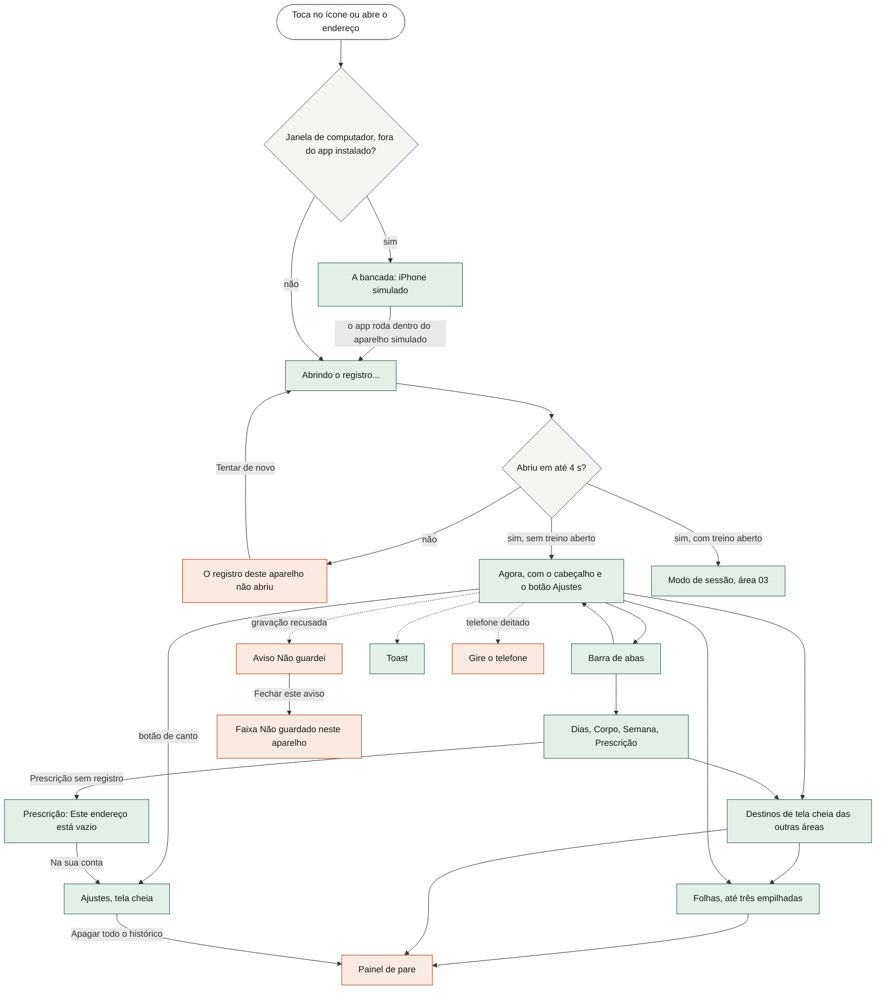

As setas pontilhadas são avisos que chegam sozinhos, de qualquer tela: o
aviso de falha, o toast e o aviso de telefone deitado podem aparecer por cima
de qualquer lugar, inclusive de dentro de um destino de tela cheia.

---

## 3. Fluxos, um por funcionalidade

### 3.1 A abertura com prazo

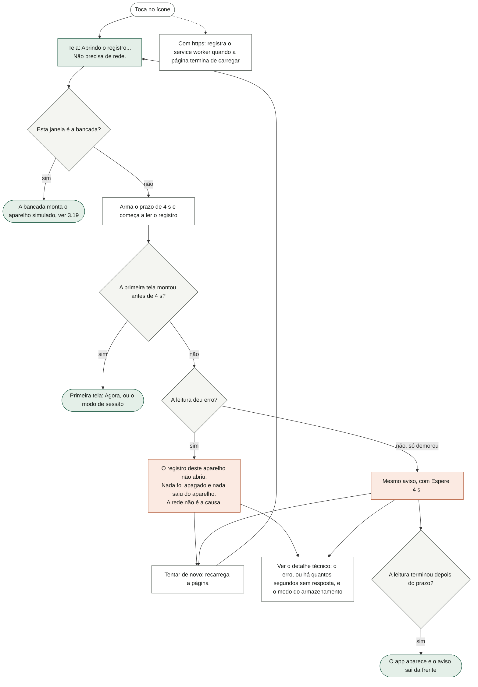

O aviso de falha é desenhado fora do app (em HTML puro, numa camada à parte),
porque o app ainda não montou. A primeira montagem do app é a prova de que o
registro abriu: ela cala o prazo e remove o aviso, se ele já estiver na tela.
O texto do erro entra como texto, nunca como HTML. Se o erro acontecer depois
da primeira tela (por exemplo, ao migrar o cache de fotos), o aviso não aparece
mais — o app já abriu. Na bancada, a janela de fora não roda o app: quem abre
o registro é o aparelho simulado.

### 3.2 Ler o registro guardado e a chave antiga

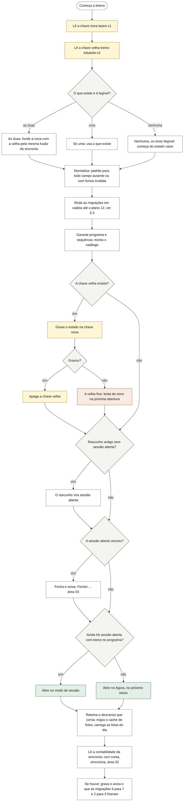

**A chave antiga.** O app se chamava "Treino" e a chave guardava esse nome.
Trocar de chave é a mudança com mais jeito de perder dado, então não é uma
cópia: a pergunta é sempre "a chave velha existe?", e nunca "já migrei?".
Publicada uma versão nova, o iPhone pode servir o código antigo por uma ou duas
aberturas, e uma série registrada nessa janela cai na chave velha depois de a
nova já existir; fundir (e não copiar) é o que salva essa série. A ordem da
fusão é (nova, velha): em empate de documento, vence quem tem o carimbo mais
novo; os registros se unem pela chave natural de cada um (regras da área 02).
A chave velha só é apagada depois de a nova ter sido gravada **com sucesso**.
A sessão da nuvem também trocou de chave (`treino-nuvem-v1` → `lastro-nuvem-v1`),
mas ali não há fusão: a velha é promovida se for a única e apagada sempre
(`src/infra/nuvem.ts`, área 02).

A rota de chegada: o dia mostrado passa a ser o da sessão aberta ou o próximo
da sequência; com sessão aberta, a aba fica no Agora e o modo de sessão abre
por cima. A nuvem entra só depois de a tela estar de pé: o app não espera rede.
A leitura de cada chave engole erro e devolve "nada lá" — por isso uma chave
com texto ilegível abre o app vazio (ver risco 1).

### 3.3 As migrações (plano 1 → 12)

```mermaid
flowchart LR
  E0(["Estado do disco ou de um backup"])
  N0["Normaliza primeiro"]
  M2["1 para 2: arquiva o histórico do plano 1 por nome"]
  M3["2 para 3: a chave vira o exercício; semeia o programa da época"]
  M4["3 para 4: entra a comida, aditiva"]
  M5["4 para 5: as letras D e E trocam"]
  M6["5 para 6: o RIR desce para a série"]
  M7["6 para 7: zera o histórico das estações de HYROX, com lápide"]
  M8["7 para 8: Café da manhã / pós-treino vira Café da manhã"]
  M9["8 para 9: a revisão do dia B"]
  M10["9 para 10: instante nas marcas, bioimpedância, perguntas viram coleção"]
  M11["10 para 11: entra a ceia"]
  M12["11 para 12: quanto o ajuste deu a cada prato de arroz"]
  F1(["Estado no plano 12"])
  E0 --> N0 --> M2 --> M3 --> M4 --> M5 --> M6 --> M7 --> M8 --> M9 --> M10 --> M11 --> M12 --> F1
  classDef acao fill:#FFFFFF,stroke:#69716B,color:#161A17
  classDef dado fill:#FFF6D6,stroke:#9A7A12,color:#161A17
  class E0,F1 dado
  class N0,M2,M3,M4,M5,M6,M7,M8,M9,M10,M11,M12 acao
```

Cada passo só roda se o estado ainda está abaixo daquele plano (o número em
`S.plano`), e termina subindo o número — por isso um passo nunca roda duas
vezes no mesmo estado. Todos leem **dado congelado da época** escrito dentro de
`migracoes.ts` (o programa do plano 3, os nomes do plano 1, a ceia do plano 11,
o passo de arroz de 120 g), nunca o código de hoje. A cadeia roda nos dois
caminhos, com a mesma ordem: na abertura e na importação de backup. O que cada
passo faz, com as palavras do código:

| passo | o que muda | o que preserva | conta ao usuário? |
|---|---|---|---|
| 1→2 | chaves de histórico "dia+posição" (A0, B3…) do plano 1 viram `antigo~<nome>`; zera correções de tipo de carga, sessão aberta e rascunho | os dias treinados | não |
| 2→3 | a chave do histórico passa a ser o id do exercício; o que ainda existe volta ao ativo; o que sumiu vira exercício arquivado; substituto vira exercício próprio com a posição de onde veio; semeia `S.prog` e `S.rot` com o programa **da época** (A B C E D F) | dias treinados | sim: "Histórico reindexado por exercício. N voltaram para o histórico ativo." |
| 3→4 | aditiva: cadência (descansa domingo), plano alimentar base, compras, saldo de ajuste, histórico do ajuste, leituras de gordura, quadro, dia | todo o treino | não |
| 4→5 | troca as letras D↔E em sessões, sessão aberta, rascunho, mudanças, histórico de mudanças, sequência e programa | a ordem dos treinos | não |
| 5→6 | o RIR, que era um por exercício e em faixa ("0–1"), desce para a última série feita, pelo limite inferior | as séries | não |
| 6→7 | apaga o histórico dos exercícios da simulação de HYROX, com uma **lápide por entrada** (senão a sincronia o traria de volta) | a presença em `S.done` | sim: "Histórico do HYROX zerado: N entradas em M exercícios." |
| 7→8 | renomeia a refeição `pos` só se o nome for exatamente "Café da manhã / pós-treino" | nome que ele já tenha mudado | não |
| 8→9 | no dia B, só nos slots ainda iguais ao antigo: pendulum (3) → agachamento no smith (2); flexora sentada 3→4; extensora 2→1; elevação pélvica 2→3 | slot que ele já mudou | não |
| 9→10 | a marca de refeição `1` vira o instante da meia-noite daquele dia (no dia aberto e no histórico); cria as 5 séries da bioimpedância; a pergunta de programa guardada vira coleção com chave | marcas que já são instante | não |
| 10→11 | insere a ceia no fim do plano, se não houver refeição com id `ceia` | a ceia que ele mesmo criou | não |
| 11→12 | com saldo de ajuste em vigor, grava em cada item de arroz quanto o ajuste deu: arredonda (saldo × 120 g ÷ nº de itens de arroz ÷ 15) × 15 | não reconstrói o passado | não |

O que o diagrama não mostra: a normalização roda **antes** das migrações e, por
contrato, ela dá padrão a campo novo e opcional (não precisa de migração),
enquanto a migração existe para **reformatar dado que já está no aparelho**. O
único cuidado de ordem documentado: a pergunta de programa guardada (formato
antigo, objeto) não é apagada pela normalização para que a 9→10 possa
convertê-la. Depois da sincronia, as migrações **não** rodam (só a
normalização) — ver risco 5.

### 3.4 Gravar

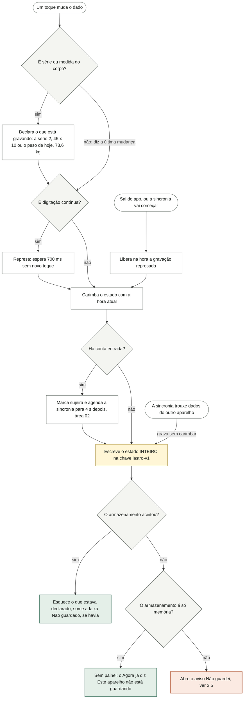

**Onde o dado mora.** A camada de armazenamento (`src/infra/db.ts`) escolhe
uma de três, na primeira vez que alguém a usa: o armazenamento do Claude.ai
(quando o app roda embutido lá; modo `host`), o armazenamento local do
navegador (`local`) ou só a memória da aba (`mem`). Toda escrita é espelhada
primeiro no armazenamento local; no modo `host`, se o host falhar uma vez, o
app passa a usar o local até fechar; na leitura, se o host vier vazio e houver
espelho local, o espelho é resgatado. A tela Ajustes mostra qual está em uso
("armazenamento local deste navegador", "armazenamento do Claude.ai, com cópia
no navegador" ou "apenas na memória desta aba — nada será salvo ao fechar").

**A gravação diz a verdade.** Desde 13/10 a camada devolve se a escrita durou;
antes ela respondia "gravei" mesmo com o aparelho cheio. A causa vem em uma de
duas palavras: `cota` (cheio — o teto do Safari é de cerca de 5 MiB, e o
estado inteiro é regravado a cada série) ou `recusa` (qualquer outra negativa,
inclusive não haver armazenamento).

**Dois tipos de escrita.** `save` carimba o estado (é o carimbo que decide, na
fusão, de que lado vêm os documentos: programa, plano, cadência), marca
sujeira para a sincronia e grava. `grava` só escreve, sem carimbar: é o que a
fusão da sincronia e a migração da chave antiga usam, porque fundir não é
"tocar" no estado. Só dois lugares declaram o que gravam: a série
("a série N", com carga × reps) e a medida do corpo ("o peso de hoje", "a
medida de cintura"); o resto aparece como "a última mudança".

### 3.5 O aviso de que a gravação falhou

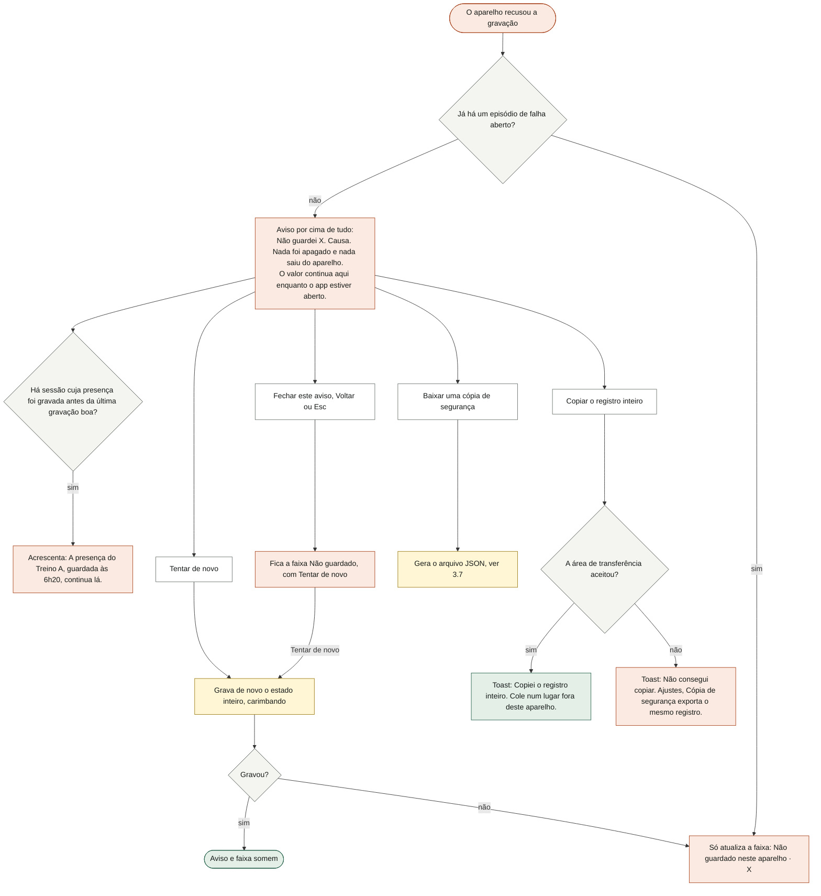

O aviso abre **uma vez por episódio**: com o aparelho cheio, cada série
seguinte também falha, e um alerta por série ensinaria a fechar sem ler; a
faixa, essa sim, acompanha cada falha e diz o que ficou por último. Fechar o
aviso não apaga a marca — "não guardado" é o estado do dado, não do aviso, e só
some quando uma gravação der certo. O aviso é uma camada: o Voltar e o Esc o
fecham como "Fechar este aviso". "Copiar o registro inteiro" copia o mesmo
envelope do backup (é o registro completo, porque o estado é regravado inteiro
a cada série). No modo memória o aviso nunca abre, nem a faixa: o canal ali é o
aviso fixo do Agora. Se o aparelho continuar cheio, "Tentar de novo" falha de
novo e só a faixa atualiza; a saída real é baixar ou copiar a cópia e liberar
espaço — o app não mede o próprio tamanho nem avisa antes de encher.

### 3.6 Sair do app no meio e voltar

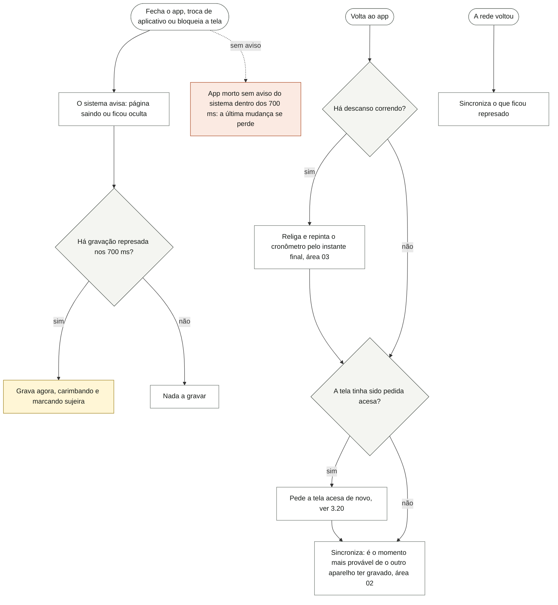

O app escuta `pagehide` (o evento que o iOS entrega de verdade quando o PWA
sai de cena) e a página ficar oculta. **a confirmar:** a gravação liberada é
assíncrona e ninguém espera por ela; se o iOS congela a página antes de a
escrita acontecer, ela só acontece ao voltar. O rascunho de série vive dentro
do próprio estado (não há gravação separada dele), então o que não foi
gravado não tem outra cópia. O que já foi gravado sobrevive a qualquer forma de
fechar.

### 3.7 Exportar (baixar o arquivo)

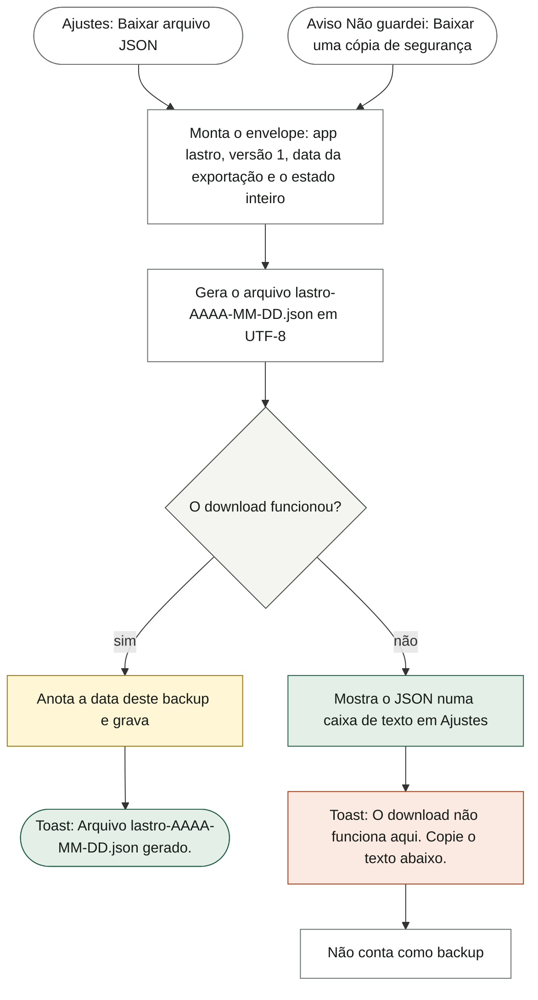

O arquivo leva `charset=utf-8` explícito: sem isso, um leitor que assume
Latin-1 transformaria "tríceps" em "tríceps". "Funcionou" quer dizer que o
navegador não recusou o clique no link de download; **a confirmar:** no PWA
instalado do iPhone o download abre uma folha do sistema que pode ser
cancelada, e o app conta como backup do mesmo jeito. A data no nome do arquivo
é a de Greenwich (ver risco 14). A data do backup alimenta a cobrança do Agora
(regra 5).

### 3.8 Mostrar e copiar o JSON

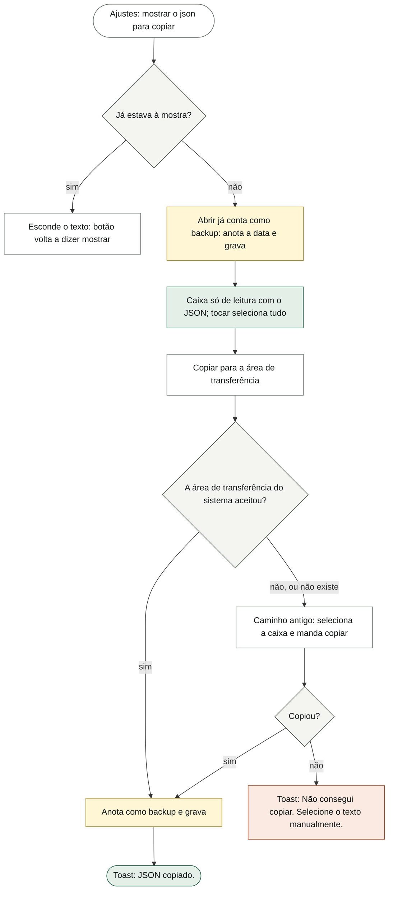

Abrir o texto já conta como backup de propósito: quem copia à mão nunca
passaria pelo botão de copiar, e a cobrança pediria para sempre.

### 3.9 Importar (arquivo ou texto colado)

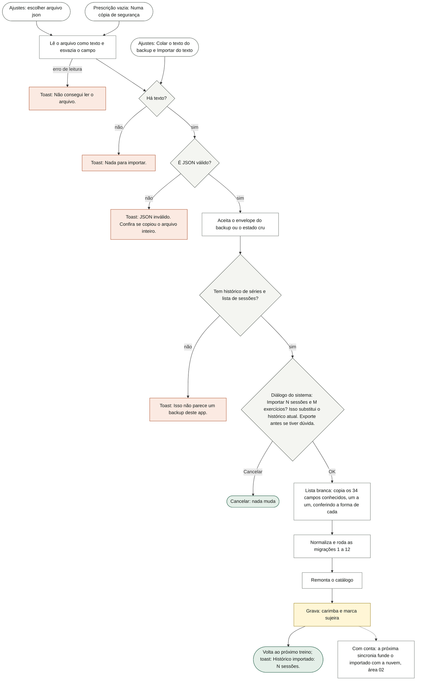

**A lista branca.** A importação não copia o arquivo por cima: monta um estado
novo campo a campo, aceitando cada um só se tiver a forma certa (lista é lista,
objeto é objeto, número é número finito). Um backup adulterado não consegue
injetar campo que o app não conhece; o preço é que **todo campo novo precisa
ser listado ali**, e foi por esquecer isso que seis campos (histórico do
ajuste, leituras de gordura, modelos de aula, histórico de comida, protocolo de
fotos, quadro) chegaram a voltar vazios em silêncio. Hoje o teste "reimportar
devolve TODOS os campos" escreve em cada campo, exporta, apaga, importa e
compara. Detalhes que valem uma linha: o saldo de ajuste entra como número
qualquer (antes era podado a −1/0/1 e um backup com dois passos voltava com
zero); as medidas do corpo entram série por série, pela lista oficial das
grandezas; a pergunta de programa guardada pode chegar no formato antigo e a
9→10 converte; as lápides e o carimbo entram, senão importar faria um aparelho
ressuscitar o que o outro apagou.

**Backup antigo.** Um JSON de qualquer época passa pelas mesmas migrações da
abertura; um backup do plano 6 sai sem o histórico das estações de HYROX
(a 6→7). A pergunta usa o diálogo do sistema ("OK"/"Cancelar"), e não o painel
de pare (ver risco 4). A importação **não** garante programa e sequência como
a abertura faz (ver risco 3). Os Ajustes continuam na tela depois de importar.

### 3.10 Apagar todo o histórico

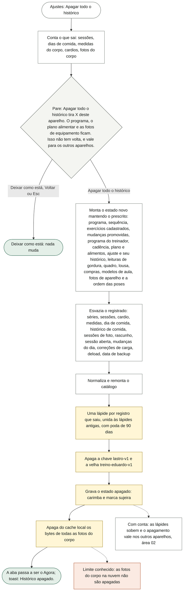

Sem as lápides novas, o outro aparelho leria o que sobrou lá como "registro
que este não tem" e o traria de volta — contra um aviso que acabou de prometer
que não tem volta. As lápides antigas entram junto, porque ainda são a única
coisa que impede a ressurreição do que foi apagado antes. A remoção das chaves
vem antes da gravação de propósito: uma gravação que falhe não pode deixar o
histórico velho de pé na chave (se falhar, o estado apagado fica só na memória
e o aviso de falha abre). A chave velha vai junto, senão a migração da próxima
abertura ressuscitaria o histórico. Os bytes das fotos do corpo saem do cache
do aparelho porque, sem as sessões, nada mais os referencia; o que a fusão
trouxer de volta do outro aparelho volta da nuvem. A poda do cache roda em
"tentar e seguir": falhar ali não impede a parte sem volta. O apagamento não
toca na sessão da nuvem nem na contabilidade da sincronia. Os Ajustes continuam
na tela; por baixo, a aba vira o Agora. No app há um só apagamento em bloco:
"apagar tudo" e "apagar o histórico" são o mesmo gesto.

### 3.11 O endereço vazio

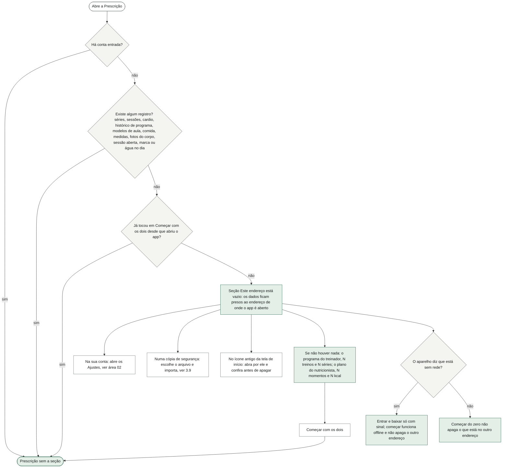

O porquê (F56, F271): os dados ficam presos ao endereço; um link novo abre um
app vazio enquanto o histórico continua no antigo. Por isso o vazio oferece
**achar** antes de **começar**. Programa e plano já vêm semeados: "Começar com
os dois" não grava nada, só tira o aviso — e o aviso some de vez no primeiro
registro. Como o toque não é guardado, fechar e abrir o app sem registrar nada
traz o aviso de volta. O cabeçalho da Prescrição troca o olho para "nada aqui
ainda" enquanto o aviso está de pé.

### 3.12 O painel de pare

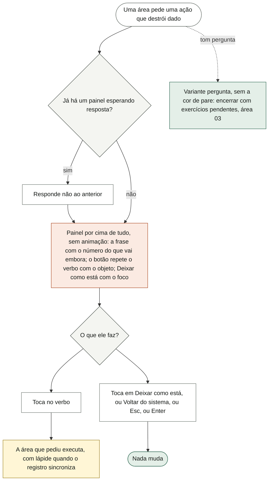

A moldura é desta área; cada frase e o que acontece depois são da área que
pede. Quem usa o pare hoje: descartar a sessão sem série e encerrar com
pendentes (variante pergunta) — área 03; tirar um exercício com série de hoje —
área 03; apagar um registro do histórico de um exercício — área 04; apagar uma
série de uma sessão passada e apagar um treino registrado — área 11; apagar um
cardio — áreas 10/11; apagar uma medida do corpo — área 07; apagar a foto de
um aparelho — área 03; apagar uma foto do corpo — área 08; apagar todo o
histórico — aqui. As perguntas que mexem só em prescrição ou em conta
continuam no diálogo do sistema (doze chamadas), de propósito: pintá-las de
pare treinaria o dono a ignorar o painel. O painel é a camada mais alta da pilha
(acima até do aviso de falha) e é desenhado também por cima dos destinos de
tela cheia.

### 3.13 O toast

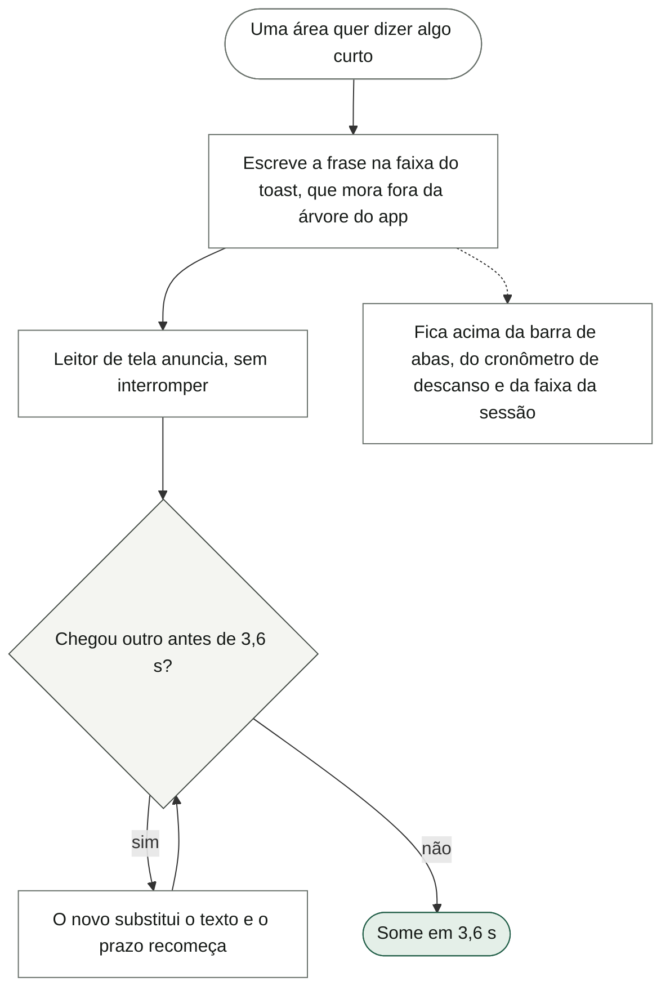

Não há fila: a última frase vence. O toast não tem botão nem desfazer. A
posição é calculada a partir das alturas reais da barra de abas, do cronômetro
e da faixa da sessão (antes, durante um descanso, ele nascia atrás do
cronômetro e não aparecia). A série gravada **não** usa o toast: tem uma região
invisível própria para o leitor de tela (`#serie-dita`, área 03).

### 3.14 A casca: abas, telas cheias e o que fica por cima

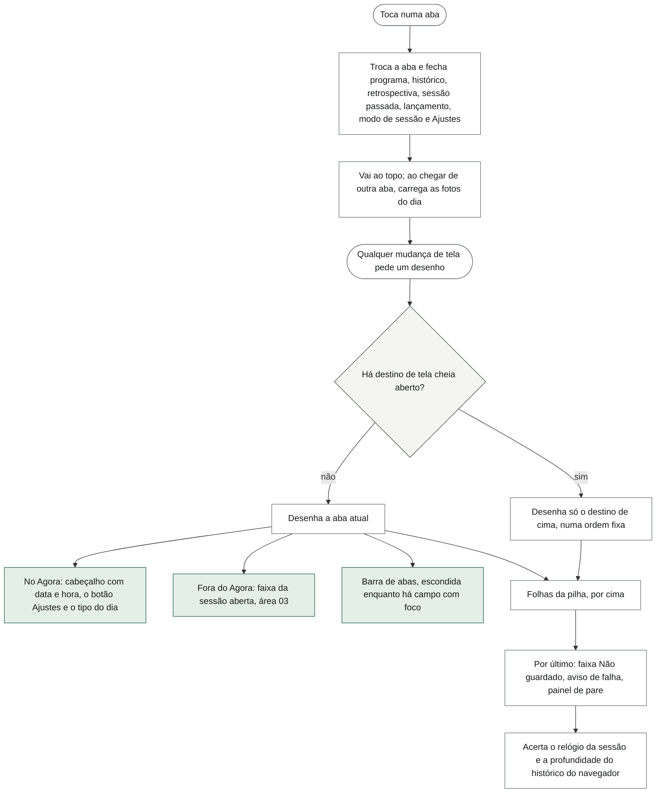

**A ordem dos destinos de tela cheia** (o primeiro que estiver aberto é o
desenhado): Ajustes, câmera, ajuste de foto, protocolo de fotos, revisão do
treinador, comparar, Evolução, retrospectiva, lançamento de treino passado,
sessão passada, dia aberto, histórico do exercício, programa e, por último, o
modo de sessão (a camada mais funda: tudo o que se abre de dentro dele fica por
cima). Não há roteador nem endereço por tela: a rota mora no estado de tela, e
são cinco lugares sem URL para compartilhar. A moldura comum dos destinos
(`TelaCheia`) tem "‹ Voltar" no topo, o olho, o título (que recebe o foco ao
entrar) e o corpo; o desenho é refeito pelo Preact, que só mexe no que mudou, e
por isso um campo em foco continua em foco. A faixa da sessão continua montada
(vazia) no Agora porque ela escreve a própria altura, que o toast lê.

### 3.15 As folhas e a pilha de folhas

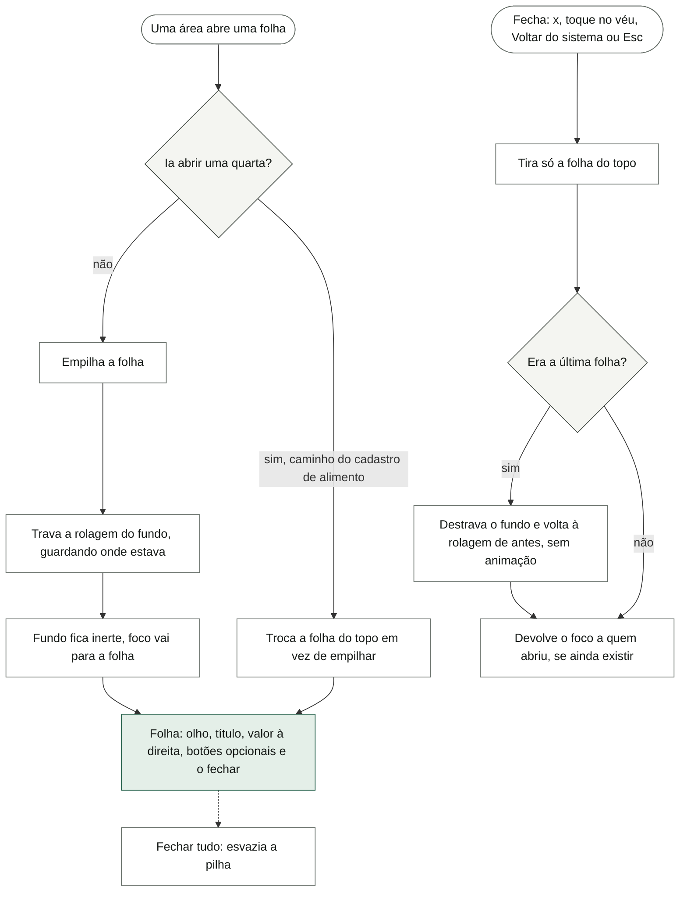

As folhas que existem e a área de cada uma: refeição, tipo do dia, editar
refeição, seletor de alimento, editar alimento e pôr o dia em dia (área 06);
decidir (área 10); foto do aparelho e menu da sessão (área 03); peso rápido
(área 07). Elas empilham em três níveis — refeição (camada 50), seletor (70),
editor (80) —, e a regra "três, nunca mais" é de desenho: o código empilha sem
teto, e quem evita a quarta é a troca da folha do topo (ver risco 7). No iOS,
esconder a rolagem do corpo não segura o dedo; por isso a trava fixa o corpo na
posição atual e a devolve ao destravar, com contagem para folhas empilhadas. As
folhas abertas de dentro de um destino de tela cheia também são desenhadas
(conserto recente: antes abriam "no vazio"). O Esc não mora na folha: é um
ouvinte só, da navegação (3.16).

### 3.16 Voltar do sistema, gesto de borda e Esc

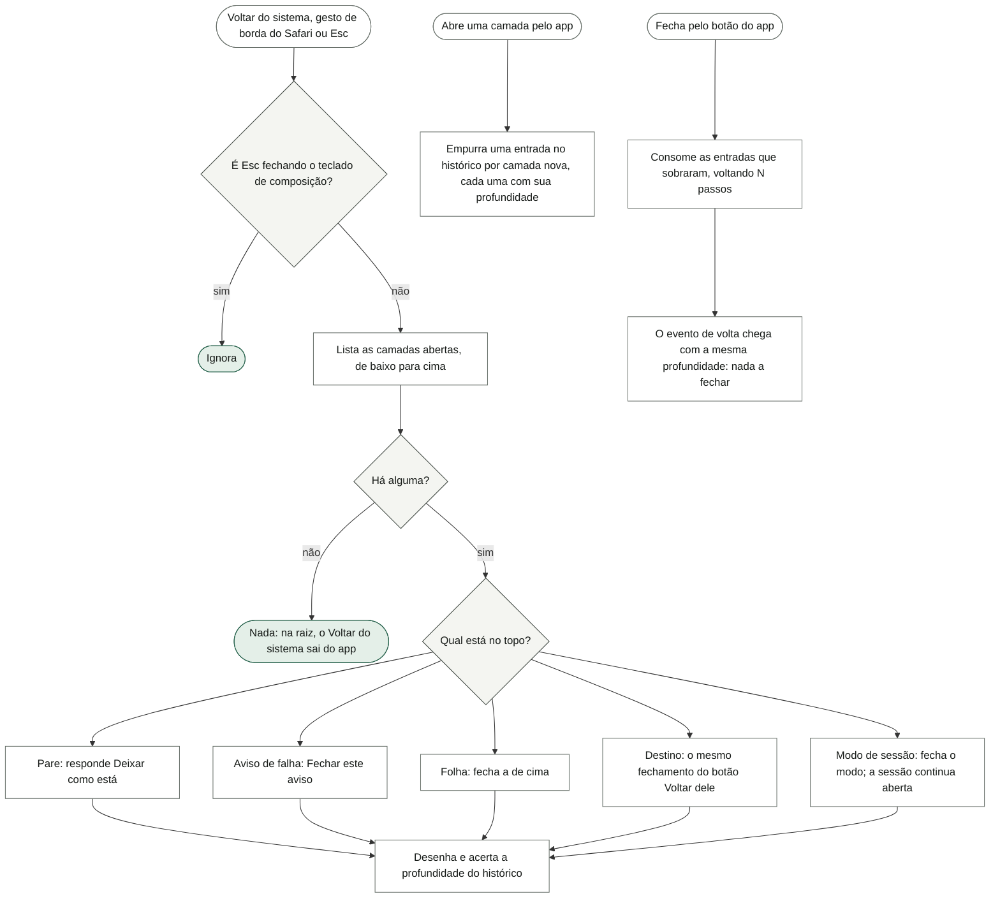

O app nunca empurrava histórico, e no Android e no gesto de borda do Safari o
primeiro Voltar em qualquer ponto **fechava o app**. A correção não usa rota
com nome: o histórico do navegador tem a mesma profundidade que a pilha de
camadas abertas, uma entrada por camada. A pilha não é um estado a mais: é uma
leitura do estado de tela, de baixo para cima — modo de sessão, dia aberto,
sessão passada, lançamento, retrospectiva, programa, histórico, Evolução,
comparar, revisão, protocolo, ajuste de foto, câmera, Ajustes, as folhas, o
aviso de falha e, no topo, o pare. Cada entrada do histórico carrega a própria
profundidade; quando o navegador volta, o app compara "em que profundidade o
histórico está agora" com "quantas camadas estão abertas" e fecha a diferença.
Não há contador de eventos, e por isso o mecanismo se corrige sozinho depois de
qualquer divergência. Avançar (botão de ir adiante) não reabre nada. Contrato:
"Voltar desfaz exatamente uma camada" vale para "‹ Voltar", ×, véu, Esc e
Voltar do sistema, todos pelo mesmo caminho.

### 3.17 A posição de leitura

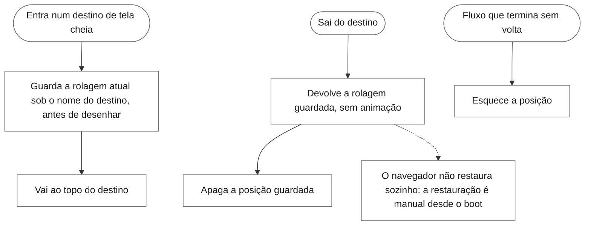

Guardado por nome do destino, e não numa pilha: um destino que abre outro por
cima (protocolo → ajuste de foto) tem de devolver os dois, e uma pilha
desbalanceada por uma saída que não passou pelo fechar iria escorregando. A
restauração automática do navegador foi desligada porque, depois do Voltar, ela
desfazia a devolução meio quadro depois (voltar do Programa caía no topo).
Trocar de aba vai ao topo da aba nova.

### 3.18 Publicar uma versão e o aparelho pegá-la

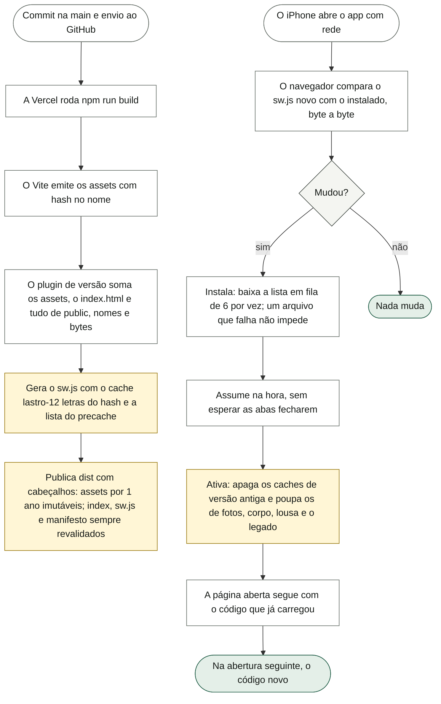

O número da versão saiu da mão: antes era um `treino-v28` que precisava ser
incrementado, e esquecer era publicar sem o aparelho perceber. O hash cobre o
que não passa pelo empacotador (index.html, manifesto, ícones), senão trocar um
ícone deixaria o sw.js idêntico. Não há aviso de versão nova nem recarga
automática; o README diz "No iPhone, feche o app e abra de novo duas vezes para
pegar a versão nova". Os dados não correm risco na publicação: não estão no
cache do app, e os caches de fotos não têm versão no nome (um caso de teste
cobra que todo cache de dado declarado em `src/infra` esteja na lista poupada —
`lastro-corpo` já foi esquecido uma vez, e cada publicação apagava as fotos do
corpo que ainda não tinham subido, F252). **a confirmar:** a publicação na
Vercel acontece pela integração com o GitHub (o diário do redesenho registra
"deploy da Vercel com sucesso" após o envio à `main`); a configuração dessa
integração está no painel da Vercel, não no repositório. O `vercel.json` é
validado em modo estrito e um teste confere as chaves.

### 3.19 Abrir sem rede (o service worker servindo arquivos)

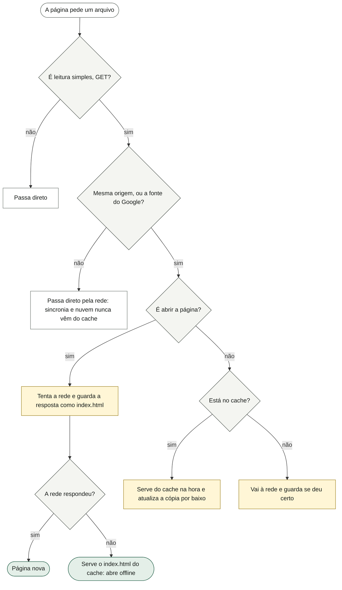

Abrir a página é "rede primeiro, cache se falhar"; o resto é "cache primeiro,
atualiza por baixo". Nunca alargar para "cachear tudo": a sincronia é outra
origem, e servi-la do cache devolveria um estado velho como se fosse o da
nuvem. O service worker não serve as fotos: quem as lê é a página, direto dos
caches de dado (áreas 03, 05 e 08). Ele só se registra em `https` (em
`file://`, no iframe do Claude.ai e em navegador antigo falha calado). A
manifestação para quem usa: app instalado (`display: standalone`, nome
"Lastro", ícones comuns e mascaráveis de 192 e 512, retrato), barra de status
translúcida com uma faixa de fundo desenhada por baixo dela para o texto não
ficar sob o relógio, e cor da barra por tema (claro `#E7E3DB`, escuro
`#08090A`).

### 3.20 A bancada (o app no computador)

```mermaid
flowchart TD
  F1(["Abre o endereço numa janela"])
  D1{"A URL pede palco com um aparelho?"}
  A1["Este documento É o aparelho: escreve a área segura dele antes da primeira tela"]
  D2{"palco=0, embutido em outra página, instalado, ou sem mouse?"}
  T1(["App cru na janela"])
  D3{"Janela de pelo menos 760 por 420?"}
  A2["Liga a bancada; o app NÃO monta nesta janela"]
  X1["Lê a escolha guardada: aparelho e deitado"]
  A3["Abre o próprio app num iframe com o aparelho escolhido"]
  T2["Cena: aparelho com moldura, ilha, relógio do sistema, réguas e o painel com a leitura"]
  A4["Trocar aparelho, Alt 1 a 4, ou girar, Alt R: muda medidas e área segura sem recarregar"]
  X2["Guarda a escolha em lastro-bancada-v1"]
  A5["Janela menor que 1040: some o painel e as réguas"]
  A6["Escala só reduz, nunca amplia; mínimo 0,3; o painel diz quanto"]
  F1 --> D1
  D1 -->|"sim"| A1
  D1 -->|"não"| D2
  D2 -->|"sim"| T1
  D2 -->|"não"| D3
  D3 -->|"não"| T1
  D3 -->|"sim"| A2 --> X1 --> A3 --> T2
  T2 --> A4 --> X2
  T2 --> A5
  T2 --> A6
  A3 -.-> A1
  classDef tela fill:#E4EFE8,stroke:#24604A,color:#161A17
  classDef acao fill:#FFFFFF,stroke:#69716B,color:#161A17
  classDef dado fill:#FFF6D6,stroke:#9A7A12,color:#161A17
  classDef decisao fill:#F4F5F1,stroke:#434B45,color:#161A17
  class T1,T2 tela
  class F1,A1,A2,A3,A4,A5,A6 acao
  class X1,X2 dado
  class D1,D2,D3 decisao
```

Por que um iframe e não um CSS de desktop: dentro de um iframe do mesmo
documento, 402 × 874 **é** 402 × 874 — media query, `svh`, `fixed`, `sticky`
e rolagem se resolvem sozinhos. A única concessão é a área segura, que no
computador vem zero: a bancada a escreve à mão (deitado, o topo zera, a base
vira 21 e os lados recebem o recuo do sensor). Os aparelhos da prateleira:
iPhone SE (375 × 667), iPhone 16 (393 × 852), iPhone 16 Pro (402 × 874, o
padrão) e iPhone 16 Pro Max (440 × 956). O iframe recebe as permissões de
câmera, microfone, tela acesa, tela cheia e escrever na área de transferência.
Os dois documentos são da mesma origem e leem o mesmo armazenamento; só o de
dentro roda o app ("um app por documento": dois apps vivos disputariam a nuvem,
os cronômetros e a tela acesa).

### 3.21 Tela acesa durante o treino

```mermaid
flowchart TD
  F1(["Inicia ou retoma o treino, registra uma série, usa o valor anterior ou começa um descanso"])
  A1["Marca que quer a tela acesa"]
  D1{"O aparelho oferece a trava, ainda não há uma, e a página está visível?"}
  A2["Pede ao sistema a tela acesa"]
  D2{"O sistema concedeu?"}
  T1(["A tela não apaga"])
  E1["Falha calada, sem aviso"]
  A3["O sistema soltou sozinho, ao bloquear ou sair"]
  F2(["Volta ao app"])
  D3{"Ainda quer a tela acesa?"}
  F3(["Pausa, encerra ou descarta o treino"])
  A4["Deixa de querer e solta a trava"]
  F1 --> A1 --> D1
  D1 -->|"sim"| A2 --> D2
  D1 -->|"não"| E1
  D2 -->|"sim"| T1
  D2 -->|"não"| E1
  T1 -.-> A3
  F2 --> D3
  D3 -->|"sim"| D1
  F3 --> A4
  classDef tela fill:#E4EFE8,stroke:#24604A,color:#161A17
  classDef acao fill:#FFFFFF,stroke:#69716B,color:#161A17
  classDef erro fill:#FBEAE2,stroke:#A63F17,color:#161A17
  classDef decisao fill:#F4F5F1,stroke:#434B45,color:#161A17
  class T1 tela
  class F1,F2,F3,A1,A2,A3,A4 acao
  class E1 erro
  class D1,D2,D3 decisao
```

Funciona em PWA instalado a partir do iOS 18.4 (diz o código). O fecho
automático por inatividade (área 03) não solta a trava — ver risco 6.

### 3.22 Só retrato e o aviso de telefone deitado

```mermaid
flowchart TD
  F1(["Na abertura"])
  D1{"Tela de toque, e o navegador oferece travar a orientação?"}
  A1["Pede retrato ao sistema; recusa é o caso normal"]
  A2["No iPhone não há trava: quem age é o aviso"]
  F2(["Gira o telefone"])
  D2{"Deitado e com até 520 px de altura?"}
  T0(["Tela normal"])
  D3{"O modo de sessão está na tela?"}
  T1["Sessão em duas colunas, área 03"]
  T2["Cobre tudo: retrato · Gire o telefone · Fora do treino, o app foi desenhado de pé"]
  F1 --> D1
  D1 -->|"sim"| A1
  D1 -->|"não"| A2
  F2 --> D2
  D2 -->|"não"| T0
  D2 -->|"sim"| D3
  D3 -->|"sim"| T1
  D3 -->|"não"| T2
  classDef tela fill:#E4EFE8,stroke:#24604A,color:#161A17
  classDef acao fill:#FFFFFF,stroke:#69716B,color:#161A17
  classDef erro fill:#FBEAE2,stroke:#A63F17,color:#161A17
  classDef decisao fill:#F4F5F1,stroke:#434B45,color:#161A17
  class T0,T1 tela
  class F1,F2,A1,A2 acao
  class T2 erro
  class D1,D2,D3 decisao
```

O manifesto pede retrato, e o Android o honra no app instalado; o iOS não. O
aviso fica no HTML, fora do app, e quem o liga é só a media query — por isso
aparece até antes de o app terminar de abrir. A condição tem duas partes para
não pegar janela de computador (que é deitada por natureza): deitado **e**
baixo (até 520 px) é telefone.

### 3.23 O zoom

```mermaid
flowchart TD
  F1(["Foco num campo, toque duplo ou pinça"])
  D1{"Foco num campo de texto?"}
  A1["Todo campo tem 16 px: o Safari não dá zoom automático"]
  D2{"Toque duplo num botão?"}
  A2["Botões sem zoom de toque duplo e sem o atraso de 300 ms"]
  A3["Pinça: a raiz só deixa rolar; os gestos próprios do WebKit são recusados; a viewport pede sem zoom"]
  D3{"App instalado na tela de início?"}
  E1["Medido pelo dono em 06/10: a pinça funciona mesmo assim"]
  T1(["Fora do app instalado: a pinça é recusada"])
  F1 --> D1
  D1 -->|"sim"| A1
  D1 -->|"não"| D2
  D2 -->|"sim"| A2
  D2 -->|"não, pinça"| A3 --> D3
  D3 -->|"sim"| E1
  D3 -->|"não"| T1
  classDef tela fill:#E4EFE8,stroke:#24604A,color:#161A17
  classDef acao fill:#FFFFFF,stroke:#69716B,color:#161A17
  classDef erro fill:#FBEAE2,stroke:#A63F17,color:#161A17
  classDef decisao fill:#F4F5F1,stroke:#434B45,color:#161A17
  class T1 tela
  class F1,A1,A2,A3 acao
  class E1 erro
  class D1,D2,D3 decisao
```

O bloqueio fica por decisão do dono ("zoom acidental no meio de uma série, com
a mão suada, custa mais que zoom deliberado ganha"), mesmo sabendo que no app
instalado ele não pega. Quem for cortar código morto: não corte sem perguntar.
**a confirmar:** "fora do app instalado a pinça é recusada" é o que o código
pretende; a medição registrada é só a do app instalado. O que de fato funciona
é a regra dos 16 px nos campos. O app também mata o "puxar além do fim"
(que revelava uma faixa do fundo e recarregava a página).

### 3.24 Os Ajustes (a tela)

```mermaid
flowchart TD
  F1(["Toca no botão de canto do Agora"])
  F2(["Prescrição vazia: Na sua conta"])
  A1["Abre os Ajustes como destino e guarda a rolagem"]
  T1["A sincronia: entrar, sincronizar agora, sair, área 02"]
  T2["A cópia de segurança: Exportar e Importar, ver 3.7 a 3.9"]
  T3["O que dá para restaurar: o programa, área 04; o plano, área 06"]
  T4["Onde ficam seus dados: salvos em, o resumo do acervo, Apagar todo o histórico"]
  F3(["Voltar, Voltar do sistema, Esc, ou tocar numa aba"])
  A2["Fecha e devolve a rolagem"]
  F1 --> A1
  F2 --> A1
  A1 --> T1
  A1 --> T2
  A1 --> T3
  A1 --> T4
  F3 --> A2
  classDef tela fill:#E4EFE8,stroke:#24604A,color:#161A17
  classDef acao fill:#FFFFFF,stroke:#69716B,color:#161A17
  class T1,T2,T3,T4 tela
  class F1,F2,F3,A1,A2 acao
```

Os Ajustes não são lugar (não estão na barra de abas): são um botão de canto,
porque conta, sincronia e backup não respondem nenhuma das cinco perguntas dos
lugares. Não possuem decisão de treino nem de comida. A cobrança de backup não
mora aqui, de propósito: aviso de perda atrás de um botão de canto é aviso que
não se lê, então ela fica no topo do Agora. O resumo do acervo conta sessões,
exercícios com histórico, cardio, pesagens, medidas de cintura e leituras de
bioimpedância (cada leitura conta uma vez, embora tenha cinco números).

### 3.25 O desligamento

```mermaid
flowchart TD
  F1(["Quem roda o app pede para desligar: hoje, o harness dos testes antes de fechar a janela"])
  A1["Marca desligado: nenhum desenho a mais"]
  A2["Para o cronômetro, o relógio da sessão e a batida de 30 s"]
  A3["Desmonta a árvore do app"]
  A4["Cada continuação que esperava banco ou rede pergunta se ainda está ligado e para"]
  T1(["Nada pinta num documento que sumiu"])
  F1 --> A1 --> A2 --> A3 --> T1
  A1 -.-> A4
  classDef tela fill:#E4EFE8,stroke:#24604A,color:#161A17
  classDef acao fill:#FFFFFF,stroke:#69716B,color:#161A17
  class T1 tela
  class F1,A1,A2,A3,A4 acao
```

A ordem importa: desmontar antes de travar o desenho deixaria uma janela para
uma continuação remontar tudo. Era a origem de quatro rejeições não tratadas na
suíte de fluxo. O desligamento não remove os ouvintes da janela e não cancela a
gravação represada nem a sincronia agendada (uma gravação pendente ainda
escreve depois — o que é bom para o dado).

---

## 4. Estados da tela

| estado | quando acontece | o que a tela mostra |
|---|---|---|
| Abrindo | do toque no ícone até a primeira tela | "Abrindo o registro… Lendo o registro deste aparelho. Não precisa de rede." |
| Abertura sem resposta | 4 s sem a primeira tela | "O registro deste aparelho não abriu." + "Esperei 4 s. Nada foi apagado…" + Tentar de novo / Ver o detalhe técnico |
| Abertura com erro | a leitura rejeitou antes do prazo | o mesmo aviso, sem "Esperei 4 s", com o erro no detalhe |
| Abertura atrasada | a leitura termina depois do aviso | o app aparece e o aviso é removido |
| Pouso no treino | abriu com sessão aberta cujo treino ainda existe | o modo de sessão, por cima do Agora |
| Sessão fechada na abertura | sessão venceu enquanto o app estava fechado | toast "Fechei …" (área 03) |
| Migração com aviso | a 6→7 apagou entradas, ou a 2→3 reindexou | toast "Histórico do HYROX zerado: …" / "Histórico reindexado por exercício. …" |
| Não está guardando | armazenamento só na memória | no Agora, acima do cartão: "Este aparelho não está guardando" (área 10); em Ajustes, "apenas na memória desta aba — nada será salvo ao fechar" |
| Verificando | a sonda do armazenamento ainda não respondeu | Ajustes › salvos em: "verificando"; o Agora não avisa (conta como guardando) |
| Falhou (aviso aberto) | primeira gravação recusada do episódio | painel "Não guardei …" com quatro botões; fundo coberto |
| Não guardado (marca) | aviso fechado e ainda sem gravação boa | faixa "Não guardado neste aparelho · …" com Tentar de novo |
| Backup atrasado | ≥ 30 dias sem backup e ≥ 1 sessão | no Agora: "Cópia de segurança atrasada" + "N dias desde o último backup." ou "Você nunca exportou o histórico." |
| JSON à mostra | tocou em "mostrar o json para copiar", ou o download falhou | caixa de texto com o JSON e "Copiar para a área de transferência"; o botão diz "esconder o texto" |
| Colando | tocou em "Colar o texto do backup" | caixa "cole aqui o conteúdo do arquivo" + "Importar do texto" |
| Endereço vazio | sem conta, sem registro, sem ter tocado em começar | seção "Este endereço está vazio" no topo da Prescrição; olho "nada aqui ainda" |
| Endereço vazio sem rede | o mesmo, com o aparelho dizendo offline | a nota troca para o que funciona offline |
| Pare aberto | uma ação destrutiva pediu confirmação | painel por cima de tudo, foco em "Deixar como está" |
| Pergunta aberta | o pare no tom "pergunta" | a mesma moldura, sem a cor de pare |
| Aba | nenhum destino de tela cheia aberto | a aba + barra de abas (+ cabeçalho no Agora, + faixa da sessão fora do Agora) |
| Teclado aberto | foco num campo de texto | a barra de abas some |
| Destino de tela cheia | algum destino aberto | só o destino de cima, com "‹ Voltar"; sem barra de abas |
| Folha(s) | pilha não vazia | folhas por cima do que houver, véu, fundo inerte e travado |
| Telefone deitado | deitado e ≤ 520 px de altura, fora do modo de sessão | "retrato · Gire o telefone" cobrindo tudo |
| Deitado na sessão | o mesmo, com o modo de sessão na tela | duas colunas (área 03) |
| Bancada | computador, janela ≥ 760 × 420, fora do app instalado | o iPhone simulado com o app dentro, prateleira, réguas e painel |
| Bancada compacta | a mesma, janela < 1040 px de largura | só o aparelho |
| Toast | qualquer área disse algo | a faixa curta por 3,6 s |

---

## 5. Dados

### O que esta área guarda

**A chave do registro — `lastro-v1`** (armazenamento local do navegador, ou o do
Claude.ai com espelho local). Guarda o estado inteiro `S` como um texto JSON,
sem envelope, regravado inteiro a cada gravação. É a verdade do app: a nuvem é
cópia por cima. Quem lê: a abertura (3.2) e ninguém mais; em memória, todas as
áreas leem e escrevem `S`. Os campos de `S` que são **desta área** (os outros
são das áreas donas de cada assunto):

| campo | formato | o que é | quem mais lê |
|---|---|---|---|
| `S.plano` | número (hoje 12) | a versão do formato do estado; guarda das migrações | só as migrações |
| `S.mtime` | número, instante em ms (0 = nunca) | o carimbo da última gravação com `save`; decide de que lado vêm os documentos na fusão | área 02 (fusão) |
| `S.export` | número, instante em ms (0 = nunca) | a data do último backup (baixar, mostrar ou copiar o JSON) | Agora (cobrança, área 10), Ajustes |
| `S.apagados` | objeto `{ chave do registro: instante }` | as lápides: "isto morreu em T". A regra é da área 02; esta área as escreve no apagar tudo e na 6→7 | área 02 (fusão) e todas que apagam (via `lapide()`) |

A normalização (`normalizaEstado`) é desta área e conhece o **padrão de todos
os campos** de `S` (34): `logs`, `done`, `deload`, `draft`, `sessao`, `cardio`,
`body` (12 séries), `carga`, `export`, `plano`, `prog`, `rot`, `ex`, `mods`,
`progLog`, `aulas`, `quadro`, `lousa`, `progTreinador`, `cadencia`, `comida`,
`dia`, `comidaHist`, `ajuste`, `ajusteHist`, `gordura`, `perfManual`,
`compras`, `mtime`, `promoPendente`, `fotos`, `protocolo`, `descanso`,
`apagados`. Um estado vazio nasce com `plano = 12` e é completado por ela.

**A chave velha — `treino-eduardo-v1`.** O registro do tempo em que o app se
chamava "Treino". Lida e fundida na abertura, apagada depois de a nova gravar
com sucesso; apagada também no apagar tudo.

**Outras chaves locais que esta área não possui, mas que vivem na mesma
camada** (para quem for separar o serviço de armazenamento):

| chave | dona | o que guarda |
|---|---|---|
| `treino-sync-v1` | área 02 | a contabilidade da sincronia deste aparelho (versão vista, sujeira, fotos confirmadas, expirou); nunca viaja; ainda com o nome antigo |
| `lastro-nuvem-v1` / `treino-nuvem-v1` | área 02 | a sessão de login (a velha é promovida e apagada) |
| `lastro-descanso-v1` | área 03 | o descanso que estava correndo (sobrevive a fechar o app) |
| `lastro-bancada-v1` | esta área (bancada) | `{ aparelho, deitado }` da bancada; gravada direto no armazenamento local, fora da camada `DB` |

**Caches do navegador (Cache Storage).**

| cache | dono | política na publicação |
|---|---|---|
| `lastro-<12 letras do hash>` | esta área (service worker) | os arquivos do app; o de versão antiga é apagado ao ativar a nova |
| `lastro-fotos` | área 03 (foto do aparelho) | poupado |
| `lastro-corpo` | área 08 | poupado; o apagar tudo poda tudo dele |
| `lastro-lousa` | área 05 | poupado |
| `treino-fotos` | legado da área 03 | poupado até a página copiar os bytes para `lastro-fotos` |

**O envelope da cópia de segurança** (arquivo, texto mostrado e "Copiar o
registro inteiro"): `{ "app": "lastro", "v": 1, "exportedAt": "<data ISO>",
"data": <S inteiro> }`, com recuo de 2 espaços. A importação aceita o envelope
ou o `S` cru.

**Estado de tela desta área (não guardado, some ao fechar):** `view.aba` (a
aba), `view.pilha` (as folhas, `{ k, id?, ref?, idx?, data? }`), `view.pare`
(`{ id, texto, sim, nao, tom }`), `view.naoGuardado` (`{ motivo, oQue, valor,
salvo }`), `view.falhou` (o aviso aberto), `view.json` (o texto à mostra),
`view.paste` (a área de colar), `view.ajustes`, `view.comecouAqui`. Variáveis de
módulo: a posição de leitura por destino, a profundidade do histórico, o que
está sendo gravado e a hora da última gravação boa, o prazo da abertura, o
desligado.

### O que só lê de outras áreas

- Para contar no pare do apagar tudo e no resumo dos Ajustes: sessões, séries,
  cardio, medidas, histórico de comida e fotos do corpo.
- Para o endereço vazio: todas as coleções de registro, o dia de comida aberto,
  a sessão aberta e se há conta (área 02); o programa e o plano para o resumo
  (áreas 04 e 06).
- Para escolher a rota da abertura: a sessão aberta e o próximo treino (área 03/04).
- Para o aviso de falha: a sessão aberta e a presença dela (área 03).

### Como atravessa a sincronia

- O estado inteiro sobe como **uma linha** na nuvem, com versão (área 02). Os
  campos desta área são **documento**: `plano`, `mtime` e `export` vêm inteiros
  do lado com o carimbo maior. `apagados` é **união** das lápides dos dois
  lados, com poda de 90 dias.
- O carimbo é o que faz um gesto local vencer na fusão: o apagar tudo e a
  importação gravam com `save` justamente para os documentos zerados ou
  trazidos não voltarem do outro aparelho.
- A fusão grava com `grava` (sem carimbar) e roda só a normalização, não as
  migrações (risco 5).
- A chave velha é fundida com a nova pela mesma fusão, sem rede.

---

## 6. Regras

1. **Prazo da abertura: 4 s** (`PRAZO_ABERTURA = 4000`). Passado o prazo, ou na
   primeira rejeição, a tela diz o que aconteceu. Origem: §7.2 da frente 3,
   defeito F273 ("Carregando…" sem fim).
2. **A primeira tela montada cala o prazo** e remove o aviso, se ele já estiver
   na tela. Um guarda só (dois se mascaravam nos testes).
3. **Gravação represada: 700 ms** desde o último toque (`queueSave`). Sair do
   app, ficar oculto ou começar uma sincronia libera na hora.
4. **Sincronia agendada 4 s** depois de cada gravação, só com conta entrada
   (área 02).
5. **Cobrança de backup: ≥ 30 dias e ≥ 1 sessão registrada.** Os dias contam
   desde o último backup; se nunca houve, desde a primeira sessão. Baixar o
   arquivo, abrir o JSON e copiar o JSON contam como backup; o download que
   falhou não conta.
6. **O estado é regravado inteiro a cada gravação** (F256), num armazenamento
   que no Safari tem teto de cerca de 5 MiB (F53).
7. **A camada de armazenamento não mente**: devolve se a escrita durou e a causa
   (`cota` ou `recusa`). No modo `host`, a escrita dura se o host aceitou, mesmo
   que o espelho local não.
8. **O aviso de falha abre uma vez por episódio**; a faixa "não guardado" fica
   até a próxima gravação boa. No modo memória, nem aviso nem faixa (o Agora já
   avisa). Decisão 13, §3.2 da frente 3.
9. **O aviso de falha diz o que continua guardado**: a presença da sessão, se
   ela nasceu antes da última gravação aceita, com a hora (a D, `aula.html`,
   estado 12).
10. **Migrações**: cada passo roda só se `S.plano` está abaixo dele e sobe o
    número no fim; lê dado congelado da época, nunca o código de hoje; roda na
    abertura e na importação, na mesma ordem; a normalização vem antes. Campo
    novo e opcional ganha padrão na normalização; dado existente a reformatar
    exige migração. Regra 2 do projeto: "não quebrar dados salvos".
11. **Chave antiga**: funde (nova, velha); a velha só sai depois de a nova
    gravar com sucesso; a pergunta é "a velha existe?", nunca "já migrei?".
12. **Importação é lista branca** dos 34 campos, com a forma de cada um
    conferida; campo novo tem de ser listado (o teste cobra a paridade com a
    exportação).
13. **Apagar todo o histórico** apaga o registrado e mantém o prescrito, a
    biblioteca e o catálogo (decisão do dono, 08/10: modelos de aula e fotos de
    aparelho ficam; o protocolo de fotos é partido: a ordem das poses fica, as
    sessões vão). Deixa uma lápide por registro que saiu; une com as antigas;
    poda de 90 dias. Apaga as duas chaves antes de gravar.
14. **Painel de pare**: um por vez (o novo responde "não" ao anterior); foco na
    saída; nunca "OK"/"Cancelar"; o botão repete o verbo com o objeto; a saída é
    "Deixar como está"; Voltar, Esc e Enter respondem a saída; sem animação.
    Decisão 13, §3.3 da frente 3. Só ações que apagam dado que o aparelho não
    reconstrói; o resto fica no diálogo do sistema.
15. **Toast: 3,6 s**, sem fila (o último vence), anunciado com `aria-live=polite`.
16. **Folhas: três níveis** (camadas 50, 70, 80); a quarta vira troca da folha
    do topo. Fecham por ×, véu, Voltar e Esc.
17. **Voltar desfaz exatamente uma camada**, pelo mesmo caminho para "‹ Voltar",
    ×, véu, Esc e Voltar do sistema (`docs/LASTRO_UX_CONTRACT.md`, §2). Ordem
    da pilha: pare acima do aviso de falha, que fica acima das folhas, que
    ficam acima dos destinos; o modo de sessão é o mais fundo. Voltar no modo
    de sessão fecha o modo e não encerra a sessão (decisão para o gesto de
    borda não matar o treino).
18. **Trocar de aba fecha** programa, histórico, retrospectiva, sessão passada,
    lançamento, modo de sessão e Ajustes, e vai ao topo.
19. **Service worker**: precache em fila de 6 por vez (o que um navegador abre
    por origem); um arquivo que falha não impede a instalação; caches de dado
    (`lastro-fotos`, `lastro-corpo`, `lastro-lousa`, `treino-fotos`) sobrevivem
    à ativação; outra origem que não a fonte do Google nunca vem do cache;
    abrir a página é rede primeiro.
20. **Versão do cache** = as 12 primeiras letras do SHA-256 dos assets, do
    `index.html` e de todo `public/` (nomes e bytes).
21. **Cabeçalhos na Vercel**: `/assets/*` com `max-age=31536000, immutable`;
    `/sw.js`, `/index.html` e `/manifest.webmanifest` com `max-age=0,
    must-revalidate`; o sw com `Service-Worker-Allowed: /`; o manifesto com
    `application/manifest+json`.
22. **Bancada**: só com ponteiro fino, fora do app instalado, fora de iframe, sem
    `?palco=0`, janela ≥ 760 × 420; compacta abaixo de 1040 px; escala entre
    0,3 e 1 (nunca amplia); 402 × 874 é o padrão.
23. **Retrato**: aviso quando deitado **e** com até 520 px de altura; dentro do
    modo de sessão, duas colunas em vez de aviso; a trava do sistema só é
    pedida em tela de toque.
24. **Campos nunca abaixo de 16 px** (senão o Safari dá zoom ao focar).
25. **Tela acesa** é pedida ao iniciar/retomar, ao registrar série, ao usar o
    valor anterior e ao começar descanso; solta ao pausar, encerrar ou
    descartar; pedida de novo ao voltar ao app se ainda for querida.
26. **O app não espera a rede**: a nuvem entra depois de a primeira tela estar
    de pé.

---

## 7. Ligações com as outras áreas

| área | o que esta recebe dela | o que esta entrega a ela |
|---|---|---|
| 02 · Sincronia | a fusão (`funde`) usada também na chave antiga; o pedido de gravar sem carimbar depois de fundir; a seção "A sincronia" dos Ajustes; a sessão de login (para o endereço vazio e para `sujou`) | `save` marca sujeira e agenda sincronia; `liberaSave` antes de cada ciclo; o carimbo `mtime`; as lápides do apagar tudo e da 6→7; a sincronia ao voltar ao app e quando a rede volta; a ordem "tela primeiro, nuvem depois" na abertura |
| 03 · Sessão de treino | os pedidos de tela acesa; o declarar "a série N"; a sessão aberta e a presença (para o aviso de falha e a rota); o fecho da sessão vencida; o descanso a retomar; o pare do descarte e do "encerrar com pendentes"; as folhas da foto do aparelho e do menu da sessão | o pouso no modo de sessão; a camada mais funda da pilha; o Voltar que fecha o modo sem encerrar; o aviso de deitado desligado no modo; a gravação represada de 700 ms; o toast |
| 04 · Programa | "Restaurar o programa do treinador" (nos Ajustes); o programa semeado; o catálogo (`montaCatalogo`) | os destinos de tela cheia do programa e do histórico na pilha; a migração 2→3 (programa da época), 4→5 (letras), 8→9 (revisão do B); o resumo do programa no endereço vazio |
| 05 · Aula do box | o cache `lastro-lousa` | a lista de caches poupados; a migração 6→7 (HYROX); os modelos de aula preservados no apagar tudo |
| 06 · Comida | "Restaurar o plano do nutricionista" (nos Ajustes); as folhas de refeição, tipo do dia, editores, seletor, pôr o dia em dia | a pilha de folhas (com a troca do topo, nascida no cadastro de alimento); as migrações 3→4, 7→8, 9→10 (marcas), 10→11 (ceia), 11→12 (arroz); o plano semeado na normalização; o resumo do plano no endereço vazio |
| 07 · Corpo | o declarar "o peso de hoje"/"a medida de…"; a folha do peso rápido; o pare de apagar medida | as 12 séries de medida no estado vazio, na normalização e na importação; a 9→10 (bioimpedância); o aviso de falha com o valor |
| 08 · Fotos do corpo | o cache `lastro-corpo`; a poda | a poda total no apagar tudo; a lista de caches poupados; os destinos protocolo, comparar, ajuste e câmera na pilha |
| 09 · Semana | o saldo do ajuste (normalizado e importado como número) | a 3→4 (saldo), a 11→12 (arroz) |
| 10 · Agora | o lugar dos avisos "não está guardando", "cópia de segurança atrasada" e o botão ⚙ | `guardando`, `cobraBackup`/`backupTxt`, o cabeçalho na casca, a faixa da sessão escondida no Agora |
| 11 · Dias | os pares de apagar sessão passada, série passada, cardio | os destinos dia aberto, sessão passada e lançamento na pilha; a posição de leitura ao voltar ao mês |

---

## 8. Como serviço individual

A área tem quatro peças que podem virar serviços separados, mas que nascem
juntas por estarem todas na "porta" do app. Proposta: um serviço **Plataforma**
com quatro módulos.

**8.1 Registro (o armazenamento do estado)**
- Possui: a chave `lastro-v1`, a chave legada, a camada `DB`, `S.plano`,
  `S.mtime`, `S.export`, o envelope do backup, as migrações e a normalização.
- Operações:
  - `abrir()` → devolve o estado normalizado e migrado, e o que as migrações
    fizeram (`{ estado, avisos: [...] }`).
  - `gravar({ oQue, valor?, carimbar: true|false, represar: ms })` → `{ ok,
    motivo?: 'cota'|'recusa' }`.
  - `liberar()` → grava agora o que está represado.
  - `ondeGuarda()` → `'host'|'local'|'mem'|null`.
  - `exportar()` → envelope; `marcarBackup()`.
  - `importar(texto)` → `{ ok, sessoes, exercicios }` ou o erro (`vazio`,
    `json`, `formato`); a confirmação fica com quem chama.
  - `apagarHistorico()` → o estado novo e as lápides.
- Eventos que emite: `registro.aberto`, `registro.gravado`,
  `registro.gravacaoFalhou { motivo, oQue, valor }`, `registro.gravacaoVoltou`,
  `registro.substituido` (importação), `registro.apagado`, `app.saindo`,
  `app.voltou`, `rede.voltou`.
- Escuta: `sincronia.fundiu` (grava sem carimbar), cada área que declara o que
  grava.

**8.2 Casca e navegação**
- Possui: a aba, a pilha de destinos e de folhas, a profundidade do histórico,
  a posição de leitura, o pare, o toast, o aviso de falha.
- Operações: `irPara(aba)`, `abrirDestino(nome, dados)`, `fecharDestino(nome)`,
  `abrirFolha(f)`, `trocarFolha(f)`, `fecharFolha()`, `fecharTudo()`,
  `voltar()`, `pare({ texto, sim, nao?, tom? })` → promessa de sim/não,
  `toast(frase)`.
- Eventos: `camada.aberta`, `camada.fechada`, `voltar.pedido`.
- Escuta: `registro.gravacaoFalhou`/`gravacaoVoltou` (abre e fecha o aviso).

**8.3 Distribuição (PWA)**
- Possui: o service worker, o plugin de versão, o manifesto, os ícones, o
  `vercel.json`, a lista de caches poupados.
- Operações: `publicar()` (build + deploy), `versaoAtual()` (hoje não existe),
  `haVersaoNova()` (hoje não existe).
- Contrato com os outros: todo cache de dado declarado por uma área entra na
  lista poupada (hoje cobrado por teste, lido de `src/infra`).

**8.4 Aparelho**
- Possui: tela acesa, trava de retrato, aviso de deitado, zoom, a bancada.
- Operações: `segurarTela()`, `soltarTela()`, `ehBancada()`.
- Eventos: `aparelho.deitado`, `aparelho.voltouDoBloqueio`.

**O que hoje está acoplado e precisaria ser separado**
- `S` é um global reatribuído (a importação e o apagar tudo trocam o objeto
  inteiro) e mutado por todas as áreas; não há fronteira de escrita.
- **A normalização, a importação e o apagar tudo conhecem todos os campos de
  todas as áreas.** Cada campo novo de qualquer área precisa entrar em três
  listas desta (normalização, lista branca, o que fica/sai no apagar), mais a
  regra de fusão da área 02. Separar exigiria que cada área registrasse seu
  campo com padrão, validação e "é registro ou prescrição".
- As migrações sabem do conteúdo de treino, comida e corpo (programa da época,
  ceia, arroz): seriam migrações por área, com um número de versão por área.
- `save()` chama a sincronia diretamente (`sujou`); a fusão chama `grava`. Hoje
  não há evento entre os dois.
- Quatro listas descrevem os destinos de tela cheia e precisam concordar:
  `emTelaCheia`, `telaCheia`, `camadasAbertas` e `FECHA_CAMADA` (risco 8/9). E
  `folhaAberta` lista todas as folhas de todas as áreas.
- O toast e o aviso de abertura escrevem direto no DOM, fora da árvore.
- A superfície de testes (`window.__modelo`, `window.__escopo`) atravessa tudo.

---

## 9. Riscos e dívidas que apareceram na leitura

1. **Registro ilegível é sobrescrito no primeiro toque.** Se o texto em
   `lastro-v1` não for um JSON válido, a abertura registra no console
   "histórico ilegível, mantido intacto no storage" e começa do estado vazio —
   mas nada impede a primeira gravação de escrever por cima. O "mantido
   intacto" dura até o primeiro toque. Reproduzir: gravar `{"logs":` em
   `localStorage['lastro-v1']`, abrir o app (aparece o endereço vazio), tocar
   num copo de água; o texto original some. (Com conta, a nuvem traz o
   histórico de volta pela fusão; sem conta, perdeu.) O mesmo vale se a chave
   velha estiver ilegível: ela é apagada depois da gravação da nova.
2. **Importar com a conta entrada não substitui: une com a nuvem.**
   **a confirmar** (não há teste): a importação grava o backup e marca sujeira;
   a sincronia seguinte funde o backup com a nuvem, e as coleções se unem pela
   chave — o que estava na nuvem e não no backup volta. A frase "Isso
   substitui o histórico atual" só é verdade sem conta. Reproduzir: com conta,
   registrar uma sessão, importar um backup anterior a ela, esperar a
   sincronia.
3. **A importação não garante programa e sequência.** A abertura chama
   `garanteProgramaERotacao`; a importação não. Um backup com `plano ≥ 3` e sem
   `prog` (feito à mão, ou de um estado quebrado) deixa o app sem programa até a
   próxima abertura. **a confirmar** o efeito na tela. Reproduzir: importar
   `{"logs":{},"done":[],"plano":12}`.
4. **A importação substitui o histórico pelo diálogo do sistema**
   ("OK"/"Cancelar"), contra a decisão 13 (o painel de pare é para ação que
   apaga dado que o aparelho não reconstrói — e substituir o histórico é isso).
5. **Dois aparelhos em versões diferentes podem rebaixar `S.plano`.** O número
   viaja como documento (vem do lado com carimbo maior) e a sincronia não roda
   as migrações. No dia de uma publicação, o iPhone ainda pode rodar o código
   antigo (o próprio código diz "uma ou duas aberturas"); se ele gravar por
   último com `plano` menor, o aparelho novo recebe o número velho e, na
   abertura seguinte, **refaz** as migrações acima dele. **a confirmar**
   consequências: a 10→11 devolveria a ceia que ele tivesse removido; a 11→12
   reescreveria o quanto o ajuste deu a cada prato com a divisão igual.
6. **O fecho automático por inatividade não solta a tela acesa.** A sessão que
   a batida de 30 s fecha (área 03) não passa por `soltarTela`; com o app aberto
   na bancada da academia, a tela continua acesa depois do fecho, e o pedido é
   refeito a cada volta ao app. Reproduzir: iniciar sessão, registrar uma série,
   deixar o app aberto e intocado 1h40; conferir `querSegurar` (continua
   verdadeiro).
7. **A pilha de folhas não tem teto no código.** "Três níveis, nunca mais" é
   convenção; `abreFolha` empilha sem limite, e só o caminho do cadastro de
   alimento usa a troca do topo.
8. **A ordem de `camadasAbertas` não é o espelho exato de `telaCheia`.** Em
   `telaCheia`, retrospectiva, lançamento, sessão passada e dia aberto estão
   **acima** do histórico e do programa; em `camadasAbertas`, abaixo. Hoje
   nenhuma porta abre os dois grupos ao mesmo tempo, mas se abrir, o primeiro
   Voltar fechará uma camada invisível.
9. **Quatro listas por destino** (`emTelaCheia`, `telaCheia`,
   `camadasAbertas`, `FECHA_CAMADA`). Um destino novo esquecido em uma delas
   aparece sem Voltar, ou não aparece.
10. **Os Ajustes prometem o que não têm.** O comentário do topo de
    `ajustes.jsx` diz que a tela possui "a versão e a atualização, e a troca
    manual de tema"; não há nenhuma das duas. O CSS tem o gancho de tema manual
    (`data-theme`), mas nenhum código o escreve. Não há como ver qual versão
    está rodando nem forçar a atualização no aparelho.
11. **Abas duplicadas no mesmo aparelho sobrescrevem uma à outra.** Não há
    ouvinte do evento de armazenamento entre abas: duas janelas abertas gravam
    o estado inteiro cada uma, e vence a última. Sem conta, o registro de uma
    das abas se perde. (Raro no iPhone instalado; possível no computador.)
12. **Sem medida de tamanho.** O estado inteiro é regravado a cada série e o
    teto do Safari é de cerca de 5 MiB; o app só descobre na recusa. A
    contabilidade da sincronia e o descanso gravam sem conferir o resultado.
13. **Aba privada moderna não é detectada.** **a confirmar:** o Safari atual
    deixa usar o armazenamento local na aba privada e o apaga ao fechar; aí o
    modo é `local`, o Agora não avisa e o aviso de falha não abre. O aviso
    "não está guardando" só pega o armazenamento que recusa de cara.
14. **O nome do arquivo de backup usa a data de Greenwich.**
    `toISOString().slice(0,10)`: a partir das 21h no horário de Brasília, o
    arquivo sai com a data de amanhã. Reproduzir: exportar às 22h.
15. **Exportar conta como backup antes de o arquivo ser salvo.** **a
    confirmar** no iPhone: o clique no link abre a folha do sistema, que pode
    ser cancelada; `S.export` já foi anotado.
16. **O zoom não é bloqueado no app instalado** (medido pelo dono em 06/10).
    As três camadas (viewport, `touch-action`, gestos do WebKit) ficam por
    decisão dele; o comentário do código que dizia o contrário foi corrigido.
17. **A superfície de testes vai para produção.** `window.__escopo` é um
    `eval` no escopo do módulo e `window.__modelo` expõe `S`, `view` e os
    verbos. Qualquer script na página lê e escreve o registro. Hoje não há
    script de terceiros além da folha de estilo da fonte do Google.
18. **"Começar com os dois" não é lembrado.** Fechar e abrir o app sem registrar
    nada traz o aviso do endereço vazio de volta.
19. **O manifesto declara cores escuras** (`#0C0E0C`) para a tela de abertura e
    a barra, enquanto o tema segue o do aparelho; no Android, a abertura do app
    instalado sai escura mesmo no tema claro. **a confirmar** no aparelho.
20. **O resumo dos Ajustes não conta tudo o que o apagar leva**: o pare conta
    dias de comida e fotos do corpo; o resumo de "onde ficam seus dados" não.
21. **Deriva de comentário**: o pare diz "as NOVE ações"; hoje são dez
    destrutivas e uma pergunta. O `raiz.jsx` cita o texto antigo da espera
    ("Carregando seu histórico…").
22. **A contabilidade da sincronia ainda usa o nome antigo** (`treino-sync-v1`),
    sem migração. Inofensivo; inconsistente com a troca de nome.
23. **Desligar não cancela os relógios de gravação e de sincronia** nem remove
    os ouvintes da janela. Hoje só o harness desliga.

---

## 10. Índice técnico

### Arquivos

| arquivo | papel |
|---|---|
| `index.html` | a casca HTML: viewport, metas de PWA, manifesto, ícones, fontes, folhas de estilo; `#app` com a frase de espera; `#toast`; `#serie-dita`; `#deitado`; `#timer`; a entrada `main.jsx` |
| `src/main.jsx` | o casco: estado `S`/`view`, abertura, gravação, backup, apagar, pare, toast, folhas, render, Voltar, tela acesa, retrato, zoom, desligamento, service worker, superfície de testes |
| `src/infra/db.ts` | a camada de armazenamento (`DB`): sonda `host`/`local`/`mem`, espelho local, `set` que devolve se durou, `falha` com a causa |
| `src/dominio/migracoes.ts` | `PLANO_ATUAL = 12` e as doze migrações, com os dados congelados de cada época |
| `src/sw.js` | o molde do service worker (instalar em fila, ativar poupando caches de dado, servir) |
| `vite.config.js` | o build e o plugin `sw-versionado` (hash e lista do precache) |
| `vercel.json` | build, saída `dist/`, `cleanUrls`, cabeçalhos de cache |
| `public/manifest.webmanifest`, `public/icone*` | o manifesto e os ícones |
| `src/ui/app.jsx` | `App`: a casca (aba ou destino, cabeçalho do Agora, folhas, faixa da sessão, barra de abas, pare/falhou/não guardado) |
| `src/ui/raiz.jsx` | `montaNoApp`, `desmontaDoApp` (o Preact no `#app`; limpa a frase de espera) |
| `src/ui/navegacao.js` | `camadasAbertas`, `sincronizaHistorico`, `liga` (popstate, Esc, restauração manual), `_reinicia` |
| `src/ui/instrumento/tabbar.jsx` | `TabBar`, `ABAS` (cinco lugares; some com teclado) |
| `src/ui/instrumento/folha.jsx` | `Folha` (trava de rolagem, `inert`, foco), `LinhaExpansivel` |
| `src/ui/instrumento/telacheia.jsx` | `TelaCheia` (moldura dos destinos), `Stats`, `Grafico`, `LinhaResumo` |
| `src/ui/instrumento/pare.jsx` | `Pare`, `Falhou`, `NaoGuardado` |
| `src/ui/telas/ajustes.jsx` | `Ajustes` |
| `src/ui/telas/prescricao.jsx` (só a seção do vazio) | o endereço vazio |
| `src/palco.js`, `src/palco.css` | a bancada (`ehBancada`) |
| `src/base.css` | `touch-action`, `overscroll-behavior`, `svh`, `overflow-x: clip`, `body.ins-travado`, campos 16 px, faixa da barra de status, `#deitado` |
| `src/componentes.css` | `.abertura-falhou`, `#toast`, deitado no modo de sessão |
| `src/tokens.css` | os dois temas e o gancho `data-theme` |

### Funções de `src/main.jsx` (linha no commit `8ec19a4`)

`desligado` (104), `KEY`/`KEY_LEGADO` (120–121), `lapide` (130, mecanismo da
área 02 usado por todas), `corpoVazio` (327), `corpoDoBackup` (334), `S`/`view`
iniciais (345–346), `STORE_LABEL` (353), `normalizaEstado` (362), `leBruto`
(440), `interpreta` (448), `load` (459), `garanteProgramaERotacao` (1168),
`oQueGrava`/`ultimaGravacaoOk` (1437/1441), `declaraGravacao` (1447), `grava`
(1450), `naoGuardou` (1464), `oQueEstaGuardado` (1480), `dispensaFalha`
(1490), `save` (1493), `queueSave` (1560), `liberaSave` (1573),
`diasSemBackup` (1644), `ajustaRelogio` (1855, chamada pelo render),
`CTX` (2297), `telaCheia` (2591), `pare` (4452), `respondePare` (4466),
`payload` (4530), `exportData` (4534), `showJSON` (4556), `pasteJSON` (4563),
`copyJSON` (4565), `legacyCopy` (4572), `importFile` (4579), `importText`
(4588), `toast` (4691), `wipe` (6231), `segurarTela` (6570), `soltarTela`
(6580), `descarregaAoSair` (6596) e os ouvintes `pagehide` (6597),
`visibilitychange` (6600), `online` (6612), `travaEmRetrato` (6623, não está
no inventário), recusa dos gestos de pinça (6641, não está no inventário),
`SUPERFICIE` (6715), `window.__modelo` (6840), `window.__escopo` (6856),
`PRAZO_ABERTURA` (6874), `naoAbriu` (6879), `arranca` (6916), a escolha
bancada/arranque (6921), registro do service worker (6933), `folhaAberta`
(6942), `render` (7048), `FECHA_CAMADA` (7072), `voltarUmaCamada` (7098),
`ligaNavegacao` (7109), `enderecoVazio` (7182), `pilha` (8198),
`scrollDoDestino` (11136), `entraNoDestino` (11448), `esqueceDestino` (11454),
`saiDoDestino` (11456).

Usadas aqui e documentadas por outras: `carregaSync`, `gravaSync`, `sujou`,
`sincroniza` (02); `encerraSePreciso`, `ligaBatida`, `abreModo`,
`retomaDescanso`, `diaDaSessaoAberta` (03); `montaCatalogo`, `nextDay` (04).

### Pontos de entrada `CTX.*` cobertos

`abaAtual`, `vaiPara`, `telaCheia`, `emTelaCheia`, `folhas`, `pare`,
`respondePare`, `naoGuardado`, `falhou`, `tentaGravar`, `copiaRegistro`,
`dispensaFalha`, `desliga`, `enderecoVazio`, `comecaAqui`, `abreFolha`,
`trocaFolha`, `fechaFolha`, `fechaTudo`, `dadosDoApp`, `exportar`,
`mostraJSON`, `copiaJSON`, `alternaColar`, `importaTexto`, `importaArquivo`,
`apagaTudo`, `guardando` (exibido pela área 10), `abreAjustes`,
`fechaAjustes`. Só a ligação (comportamento de outra área): `restauraPrograma`
(04), `restauraPlano` (06), `nuvem`/`entrarNaNuvem`/`sairDaNuvem`/
`sincronizaAgora`/`nuvemCampo` (02), `abreModoDeSessao`/`fechaModoDeSessao` (03).

### Regras do domínio e da infra

- `src/dominio/migracoes.ts`: `PLANO_ATUAL`, `ARQUIVO`, `PLANO_1`, `migraPlano`,
  `Resultado3`, `ROT_PLANO_3`, `PROGRAMA_PLANO_3`, `migraPlano3`, `Resultado4`,
  `migraPlano4`, `TROCA_4_5`, `trocaLetra`, `Resultado5`, `migraPlano5`,
  `Resultado6`, `migraPlano6`, `Resultado7`, `migraPlano7`, `NOME_POS_PLANO_7`,
  `Resultado8`, `migraPlano8`, `REVISAO_B_PLANO_8`, `Resultado9`, `migraPlano9`,
  `Resultado10`, `listaDePromo`, `migraPlano10`, `CEIA_PLANO_11`, `Resultado11`,
  `migraPlano11`, `PASSO_ARROZ_PLANO_12`, `GRADE_ARROZ_PLANO_12`, `Resultado12`,
  `migraPlano12` (a regra de conteúdo de cada uma é das áreas 04, 05, 06, 07).
- `src/infra/db.ts`: `Armazenamento`, `Modo`, `MotivoDeFalha`, `DB`.
- `src/palco.js`: `ehBancada`.
- `src/sw.js` (inteiro).
- `src/ui/navegacao.js`: `camadasAbertas`, `sincronizaHistorico`, `liga`,
  `_reinicia`.
- Usadas da área 02: `funde`, `uneLapides`, `lapidesDoApagamento`.

### Componentes

`App` (`app.jsx`), `TabBar` (`tabbar.jsx`), `Folha`, `LinhaExpansivel`
(`folha.jsx`), `TelaCheia`, `Stats`, `Grafico`, `LinhaResumo`
(`telacheia.jsx`), `Pare`, `Falhou`, `NaoGuardado` (`pare.jsx`), `Ajustes`
(`ajustes.jsx`), `montaNoApp`, `desmontaDoApp` (`raiz.jsx`).

### Campos `S.*` e `view.*`

- `S.plano`, `S.mtime`, `S.export`, `S.apagados` (escrita no apagar tudo e na
  6→7; regra da área 02). A normalização e a lista branca tocam os 34.
- `view.aba`, `view.pilha`, `view.pare`, `view.falhou`, `view.naoGuardado`,
  `view.json`, `view.paste`, `view.ajustes`, `view.comecouAqui`.
  `view.tab` está no inventário mas **não existe mais** (só num comentário de
  `vaiPara`).

### Testes que cobrem a área

- `tests/fluxo/estados.test.js`: "o registro que não abre em 4 s é dito, e o
  "carregando" não fica para sempre"; "o app que abre a tempo nunca mostra a
  falha da abertura"; "a sessão fechada por inatividade é dita na abertura
  seguinte".
- `tests/fluxo/gravacao.test.js` (6): a frase da falha, fechar sem apagar a
  marca e tentar de novo, a série dita pelo número, copiar o registro inteiro,
  modo privado sem painel, a presença que continua guardada.
- `tests/fluxo/dados.test.js` (34): estado antigo carrega com padrões; exportar
  carrega todos os campos; apagar e reimportar; importar lixo; objeto cru;
  abrir o JSON conta como backup; UTF-8; "reimportar devolve TODOS os campos";
  as doze medidas do corpo; os estados congelados do plano 9 e 10 pela
  abertura; reindexação do plano antigo; `ctx.apagaTudo` (pergunta, o que leva e
  o que deixa, biblioteca, lápides); `ctx.mostraJSON`, `ctx.copiaJSON`,
  `ctx.exportar` (sem download), `ctx.importaTexto`, `ctx.importaArquivo`,
  `ctx.alternaColar`/`ctx.dadosDoApp`.
- `tests/fluxo/migracaochave.test.js` (7): as duas chaves (registro e sessão da
  nuvem).
- `tests/fluxo/navegacao.test.js` (20): pilha derivada, Voltar e Esc por
  camada, entrada órfã, posição de leitura, foco e fundo inerte da folha,
  `trocaFolha`, o modo como camada mais funda, Ajustes como destino.
- `tests/fluxo/pare.test.js`: "apagar todo o histórico conta cada coisa que
  sai, e diz o que fica" (os demais casos são das áreas donas).
- `tests/fluxo/portas.test.js`: ""Fechar este aviso" fecha o painel e deixa a
  marca de não guardado".
- `tests/fluxo/endereco.test.js` (6): o endereço vazio inteiro.
- `tests/fluxo/publicacao.test.js` (14): sw versionado, hash, precache, offline,
  caches poupados, fila, ícones, manifesto, `vercel.json`, cabeçalhos.
- `tests/fluxo/fluxo.test.js`: "importar um backup do formato antigo reconstrói
  tudo".
- `tests/dominio/migracoes.test.ts` (62): cada migração contra fixture.
- `tests/dominio/estilo.test.ts`: "tela cheia usa svh, não vh"; "o
  `touch-action` que recusa o zoom está na RAIZ"; "o campo nunca fica abaixo
  de 16px"; "nenhum ancestral do sticky vira scroll container"; "o toast é
  anunciado por leitor de tela"; "o app avisa quando o telefone está deitado";
  "a trava de retrato não pega janela de computador"; "deitado no meio da sessão
  não é aviso"; os casos da bancada ("a bancada recusa telefone, PWA instalado e
  embutido", "o app não monta duas vezes quando a bancada está de pé", "o
  aparelho simulado recebe as permissões que o app usa"); "nada entre a folha e
  a janela cria bloco de contenção".
- `tests/fluxo/harness.js`: o armazenamento cheio (`encheCota`), o
  armazenamento mudo e o desligamento usados por esses casos.
