# 02 · Sincronia e nuvem

> Em uma frase: mantém uma cópia do registro inteiro na nuvem (Supabase) e junta, campo a campo, o que cada aparelho registrou, para que o celular e o computador mostrem o mesmo histórico sem que um apague o que o outro fez. O app funciona inteiro sem ela.

A regra que manda em toda a área: **a verdade é o aparelho; a nuvem é réplica.** Nada aqui pode impedir o app de gravar no aparelho, e falta de rede é o caso normal (academia no subsolo), não um erro.

---

## 1. O que o usuário faz aqui

| Funcionalidade | O que faz | Onde fica | Quando aparece / some |
|---|---|---|---|
| **Entrar na conta** | E-mail e senha da conta; a partir daí o registro deste aparelho se junta ao da nuvem. | Ajustes (botão do canto do Agora) → seção "A sincronia" → bloco "Entrar" → botão **entrar** | Aparece quando o aparelho não tem sessão de login. Some ao entrar. |
| **Ver o estado da sincronia** | Uma linha diz: "sincronizando...", o erro da última tentativa, "há mudanças para enviar", "em dia · 14/10 às 7:31" ou "ainda não sincronizou". | Ajustes → "A sincronia", com o e-mail da conta como título | Só com conta. |
| **Sincronizar agora** | Roda o ciclo na hora, com aviso (toast) do resultado. | Ajustes → botão **sincronizar agora** (vira "sincronizando..." e fica desligado enquanto roda) | Só com conta. |
| **Sair desta conta** | Para de sincronizar neste aparelho. O histórico fica no aparelho. Pergunta antes. | Ajustes → botão **Sair desta conta** | Só com conta. |
| **Aviso de sessão expirada** | "A sua sessão de login expirou": diz que o registro continua gravado no aparelho, se há mudanças esperando subir e quando foi a última sincronização. Botões **Entrar de novo** (abre Ajustes) e **Baixar cópia** (exporta o JSON, área 01). | Topo do Agora, na faixa de avisos | Aparece quando o servidor recusou o login durante uma sincronização. Some quando ele entra de novo. Fica de pé mesmo fechando e abrindo o app. |
| **Sincronia automática** | Sem toque nenhum: ao abrir o app, ao voltar para ele, quando a rede volta e 4 segundos depois de cada mudança gravada. | Invisível | Só com conta. |
| **Aviso "Do outro aparelho"** | Toast com o que a junção trouxe: "Do outro aparelho: 3 séries · 1 sessão · 2 medidas." | Toast | Quando a junção trouxe série, sessão, medida, cardio ou foto do corpo. |
| **Fotos do corpo só neste aparelho** | Conta as fotos do corpo que ainda não estão na cópia remota. Com conta: "2 fotos ainda não subiram para a cópia remota" + **Subir agora**. Sem conta: "As 9 fotos do corpo existem só neste aparelho" + **Entrar na conta**. | Corpo → bloco das fotos | Some quando tudo subiu (com conta) ou quando não há foto nenhuma. |
| **Resumo de subida no fim da sessão de fotos** | "Todas na cópia remota.", "Subindo para a cópia remota: 4 de 9. Pode fechar o app; continua depois." ou "As fotos ficam neste aparelho: sem a conta, elas não sobem." | Fim da sessão de fotos (área 08) | No resumo de fim da sessão. |
| **Foto que não chegou** | No quadro da foto: "buscando a foto…", "a nuvem não devolveu a foto" (com **Tentar de novo**) ou "a foto está na nuvem, e este aparelho não entrou na conta" (sem botão). Na folha da foto do aparelho: "A foto desta máquina ainda não chegou a este aparelho." | Sessão de fotos, Comparar, Ajustar foto, câmera (área 08); folha da foto do aparelho (área 03) | Quando há referência da foto e os bytes não estão neste aparelho. |
| **Subir e baixar as fotos** | As fotos do aparelho (máquinas) sobem e descem sozinhas. As do corpo sobem sozinhas e descem só quando alguém abre a sessão antiga. | Invisível | Depois de cada sincronização e de cada foto tirada. |

---

## 2. Mapa da área

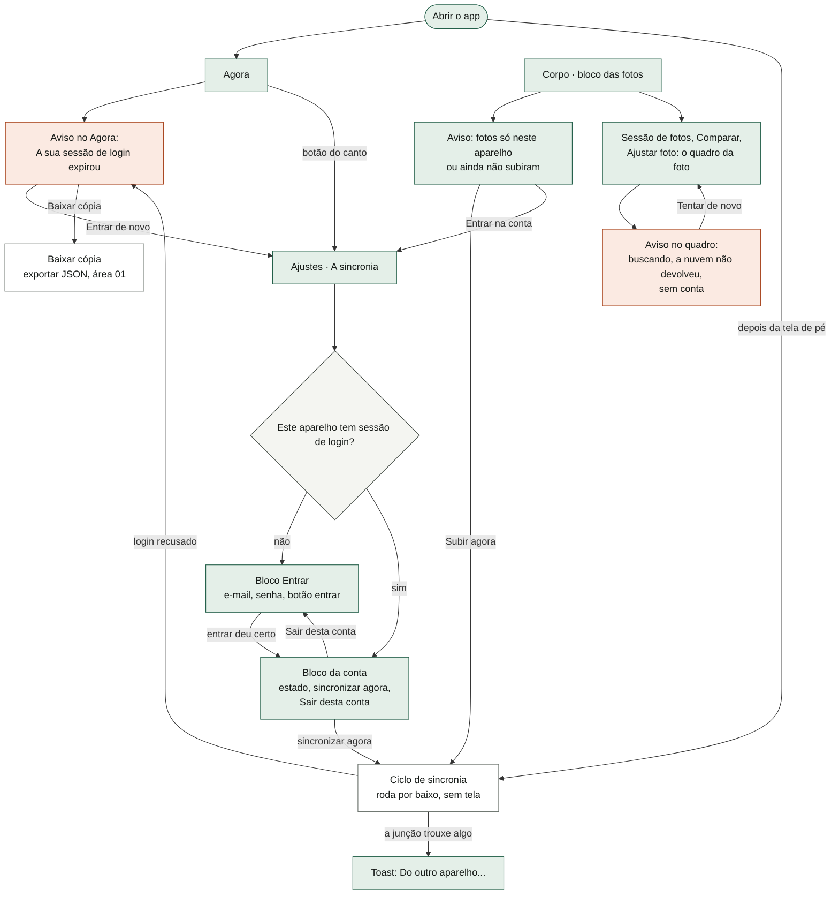

A área quase não tem tela própria: o que ela tem é a seção "A sincronia" dentro de Ajustes. O resto são avisos que ela empresta a telas de outras áreas (o Agora, o Corpo, os quadros de foto) e o ciclo que roda por baixo.

---

## 3. Fluxos, um por funcionalidade

### 3.1 Entrar na conta

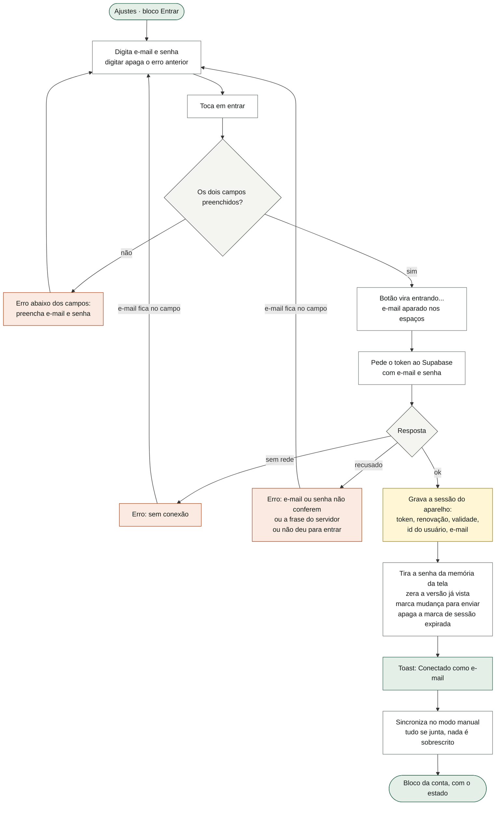

O que o diagrama não mostra: o primeiro login num aparelho parte da versão "nenhuma vista". Por isso a primeira sincronização sempre **junta** o que o aparelho tem com o que a nuvem tem, em vez de um sobrescrever o outro. Não há cadastro pelo app: o cadastro público está desligado no painel do Supabase, e a conta é criada lá. O toast "Conectado como…" costuma ser trocado logo pelo toast da sincronização ("Sincronizado." ou o motivo da falha), porque o toast tem um lugar só. Entrar com uma conta **diferente** da anterior junta o histórico local na conta nova: o estado do aparelho não é separado por conta (ver §9).

### 3.2 Sair da conta

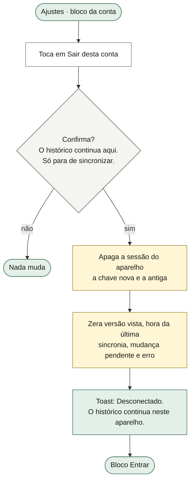

O que o diagrama não mostra: sair não apaga nada do registro, nem da nuvem. A lista de fotos que este aparelho já confirmou ter enviado (`sync.fotos`) **não** é apagada ao sair (ver §9, item 16). Sem conta, as mudanças deixam de ser marcadas como pendentes; ao entrar de novo, a primeira sincronização junta tudo de qualquer forma.

### 3.3 O token que vence e a sessão que expira

Toda conversa com a nuvem (ler, gravar, subir, baixar, apagar foto) passa antes por esta checagem:

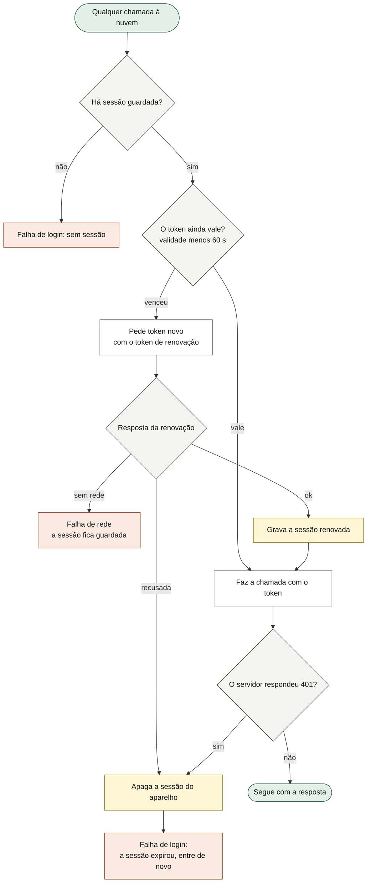

E o aviso no Agora:

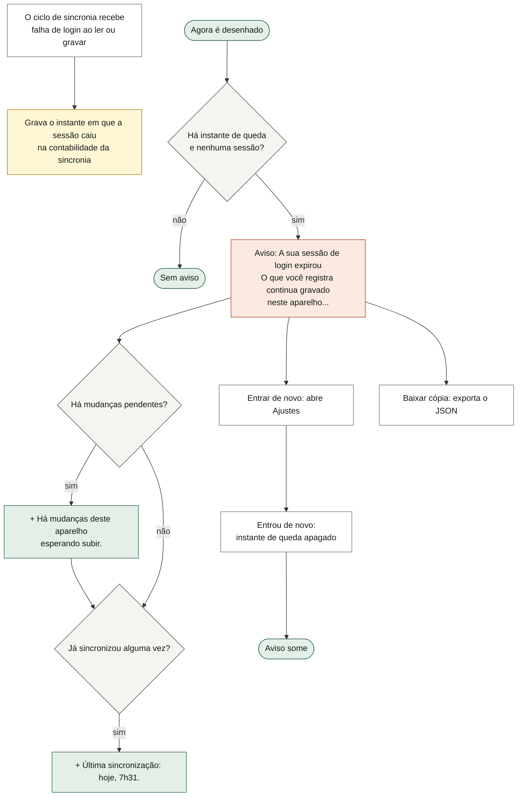

O que os diagramas não mostram:

- **Sem rede ≠ sessão expirada.** Falta de rede é silenciosa no Agora, de propósito (decisão de desenho, "a D, prescricao.html, estado 11"); só aparece como texto no estado da sincronia em Ajustes. Sessão expirada é dita, porque o outro aparelho deixa de ver o que muda aqui.
- A renovação acontece **antes** de vencer: o app considera o token vencido 60 segundos antes do prazo que o servidor deu (padrão de 3.600 s quando o servidor não diz). Isso evita que ele vença no meio do pedido.
- Um 401 não tenta renovar: derruba a sessão na hora.
- O instante da queda só é gravado quando a falha acontece **dentro do ciclo de sincronia**. Se a sessão cair numa subida ou descida de foto, ela some sem acender o aviso (ver §9, item 9).

### 3.4 Quando a sincronia dispara

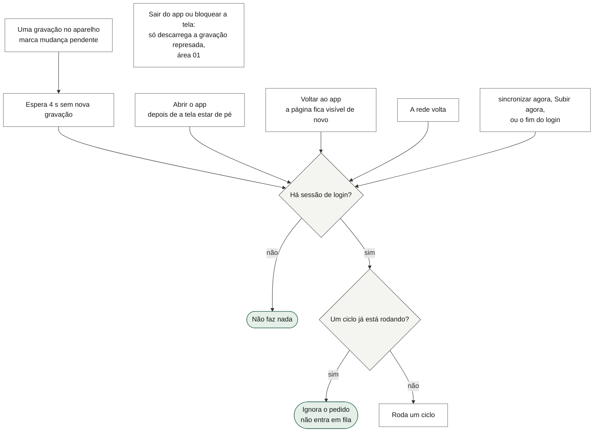

O que o diagrama não mostra: a gravação no aparelho (área 01) é a ponte. Toda gravação "de verdade" carimba o estado com a hora (`mtime`) e, se houver conta, marca "mudança pendente", grava essa marca e (re)agenda a sincronia para 4 s depois — o tempo de terminar de digitar uma série sem mandar a cada tecla. Sem conta, nem a marca é feita. Não existe tentativa periódica: se a rede cair, o próximo gatilho é a próxima gravação, voltar ao app, a rede voltar ou o toque manual. Ao sair do app nada sobe — no iOS, o app em segundo plano é congelado; o que estava pendente sobe ao voltar.

### 3.5 Um ciclo de sincronia

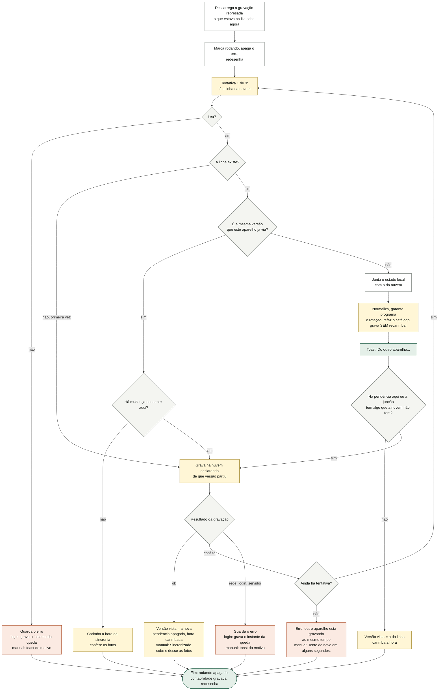

O que o diagrama não mostra:

- **A trava de versão.** A nuvem guarda uma linha por usuário com o estado inteiro e um número de versão. O aparelho grava dizendo "parti da versão 7"; o banco só aceita se a linha ainda estiver na 7, e quem aumenta o número é o banco (um gatilho no Postgres), nunca o aparelho. Se outro aparelho gravou no meio, a gravação não acontece, e o ciclo relê, junta de novo e tenta de novo. Três tentativas: para haver uma quarta, dois aparelhos teriam de gravar ao mesmo tempo três vezes seguidas.
- **Primeira vez da conta:** sem linha na nuvem, o aparelho cria. Se dois aparelhos criarem ao mesmo tempo, o segundo recebe "conflito" (409), relê e junta.
- **"Grava sem recarimbar":** a junção não conta como mudança do dono; ela mantém o carimbo de hora (`mtime`) igual ao maior dos dois lados. Se recarimbasse, os documentos deste aparelho passariam a vencer sempre.
- **Sem rede:** a falha fica guardada em `sync.erro` (aparece em Ajustes como "sem conexão"), a pendência continua marcada e nada se perde. Só o toque manual mostra toast.
- **A junção não roda as migrações de formato.** Se o lado que manda nos documentos ainda estiver num formato antigo, o aparelho fica com ele até a próxima abertura, quando a cadeia de migrações (área 01) roda e fecha a janela.
- **As fotos** (§3.9 a §3.11) sobem e descem **depois** e por fora do ciclo, sem esperar: o estado é pequeno e precisa fechar rápido entre duas séries.
- **O app fechar no meio:** a pendência e a versão vista estão gravadas. Se fechou antes de a gravação na nuvem chegar, o próximo ciclo refaz. Se a gravação chegou e a resposta se perdeu, o próximo ciclo vê uma versão "nova" (a sua própria), junta consigo mesmo — a junção é estável, juntar duas vezes não muda nada — e grava de novo.

### 3.6 A junção (fusão) dos dois estados

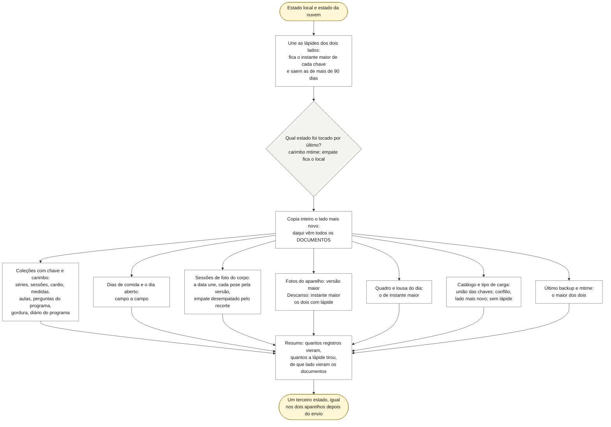

E a regra de uma coleção com chave e carimbo, registro por registro:

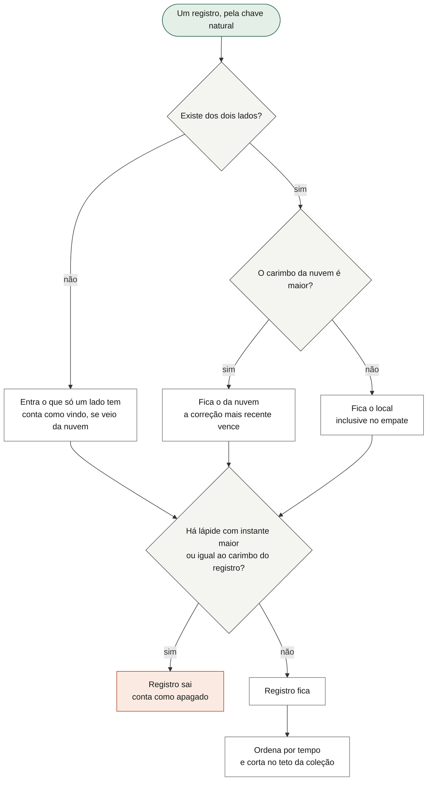

O que os diagramas não mostram: a junção é **pura** — não fala com rede nem com a tela, não altera nenhum dos dois estados que recebe e devolve um terceiro. Juntar duas vezes os mesmos dois estados dá o mesmo resultado, e a ordem dos lados não muda o conteúdo (só decide o empate). A tabela completa, campo por campo, está em §5.3. Duas sutilezas de chave: a série é identificada pelo exercício + sessão + **posição do treino** (o mesmo aparelho pode aparecer em duas posições do mesmo treino), e a pergunta de programa pendente pelo identificador da sessão, não pelo dia (o dia é editável no meio do treino).

**O dia de comida, campo a campo** (vale para os dias fechados do histórico e para o dia aberto, quando os dois lados estão na mesma data):

| Campo | Regra | Por quê |
|---|---|---|
| refeições marcadas (`done`) | união das marcas; cada marca tem lápide própria (desmarcar) | marcar o almoço no iPhone e a água no iPad no mesmo dia, os dois sem rede |
| "como foi" da refeição (`como`: fora do plano, não comi, não sei) | viaja com a marca que entrou e morre com a lápide dela; sem marca, é descartado | é atributo da marca, não registro próprio |
| água (`agua`) | o **maior** dos dois | contador que só cresce no dia; "subestimar um copo é ruído aceitável" |
| "não contei a água" (`aguaNaoContada`) | só fica se nenhum dos dois lados contou | contar tem dado por trás |
| porções, totais, versão do plano, cadência, alta demanda, turno, ajuste, enquadramento do dia (`escala`, `tot`, `pv`, `cadencia`, `alta`, `turno`, `aj`, `aderencia`) | do lado com carimbo mais novo (no dia fechado, o `m` do dia; no dia aberto, o `mtime` do estado inteiro) | decisões tomadas uma vez |
| o dia inteiro | lápide `comida:data` (só o apagamento em bloco a cria) | — |

Se o dia aberto dos dois lados estiver em datas **diferentes**, ele vem inteiro do lado que manda nos documentos. Isso só não perde nada porque a virada da data (área 06) fecha o dia velho no histórico assim que alguma tela pede o dia de hoje — o que, na abertura, acontece antes da sincronia (**a confirmar** para todas as rotas de entrada).

### 3.7 Apagar sem ressuscitar: a lápide

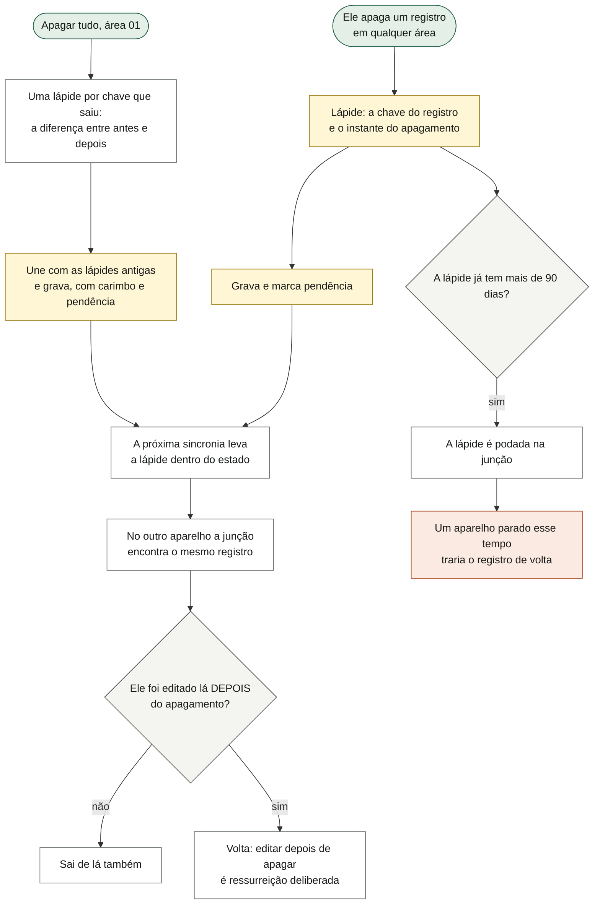

O que o diagrama não mostra:

- **Quem cria lápide** (cada área chama a mesma função e a chave sai do mesmo módulo da junção, para as duas nunca divergirem): tirar a série de uma sessão ou o exercício do dia, apagar uma entrada do histórico de um exercício, apagar uma sessão, apagar um cardio, apagar uma medida do corpo (uma ou todas do dia), desmarcar uma refeição, apagar um modelo de aula, responder uma pergunta de programa (responder é resolver), apagar a foto de um aparelho, refazer ou apagar uma pose do corpo (e a sessão de fotos quando fica sem foto), desmarcar um dia de descanso.
- **Apagar tudo** (área 01) não apaga registro por registro: monta um estado novo. Por isso calcula a diferença entre o antes e o depois e cria uma lápide por chave que saiu. O alcance é **o que este aparelho conhecia**: o que só existe no outro aparelho, ou o que o outro editar depois, sobrevive. "Apagar de menos se conserta repetindo o gesto no outro aparelho; apagar de mais não se conserta." O que o gesto preserva (programa, plano de comida, fotos dos aparelhos) não ganha lápide.
- **A água não tem lápide**: o apagamento leva as marcas de refeição de hoje, mas a água do outro aparelho volta, porque fica sempre o maior dos dois.
- **Referência de foto sem versão** não ganha lápide: a junção já a descarta dos dois lados.
- O catálogo de exercícios (`ex`) e o tipo de carga (`carga`) **não** têm lápide: apagar uma chave deles é desfeito pela união com o outro aparelho (ver §9, item 7).

### 3.8 O resumo da junção e o toast

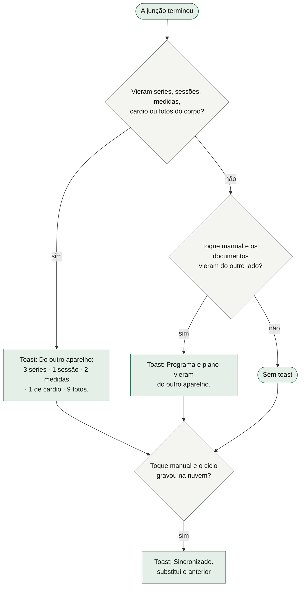

O que o diagrama não mostra: "Mudar o histórico dele em silêncio seria pior que não sincronizar" é a regra; mas o toast **não** fala de tudo. Apagamentos que vieram do outro aparelho, dias de comida, modelos de aula, perguntas de programa, leituras de gordura, descansos e fotos de aparelho atravessam calados. E "séries" conta **registros de exercício numa sessão** (cada um com várias séries dentro), não séries soltas. No toque manual, "Sincronizado." apaga o toast do resumo no mesmo instante, porque o toast tem um lugar só (ver §9, item 10). A conta que decide se o resultado da junção precisa subir usa os mesmos números mais "os documentos vieram daqui" e "há recortes de foto só daqui".

### 3.9 Fotos dos aparelhos (máquinas): subir, baixar, apagar

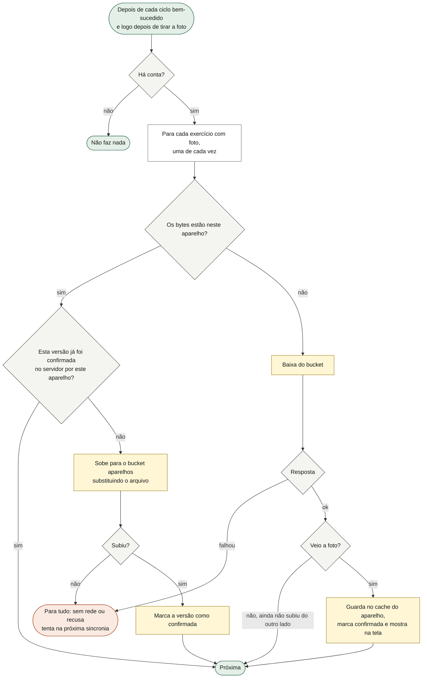

O que o diagrama não mostra: no estado só vai a **referência** da foto (versão = instante da foto, e o formato); os bytes ficam no cache do aparelho (`lastro-fotos`) e atravessam pelo bucket. Uma de cada vez, porque "é o sinal da academia, e um lote simultâneo derruba todas em vez de entregar algumas". **Apagar a foto** de um aparelho (área 03) avisa "tira a imagem deste aparelho e da cópia remota", apaga do cache, manda apagar do bucket sem esperar a resposta, esquece a confirmação e deixa lápide — o outro aparelho perde a referência na junção, mas os bytes que ele tinha ficam no cache dele, órfãos. Trocar a foto num aparelho e sincronizar no outro tem um defeito (ver §9, item 2).

### 3.10 Fotos do corpo: subir e podar o aparelho

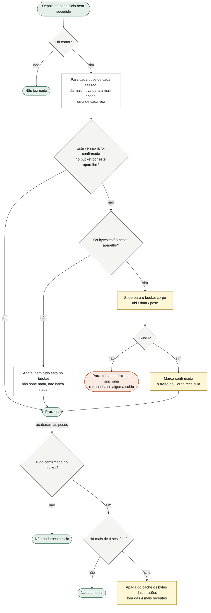

O que o diagrama não mostra: aqui a relação se inverte. Para as fotos do corpo **o bucket é o arquivo permanente e o aparelho é o cache** (9 fotos por sessão, a cada 14 dias, uns 35 MB no primeiro ano, num cache que o iOS despeja sob pressão de disco). Duas assimetrias deliberadas: **subir é obrigação** (enquanto o byte só existe aqui, está a um despejo de sumir) e **baixar é sob demanda** (§3.11). **A poda só roda quando todas as fotos estão confirmadas no bucket** — "apagar byte que ainda não subiu é o erro mais caro que este arquivo pode cometer"; uma foto que falta segura a poda inteira. O endereço no bucket não tem versão: refazer uma pose sobrescreve o mesmo arquivo. Nada no app apaga do bucket do corpo: apagar uma pose ou apagar tudo tira dos aparelhos, não da nuvem (limite conhecido, ver §9, item 12). Apagar tudo (área 01) poda o cache do corpo inteiro no próprio gesto, porque este ciclo não alcançaria a poda depois dele.

### 3.11 Buscar fotos do corpo quando alguém abre a sessão antiga

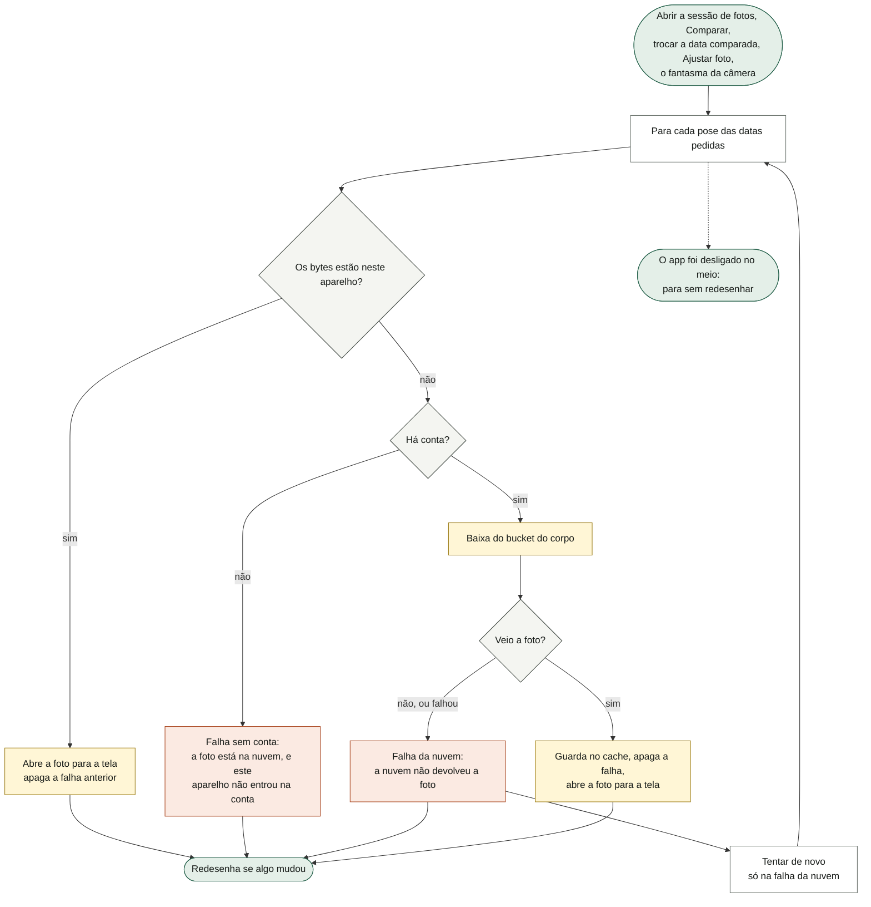

O que o diagrama não mostra: a falha fica só na memória (por data e pose) e some sozinha quando os bytes chegam. Ela existe para o quadro não ficar escrito "buscando a foto…" para sempre quando o app já desistiu. "Tentar de novo" só aparece na falha da nuvem; sem conta, tentar daria no mesmo, e a saída é entrar na conta. O 404 do bucket ("a foto ainda não subiu do outro lado") é tratado como "a nuvem não devolveu". A cada espera o app confere se não foi desligado no meio, para não desenhar numa tela que já não existe. Os bytes baixados aqui **não** são marcados como confirmados no bucket (ver §9, item 3).

### 3.12 Casos raros, um por um

| Caso | O que acontece | De onde sai |
|---|---|---|
| **Dois aparelhos gravando ao mesmo tempo** | O segundo a gravar recebe conflito pela trava de versão, relê, junta (as coleções se somam) e grava. Até 3 tentativas por ciclo; depois, "outro aparelho está gravando ao mesmo tempo", e a pendência continua para o próximo gatilho. | `sincroniza`, `NUVEM.empurra`, teste "conflito no meio do caminho refaz o ciclo em vez de perder" |
| **Treinar no celular e abrir o notebook com o estado de ontem** | As séries, sessões e medidas do celular se juntam às do notebook; nada some. O programa, o plano de comida e os outros **documentos** vêm inteiros do lado tocado por último. | teste "a sessão do celular sobrevive ao notebook com estado velho" |
| **Apagar num aparelho e editar no outro** | Se a edição tem carimbo **posterior** ao apagamento, o registro volta (ressurreição deliberada). Se é anterior, morre. Os relógios comparados são de aparelhos diferentes. | `uneLista`, testes "registro editado DEPOIS de apagado volta", "registro que o outro aparelho criou ou editou DEPOIS do apagamento sobrevive" |
| **Apagar tudo num aparelho** | O outro aparelho recebe uma lápide por registro e esvazia também; o que ele registrou depois sobrevive; a água do dia volta (é contador). | testes "apagar todo o histórico no celular não volta pelo notebook", "a refeição marcada HOJE não volta; a água volta" |
| **Token vencido no meio do uso** | Renova sozinho 60 s antes de vencer. Se a renovação for recusada, ou o servidor responder 401, a sessão é apagada; dentro do ciclo, o Agora passa a avisar. Sem rede na renovação, a sessão fica e tenta depois. | `token()` em `nuvem.ts` |
| **Sem rede por dias** | Tudo continua gravando no aparelho; a pendência fica marcada; cada gatilho tenta e falha calado (Ajustes mostra "sem conexão"). Quando a rede volta, uma junção leva tudo. Se passar de 90 dias, lápides do outro lado já foram podadas e registros apagados lá podem voltar. E os documentos deste aparelho, se ele foi tocado por último, atropelam os do outro (§9, item 6). | `LAPIDE_DIAS`, teste "sem rede, o app não perde nada e volta a sincronizar depois" |
| **Aparelho novo** | Entrar puxa o estado inteiro; as fotos de aparelho descem sozinhas; as do corpo só quando abertas. O Corpo vazio convida: "Se você já tem histórico em outro aparelho, entrar na conta traz tudo de volta antes de registrar qualquer coisa aqui." (área 07) | `CTX.entrarNaNuvem`, teste "referência sem bytes locais busca a foto do outro aparelho" |
| **Fazer metade das poses num aparelho e o resto no outro** | A sessão do dia une as poses dos dois; cada pose fica com a versão mais nova. | teste "poses tiradas em aparelhos diferentes no MESMO dia se somam" |
| **Recortar a foto num aparelho** | O recorte não muda a versão da foto; no empate, vence o recorte mais recente, e um recorte que só existe aqui obriga a subir. | testes "o recorte feito num aparelho não some na volta do outro", "recorte que só existe aqui obriga a empurrar" |
| **Um aparelho ainda com a versão antiga do app** | O documento do lado mais novo vem com o número de formato dele; a abertura seguinte roda as migrações e reconstrói o que faltava. | testes "o aparelho que ainda não migrou não deixa a ceia sumir do outro", "o registro do que o ajuste deu atravessa a janela da atualização" |
| **O app fecha no meio de um ciclo** | Nada se perde; o ciclo seguinte refaz a parte que faltou (§3.5). | `gravaSync`, `carregaSync` |
| **O app fecha no meio da subida de fotos** | A foto que não subiu não foi marcada; sobe no próximo ciclo. A poda espera. | teste "sem rede, a foto fica aqui e não é dada como enviada" |

---

## 4. Estados da tela

| Estado | Quando acontece | O que a tela mostra |
|---|---|---|
| Sem conta | Nunca entrou, saiu, ou a sessão caiu | Ajustes: bloco "Entrar" com o texto "Entre com a mesma conta no celular e no computador e o registro passa a ser o mesmo nos dois. O app continua funcionando sem isto, e sem rede: a nuvem é cópia, não é a fonte." |
| Campos vazios | Tocou **entrar** sem e-mail ou senha | "preencha e-mail e senha" em âmbar abaixo dos campos |
| Entrando | Pedido de login em voo | Botão "entrando..." desligado |
| Login recusado | Senha errada / servidor recusou | "e-mail ou senha não conferem" (ou a frase do servidor, ou "não deu para entrar"); e-mail continua no campo |
| Login sem rede | Sem conexão ao entrar | "sem conexão" |
| Sincronizando | Ciclo em andamento | "sincronizando..." e o botão desligado com o mesmo texto |
| Em dia | Último ciclo deu certo e não há pendência | "em dia · 14/10 às 7:31", em verde-ácido |
| Pendente | Há mudança local ainda não enviada | "há mudanças para enviar" (cor neutra) |
| Erro | O último ciclo falhou (rede, servidor, conflito repetido, login) | A frase do erro em âmbar ("sem conexão", "o servidor recusou a escrita (500)", "outro aparelho está gravando ao mesmo tempo"…). O erro não sobrevive a fechar o app. |
| Nunca sincronizou | Conta sem nenhum ciclo concluído | "ainda não sincronizou" |
| Sessão expirada | Login recusado durante um ciclo | Agora: "A sua sessão de login expirou" + "O que você registra continua gravado neste aparelho. Só não vai para a cópia remota, e os outros aparelhos não veem o que mudou aqui." + (se houver) "Há mudanças deste aparelho esperando subir." + (se houver) "Última sincronização: hoje, 7h31." + **Entrar de novo** e **Baixar cópia**. Ajustes mostra o bloco "Entrar". |
| Sem rede, sem conta expirada | Falha de rede | Nada no Agora (de propósito) |
| Fotos do corpo só aqui, sem conta | Há fotos do corpo e nenhuma conta | Corpo: "As N fotos do corpo existem só neste aparelho" / "A cópia de segurança leva as referências, não as fotos. Com a conta, elas sobem para a cópia remota." + **Entrar na conta** |
| Fotos do corpo pendentes, com conta | Alguma foto não confirmada no bucket | Corpo: "N fotos ainda não subiram para a cópia remota" / "Elas não existem em outro lugar até subir." + **Subir agora** |
| Quadro buscando | Há referência, os bytes não estão aqui e não há falha registrada | "buscando a foto…" |
| Quadro: nuvem não devolveu | Download falhou ou o arquivo não existe no bucket | "a nuvem não devolveu a foto" + **Tentar de novo** |
| Quadro: sem conta | Há referência, os bytes não estão aqui e não há conta | "a foto está na nuvem, e este aparelho não entrou na conta", sem botão |
| Foto do aparelho não chegou | Há referência, sem bytes neste aparelho | Folha da foto: "A foto desta máquina ainda não chegou a este aparelho." e o botão "trocar a foto" |
| Fim da sessão de fotos | Resumo da sessão (área 08) | "Todas na cópia remota." / "Subindo para a cópia remota: X de 9. Pode fechar o app; continua depois." / "As fotos ficam neste aparelho: sem a conta, elas não sobem." |
| Toasts | — | "Conectado como …", "Desconectado. O histórico continua neste aparelho.", "Sincronizado.", "Do outro aparelho: …", "Programa e plano vieram do outro aparelho.", "Tente de novo em alguns segundos.", e a frase do erro no toque manual |

---

## 5. Dados

### 5.1 O que esta área guarda

**No aparelho, fora do estado sincronizado** (contabilidade do aparelho; se viajasse, um aparelho diria ao outro o que já viu ou subiu):

| Onde | Chave | Formato | Quem lê |
|---|---|---|---|
| Armazenamento local (`DB`, área 01) | `lastro-nuvem-v1` (antes `treino-nuvem-v1`, promovida e apagada na abertura) | sessão de login: `{ token, refresh, expira, uid, email }` — `expira` é o instante local em que o app considera o token vencido (prazo do servidor − 60 s) | só `nuvem.ts` |
| Armazenamento local | `treino-sync-v1` (nome antigo, nunca migrado) | `{ v, em, sujo, forcar, fotos, expirou }`: `v` = versão da linha que este aparelho viu por último (`null` = nunca); `em` = hora da última sincronia concluída; `sujo` = há mudança local não enviada; `forcar` = nunca ligado (ver §9); `fotos` = mapa "foto → versão já confirmada no servidor por ESTE aparelho" (chave `idEx` para aparelhos, `corpo:data:pose` para o corpo); `expirou` = instante em que a sessão caiu (0 = não caiu) | `main.jsx` (Ajustes, Agora, Corpo, fim da sessão de fotos) |
| Memória | — | `sync.rodando`, `sync.erro` (não são gravados), o temporizador de 4 s, as falhas de foto do corpo por `data|pose` | `main.jsx` |
| Memória da tela | `view.nuvemForm`, `view.nuvemErro`, `view.nuvemEntrando` | e-mail e senha digitados (a senha sai depois do login), erro do login, login em voo | Ajustes |
| Cache Storage | `lastro-fotos` (`./foto/<idEx>.<ext>`) | bytes das fotos dos aparelhos, sem versão no nome | área 03 é dona da foto; esta área sobe e baixa |
| Cache Storage | `lastro-corpo` (`./corpo/<data>/<pose>.<ext>`) | bytes das fotos do corpo, sem versão no nome; podado para as 4 sessões mais recentes | área 08 é dona; esta área sobe, baixa e poda |

**Dentro do estado sincronizado** (área dona: esta):

| Campo | Formato | Para quê |
|---|---|---|
| `S.apagados` | `{ chave: instante }` — as lápides | dizer "isto morreu em T" ao outro aparelho; podadas aos 90 dias em cada junção |
| `S.mtime` | instante | quando o estado foi tocado por último por uma gravação de verdade; decide de que lado vêm os documentos |

**Na nuvem (Supabase):**

| Onde | Forma | Regra |
|---|---|---|
| Tabela `public.estado` | uma linha por usuário: `dono` (id do usuário), `v` (versão, começa em 1), `data` (o estado inteiro em JSON), `atualizado` | o gatilho `estado_versiona` soma 1 em `v` a cada atualização e impede trocar o dono; RLS: cada um lê, cria e atualiza só a própria linha; não há apagar |
| Bucket `aparelhos` (privado) | `uid/<idEx>.<ext>` | ler, criar, substituir e apagar só na própria pasta |
| Bucket `corpo` (privado) | `uid/<data>/<pose>.<ext>` | idem; o app nunca apaga daqui |

A chave pública do Supabase vai no código do app de propósito; quem protege é o RLS, e o cadastro público está desligado no painel.

### 5.2 O que só lê de outras áreas

- O estado inteiro `S` (para enviar e juntar), o armazenamento local `DB` e a gravação `grava`/`save`/`liberaSave` (área 01).
- `normalizaEstado`, `garanteProgramaERotacao` e `montaCatalogo`, que rodam depois de cada junção (áreas 01 e 04).
- As listas de grandezas do corpo (`MARCAS_DO_CORPO`, área 07) — a junção as enumera para que grandeza nova entre sem mexer aqui.
- Os módulos de cache `FOTO` (fotos de aparelho) e `CORPO` (fotos do corpo), e `sessaoDe` do protocolo (área 08).
- A pilha de telas e o `render()` (área 01), o `toast` (área 01), `exportar` (área 01, botão do aviso).

### 5.3 Como cada campo do estado atravessa entre aparelhos

"Documento" = vem inteiro do lado com `mtime` mais novo (empate: o local). "Coleção" = unida pela chave natural; no conflito, vence o carimbo maior (empate: o local); lápide com instante ≥ carimbo remove.

| Campo | Área dona | Regra de fusão | Chave natural | Carimbo | Lápide | Teto |
|---|---|---|---|---|---|---|
| `logs` (séries por exercício) | 03 | coleção, por exercício; exercício sem registro sai do mapa | `log:<exercício>:<sessão>:<posição>` | `m` | sim | 500 por exercício |
| `done` (sessões) | 03 / 11 | coleção | `done:<sessão>` | `m` | sim | 3.000 |
| `cardio` | 10 / 11 | coleção | `cardio:<instante>` | `alt` (porque `m` já é o modal) | sim | 200 |
| `body` (12 grandezas: peso, cintura, as 5 da bioimpedância e as 5 outras medidas de fita) | 07 | coleção por grandeza | `<grandeza>:<instante>` | `m` | sim | 400 por grandeza |
| `progLog` (diário do programa) | 04 | coleção, só cresce | `prog:<instante>:<dia>` | `m` | só pelo apagamento em bloco | 300 |
| `aulas` (modelos de aula) | 05 | coleção | `aula:<id>` | `m` | sim | 60 |
| `promoPendente` (mudanças que esperam decisão) | 04 | coleção | `promo:<sessão>` (ou o instante, se for antiga) | `m` | sim (responder) | 60 |
| `gordura` (leituras de gordura visual) | 08 / 09 | coleção, ordenada pela data | `gordura:<data>` | `t` | sim | 200 |
| `comidaHist` (dias de comida fechados) | 06 | coleção por data, **campo a campo** (§3.6) | `comida:<data>`; marcas `comida:<data>:<refeição>` | `m` do dia; a marca é o próprio instante | sim (dia e marca) | 4.000 |
| `dia` (dia de comida aberto) | 06 | mesma data dos dois lados: campo a campo como `comidaHist`, com carimbo = `mtime` do estado; datas diferentes: documento | marcas `comida:<data>:<refeição>` | `mtime` do estado; a marca é o instante | marcas sim; água não | — |
| `descanso` (dias de descanso) | 11 | mapa data → instante; união, fica o instante maior | `descanso:<data>` | o instante | sim | — |
| `fotos` (referência da foto de cada aparelho) | 03 | mapa por exercício; fica a versão maior; referência sem versão é descartada | `foto:<exercício>` | `v` | sim | — |
| `protocolo.sessoes` (sessões de foto do corpo) | 08 | por data; dentro, cada pose pela versão maior; empate pela data do recorte (`enq.m`); nota e carimbo da sessão do lado com `m` maior; instante = o menor; sessão sem foto sai | `corpo:<data>`; pose `corpo:<data>:<pose>` | sessão `m`; pose `v` | sim (sessão e pose) | 200 |
| `protocolo.poses` (ordem das poses) | 08 | documento | — | `mtime` | — | — |
| `quadro` (quadro do box de hoje) | 05 | o de instante `t` maior; empate ou sem `t`: o local | — | `t` | — | — |
| `lousa` (foto da lousa da aula em curso) | 05 | o de instante `t` maior; **os bytes nunca saem do aparelho** | — | `t` | — | — |
| `ex` (catálogo dele: nomes, cadastrados, arquivados) | 04 | união das chaves; chave dos dois lados: do lado mais novo | `<exercício>` | `mtime` | **não** | — |
| `carga` (tipo de carga por exercício) | 03 | união das chaves, como `ex` | `<exercício>` | `mtime` | **não** | — |
| `export` (último backup) | 01 | o maior dos dois | — | — | — | — |
| `mtime` | 02 | o maior dos dois | — | — | — | — |
| `apagados` (lápides) | 02 | união; por chave, o instante maior; poda das de mais de 90 dias | — | — | — | 90 dias |
| `prog` (programa dele) | 04 | documento | — | `mtime` | — | — |
| `rot` (rotação) | 04 | documento | — | `mtime` | — | — |
| `progTreinador` (programa colado do treinador) | 04 | documento | — | `mtime` | — | — |
| `mods` (mudanças do treino de hoje) | 03 | documento | — | `mtime` | — | — |
| `sessao` (sessão aberta) | 03 | documento | — | `mtime` | — | — |
| `draft` (rascunho de digitação) | 03 | documento | — | `mtime` | — | — |
| `deload` | 03 | documento | — | `mtime` | — | — |
| `plano` (versão do formato) | 01 | documento (vem junto do documento que descreve) | — | `mtime` | — | — |
| `comida` (plano alimentar, alimentos, ocultos) | 06 | documento | — | `mtime` | — | — |
| `cadencia` (treino/descanso da semana) | 06 | documento | — | `mtime` | — | — |
| `compras` | 06 | documento | — | `mtime` | — | — |
| `ajuste` (saldo de passos de ±150 kcal) | 09 | documento | — | `mtime` | — | — |
| `ajusteHist` (passos que aconteceram) | 09 | **documento**, apesar de ser lista | — | `mtime` | — | — |
| `perfManual` (força manual) | 09 | documento | — | `mtime` | — | — |

Bytes de foto **não** estão no estado: os de aparelho atravessam pelo bucket `aparelhos`, os do corpo pelo bucket `corpo`, e os da lousa não atravessam.

---

## 6. Regras

1. **A nuvem é réplica, o aparelho é a fonte.** Nada nesta área impede o app de gravar no aparelho; a sincronia roda só depois de a tela estar de pé. (desenho, `nuvem.ts` e `main.jsx`)
2. **Disparos:** ao abrir (se há sessão), ao voltar ao app, quando a rede volta, 4 s depois da última gravação e no toque manual (sincronizar agora, Subir agora, fim do login). Pedido durante um ciclo é ignorado. (desenho; os 4 s: "tempo de terminar de digitar uma série sem mandar a cada tecla")
3. **Antes de cada ciclo, a gravação represada (700 ms, área 01) é descarregada**, para o ciclo não concluir "nada mudou" sobre um estado ainda não carimbado.
4. **Trava de versão:** o aparelho grava declarando a versão de que partiu; o banco recusa se não bater e é o banco que soma 1 à versão. **3 tentativas** por ciclo. (desenho, `schema.sql`)
5. **Mesma versão e nenhuma pendência = não reescreve**; só confere as fotos.
6. **A junção grava sem recarimbar**: o `mtime` do resultado é o maior dos dois lados.
7. **A junção só sobe** se havia pendência local ou se trouxe série, sessão, medida, cardio, foto do corpo, recorte só daqui, apagamento, ou se os documentos vieram daqui.
8. **Documentos vêm inteiros do lado com `mtime` mais novo; empate fica o local.** "É a única linha com perda possível, e ela é aceitável porque documento se edita deliberadamente, num aparelho por vez." (desenho, `sincronia.ts`)
9. **Coleções se unem pela chave natural**; no conflito, carimbo maior; empate, o local. Registro sem carimbo vale 0.
10. **Lápide mata o que tem carimbo menor ou igual a ela**; o que foi editado depois volta.
11. **Lápides com mais de 90 dias são podadas** em cada junção ("o que sumiu há meses já sumiu dos dois lados").
12. **Tetos** (iguais aos da gravação local): séries 500 por exercício; sessões 3.000; diário do programa 300; medidas 400 por grandeza; cardio 200; sessões de foto do corpo 200; leituras de gordura 200; modelos de aula 60; dias de comida 4.000; perguntas de programa 60. Corte pelos mais antigos, depois de ordenar.
13. **A chave da lápide e a chave da junção são a mesma string**, e saem do mesmo módulo.
14. **Apagar tudo cria uma lápide por chave que saiu** (diferença entre antes e depois), com alcance limitado ao que este aparelho conhecia, e une com as lápides antigas.
15. **Dia de comida:** marcas unidas com lápide; "como foi" acompanha a marca; água fica o maior; "não contei" cai se algum lado contou; o resto vem do lado com carimbo mais novo.
16. **Sessão de foto do corpo:** a data une; cada pose pela versão; empate desempata o recorte mais recente; sessão sem foto não sobrevive.
17. **Quadro e lousa:** vence o de instante maior.
18. **Catálogo (`ex`) e tipo de carga:** união das chaves, conflito do lado mais novo.
19. **Último backup e `mtime`:** o maior dos dois.
20. **Token:** vencido 60 s antes do prazo do servidor; prazo padrão 3.600 s; renovação recusada ou 401 apaga a sessão; falha de rede na renovação mantém a sessão.
21. **Sem rede é silencioso** (só Ajustes mostra); **sessão expirada é dita no Agora** e o aviso sobrevive a fechar o app até ele entrar de novo. (decisão de desenho "a D, prescricao.html, estado 11")
22. **Primeiro login no aparelho zera a versão vista e marca pendência**, para tudo se juntar em vez de sobrescrever.
23. **Sair** pergunta, apaga a sessão (chave nova e antiga), zera versão, hora, pendência e erro, e não toca no histórico.
24. **A sessão de login é do aparelho** e nunca entra no estado; a chave antiga `treino-nuvem-v1` é promovida se for a única e apagada sempre ("a pergunta é a velha existe?, nunca já migrei?").
25. **Fotos atravessam como dado, uma de cada vez**: referência no estado, bytes no cache do aparelho e no bucket. Subir usa substituição (`x-upsert`); 404 ao baixar não é erro.
26. **Foto do aparelho:** sobe se os bytes estão aqui e a versão não foi confirmada; desce se a referência existe e os bytes não. Para no primeiro erro.
27. **Foto do corpo:** subir é obrigação; baixar é sob demanda (ao abrir a sessão); a poda deixa os bytes das **4** sessões mais recentes e só roda com **todas** as fotos confirmadas no bucket. (desenho; "35 MB no primeiro ano")
28. **Falhas de foto do corpo:** "sem conta" não oferece tentar de novo; "a nuvem não devolveu" oferece. A marca some quando os bytes chegam. (decisão de desenho, "a D, comparar, estado 10")
29. **Lado maior das fotos**: 1.080 px para aparelho, 1.440 px para corpo, 1.600 px para a lousa (áreas 03, 08, 05; aqui só atravessam).

---

## 7. Ligações com as outras áreas

| Área | O que esta recebe dela | O que esta entrega a ela |
|---|---|---|
| 01 · Fundação | a gravação (`save` carimba `mtime` e chama `sujou`; `grava` grava sem carimbo; `liberaSave`), o armazenamento `DB`, a abertura (chama `carregaSync`, `NUVEM.pronta` e `sincroniza` no fim), `normalizaEstado`, o apagar tudo (que pede `lapidesDoApagamento` e `uneLapides`), a importação de backup (que aceita `mtime` e `apagados`), a migração da chave antiga do estado (que usa `funde`), o toast, a tela de Ajustes, `exportar` | a junção usada na migração da chave antiga; as lápides do apagamento; o estado de conta para o "endereço vazio" (que não aparece com conta) |
| 03 · Sessão de treino | séries, sessões, mods, sessão aberta, rascunho, tipo de carga, a foto do aparelho e as lápides de série/sessão | a réplica entre aparelhos; subida e descida dos bytes da foto do aparelho; o texto do aviso de apagar a foto ("e da cópia remota") depende de haver conta |
| 04 · Programa | programa, rotação, programa do treinador, catálogo, diário, perguntas que esperam e as lápides de resposta | documentos do lado mais novo; perguntas como coleção; `garanteProgramaERotacao` depois de cada junção |
| 05 · Aula do box | modelos de aula, quadro, lousa (só referência) | modelos como coleção; quadro e lousa pelo instante; os bytes da lousa **não** atravessam |
| 06 · Comida | plano, cadência, compras, dia aberto, dias fechados, marcas e as lápides de desmarcar | a fusão campo a campo do dia; a água pelo maior |
| 07 · Corpo | as 12 grandezas e as lápides de medida; o texto "entrar na conta traz tudo de volta" no Corpo vazio | medidas como coleção; o número de medidas no toast |
| 08 · Fotos do corpo | sessões de foto, poses, recortes, leituras de gordura, lápides de pose e de sessão; quem chama `garanteBytesDoCorpo` | subida, poda e descida dos bytes; `fotosSoAqui` e a linha de subida do fim da sessão; os avisos do quadro (`avisoDaFoto`, `podeTentarFoto`, `tentaFotos`) |
| 09 · Semana | saldo e histórico dos passos de kcal, força manual, leituras de gordura | documentos do lado mais novo; gordura como coleção |
| 10 · Agora | o lugar do aviso de sessão expirada; cardio | `ctx.loginExpirou`; cardio como coleção |
| 11 · Dias | dias de descanso e as lápides de desmarcar; correções de sessões passadas | descanso como mapa com lápide |

---

## 8. Como serviço individual

**Nome:** Réplica (sincronia e nuvem).

**Possui:**
- a sessão de login do aparelho e a renovação do token;
- a contabilidade da sincronia (`v`, `em`, `sujo`, `expirou`, fotos confirmadas);
- o carimbo `mtime` e as lápides `apagados` dentro do estado;
- a linha `estado` no Supabase, a trava de versão e os dois buckets;
- a regra de fusão (pura) e o registro de como cada coleção funde.

**Operações (API):**

| Verbo | Recebe | Devolve |
|---|---|---|
| `entrar` | e-mail, senha | sessão (e-mail, uid) ou falha (`rede`, `auth`) |
| `sair` | — | ok |
| `estado` | — | `{ conta, rodando, pendente, erro, ultimaEm, expirouEm }` |
| `sincronizar` | `{ manual }` | resumo da fusão, ou falha (`rede`, `auth`, `conflito`, `servidor`) |
| `fundir` (pura) | estado local, estado remoto, agora | `{ estado, resumo }` |
| `lapidar` | chave natural | ok (grava `apagados[chave] = agora`) |
| `lapidesDoApagamento` (pura) | estado antes, estado depois, agora | mapa de lápides |
| `subirBytes` | bucket, caminho, bytes | ok ou falha |
| `baixarBytes` | bucket, caminho | bytes, `nenhum` (404) ou falha |
| `apagarBytes` | bucket, caminho | ok ou falha |
| `garantirBytes` | datas de sessão do corpo | por pose: presente, `semconta`, `nuvem` |
| `pendenciasDeFoto` | — | quantas fotos do corpo não confirmadas |

**Eventos que emitiria:** `SincroniaConcluida{resumo}`, `ChegouDoOutroAparelho{resumo}`, `SessaoExpirou{quando}`, `SessaoRestabelecida`, `FotoConfirmada{chave, versao}`, `FotoNaoVeio{data, pose, motivo}`, `CachePodado{datas}`.

**Eventos que escutaria:** `EstadoGravado` (área 01, para marcar pendência e agendar), `AppVoltouAoPrimeiroPlano`, `RedeVoltou`, `RegistroApagado{chave}` (de todas as áreas), `ApagouTudo{antes, depois}` (01), `FotoTirada{qual, versao}` (03, 08), `SessaoDeFotoAberta{datas}` (08).

**O que hoje está acoplado e precisaria ser separado:**
1. **A fusão conhece a forma de todas as coleções** (`funde`, `chavesDoEstado`): cada área nova exige editar `sincronia.ts`. O serviço deveria receber, de cada área, um "contrato de fusão" (chave, carimbo, teto, lápide sim/não, ou "documento").
2. **Os tetos estão duplicados**: em `TETO` (`sincronia.ts`) e espalhados nas gravações de `main.jsx` (`slice(-500)`, `slice(-400)`…).
3. **O ciclo troca o estado global `S` por outro objeto** e chama `normalizaEstado`, `garanteProgramaERotacao`, `montaCatalogo`, `grava`, `render` e `toast` diretamente.
4. **"Documento" é decidido pelo `mtime` do estado inteiro**, não por documento: separar em serviços exigiria um carimbo por documento (programa, plano, cadência, saldo de kcal…).
5. **A reconciliação de fotos conhece `S.fotos` e `S.protocolo.sessoes`** e os caches `FOTO`/`CORPO`; os avisos de foto (`falhaDeFoto`, `avisoDaFoto`, `fotosSoAqui`) moram no casco.
6. **`sujou` é chamado por `save`** (área 01): a ligação gravação → sincronia deveria ser um evento.
7. **A importação de backup e o apagar tudo** (área 01) mexem em `mtime` e `apagados` por conta própria.
8. **O estado local não é por conta**: trocar de conta mistura históricos; `sync.fotos` não é por conta.

---

## 9. Riscos e dívidas que apareceram na leitura

Só registro; nada foi consertado.

1. **Provável bug — refazer uma pose do corpo pode apagar a foto nova no outro aparelho.** Ao refazer, o app cria a lápide da pose com `Date.now()` e, na linha seguinte, a versão nova da foto com outro `Date.now()`. Os dois caem quase sempre no mesmo milissegundo, e a regra "lápide mata o que tem versão menor **ou igual**" mata a foto nova. Verificado rodando `funde` puro: com lápide = versão, a pose some (e a sessão inteira, se era a única pose); com 1 ms de diferença, fica. Reproduzir: dois aparelhos sincronizados; no A, refazer uma pose e sincronizar; no B, sincronizar (ou o A juntar qualquer coisa vinda do B) → a pose some da sessão. No aparelho único não aparece, porque sem outro lado não há junção. Os testes cobrem que a lápide existe, não que a foto nova sobrevive. (`guardaFotoDaPose`, linha ~10025; `uneSessoesDeFoto`)
2. **Provável bug — o aparelho com a foto velha sobe os bytes velhos por cima da nova.** O nome no cache não tem versão (`./foto/<id>.webp`, `./corpo/<data>/<pose>.webp`). Se o aparelho B tinha a foto antiga e o A trocou a foto (aparelho) ou refez a pose (corpo), a junção traz a referência nova ao B; a reconciliação do B vê "os bytes estão aqui" e "esta versão não foi confirmada", lê os bytes **antigos** e os sobe por cima, marcando a versão nova como confirmada. Resultado: o bucket fica com a foto velha, o B continua mostrando a velha e um terceiro aparelho baixa a velha. (`reconciliaFotos`, `reconciliaCorpo`)
3. **Provável bug — no segundo aparelho, o aviso de fotos do corpo "ainda não subiram" conta as que vieram do outro.** `fotosSoAqui` compara com as confirmações **deste** aparelho, e baixar não confirma. Reproduzir: tirar as 9 fotos no A (com conta), sincronizar o B, abrir o Corpo no B → "9 fotos ainda não subiram para a cópia remota" + **Subir agora**, que não resolve (não há bytes a subir). Mesma causa: a poda **nunca roda** no B enquanto houver uma foto do A que ele não abriu, e as que ele abriu são subidas de novo (desperdício, inofensivo).
4. **Provável bug — mudança feita durante o envio fica marcada como enviada.** O ciclo apaga a pendência **depois** que a gravação na nuvem responde; se uma série for gravada enquanto o pedido está em voo, a marca dela é apagada junto, e o próximo ciclo conclui "mesma versão, nada pendente". A série fica só no aparelho até a próxima mudança qualquer. Não há perda local, só atraso (que pode ser longo se for a última série do dia).
5. **Pedido durante um ciclo é descartado, sem fila.** Somado ao item 4 e a uma rede lenta, uma mudança pode ficar parada até o próximo gatilho.
6. **Documentos vencem pelo `mtime` do estado inteiro, não pelo documento.** Qualquer toque num aparelho desatualizado (um copo de água, uma série) faz os documentos **dele** vencerem. Reproduzir: editar o programa (ou aplicar um passo de kcal, ou editar o plano de comida) no celular e sincronizar; no notebook sem rede, marcar uma refeição; ligar a rede do notebook → o programa, o plano, o saldo de kcal e o histórico de passos (`ajusteHist`, que é lista mas funde como documento) voltam ao do notebook, em silêncio (o toast só fala de documentos no toque manual). O mesmo vale para a sessão aberta e o rascunho: com o celular em sessão e a tela bloqueada no descanso, um toque no outro aparelho faz a volta ao app trazer `sessao`/`draft`/`mods` do outro lado (**a confirmar** no aparelho; a leitura do código diz que sim).
7. **Bug — apagar chave do catálogo ou do tipo de carga é desfeito.** `ex` e `carga` fundem por união de chaves sem lápide. "Voltar ao nome do treinador" (apaga `S.ex[id]`) e voltar a carga ao padrão (apaga `S.carga[k]`) voltam pelo outro aparelho, que ainda tem a chave.
8. **A água corrigida para menos não atravessa.** A junção fica com o maior; a correção (`abreCorrecaoDaAgua`) é desfeita pelo outro aparelho, e os dois podem ficar mostrando números diferentes até o próximo envio.
9. **A sessão pode cair sem acender o aviso.** O instante da queda só é gravado dentro do ciclo de sincronia; um 401 ou renovação recusada numa subida/descida de foto apaga a sessão em silêncio, e os ciclos seguintes nem começam (não há sessão). Também **a confirmar**: duas renovações simultâneas (ciclo e foto) com o mesmo token de renovação — se o Supabase recusar a segunda, a sessão cai. Um 401 nunca tenta renovar antes de derrubar.
10. **O resumo da junção nem sempre é visto, e não diz tudo.** No toque manual, "Sincronizado." apaga o "Do outro aparelho…" no mesmo instante (o toast tem um lugar só); no login, o toast "Conectado como…" também é coberto. Apagamentos vindos do outro aparelho, dias de comida, aulas, perguntas, gordura, descansos e fotos de aparelho não são ditos. "séries" conta registros de exercício, não séries.
11. **Importar backup com conta não "substitui".** A importação (área 01) avisa "Isso substitui o histórico atual", mas não cria lápide do que saiu; a sincronia seguinte junta com a nuvem e traz de volta tudo o que o backup não tinha. **A confirmar** se é a intenção.
12. **As fotos do corpo nunca saem do bucket.** `NUVEM.apagaCorpo` não tem chamador: apagar uma pose, apagar a sessão ou apagar tudo tira dos aparelhos, não da nuvem (o código chama isso de limite conhecido). O aviso de apagar a pose diz "tira ela deste aparelho e dos outros", o que é verdade, mas o arquivo fica. Sensível por ser foto do corpo.
13. **Lápides de 90 dias.** Aparelho parado mais que isso traz de volta o que foi apagado no outro (e vice-versa).
14. **Tetos silenciosos.** 400 medidas por grandeza ≈ 13 meses de pesagem diária; 200 cardios ≈ 2 anos a 2 por semana. O mais antigo sai sem aviso, nos dois aparelhos.
15. **Código morto:** `sync.forcar` nunca é ligado em `src/` (se fosse, o ciclo gravaria sem juntar — sobrescrevendo a nuvem); `resumo.identicos` é calculado e nunca lido.
16. **Sair não apaga as confirmações de foto.** Entrar depois com **outra** conta considera as fotos já enviadas, e elas nunca sobem para a conta nova. Relevante se o produto passar a ter mais usuários.
17. **Trocar de conta junta os históricos.** O estado do aparelho não é separado por conta; entrar com outra conta funde o histórico local na linha dela.
18. **Relógios de aparelhos diferentes** decidem documentos, carimbos e lápides; um relógio adiantado faz os documentos daquele aparelho vencerem enquanto durar a diferença.
19. **A lousa nunca sai do aparelho.** A referência atravessa; no outro aparelho não há bytes (área 05 decide o que mostrar).
20. **A junção não roda migrações**; a janela fecha só na próxima abertura (coberto pelos testes, aceito).
21. **"sincronizar agora" sem novidade não diz nada** (nem "Sincronizado."); "Subir agora" no Corpo não fica desligado durante um ciclo e o toque é ignorado.
22. **Bytes órfãos:** apagar a foto de um aparelho deixa os bytes no cache do outro; o apagar no bucket é disparado sem esperar e sem conferir a resposta (`apaga` não olha o status), e com rede ruim o arquivo fica.
23. **O erro da sincronia não é gravado**: ao reabrir o app, Ajustes mostra "há mudanças para enviar" em vez do motivo.
24. **Nome antigo:** a contabilidade continua em `treino-sync-v1`, sem a migração que a sessão de login teve. Inofensivo.
25. **Comentário fora do lugar em `nuvem.ts`:** a explicação da trava de versão de `empurra` está escrita em cima de `subirFoto`.
26. **A confirmar:** o limite de tamanho do pedido no Supabase — o estado inteiro sobe a cada envio, e cresce com os tetos acima.

---

## 10. Índice técnico

### Arquivos

| Arquivo | Papel |
|---|---|
| `src/infra/nuvem.ts` | Fala HTTP puro com o Supabase (sem SDK): sessão do aparelho (`lastro-nuvem-v1`, promoção da `treino-nuvem-v1`), login, renovação do token, ler (`puxa`) e gravar com trava de versão (`empurra`), subir/baixar/apagar bytes nos buckets `aparelhos` e `corpo`. Resultado tipado (`rede`, `auth`, `conflito`, `servidor`) em vez de exceção. |
| `src/dominio/sincronia.ts` | A fusão pura: chaves naturais, lápides, tetos, `funde`, `uneLapides`, `lapidesDoApagamento`, `mtimeDe`. |
| `src/main.jsx` | O ciclo (`sincroniza`), a contabilidade (`sync`), os gatilhos, as reconciliações de fotos, os avisos e as portas da tela (`CTX.*`). |
| `supabase/schema.sql` | Tabela `estado`, gatilho `estado_versiona`, RLS, buckets e políticas. |
| `src/infra/fotos.ts`, `src/infra/corpo.ts` | Caches de bytes (`lastro-fotos`, `lastro-corpo`, `poda`, `SESSOES_NO_APARELHO = 4`) — donos: áreas 03 e 08. |
| `src/infra/lousa.ts` | Cache `lastro-lousa`; não fala com a nuvem (área 05). |
| `src/ui/telas/ajustes.jsx` | Seção "A sincronia" (Entrar / estado / sincronizar agora / Sair desta conta). |
| `src/ui/telas/agora.jsx` (linhas ~81 e ~284) | Aviso "A sua sessão de login expirou". |
| `src/ui/telas/corpo.jsx` (linha ~199) | Aviso das fotos só neste aparelho, **Subir agora** / **Entrar na conta**. |
| `src/ui/instrumento/fotoajustada.jsx` | O botão "Tentar de novo" do quadro de foto. |
| `src/ui/folhas/foto.jsx` | "A foto desta máquina ainda não chegou a este aparelho." |

### Funções de `main.jsx` (linhas do commit `8ec19a4`)

| Função | Linha | Papel |
|---|---|---|
| `lapide` | 130 | grava `S.apagados[chave] = agora` |
| `load` (trecho) | 459, 468, 544–546 | junta a chave antiga do estado com `funde`; no fim, `carregaSync`, `NUVEM.pronta`, `sincroniza` |
| `CHAVE_SYNC`, `sync` | 1121, 1127 | contabilidade do aparelho |
| `carregaSync` | 1129 | lê `treino-sync-v1` |
| `gravaSync` | 1136 | grava `v, em, sujo, forcar, fotos, expirou` |
| `sujou` | 1145 | marca pendência e agenda o ciclo em 4 s (só com conta) |
| `garanteProgramaERotacao` | 1168 | semeia programa e rotação se a junção os trouxe vazios |
| `sincroniza` | 1173 | o ciclo |
| `reconciliaFotos` | 1243 | bytes das fotos de aparelho |
| `reconciliaCorpo` | 1290 | bytes das fotos do corpo e a poda |
| `falhaDeFoto`, `chaveDaFalha`, `marcaFalha`, `limpaFalha` | 1336–1347 | falhas de foto do corpo em memória |
| `AVISO_DA_FALHA`, `avisoDaFoto` | 1349, 1355 | texto do quadro |
| `podeTentarFoto` | 1361 | só "nuvem" oferece tentar de novo |
| `garanteBytesDoCorpo` | 1365 | descida sob demanda |
| `temQueEmpurrar` | 1404 | a junção precisa subir? |
| `contaFusao` | 1410 | toast do resumo |
| `grava` / `save` / `liberaSave` / `queueSave` | 1450 / 1493 / 1573 / 1560 | gravação (área 01): `save` carimba `mtime` e chama `sujou` |
| `apagaFoto` | 5315 | apaga foto de aparelho: cache, bucket, `sync.fotos`, lápide |
| `tiraFoto` | 5293 | depois de gravar, chama `reconciliaFotos` |
| `wipe` (trecho) | 6231, 6298, 6342 | lápides do apagamento em bloco e poda do cache do corpo |
| `descarregaAoSair`, ouvintes `pagehide`, `visibilitychange`, `online` | 6596, 6597, 6600, 6612 | gatilhos |
| `enderecoVazio` | 7182 | não aparece com conta (área 01) |
| `guardaFotoDaPose` | 10016 | lápide da pose ao refazer (ver §9, item 1) |
| `fimDaSessaoDeFotos` (linha `subida`) | 10102 | resumo de subida (área 08) |
| `fotosSoAqui` | 11102 | aviso do Corpo |

### Portas da tela (`CTX.*`)

`nuvem` (8482), `nuvemCampo` (8508), `loginExpirou` (8520), `entrarNaNuvem` (8529), `sairDaNuvem` (8546), `sincronizaAgora` (8554), `tentaFotos` (10259, com a área 08). Ligações usadas: `abreAjustes` (11183, área 01), `exportar` (área 01), `protocoloFotos().soAqui` (área 08), `foto` (área 03).

### `src/infra/nuvem.ts`

`CHAVE_SESSAO` (37), `CHAVE_SESSAO_LEGADO` (38), `SessaoNuvem` (40), `Falha` e `Resultado` (54–55), `leSessao` (62), `gravaSessao` (79), `deTokens` (88, folga de 60 s, padrão 3.600 s), `chama` (100), `token` (106), `LinhaDoEstado` (124), `BUCKET` (136), `BUCKET_CORPO` (143), `endereco` (151), `subir` (164), `baixa` (185), `apaga` (201), `NUVEM` (212): `sessao`, `pronta` (217), `entrar` (219), `sair` (238), `puxa` (244), `subirFoto` (268), `baixaFoto` (272), `apagaFoto` (277), `subirCorpo` (286), `baixaCorpo` (290), `apagaCorpo` (294, sem chamador), `empurra` (298).

### `src/dominio/sincronia.ts`

`TETO` (37), `LAPIDE_DIAS` (40), `carimboM`/`carimboAlt` (46–47), `ResumoDaFusao` (50), `chaveDeLog` (86), `chaveDeSessao` (89), `chaveDeMarca` (98), `chaveDeCardio` (101), `chaveDeDiaComida` (103), `chaveDeRefeicaoFeita` (105), `chaveDePromo` (122), `chaveDeAula` (127), `chaveDeDescanso` (128), `chaveDeLeitura` (129), `chaveDeFoto` (130), `chaveDeSessaoFoto` (136), `chaveDeFotoDoCorpo` (143), `chaveDeProgLog` (152), `chavesDoEstado` (167), `lapidesDoApagamento` (256), `uneLista` (280), `uneSessoesDeFoto` (330), `uneDiasDeComida` (432), `uneMapa` (508), `porTempo` (517), `uneLapides` (520), `mtimeDe` (538), `funde` (551).

### Campos

- `S.*` donos desta área: `S.apagados`, `S.mtime`. Todos os 34 campos de `Estado` atravessam pela tabela de §5.3: `logs`, `done`, `deload`, `draft`, `sessao`, `cardio`, `body`, `carga`, `export`, `plano`, `prog`, `rot`, `ex`, `mods`, `progLog`, `aulas`, `quadro`, `lousa`, `progTreinador`, `cadencia`, `comida`, `dia`, `comidaHist`, `ajuste`, `ajusteHist`, `gordura`, `perfManual`, `compras`, `mtime`, `promoPendente`, `fotos`, `protocolo`, `descanso`, `apagados`.
- `view.*`: `view.nuvemForm`, `view.nuvemErro`, `view.nuvemEntrando` (e `view.ajustes`, da área 01, que abre a tela).
- Fora do inventário, mas da área: `sync` (`v`, `em`, `sujo`, `rodando`, `erro`, `forcar`, `fotos`, `expirou`), `syncT`, `falhaDeFoto`, `CHAVE_SYNC`, as chaves `lastro-nuvem-v1`/`treino-nuvem-v1`/`treino-sync-v1`, a tabela `estado` e os buckets.

### Testes que cobrem a área

- `tests/dominio/sincronia.test.ts` (64 casos) — a fusão pura: "a sessão do celular sobrevive ao notebook com estado velho", "fundir duas vezes não muda nada na segunda", "a ordem dos lados não muda o conteúdo", "apagar num aparelho não é desfeito pelo outro", "registro editado DEPOIS de apagado volta", "lápide antiga é podada…", "o programa vem inteiro do lado alterado por último", "documento do notebook não atropela série do celular", "as chaves de lápide e de fusão são a mesma string", as poses e recortes ("poses tiradas em aparelhos diferentes no MESMO dia se somam", "refazer uma pose vence a versão antiga…", "o recorte feito num aparelho não some na volta do outro", "recorte que só existe aqui obriga a empurrar"), a comida ("desmarcar uma refeição num aparelho não é desfeito pelo outro", "`como` viaja com a marca…", "quem contou a água vence…", "o enquadramento do dia aberto sobrevive à fusão"), as perguntas ("a pergunta guardada no celular não some…", "a chave da pergunta é o `sid`…"), a janela de migração ("o aparelho que ainda não migrou não deixa a ceia sumir do outro") e o apagamento em bloco ("o apagamento em bloco rende uma lápide por registro…", "o apagamento não alcança o que só existe no OUTRO aparelho").
- `tests/fluxo/sincronia.test.js` (21 casos) — o ciclo com a nuvem simulada: sem conta, primeira sincronização, o que desce, conflito, sem rede, sem reescrita à toa, apagar e descanso que atravessam, `entrarNaNuvem` (campos, e-mail aparado, senha fora da memória, senha errada), `sairDaNuvem`, `sincronizaAgora`, apagar tudo com dois aparelhos numa nuvem só (`nuvemDeDois`), o apagamento que sobrevive a fechar o app, a água que volta, e "login expirado não é sem rede: o Agora diz…".
- `tests/fluxo/fotos.test.js` (21 casos) — "a foto tirada aqui sobe para a nuvem", "referência sem bytes locais busca a foto do outro aparelho", "sem rede, a reconciliação para e não perde a conta", "apagar tira do bucket também…", "apagar tira a referência e deixa lápide", "foto registrada que não chegou a este aparelho não diz sem foto".
- `tests/fluxo/protocolo.test.js` (parte do bucket, ~linhas 270–520) — "sem conta, as fotos do corpo dizem que existem só neste aparelho", "com conta, o que não subiu é contado, sobe num toque…", "a foto tirada aqui sobe para o bucket do corpo", "sem rede, a foto fica aqui e não é dada como enviada", "a poda deixa no aparelho só as sessões recentes", "foto que ainda não subiu segura a poda do cache inteiro", "apagar o histórico poda os bytes de corpo, e não os do aparelho", "abrir uma sessão podada traz os bytes de volta do bucket", "a foto que a nuvem não devolveu diz isso, e tentar de novo traz", "sem conta na nuvem a foto do outro aparelho não oferece tentar de novo", "refazer uma pose deixa lápide…".
- `tests/fluxo/migracaochave.test.js` (7 casos) — promoção da sessão da chave antiga, "com as duas chaves, a nova manda e a velha some assim mesmo", "sair apaga as duas chaves da sessão"; e a junção da chave antiga do estado (área 01).
- `tests/fluxo/fusao.test.js` — apesar do nome, trata da fusão treino + nutrição (comida, backup), não da nuvem; só "o backup leva a metade de comida…" toca a travessia por backup (área 01/06).
- Sem teste: a foto nova sobreviver ao refazer a pose (§9, item 1), a troca de foto em dois aparelhos (item 2), o aviso de pendência no segundo aparelho (item 3), mudança durante o envio (item 4), documentos atropelados por um toque no aparelho desatualizado (item 6), `ex`/`carga` ressuscitando (item 7), 401 fora do ciclo (item 9).
