# 03 · A sessão de treino

> Em uma frase: é o treino em tela cheia, usado de pé na academia, com uma mão, que registra cada série no histórico no instante do toque, conta o descanso, guarda as decisões do dia (pular, trocar, fazer mesmo com dor, mudanças só de hoje) e fecha a sessão sozinho quando ele esquece.

Base da leitura: commit `8ec19a4` (as linhas citadas no índice técnico são desse commit). Onde o comportamento não pôde ser afirmado pelo código ou pelos testes, está escrito **a confirmar**.

---

## 1. O que o usuário faz aqui

**Entrar e sair**

| funcionalidade | o que faz | onde fica | quando aparece / some |
|---|---|---|---|
| Entrar no modo de sessão | Abre o treino em tela cheia, sem a barra de abas. Entrar **não** começa sessão: é só navegação. | Três portas: o cartão de cima do Agora ("Abrir o treino →" / "Fiz a aula →"), a faixa da sessão ("treino A em andamento · Supino…"), e a própria abertura do app quando há sessão aberta. | O cartão só leva se hoje tem treino previsto; a faixa só existe com sessão aberta; a abertura só cai no modo se a sessão aberta ainda tem treino no programa. |
| Sair sem encerrar | A seta `‹` no canto (rótulo acessível: "Voltar ao Agora, deixando a sessão aberta") ou o Voltar do sistema. A sessão continua aberta. | Barra grudada no topo do modo. | Sempre visível dentro do modo (não rola para fora). |
| O menu `···` (rótulo acessível: "Opções desta sessão") | Folha com o treino no título ("Treino B · hoje") e, nesta ordem: "Fazer outro treino hoje" (a fileira A B C D E HX), "Editar o treino de hoje", o deload dito em número, "Encerrar o treino · o fim é agora, 7h31" e "Descartar esta sessão · apaga o início e as N séries registradas" (desenho do dono, 21/10). Tudo, menos o descartar, também fica na tela. | Canto direito da barra do modo. | Sempre. A troca e o descartar somem em sessão de treino passado; o editar, quando o dia mostrado não é o da sessão ou já se está editando; o encerrar e o descartar, sem sessão aberta. |

**A tela do treino (dentro do modo)**

| funcionalidade | o que faz | onde fica | quando aparece / some |
|---|---|---|---|
| Cabeçalho do treino | Nome e etiqueta do treino; botão "treino A" que abre a folha do tipo do dia (área 06). | Topo da tela. | Sempre. |
| Contagem de séries e volume | "séries 6/22" (feitas hoje de prescritas) e o volume levantado hoje. Num dia aberto (box) conta "movimentos". | Grade logo abaixo do cabeçalho. | Sempre. Atualiza a cada toque sem repintar a tela. |
| Relógio da sessão | Duração líquida (sem pausas), com "desde 6h20" ou "pausado". Gruda no topo ao rolar. | Abaixo da contagem. | Com sessão aberta ao vivo; some em sessão de treino passado. |
| Iniciar treino | Começa a sessão antes da primeira série, para o tempo valer desde já. | Botão no lugar do relógio. | Só sem sessão aberta. |
| Pausar / Retomar | Para o relógio; pausada, a sessão não morre por inatividade. | Linha de controle abaixo do relógio. | Só com sessão aberta. |
| Encerrar | Fecha a sessão com o fim no instante do toque. | Mesma linha ("Encerrar") e no `···` ("Encerrar o treino"). | Só com sessão aberta. |
| A rotação | Botões A B C D E HX: o mostrado aceso, o próximo com fio. Tocar troca o dia mostrado. | Abaixo dos controles, e no `···` ("Fazer outro treino hoje"). | Sempre (no `···`, menos em sessão de treino passado). |
| Avisos do treino | "deload ativo", "fim de bloco chegando", "volta de pausa", "preenchendo treino passado". | Acima da lista de exercícios. | Conforme a regra de cada um (§6). |
| Editar treino de hoje | Abre a edição do dia (mudanças que valem só hoje). | Seção "O programa", no fim da tela. | Só no treino que dá para editar hoje (o da sessão aberta, ou o próximo da rotação sem sessão). |
| Abrir o programa | Leva à tela do programa (área 04). | Seção "O programa". | Sempre. |

**O cartão do exercício**

| funcionalidade | o que faz | onde fica | quando aparece / some |
|---|---|---|---|
| Abrir / fechar o cartão | Toque no topo do cartão; abrir rola até ele. Fecha régua, teclado, RIR, troca, nota e carga de qualquer outro. | Topo do cartão. | Sempre. Um cartão aberto por vez. |
| Os quatro estados | Selos "feito", "parcial", "pulado" (e nenhum selo = não tocado). | Linha de baixo do nome. | Só com sessão aberta. |
| A régua de repetições | Tocar no número de repetição abre uma faixa de 6 casas embaixo da linha; um toque grava e fecha. | Embaixo da linha da série. | Só em exercício de repetição (não em metro, caloria ou segundo, que têm campo). |
| O teclado próprio | Doze teclas, ordem de calculadora, para a carga (com vírgula) e para a repetição fora da régua ("outro valor"). | Embaixo da linha. | Ao tocar na carga ou em "outro valor". |
| O RIR em dois toques | Botão "rir" abre a escala 0 a 4 embaixo da linha; o segundo toque grava e fecha. | Quarta coluna da linha. | Só em exercício de repetição. |
| A coluna "anterior" | Mostra o que ele fez nesta mesma série da última vez ("55 × 9 @ 1"); tocar copia carga e repetição. | Segunda coluna da linha. | Com histórico; sem histórico é um traço inerte. |
| "+ série" | Acrescenta uma série só hoje, traz a carga da anterior e abre a régua na série nova. | Abaixo das linhas. | Treino editável hoje, de repetição, fora de dia aberto, menos de 8 séries, não pulado. |
| Pular / Desfazer | Marca o exercício como pulado nesta sessão; a caixa "Pulado hoje…" traz "Desfazer". | Botão "Pular" nas ações do cartão, no painel de máquina ocupada e no aviso de dor. | Sempre. |
| Dor repetida e "Fazer mesmo assim" | Dor no mesmo lugar nas duas últimas sessões do exercício trava a régua até ele escolher: ver substitutos, pular hoje ou fazer mesmo assim. | Caixa de dor abaixo do nome. | Quando a regra detecta (§6). Dor só na última sessão vira uma linha de alerta, sem trava. |
| Máquina ocupada (trocar) | Painel com as saídas por preço: "Fazer antes o próximo", substitutos (★ indicados pelo treinador, depois outros do mesmo grupo), "Voltar para o original", "Pular hoje", "Fechar e fazer mesmo assim". | Botão "Trocar" nas ações do cartão. | Quando há alguma opção de troca. |
| Tipo de carga e anilhas | "Carga: placa" abre as sete formas de carregar (placa, anilha por lado, barra livre, halter em cada mão, um peso só, peso do corpo, assistida); nos tipos que dobram, mostra o total ("20 de cada lado · 60 kg na barra"). | Link "Carga: …" no pé do cartão; total abaixo das linhas. | Sempre; o total só nos tipos que dobram. |
| Aquecimento | "Aproximação: 2 a 3 séries subindo carga antes da primeira valendo" com "Marcar" / "Feito". | Pé do cartão. | Só no primeiro exercício do dia e só em exercício de repetição. |
| Anotação da sessão e dor de tendão | "Anotar algo" abre o texto livre e as marcas de dor (cotovelo, ombro anterior, patelar). | Pé do cartão. | O bloco reabre sozinho se já tem conteúdo. |
| Foto do aparelho | Miniatura na calha do número; "Foto" / "Aparelho" abre a folha para fotografar, trocar ou apagar. | Calha esquerda do cartão e ações. | Sempre; sem foto a miniatura convida a tirar. |
| Histórico do exercício | Abre a tela cheia do histórico (área 04). | Ação "Histórico". | Sempre. |
| A medida do dia | "Medida: 500 m" (grandeza e quantidade do movimento). | Pé do cartão. | Só em movimento com grandeza própria — é da aula do box, **área 05**. |

**Descanso e o que se faz nele**

| funcionalidade | o que faz | onde fica | quando aparece / some |
|---|---|---|---|
| O descanso (cronômetro) | Conta regressiva com a origem ("descanso · série 2 · Pulldown"), barra, −15, +15 e "parar". Bipe e vibração ao zerar. | Barra fixa acima do rodapé. | Começa sozinho em qualquer série completada pela primeira vez, ou pelo botão "descanso 3min" do cartão. |
| Enquanto descansa | Três atalhos: a refeição de antes do treino ("comi"), "Água 3/14 · +1" e "Peso de hoje". | Dentro do cartão aberto. | Só no modo, só no cartão aberto e só enquanto há descanso armado. |
| O peso de hoje no descanso | Folha curta com o mesmo passo de 100 g e o mesmo teclado do Corpo; "Anotar" grava sempre em HOJE. | Folha "O peso de hoje" ("a sessão continua aberta"). | Pelo atalho do descanso. |

**Ciclo de vida e o resto**

| funcionalidade | o que faz | onde fica | quando aparece / some |
|---|---|---|---|
| A sessão nasce sozinha | Na primeira série completa (ou no primeiro "Pular"), sem botão de salvar. | — | — |
| Encerrar com pendentes | Pergunta neutra: "Encerrar com 2 exercícios pendentes: … Eles ficam marcados como não feitos no histórico." com "Encerrar assim" / "Voltar ao treino". | Painel por cima. | Ao encerrar com exercício parcial ou não tocado. |
| Descartar a sessão | Painel de pare: "Descartar esta sessão apaga o horário de início e a duração…", e com série: "…e as 7 séries registradas nela. Isso não tem volta…". Apaga a marca do dia e as séries, com lápide. | Painel por cima. | Ao encerrar sem nenhuma série, ou pelo `···` ("Descartar esta sessão") com sessão aberta ao vivo. |
| A pergunta de 1h30 | Faixa "Treino A sem série nova há 1h32." com "continuo treinando" / "já parei". | Faixa acima do rodapé (em todas as abas e dentro do modo); também no cartão de cima do Agora. | Depois de 1h30 sem série nova, com sessão não pausada. |
| O fecho automático | Fecha sozinho 10 min depois da pergunta (1h40 parado), ou na abertura seguinte, ou na virada do dia; avisa "Fechei o Treino A na última série, às 7h31…". | Toast. | Ver §6. |
| Deload | Liga/desliga metade das séries, mesmas cargas, com o número dito antes do toque. | `···` e botão do aviso do treino. | Sempre (se o dia tem exercício). |
| Edição do treino de hoje | Subir, descer, mais/menos série, trocar, remover, adicionar exercício (inclusive cadastrar novo); lista "mudanças de hoje" com "desfazer". | No lugar da lista, com a barra "Editando o treino A de hoje." e "Pronto". | Pelo "Editar treino de hoje" do fim da tela, ou pelo `···` ("Editar o treino de hoje"). |
| Telefone deitado | Dentro do modo, o cartão aberto vira duas colunas: leitura à esquerda, polegar à direita. Fora do modo aparece "Gire o telefone". | Toda a tela. | Deitado e com altura até 520 px. |
| As palavras do fecho | Cada maneira de acabar diz o fim que gravou ("Encerrei… 6h20 → 7h31 · 1h11", "Fechei… aproximada"). | Toast. | Em cada fecho. |
| A decisão do fim | As mudanças do dia ficam guardadas para decidir depois, sentado (a fila é da **área 04**). | — | Ao encerrar, ou no fecho automático, em dia de prescrição com mudança. |

---

## 2. Mapa da área

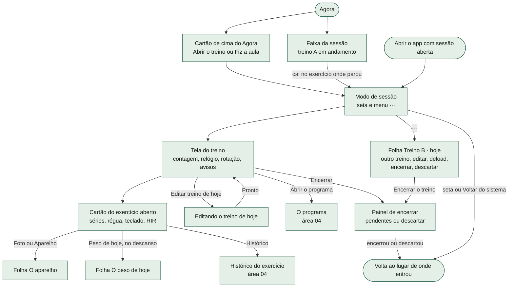

O modo é a camada mais funda da pilha de telas: tudo que abre de dentro dele (histórico, programa, folhas, painéis) fica por cima, e o Voltar fecha uma camada por vez. Tocar numa aba (por qualquer link interno que leve a um lugar) também fecha o modo, sem encerrar a sessão.

---

## 3. Fluxos, um por funcionalidade

### 3.1 Entrar no modo e sair dele

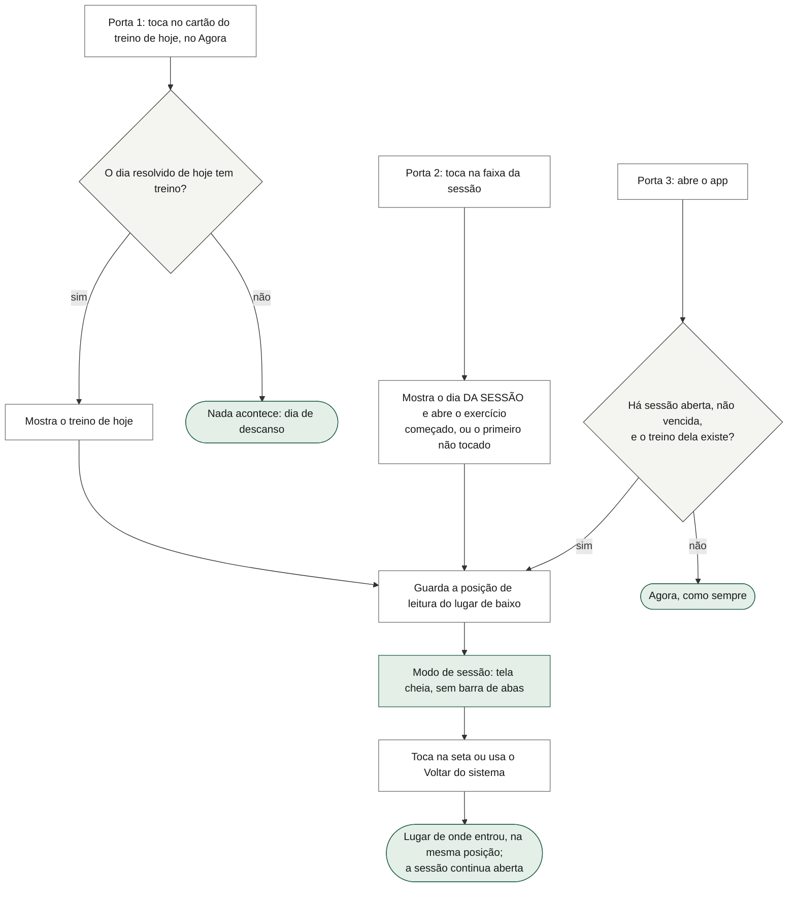

O que o diagrama não mostra: as três portas não mexem na aba de baixo — o modo é uma camada por cima do lugar, e é por isso que sair devolve exatamente de onde ele veio. A porta 3 só roda depois de o app fechar a sessão vencida (§3.20): sessão vencida não sequestra a abertura. A faixa nunca aparece como atalho dentro do modo (seria uma porta para onde ele já está); só a pergunta de 1h30 aparece lá. Concluir o lançamento de um treino passado também abre o modo (área 11).

### 3.2 A hora e o relógio da sessão

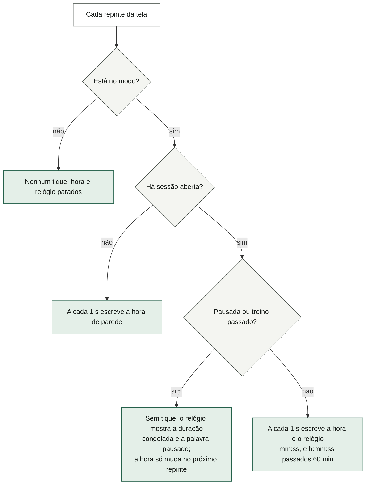

A hora e o relógio são escritos por fora do desenho da tela, de propósito: repintar a cada segundo roubaria o foco do que ele estiver preenchendo. O relógio é a duração líquida: tempo desde o início menos as pausas já ocorridas, e nunca anda para trás durante a pausa. Ele gruda logo abaixo da barra do modo ao rolar.

### 3.3 Quando a sessão nasce

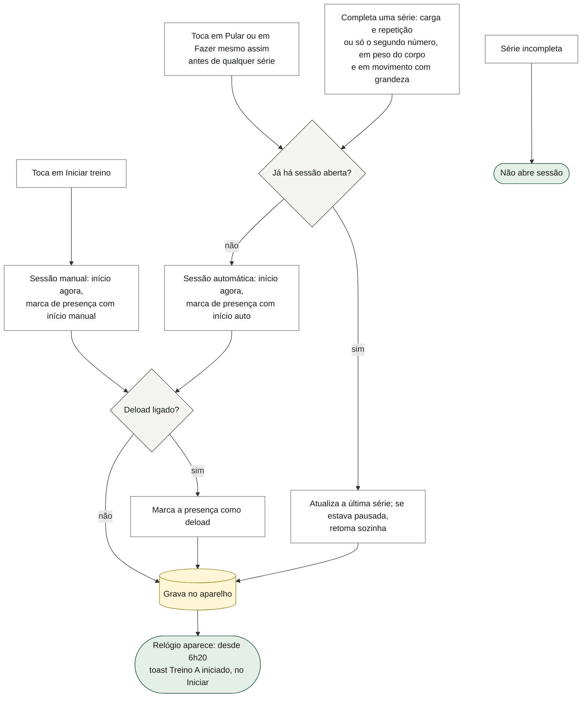

O "Iniciar treino" é só precisão de tempo: ele nunca é pré-condição para gravar série. Iniciar também pede para manter a tela acesa. A identidade da sessão (`sid`) é o instante em que ela nasceu, e é a mesma da marca de presença em "Dias". Abrir o modo não abre sessão.

### 3.4 Registrar uma série (o caminho de toda série)

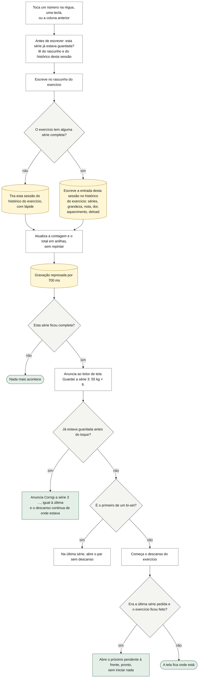

O que o diagrama não mostra: **não existe botão de salvar** — a série entra no histórico no toque. A entrada no histórico é por exercício (o id do exercício, não a posição), e leva a posição de origem quando houve troca. A data da entrada é o início da sessão. Cada toque também pede tela acesa. Apagar um valor (tocar de novo no mesmo número da régua, ou apagar no teclado) tira a série do registro e **rearma** o descanso daquela série, e só dela. "Próximo pendente" só olha para a frente e não dá a volta: chegar ao fim com algo para trás é informação para a hora de encerrar. Se o aparelho recusar a gravação, o painel "Não guardei a série 3: 55 × 9…" é da área 01; a série continua na memória e a marca de não guardado fica até a próxima gravação dar certo. Dois exercícios iguais em duas posições do mesmo treino viram duas entradas separadas (a chave inclui a posição de origem).

### 3.5 A régua de repetições

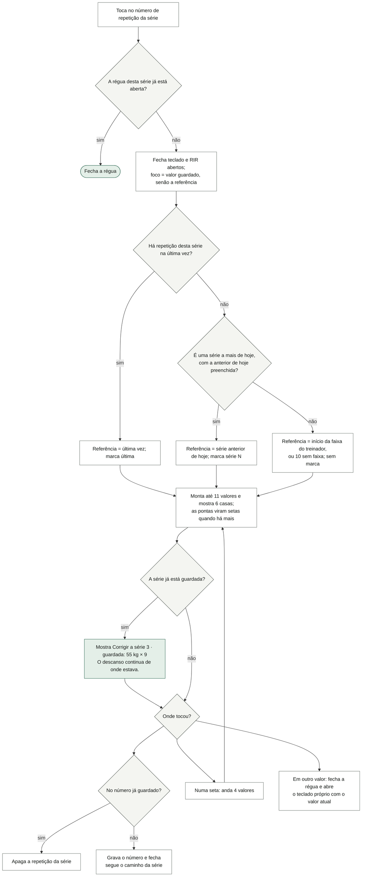

A régua não rola e não tem arrasto: só as 6 casas existem na tela, e a página é calculada a partir do valor em foco — por isso um repinte (o relógio, por exemplo) nunca a move, e fechar o cartão e reabrir não herda a janela de antes. As setas não mostram número (um botão que mostra 12 e não registra 12 seria erro de alvo); o nome acessível delas diz "mostrar de 13 a 16". Os valores dentro da faixa do treinador ficam marcados; o guardado diz "agora" e vence a marca "última". Exercícios medidos por tempo, metro ou caloria não têm régua: continuam com campo de texto numérico (o teclado do sistema).

### 3.6 O teclado próprio (carga e "outro valor")

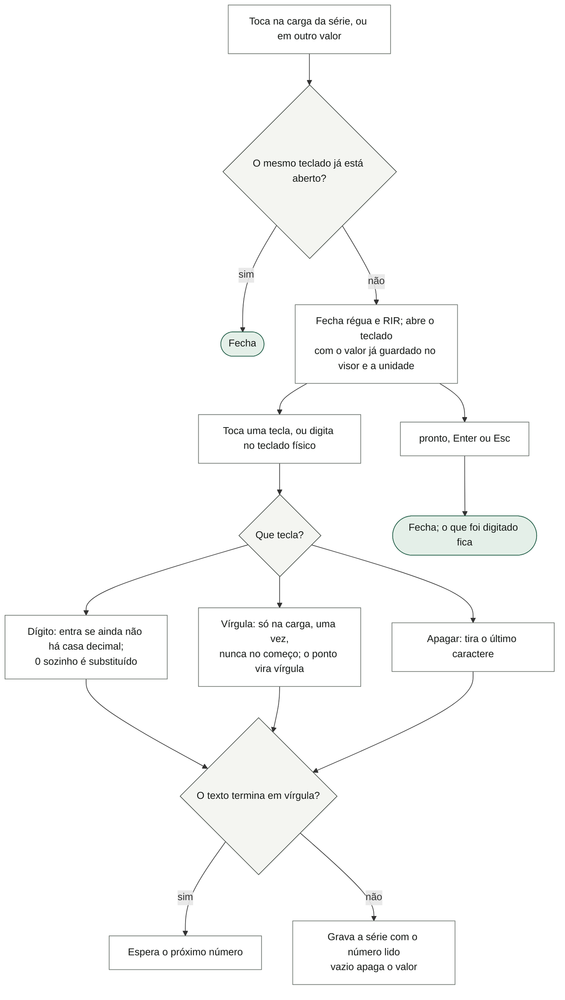

As teclas estão na ordem da calculadora (7 8 9 / 4 5 6 / 1 2 3 / , 0 ⌫). Na repetição o lugar da vírgula fica vazio (tecla que não faria nada não aparece). A carga aceita uma casa decimal e só uma (22,55 não entra). O modelo é o "livre com vírgula" (6, 0 = 60), não o de registradora (7, 3, 6 = 73,6): é uma decisão declarada e reversível numa constante só. O visor é região viva para o leitor de tela; o painel recebe o foco ao abrir para o teclado físico funcionar. Cada tecla grava como o campo gravava a cada letra — por isso, digitando a carga numa série cuja repetição já estava preenchida, a série fica completa no primeiro dígito (ver §9). O mesmo teclado serve à lista rápida da aula (área 05), ao peso e à cintura (área 07) e à correção de sessão passada (área 11).

### 3.7 O RIR em dois toques

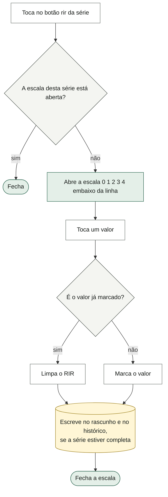

O RIR é a terceira posição da série e só existe quando foi preenchido (série sem RIR continua sendo um par). RIR sozinho não completa série, não abre sessão e não dispara descanso. Só uma coisa abre embaixo da linha por vez: régua, teclado ou escala. Exercício com grandeza própria (box) não tem coluna de RIR.

### 3.8 A coluna "anterior"

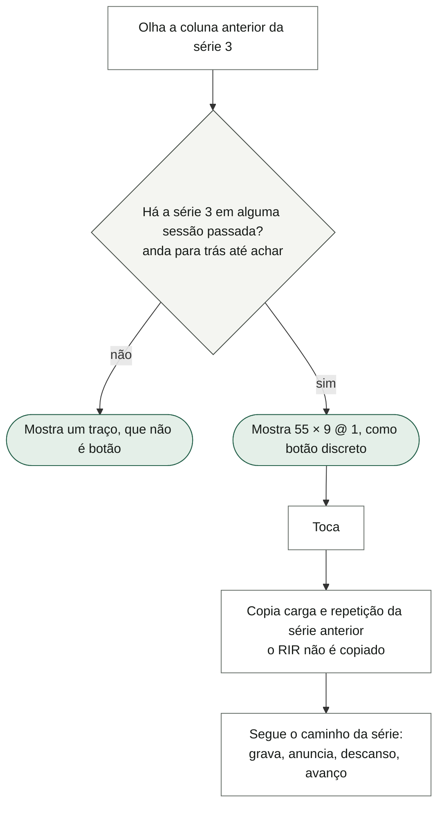

A referência ignora a própria sessão aberta (o que ele acabou de digitar não vira referência de si mesmo). Em movimento com grandeza, a coluna mostra "carga kg · segundos". Abaixo das linhas, o agregado da última vez: "volume da última vez: 1.840", "tempo" em segundo, "ritmo" em metro e caloria (segundos por 100 m ou por caloria), ou "primeira vez neste exercício".

### 3.9 "+ série"

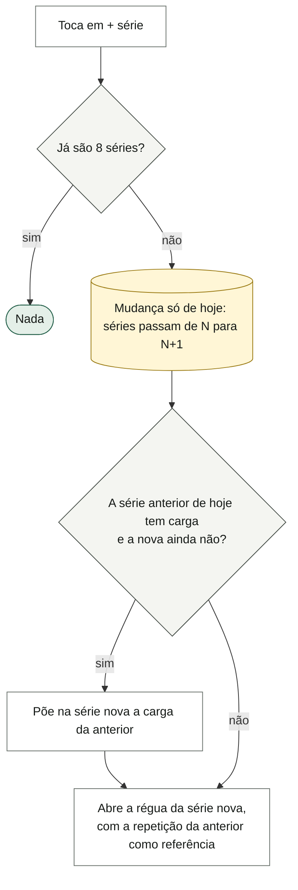

É a mesma mudança que a edição do dia faria; se fica permanente decide-se depois (área 04). Só aparece em treino editável hoje, de repetição, fora de dia aberto, com menos de 8 séries e não pulado.

### 3.10 Pular e desfazer

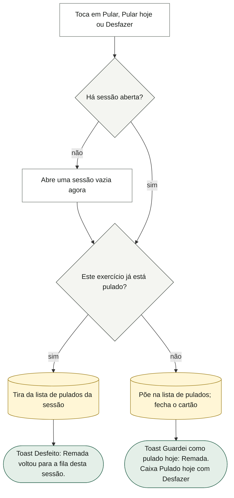

Pular é decisão declarada e reversível, por isso não há pergunta antes. Pulado nunca é pendente: não volta a ser oferecido pelo avanço, não entra no "pendentes" do encerrar, e o atalho "onde ele estava" não o aponta. No fim, a lista de pulados vai para a marca da sessão, e o toast do encerrar a conta ("· 1 pulado").

### 3.11 Dor repetida e "Fazer mesmo assim"

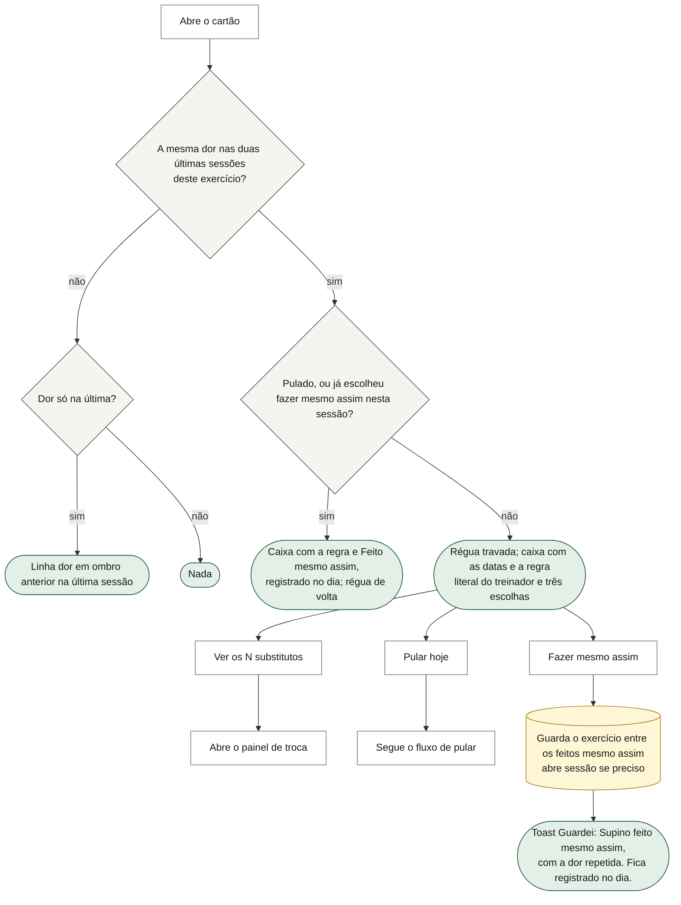

A regra citada é literal e assinada: "Treinador: Apareceu: tire aquele exercício por 2 semanas e substitua por outro ângulo. Nunca empurre porque ‘está fraquinha’." É o único estado ruim que não se dispensa sem responder. A escolha "fazer mesmo assim" vai para a marca da sessão no fim. A detecção olha o histórico do exercício na posição (se houve troca, o do substituto) e ignora a sessão aberta. "Ver os substitutos" só aparece se houver algum.

### 3.12 Máquina ocupada: trocar, fazer antes o próximo

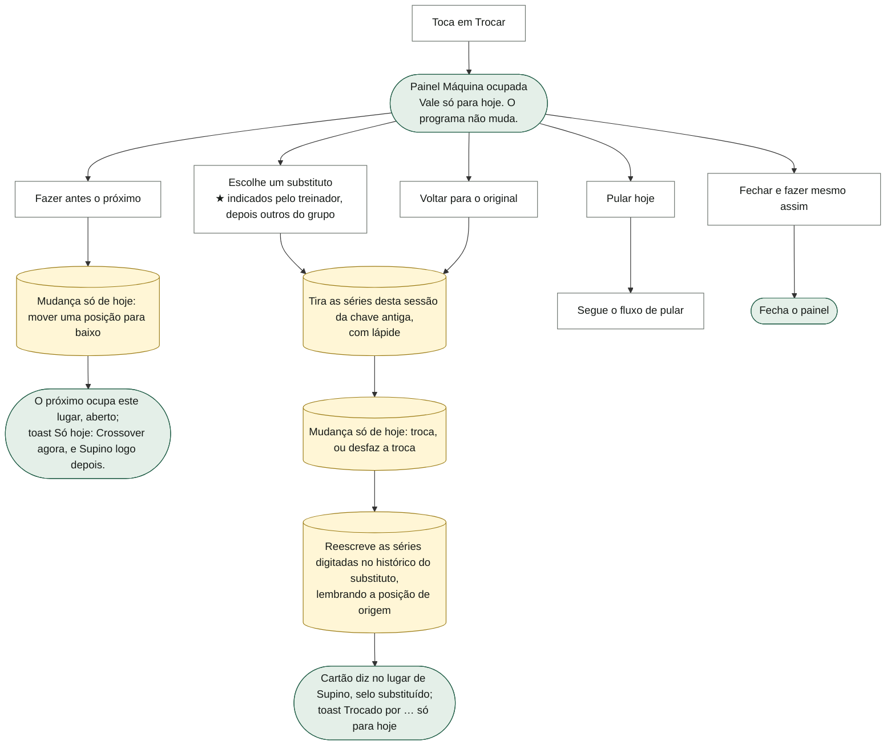

As opções são ancoradas no exercício de origem (depois de trocar, ainda aparecem os indicados do titular e o caminho de volta). Cada opção diz "última vez: 60 × 8" quando ele já usou aquele aparelho, o que muda ao trocar (texto do treinador) e a miniatura do aparelho, se houver. "Fazer antes o próximo" só existe se houver próximo. Num exercício substituído não aparece o selo "↑ subir carga" nem o aviso de pausa longa. A decisão de manter a troca no programa é da fila (área 04).

### 3.13 Tipo de carga e o total em anilhas

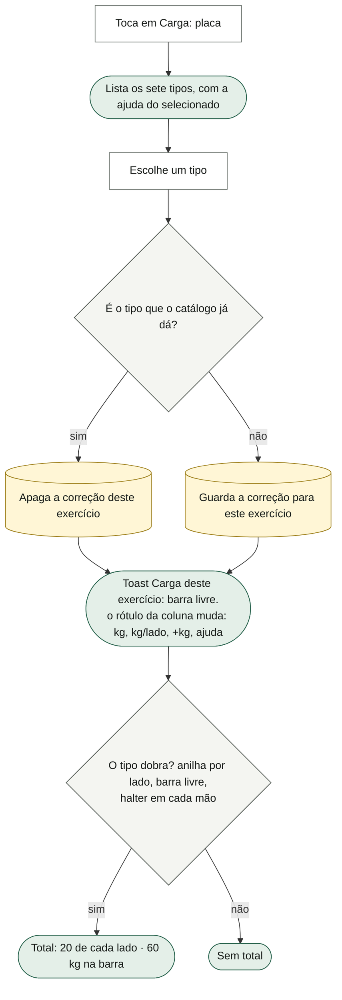

O app nunca converte carga, só rotula: guarda o número digitado. O total é exibição: 2 × o lado, mais 20 kg só na "barra livre" (anilha por lado é "fora a barra"). O total usa a última carga digitada hoje no exercício, senão a da série 1 da última vez. Em "peso do corpo" (e em movimento com grandeza) a carga é opcional: "Carga opcional: deixe o campo vazio para só o peso do corpo." — e a série completa com só a repetição. A correção vale para o exercício em qualquer treino (é por id), não só hoje.

### 3.14 Aquecimento, anotação e dor de tendão

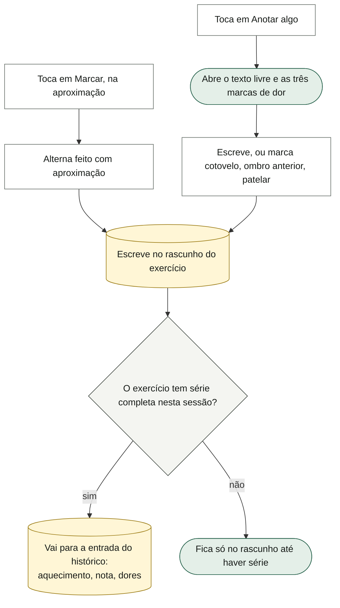

As marcas de dor desta sessão são o que alimenta a regra da dor repetida (§3.11) nas próximas. O texto grava a cada letra (sem repintar). Anotação sem série completa não chega ao histórico e se perde ao encerrar (ver §9).

### 3.15 Foto do aparelho

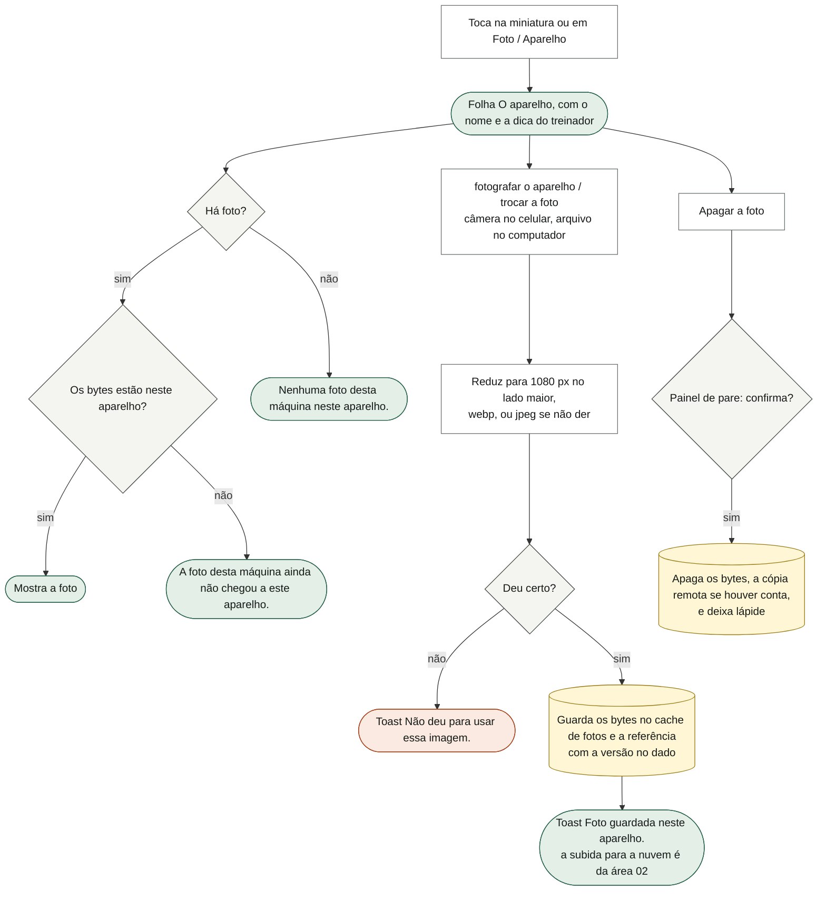

A foto é por exercício (id), não por posição: vale em qualquer treino e aparece também nas opções de troca. O texto do pare diz "Apagar a foto do equipamento de … tira a imagem deste aparelho e da cópia remota. O exercício continua; só a imagem sai. Isso não tem volta." A leitura dos bytes é assíncrona: a tela desenha primeiro sem a imagem e repinta quando ela chega.

### 3.16 O descanso (cronômetro)

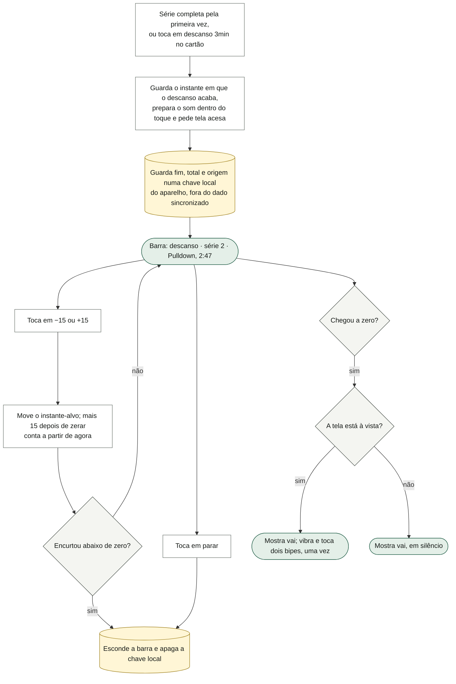

O que o diagrama não mostra: o cronômetro guarda o **instante-alvo**, não um contador — por isso sobrevive à tela apagada (o iOS congela o JavaScript) e a fechar o app: na abertura seguinte ele volta, **mudo** (sem gesto não se prepara som), se o alvo ainda não passou; alvo vencido não ressuscita. Ao voltar do bloqueio, ele retoma a pintura e pede tela acesa de novo. A tela é repintada 4 vezes por segundo por fora do desenho do app. O bipe é Web Audio (o Safari não vibra de forma confiável): dois tons de 880 Hz. Um descanso novo substitui o anterior. A barra publica a própria altura para a faixa da sessão e o toast se empilharem acima dela. Corrigir uma série não reinicia o descanso, nem depois de reabrir o app (a pergunta "já estava guardada?" é respondida pelo dado, não pela memória).

### 3.17 Enquanto descansa (pré-treino, água, peso rápido)

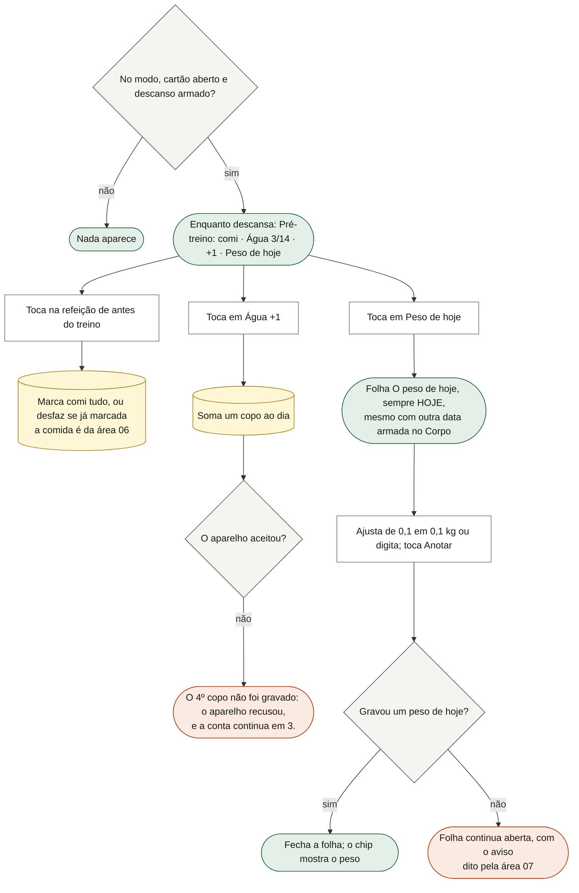

"A refeição de antes do treino" é a última refeição do plano presa ao treino (`quando: treino`) cujo horário vem antes da linha do treino no plano — ou, sem essa linha, antes do início da sessão. Sem ela, o chip some. A meta de água aqui é 14 copos (constante própria, ver §9). Parar o descanso tira os três atalhos; fora do modo eles não existem (o Agora já tem as três linhas). Esta área só oferece a porta: marcar comida e água é da área 06, registrar peso é da área 07.

### 3.18 Pausar e retomar

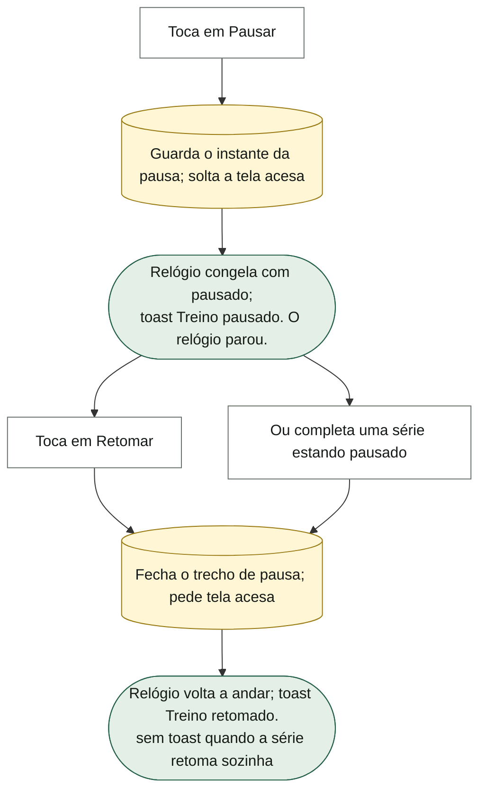

Pausada, a sessão não conta como parada (a pergunta de 1h30 não aparece e a inatividade não a fecha); só a virada do dia a fecha, na abertura seguinte. No fecho, o tempo pausado é descontado da duração e, se passou de 1 min, fica escrito na marca.

### 3.19 Encerrar (o fecho no toque)

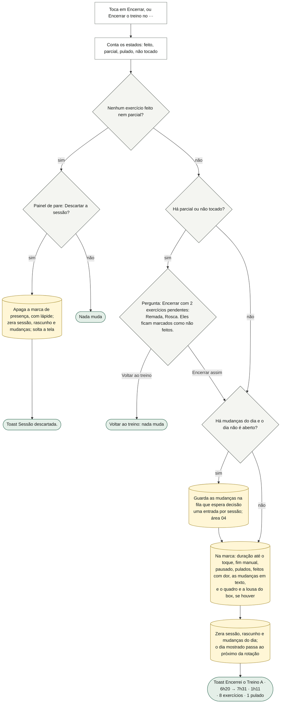

O que o diagrama não mostra: a pergunta de pendentes lista no máximo 4 nomes ("e mais N"); pulado não conta como pendente. "Pendente" é derivado (não há registro de "não fiz"): só o pulado é gravado. As mudanças do dia vão para a marca da sessão em texto **mesmo que nunca virem permanentes** ("por que o volume desse dia foi outro?" tem resposta), e para a fila de decisão só em dia de prescrição: num dia aberto (box) o que entrou É o dia. Não há tela de decisão no fecho: a pergunta "isto fica no programa?" mora na Prescrição (área 04) e o Agora avisa. Não há desfazer depois de encerrar; corrigir o tempo depois é pela sessão no Dias (área 11). O fecho solta a tela acesa e volta ao topo.

### 3.20 O fecho automático e a sessão esquecida

```mermaid
flowchart TD
  bt["A cada 30 s, com o app aberto"]
  ab["Na abertura do app"]
  pz{"Pausada?"}
  vd{"Mudou o dia desde o início?"}
  q{"Parada há quanto tempo, desde a última série?"}
  at(["Menos de 1h30: faixa é atalho"])
  pg(["De 1h30 a 1h40: faixa e cartão do Agora perguntam<br/>Treino A sem série nova há 1h32."])
  c1["continuo treinando"]
  c2[("Zera a inatividade: a última série vira agora")]
  c3(["Toast Treino continua."])
  j1["já parei"]
  au[("Fecha com fim automático: duração até a última série")]
  j2(["Toast Encerrei o Treino A na última série, às 7h31.<br/>A duração vai até ela: cerca de 1h11, aproximada."])
  fx(["Toast Fechei o Treino A de ontem na última série…<br/>aproximada."])
  nada(["Continua aberta"])
  bt --> q
  ab --> pz
  pz -->|"sim"| vd
  vd -->|"não"| nada
  vd -->|"sim"| au
  pz -->|"não"| vd2{"Mudou o dia?"}
  vd2 -->|"sim"| au
  vd2 -->|"não"| q
  q -->|"menos de 1h30"| at
  q -->|"1h30 a 1h40"| pg
  q -->|"1h40 ou mais"| au
  pg --> c1 --> c2 --> c3
  pg --> j1 --> au
  au --> fx
  au -.->|"pelo já parei"| j2
  classDef tela fill:#E4EFE8,stroke:#24604A,color:#161A17
  classDef acao fill:#FFFFFF,stroke:#69716B,color:#161A17
  classDef dado fill:#FFF6D6,stroke:#9A7A12,color:#161A17
  classDef decisao fill:#F4F5F1,stroke:#434B45,color:#161A17
  class at,pg,c3,j2,fx,nada tela
  class bt,ab,c1,j1 acao
  class c2,au dado
  class pz,vd,vd2,q decisao
```

O que o diagrama não mostra: o fecho automático grava `fim: auto` e a duração **até a última série** (o que houve depois ninguém mediu), por isso as palavras dizem "aproximada". Ele carrega as mudanças do dia para a fila de decisão do mesmo jeito que o fecho manual (só em dia de prescrição), e transforma o quadro e a lousa do box na nota da sessão. A batida de 30 s não olha a virada do dia: ela só fecha por inatividade; a virada só é verificada na abertura. "Já parei" é o único toque do app que grava um fim que não é o instante do toque. Depois de um fecho automático de um dia anterior, o Agora pergunta "Está certo / Corrigir o fim" sobre o tempo aproximado (o cartão é da área 10; "Está certo" passa o fim a declarado sem mudar o número). O toast da abertura usa "de ontem" ou o dia ("de qua 12") quando a sessão é de outro dia. Uma sessão de treino passado (área 11) fecha calada.

### 3.21 Deload

```mermaid
flowchart TD
  m["Abre o ··· ou vê o aviso do treino"]
  d0{"Deload está ligado?"}
  l1(["Deload hoje · corta 20 séries para 10, nas mesmas cargas<br/>e a regra literal do treinador"])
  l2(["Sair do deload · devolve 10 séries ao Treino A de hoje"])
  t1["Toca para ligar"]
  t2["Toca para sair"]
  s[("Liga ou desliga o modo, que é global")]
  ds{"Há sessão aberta?"}
  rm[("Remarca as séries desta sessão e a presença<br/>com ou sem deload, carimbo novo")]
  f1(["Toast Deload ligado. Metade das séries, mesmas cargas…"])
  f2(["Toast Deload desligado. As 10 séries voltaram:<br/>Pulldown volta a pedir 4, e as 2 que você já registrou ficam."])
  m --> d0
  d0 -->|"não"| l1 --> t1 --> s
  d0 -->|"sim"| l2 --> t2 --> s
  s --> ds
  ds -->|"sim"| rm
  ds -->|"não"| f1
  rm --> f1
  rm --> f2
  classDef tela fill:#E4EFE8,stroke:#24604A,color:#161A17
  classDef acao fill:#FFFFFF,stroke:#69716B,color:#161A17
  classDef dado fill:#FFF6D6,stroke:#9A7A12,color:#161A17
  classDef decisao fill:#F4F5F1,stroke:#434B45,color:#161A17
  class l1,l2,f1,f2 tela
  class m,t1,t2 acao
  class s,rm dado
  class d0,ds decisao
```

Deload corta as séries pela metade, arredondando para cima, sem tocar na carga. Os números da frase saem do treino mostrado, calculados na hora de abrir. Ligado, os cartões dizem "2 séries hoje · metade do prescrito, por deload", o selo "↑ subir carga" some, e a sessão e cada série ficam marcadas — a sessão de deload não conta nas 48 do bloco. Desligar no meio devolve as séries pedidas, mantém as registradas e tira a marca de deload da sessão inteira (sem isso o exercício de 2 séries ficaria "feito" enquanto a frase diz que voltou a pedir 4). A frase do desligar nomeia o exercício mais recente que agora pede mais do que tem. A regra do treinador ("Quando houver evidência clara de fadiga acumulada…, faça 5 a 7 dias com 50 a 60% das séries habituais…") só aparece antes de ligar. O mesmo interruptor existe no botão dos avisos "deload ativo" e "fim de bloco chegando", com as mesmas palavras.

### 3.22 Edição do treino de hoje

```mermaid
flowchart TD
  a["Toca em Editar treino de hoje"]
  b(["Barra Editando o treino A de hoje.<br/>O programa oficial só muda se você quiser, no fim do treino."])
  ac{"O que faz?"}
  sd["↑ ou ↓"]
  ss["− ou + séries, de 1 a 8"]
  tr["trocar"]
  rm["remover"]
  ad["Adicionar exercício: busca, ou Cadastrar exercício novo"]
  rg{"O exercício tem série nesta sessão?"}
  pp{"Pare: Tirar e apagar as 3 séries?"}
  ap[("Apaga as séries desta sessão dele, com lápide")]
  md[("Grava a mudança do dia;<br/>mesma mudança no mesmo lugar se junta,<br/>e voltar ao valor original a apaga")]
  im(["Linha mostra o impacto no volume do músculo<br/>quando mexida ou fora do alvo"])
  ls(["Lista mudanças de hoje, cada uma com desfazer"])
  df["desfazer"]
  dx[("Tira a mudança; numa troca, tira também<br/>as séries que ela levou")]
  pr["Pronto"]
  f(["Volta aos cartões"])
  a --> b --> ac
  ac --> sd --> md
  ac --> ss --> md
  ac --> tr --> md
  ac --> ad --> md
  ac --> rm --> rg
  rg -->|"não"| md
  rg -->|"sim"| pp
  pp -->|"sim"| ap --> md
  md --> im --> ls
  ls --> df --> dx
  b --> pr --> f
  classDef tela fill:#E4EFE8,stroke:#24604A,color:#161A17
  classDef acao fill:#FFFFFF,stroke:#69716B,color:#161A17
  classDef dado fill:#FFF6D6,stroke:#9A7A12,color:#161A17
  classDef decisao fill:#F4F5F1,stroke:#434B45,color:#161A17
  class b,im,ls,f tela
  class a,sd,ss,tr,rm,ad,df,pr acao
  class ap,md,dx dado
  class ac,rg,pp decisao
```

As mudanças são guardadas como **intenções** sobre o dia (subir/descer, séries, troca, remover, adicionar, e a medida do box), não como uma cópia do treino: é isso que permite dizer depois "Hack squat no lugar de Pendulum" ou "Elevação lateral: 5 séries, não 4". Cada intenção aponta para a posição original, mesmo depois de uma troca, por isso elas se encadeiam. Só existem para o dia que dá para editar hoje (o da sessão, ou o próximo da rotação); editar outro dia é edição de programa (área 04). Elas sobrevivem a navegar entre dias e a fechar o app, e somem no fim da sessão (depois de copiadas para a marca e, se for o caso, para a fila). Exercício adicionado entra com 3 × 6–10 (composto) ou 3 × 10–15, ou 1 passada se tiver grandeza própria; tem histórico próprio. Cadastrar exercício novo cria uma entrada no catálogo dele e já o adiciona ao dia (a regra do catálogo é da área 04). A mesma linha de edição serve à tela do programa (área 04), com outro executor.

### 3.23 Trocar de dia da rotação no meio da sessão

```mermaid
flowchart TD
  a["Toca outra letra da rotação, ex.: E"]
  g["Mostra o treino E; o rascunho é do dia mostrado"]
  h{"O dia mostrado é o da sessão?"}
  hd["Reconstrói o rascunho a partir do histórico<br/>desta sessão: séries, nota, dor, aquecimento"]
  vz(["Campos em branco"])
  s["Registra uma série no E"]
  mv[("A sessão passa a ser do dia E;<br/>a marca de presença continua dizendo A")]
  v["Volta para o A e registra outra série<br/>num exercício que já tinha séries"]
  bug[("Rascunho novo e vazio: a entrada do exercício<br/>é reescrita só com a série nova")]
  a --> g --> h
  h -->|"sim"| hd
  h -->|"não"| vz
  vz --> s --> mv --> v --> bug
  classDef tela fill:#E4EFE8,stroke:#24604A,color:#161A17
  classDef acao fill:#FFFFFF,stroke:#69716B,color:#161A17
  classDef dado fill:#FFF6D6,stroke:#9A7A12,color:#161A17
  classDef erro fill:#FBEAE2,stroke:#A63F17,color:#161A17
  classDef decisao fill:#F4F5F1,stroke:#434B45,color:#161A17
  class vz tela
  class a,g,hd,s,v acao
  class mv dado
  class bug erro
  class h decisao
```

Olhar outro dia e voltar é seguro: o rascunho do dia da sessão é reconstruído do histórico. Mas **registrar** uma série em outro dia muda o dia da sessão, e aí voltar ao dia original perde séries — reproduzido, ver §9, item 1. O comentário do tipo `PromoPendente` confirma que o dia da sessão é editável no meio do treino de propósito; a perda não é.

### 3.24 O telefone deitado

```mermaid
flowchart TD
  a["Gira o telefone: deitado e altura até 520 px"]
  d{"Está no modo de sessão?"}
  av(["Tela inteira: retrato · Gire o telefone<br/>No meio da sessão ele se arruma deitado também."])
  dc{"Há cartão aberto?"}
  two(["Cartão em duas colunas: à esquerda o nome,<br/>a dica, a pegada e o descanso; à direita as séries,<br/>a régua, os atalhos e as ações"])
  one(["Lista normal, sem o aviso de girar"])
  a --> d
  d -->|"não"| av
  d -->|"sim"| dc
  dc -->|"sim"| two
  dc -->|"não"| one
  classDef tela fill:#E4EFE8,stroke:#24604A,color:#161A17
  classDef acao fill:#FFFFFF,stroke:#69716B,color:#161A17
  classDef decisao fill:#F4F5F1,stroke:#434B45,color:#161A17
  class av,two,one tela
  class a acao
  class d,dc decisao
```

É só CSS (a mesma condição de "telefone deitado" do aviso geral). O iOS não deixa travar a orientação de app web; no Android a trava em retrato é pedida e, se recusada, ignorada (área 01).

### 3.25 Se o app fechar no meio

```mermaid
flowchart TD
  a["Ele troca de app, bloqueia a tela ou o iOS fecha o app"]
  s[("Ao sair de cena: a gravação represada<br/>dos últimos 700 ms vai para o disco")]
  b["Abre o app de novo"]
  v{"A sessão venceu? dia virou, ou parada há 1h40"}
  f(["Fecha e avisa Fechei… aproximada; Agora"])
  m(["Cai no modo, no dia da sessão"])
  r[("Rascunho reconstruído do histórico da sessão")]
  t{"Havia descanso e o alvo não passou?"}
  tv(["Cronômetro volta, mudo"])
  tn(["Sem cronômetro"])
  c["Corrige uma série antiga"]
  cc(["Corrigi a série 2; o descanso não recomeça"])
  a --> s --> b --> v
  v -->|"sim"| f
  v -->|"não"| m --> r --> t
  t -->|"sim"| tv
  t -->|"não"| tn
  r --> c --> cc
  classDef tela fill:#E4EFE8,stroke:#24604A,color:#161A17
  classDef acao fill:#FFFFFF,stroke:#69716B,color:#161A17
  classDef dado fill:#FFF6D6,stroke:#9A7A12,color:#161A17
  classDef decisao fill:#F4F5F1,stroke:#434B45,color:#161A17
  class f,m,tv,tn,cc tela
  class a,b,c acao
  class s,r dado
  class v,t decisao
```

O que fica guardado no aparelho a cada toque: sessão aberta, rascunho, mudanças do dia, séries no histórico, marca de presença. O que não fica: qual cartão estava aberto, régua/teclado/RIR abertos, a tela acesa (é pedida de novo no próximo toque ou ao voltar do bloqueio). Um rascunho do modelo antigo, sem sessão, vira sessão aberta na abertura (migração de compatibilidade).

### 3.26 Em dois aparelhos

```mermaid
flowchart TD
  a["Série registrada no iPhone"]
  b["Sincronia: área 02"]
  l[("Séries: coleção, chave log:exercício:sessão:posição,<br/>vence o carimbo mais novo, lápide ao apagar")]
  p[("Presença: coleção, chave done:sessão")]
  q[("Fila de mudanças: coleção, chave promo:sessão")]
  d[("Sessão aberta, rascunho, mudanças do dia e deload:<br/>documento inteiro, vence o lado gravado por último")]
  r{"O outro aparelho gravou qualquer coisa<br/>depois do último toque no iPhone?"}
  ok(["Sessão continua no iPhone"])
  x(["A sessão aberta do iPhone pode ser substituída<br/>pela do outro lado, inclusive por nenhuma"])
  t[("Descanso: chave local, não sincroniza")]
  a --> b
  b --> l
  b --> p
  b --> q
  b --> d --> r
  r -->|"não"| ok
  r -->|"sim"| x
  b -.-> t
  classDef tela fill:#E4EFE8,stroke:#24604A,color:#161A17
  classDef acao fill:#FFFFFF,stroke:#69716B,color:#161A17
  classDef dado fill:#FFF6D6,stroke:#9A7A12,color:#161A17
  classDef erro fill:#FBEAE2,stroke:#A63F17,color:#161A17
  classDef decisao fill:#F4F5F1,stroke:#434B45,color:#161A17
  class ok tela
  class a,b acao
  class l,p,q,d,t dado
  class x erro
  class r decisao
```

As séries e as presenças nunca se perdem entre aparelhos (coleções com chave natural). A sessão aberta, porém, viaja como documento: **a confirmar** se isso é aceitável (ver §9, item 3). O cronômetro de descanso é do aparelho e do momento, e de propósito não viaja.

---

## 4. Estados da tela

| estado | quando acontece | o que a tela mostra |
|---|---|---|
| Modo sem sessão | Entrou pela porta 1 e ainda não registrou nada | Hora andando, botão "Iniciar treino" no lugar do relógio, sem Pausar/Encerrar, cartões sem selo de estado; `···` só com o deload |
| Sessão ao vivo | Primeira série ou "Iniciar treino" | Relógio com ponto vivo e "desde 6h20", "Pausar" e "Encerrar", selos feito/parcial/pulado, contagem acesa quando todas as séries foram feitas |
| Sessão pausada | "Pausar" | Relógio congelado com "pausado", botão "Retomar"; a hora deixa de andar (ver §9) |
| Treino passado em preenchimento | Lançamento retroativo (área 11) | Aviso âmbar "preenchendo treino passado · As séries que você digitar entram em …" com "Concluir"; sem relógio; aparece "Iniciar treino", que não faz nada (ver §9) |
| Sessão esquecida | 1h30 sem série nova, não pausada | Faixa "Treino A sem série nova há 1h32." com "continuo treinando" / "já parei", inclusive dentro do modo |
| Cartão fechado / aberto | Toque no topo | Só o topo, ou o topo mais leitura e polegar; um aberto por vez |
| Exercício feito / parcial / pulado / não tocado | Derivado das séries da sessão e dos pulados | Selo verde "feito", "parcial", caixa "Pulado hoje…" com Desfazer (cartão esmaecido), ou nada |
| Régua aberta | Toque na repetição | Faixa de 6 casas embaixo da linha, "outro valor"; com a série guardada, "Corrigir a série 3 · guardada: …" |
| Teclado aberto | Toque na carga ou em "outro valor" | Visor com valor e unidade, 12 teclas, "pronto" |
| Escala de RIR aberta | Toque em "rir" | "rir da série 2" e 0 a 4 |
| Dor repetida, travada | Mesma dor nas duas últimas sessões | Caixa com as datas, a regra do treinador e três escolhas; sem tabela de séries |
| Dor repetida, escolhida | "Fazer mesmo assim" | "Feito mesmo assim — registrado no dia."; tabela de volta |
| Dor só na última | Dor na última sessão | Linha "dor em ombro anterior na última sessão deste exercício" |
| Pausa longa do exercício | 14 dias ou mais sem ele, sem dor repetida e sem troca | Linha "18 dias sem este exercício" |
| Subir carga | Todas as séries da última vez no topo da faixa, com carga, e sem pausa longa | Selo "↑ subir carga" (some em deload, troca e pulado) |
| Primeira vez | Sem histórico | Coluna anterior com traço, "primeira vez neste exercício", régua sem marca "última" começando no início da faixa |
| Substituído | Troca de hoje | "no lugar de …" e selo "substituído" |
| Máquina ocupada aberta | "Trocar" | Painel com as saídas por preço |
| Deload ativo | Interruptor ligado | Aviso âmbar "deload ativo" com "Sair do deload · devolve…"; selo de séries "metade do prescrito" |
| Fim de bloco chegando | Faltam 6 ou menos sessões de trabalho para fechar 48 | Aviso "fim de bloco chegando" com a regra e "Deload hoje · corta…" |
| Volta de pausa | 14 dias ou mais desde o último treino | Aviso âmbar "volta de pausa" |
| Editando hoje | "Editar treino de hoje" | Barra de edição, linhas editáveis, "mudanças de hoje" com desfazer, "Adicionar exercício" |
| Descanso correndo | Série completa ou botão "descanso" | Barra com origem, contagem, −15/+15/parar; atalhos "Enquanto descansa" no cartão aberto |
| Descanso zerado | Alvo passou | "vai" em destaque; bipe e vibração se a tela estava à vista; atalhos continuam até "parar" |
| Gravação recusada | O aparelho não aceitou gravar | Painel "Não guardei a série 3…" uma vez por episódio, marca de não guardado (área 01) |
| Treino vazio | Dia sem exercício | "Este treino ainda não tem exercício nenhum." (dia aberto: texto do box, área 05) |
| Deitado | Telefone deitado no modo | Cartão aberto em duas colunas |
| Folha do aparelho | Foto / Aparelho | Foto, "ainda não chegou a este aparelho", ou "Nenhuma foto…" |

---

## 5. Dados

### O que esta área GUARDA

| campo | formato | quem mais lê |
|---|---|---|
| `S.sessao` | `{ day, inicio, ultima, sid, manual?: 1, retro?: 1, tocado?, pausadoEm?: instante, pausas: [{de, ate}], pulados: [posição], dorMesmoAssim: [posição] }` ou `null`. `sid` = instante em que nasceu. `posição` = id original do exercício naquela posição do treino. | Agora (área 10: cartão de cima, faixa), dia de hoje e cadência (área 06 via `diaDeHoje`), lousa (área 05), endereço vazio e aviso de gravação (área 01), lançamento retroativo (área 11) |
| `S.draft` | `{ day, t, ex: { [índice]: { s: [[carga, reps, rir?]], obs, dor: [], alt, aq } } }` — buffer de digitação do dia mostrado; zerado ao trocar de dia e no fim. O campo `alt` não é mais usado (a troca vive nas mudanças do dia). | Só esta área (e a lista rápida do box, área 05) |
| `S.mods` | `{ day, t, list: [mudança] }`, cada mudança `{ k: sets/reps/desc/troca/rm/add/mover/med, slot, de?, para?, por?, id?, pos?, n? … }` | Programa e volume (área 04: `treino(d)` aplica as mudanças por cima do programa; `seriesDe` conta com elas) |
| `S.logs[exercício][]` (escreve as entradas da sessão aberta) | `{ t: início da sessão, sid, sets: [[carga, reps, rir?] ou null], sl?: posição de origem, u?, q?, aq?: 1, obs?, dor?: [], dl?: 1, m: carimbo }`; até 500 por exercício | Histórico e progressão (04), força e volume (09), Dias e correções (11), Agora (10), aula (05) |
| `S.done[]` (cria e fecha a marca de presença) | `{ day, t: início, sid, ini: manual/auto, dl?, dur, fim: manual/auto, pausado?, pulados?, dorMesmoAssim?, mods?: [texto], obs?: quadro do box, lousa?, m }`; até 3000 | Rotação/próximo treino (04), Dias (11), Agora e confirmação do fim (10), Semana/48 sessões (09), comida (duração do treino, 06) |
| `S.deload` | booleano global | Volume, retrospectiva e conta das 48 (04/09) |
| `S.carga[exercício]` | tipo de carga corrigido (`pino`, `lado`, `barra`, `halter`, `halter1`, `corpo`, `assist`); ausente = o do catálogo | Histórico (04, rótulo e gráfico), corrigir sessão passada (11) |
| `S.fotos[exercício]` | `{ v: versão (instante), ext: webp/jpeg }` + bytes no Cache Storage `lastro-fotos`, endereço `./foto/<id>.<ext>`, 1080 px | Opções de troca, sincronia de bytes (02) |
| `S.promoPendente[]` (escreve) | `{ sid, day, t, mods, resumoMods, m }`, uma por sessão, ordenada por tempo, até 60 | A fila de decisão (04), aviso do Agora (10) |
| `S.apagados` (lápides que esta área cria) | `log:<exercício>:<sid>:<posição>`, `done:<sid>` (descartar), `foto:<exercício>` | Sincronia (02) |
| `S.mtime` | carimbo de cada gravação (`save`) | Sincronia (02) |
| Chave local `lastro-descanso-v1` | `{ fim, total, ctx }` — fora de `S`, não sincroniza | Só esta área |
| Estado de tela (`view.*`, não guardado) | `modoSessao`, `day`, `open`, `swapOpen`, `regua {i, k, foco}`, `rir {i, k}`, `teclado {alvo, texto}`, `nota`, `carga`, `editProg`, `addEx`, `addQ`, `novoEx`, `pilha` (folhas `menuSessao`, `foto`, `pesoRapido`) | — |

### O que só LÊ de outras áreas

- **Programa e catálogo (04):** `S.prog`, `S.rot`, `S.ex` (via o catálogo efetivo), `S.progTreinador` (alvo de volume na edição), `ALT` (substitutos indicados), `RULES` (a regra do deload), as faixas e descansos de cada posição.
- **Aula do box (05):** `S.quadro` e `S.lousa` — consumidos (e zerados) no fecho, viram nota e foto da sessão.
- **Comida (06):** o plano e o dia de comida (a refeição de antes do treino, a água), através de `CTX.hoje`, `CTX.agua`, `CTX.marcaLinhaDaComida`, `CTX.maisUmCopo`.
- **Corpo (07):** `S.body.peso` (o chip "Peso de hoje"), `CTX.corpo`, `addBody('peso')`.
- **Fundação (01):** gravação (`save`, `queueSave`, `grava`), o painel de pare, o toast, a pilha de folhas, a navegação e o Voltar.

### Como cada dado atravessa a sincronia

| dado | como funde |
|---|---|
| `S.logs` | Coleção por exercício, chave `log:<exercício>:<sid>:<posição>`, vence o carimbo `m` mais novo; lápide impede a ressurreição; teto 500 |
| `S.done` | Coleção, chave `done:<sid>`, carimbo `m`; teto 3000 |
| `S.promoPendente` | Coleção, chave `promo:<sid>`; teto 60 |
| `S.fotos` | Mapa de referência, vence a versão mais nova, com lápide; os bytes vão por fora (02) |
| `S.carga` | Mapa unido chave a chave, vence o lado mais recente em conflito; **sem lápide** (ver §9) |
| `S.sessao`, `S.draft`, `S.mods`, `S.deload` | **Documento**: vêm inteiros do lado com `mtime` maior |
| descanso | Não sincroniza (chave local) |

---

## 6. Regras

1. **Não existe salvar.** Cada série completa entra no histórico no toque; a gravação em disco é represada por **700 ms** e descarregada ao sair de cena (`pagehide` e ir para o segundo plano). Decisão de produto.
2. **Série completa** = carga e repetição; em peso do corpo e em movimento com grandeza própria, basta o segundo número (a carga vira 0). Uma série de RIR sem carga e repetição não existe.
3. **A sessão nasce** na primeira série completa, no primeiro "Pular"/"Fazer mesmo assim", ou no "Iniciar treino". Entrar no modo não abre sessão. Abrir o modo não exige sessão.
4. **Inatividade:** 1h30 (**90 min**) sem série nova = a faixa pergunta; mais **10 min** de graça (1h40 no total) = fecha sozinha. A batida roda a cada **30 s** com o app aberto; na abertura, fecha o que passou da graça ou de outro dia. Antes eram 4 h (decisão registrada: "1h30 sem série nova não é descanso, é treino esquecido").
5. **Pausada não conta como parada**: só a virada do dia (verificada na abertura) a fecha.
6. **Duração:** líquida, sem pausas. Fecho no toque grava até o toque (`fim: manual`); fecho automático e "já parei" gravam até a última série (`fim: auto`, "aproximada"). Pausa acima de **60 s** fica escrita.
7. **"Está certo" e "Corrigir o fim"** passam o fim a `manual` (declarado). A correção aceita de **1 a 600 min** (área 11).
8. **Descanso:** o do slot do programa; sem ele, **180 s** se composto, **90 s** senão. Categorias do treinador: 180 (grande composto), 150 (máquina multiarticular), 120, 105 (isolador), 90 (curto). Começa em **qualquer** série completada pela primeira vez; corrigir não reinicia; o bi-set não descansa entre o par. ±**15 s** no instante-alvo. Repinta a cada **250 ms**. Aviso: vibração 420/140/420 ms e dois bipes de 880 Hz, só se a tela estiver à vista.
9. **Avanço:** ao completar a última série pedida e o exercício ficar "feito", abre o próximo **pendente à frente** (parcial ou não tocado), sem dar a volta e sem iniciar nada.
10. **Quatro estados:** feito (séries registradas ≥ pedidas; em deload, metade arredondada para cima), parcial, pulado (decisão gravada), não tocado (ausência derivada). Registro vence pulado. Pulado nunca é pendente.
11. **"Onde ele estava"** (faixa e porta 2): o primeiro exercício começado; sem começado, o primeiro não tocado; sem pendente, "tudo registrado · encerrar".
12. **Régua:** 6 casas (414 px − 2 × 16 = 382 px; 6 × 54 + 5 × 6 = 354), setas andam **4** valores; no máximo **11** valores (o maior tamanho em que qualquer valor custa ≤ 3 toques). Valores: de `min(ref − 4, faixa₀ − 1)` a `max(ref + 5, faixa₁ + 2)`, nunca abaixo de 1; acima do teto, sobe a partir da referência se a faixa está acima, desce se está abaixo, centra se a contém. Referência: a mesma série da última vez → a série anterior de hoje (série a mais) → o início da faixa → **10**. Tocar no valor guardado apaga. Decisão 8 do dono.
13. **Teclado:** ordem de calculadora; vírgula só na carga, **uma casa decimal**; modelo livre com vírgula (`DECIMAL_FIXA = false`), divergência declarada da §6.1.
14. **RIR:** escala **0 a 4** na tela; o valor gravado é limitado a **0–5**. Opcional, tocar de novo limpa.
15. **Coluna anterior:** a mesma série na sessão mais recente que a tenha (anda para trás), ignorando a sessão aberta; tocar copia carga e repetição.
16. **"+ série":** mudança só de hoje, até **8** séries; carga da anterior; régua com a anterior de hoje como referência.
17. **Séries na edição do dia:** de **1 a 8**. Mudança do mesmo tipo no mesmo lugar se junta (3→4→5 = 3→5); voltar ao original apaga a mudança.
18. **Dor repetida:** a mesma marca de dor nas **duas últimas** sessões do exercício trava a régua até a escolha; regra literal do treinador (tirar por 2 semanas, substituir, "nunca empurre"). Dores possíveis: cotovelo, ombro anterior, patelar.
19. **Subir carga** (dupla progressão, treinador): todas as séries da última vez com repetição ≥ topo da faixa e carga > 0, com pelo menos as séries prescritas; suspenso em pausa de **14 dias** ou mais, em deload, em troca, em movimento com grandeza.
20. **Deload** (treinador: "por evidência, não por calendário"): metade das séries arredondada para cima, mesmas cargas; sessões de deload não contam nas **48** do bloco. Aviso "fim de bloco chegando" quando faltam **≤ 6** sessões de trabalho; "volta de pausa" com **≥ 14** dias desde o último treino.
21. **Mudanças do dia** valem só para hoje; no fim vão em texto para a marca e, **só em dia de prescrição**, para a fila de decisão (padrão conservador: "só hoje"). Num dia aberto (box) nada vai para a fila.
22. **Pendentes no encerrar:** pergunta neutra (não é pare) com até **4** nomes. Sem nenhuma série: pare que oferece descartar (apaga a presença, com lápide).
23. **Aquecimento** ("Aproximação: 2 a 3 séries subindo carga antes da primeira valendo") só no **primeiro** exercício e só de repetição.
24. **Anilhas:** total = 2 × lado (+ **20 kg** só na barra livre); nunca converte.
25. **Foto do aparelho:** **1080 px** no lado maior, webp (qualidade **0,82**), jpeg se não der.
26. **Enquanto descansa:** só no modo, no cartão aberto, com descanso armado; água com meta **14** copos; peso rápido com passo **0,1 kg** entre **20 e 250 kg**, sempre hoje.
27. **Tela acesa:** pedida ao iniciar, a cada série, ao começar descanso e ao retomar; solta ao pausar, encerrar e descartar. Funciona em PWA a partir do iOS 18.4; onde não existe, falha calado.
28. **Relógio:** `mm:ss`, e `h:mm:ss` depois de 60 min; tique de **1 s** só no modo.

---

## 7. Ligações com as outras áreas

| área | o que esta recebe dela | o que esta entrega a ela |
|---|---|---|
| 01 · Fundação | Gravar (`save`, `queueSave`, `grava`), o painel de pare, o painel de falha, o toast, a pilha de folhas, a navegação e o Voltar, a posição de leitura, a abertura | Declara o que está gravando ("a série 3", "55 × 9"), o que continua guardado quando a gravação falha ("A presença do Treino A, guardada às 6h20, continua lá."), a camada `modoSessao` |
| 02 · Sincronia | A fusão (séries, presenças, fila, fotos, documentos) | Lápides, carimbos `m`, a referência das fotos para subir os bytes |
| 04 · Programa | O treino do dia (programa + catálogo), faixas, descansos, substitutos indicados, a regra do deload, o histórico do exercício, o próximo da rotação | As mudanças do dia (via `S.mods`), a fila de decisão (`S.promoPendente`), as séries (alimentam progressão e histórico), a presença (move a rotação) |
| 05 · Aula do box | O quadro e a lousa (viram nota e foto no fecho), a medida do dia, a lista rápida, os modelos de aula — tudo dentro da mesma tela | O mesmo cartão, a mesma projeção de série, o mesmo teclado, o fecho que guarda quadro e lousa |
| 06 · Comida | A refeição de antes do treino, a água, a folha do tipo do dia (botão "treino A") | A sessão aberta/registrada define o dia de treino; a duração das sessões move as refeições |
| 07 · Corpo | A folha e o registro do peso de hoje | A porta "Peso de hoje" no descanso |
| 09 · Semana | — | As séries (força, volume por músculo), as marcas de deload, as 48 sessões |
| 10 · Agora | As portas 1 e 2 (cartão de cima, faixa) e a pergunta de 1h30 no cartão | A faixa (`faixaDaSessao`), os fatos da sessão (guardadas/prescritas, esquecida), a marca `fim: auto` que gera "Está certo / Corrigir o fim" |
| 11 · Dias | A sessão retroativa (preencher treino passado, "Concluir"), a correção do tempo e das séries passadas | A presença com duração, fim, pausado, pulados, feitos com dor e mudanças; a régua e o teclado reutilizados na correção |

---

## 8. Como serviço individual

**Nome:** Serviço de Sessão de Treino (`sessao-treino`).

**O que ele possui (dados):** a sessão aberta, o rascunho, as mudanças do dia, as **entradas de série da sessão** (escrita), a marca de presença (criação e fecho), o interruptor de deload, as escolhas da sessão (pulados, feitos com dor), o descanso local do aparelho. Candidatos a ir para serviços vizinhos: o tipo de carga corrigido e a foto do aparelho (são do **exercício**, não da sessão — Catálogo, área 04); a fila de decisão (é da área 04, este serviço só emite o evento).

**Operações (API):**

| verbo | recebe | devolve |
|---|---|---|
| `iniciar` | dia | sessão (sid, início) |
| `registrarValor` | sid, posição, série, campo (carga/reps/rir), valor ou vazio | estado da série (nova/corrigida/apagada), estado do exercício, se começa descanso e de quanto, próxima posição a abrir |
| `copiarAnterior` | sid, posição, série | idem |
| `pular` / `despular` | sid, posição | estados do dia |
| `fazerMesmoAssim` | sid, posição | estado da trava de dor |
| `trocar` | posição, exercício ou nada | posição com o novo exercício, séries movidas |
| `mudarDia` | dia, mudança (mover, séries, remover, adicionar, medida) | lista de mudanças com texto e impacto |
| `desfazerMudanca` | dia, índice | lista de mudanças |
| `pausar` / `retomar` | sid | duração líquida |
| `continuar` | sid | inatividade zerada |
| `encerrar` | sid, modo (toque / já parei) | resumo (início, fim, duração, feitos, pulados), mudanças carregadas |
| `descartar` | sid | ok |
| `fecharVencidas` | agora | sessões fechadas com a frase |
| `estados` | dia, sid | os quatro estados por posição; "onde ele estava"; pendências |
| `cartao` | dia, posição | view-model do cartão (anterior, régua, dor, subir carga, pausa, total) |
| `ligarDeload` / `desligarDeload` | — | frase com o corte, sessão remarcada |
| `descanso.iniciar` / `ajustar` / `parar` (local) | segundos, origem / ±15 | instante-alvo |

**Eventos que emitiria:** `SessaoIniciada`, `SerieRegistrada`, `SerieCorrigida`, `SerieApagada`, `ExercicioPulado`, `ExercicioDespulado`, `DorAceita`, `ExercicioTrocado`, `MudancaDoDia`, `SessaoPausada`, `SessaoRetomada`, `SessaoEsquecida` (1h30), `SessaoEncerrada {fim manual/auto, duração, mudanças}`, `SessaoDescartada`, `MudancasAguardandoDecisao` (para 04), `DeloadAlterado`, `DescansoIniciado`, `DescansoTerminou`.

**Eventos que escutaria:** `ProgramaAlterado` e `CatalogoAlterado` (04), `FusaoConcluida` (02), `AppAbriu`, `AppSaiuDeCena`, `AppVoltou` (01), `GravacaoFalhou` / `GravacaoOk` (01), `MinutoPassou` (batida), `QuadroColado` / `LousaFotografada` (05, para levar no fecho).

**O que hoje está acoplado e precisaria ser separado:**

- `treino(d)` resolve programa + catálogo + mudanças do dia numa função só, usada por todo o app; a sessão depende do programa resolvido por posição.
- As séries moram em `S.logs`, a mesma estrutura que o histórico e a correção de sessão passada (11) editam; não há dono único da escrita.
- `fechaSessao` sabe do quadro e da lousa do box (05) e da fila de decisão (04).
- "Enquanto descansa" chama direto a comida (06), a água e o corpo (07).
- O dia da sessão muda quando se registra em outro dia, mas a presença não (ver §9).
- A sessão aberta, o rascunho, as mudanças e o deload sincronizam como documento (02).
- O DOM é tocado por fora do desenho em quatro lugares (contagem, anilhas, prescrição, relógio/hora) e o cronômetro vive em `index.html` com variáveis globais.
- `render()` é chamado de cada ação; as frases dos toasts são texto solto dentro das ações.
- O deload é um interruptor global em `S`, não um atributo da sessão.

---

## 9. Riscos e dívidas que apareceram na leitura

1. **BUG (reproduzido): registrar em outro dia da rotação apaga séries do dia original.** Caminho: no modo, registrar 3 séries no exercício 1 do Treino A → tocar "E" na rotação → registrar 1 série no exercício 1 do E → tocar "A" → o cartão mostra os campos vazios → registrar 1 série → o histórico do exercício 1 do A fica só com a série nova (`[[45,10],null,null]` no lugar de `[[40,10],[40,10],[40,9]]`). Causa: registrar no E muda `S.sessao.day` para E (`projeta`, linha 886), e o rascunho do A só é reconstruído se o dia da sessão for A (`hidrataDraft`). Efeito colateral: a marca de presença continua com `day: A`, enquanto o encerrar conta pendências do E e as mudanças do E — a rotação avança pelo A. Verificado com um roteiro descartável sobre o harness de fluxo (nenhum arquivo do projeto alterado).
2. **Cartão "o treino de antes" (Agora) mostra o intervalo deslocado.** `CTX.fatosDoDia` monta `inicio: m.t − m.dur, fim: m.t`, mas `t` da marca é o **início** da sessão. Para uma sessão 6h20–7h31, a tela diz "6h20 − 1h11 → 6h20" ("5h09 → 6h20"). O teste só confere a diferença (`fim − inicio`). Os botões funcionam porque procuram a marca por `t`. A tela é da área 10; o dado é daqui.
3. **A confirmar — sessão aberta em dois aparelhos.** `S.sessao`, `S.draft`, `S.mods` e `S.deload` não têm regra própria na fusão: vêm do lado com `mtime` maior. Marcar um copo de água no computador durante o treino e o iPhone puxar depois pode apagar a sessão aberta (e as mudanças do dia) do iPhone; as séries e a presença ficam, mas a presença sem duração nem fim.
4. **Tipo de carga sem lápide.** Voltar ao padrão apaga a chave em `S.carga`; a fusão une mapas sem lápide, então o outro aparelho pode trazer a correção antiga de volta.
5. **O fecho automático não solta a tela acesa.** Só pausar, encerrar e descartar chamam `soltarTela`; a batida, o "já parei" e o fecho na abertura não. Depois deles o app continua pedindo tela acesa ao voltar do bloqueio.
6. **A hora de parede para no modo com sessão pausada ou de treino passado** (`ajustaRelogio` desliga o tique nesses casos; a hora só muda no próximo repinte).
7. ~~**`···` vazio em dia sem exercício.**~~ Resolvido em 21/10: a folha passou a ter a troca de treino, o editar, o encerrar e o descartar, e o deload é só um item entre eles. Sem o deload (dia sem exercício), os outros continuam.
8. **O aviso "deload ativo" afirma algo que o código não faz:** "Os placeholders continuam mostrando a carga da última semana normal." A coluna anterior pega a sessão mais recente, inclusive de deload.
9. **Anotação e dor sem série completa se perdem.** Elas só vão ao histórico junto de uma série completa; o rascunho é zerado no fim da sessão.
10. **Carga digitada depois da repetição completa a série no primeiro dígito**: "Guardei a série…" e o descanso começam no "2" de "22,5"; se for a última série, a tela avança para o próximo exercício no meio da digitação (**a confirmar** o que acontece com o teclado ainda apontando para o cartão fechado).
11. **Duas regras de descanso padrão:** `descOf` usa 90 s para não composto; `descansoPadrao` (exercício adicionado) usa 105 s para isolador.
12. **Meta de água duplicada:** 14 em `COPOS_DO_DIA` (aqui) e `COPOS` (Agora).
13. **A confirmar — "Encerrar" numa sessão de treino passado:** o toast calcula a duração a partir do início no passado (número enorme), e sem série oferece descartar a presença lançada.
14. **"Iniciar treino" aparece numa sessão de treino passado** (o relógio é escondido) e o toque não faz nada.
15. **Pulado e feito ao mesmo tempo:** registrar série num exercício pulado o torna feito/parcial, mas a marca guarda o pulado do mesmo jeito.
16. **A virada do dia só é vista na abertura:** uma sessão pausada com o app aberto nunca fecha sozinha; uma sessão que atravessa a meia-noite fecha na abertura seguinte mesmo se ele ainda estiver treinando.
17. **A confirmar — régua da série a mais:** a página é montada com a série anterior de hoje como referência, mas as setas recalculam sem ela (`andaRegua`), e a janela pode pular de forma inesperada.
18. O atalho "tudo registrado · encerrar" não encerra: leva ao modo sem cartão aberto.
19. Dívida de tipo: `pulados` está tipado como lista de números, mas guarda ids de posição (texto).
20. `view.fired` (no inventário) só existe num comentário; a marca foi substituída pela leitura do dado (`serieJaRegistrada`).
21. Os comentários de documentação da porta 1 e do menu (`CTX.abreTreinoDeHoje`, `CTX.menuDaSessao`) ficaram separados das funções, num bloco perto da linha 11196.

---

## 10. Índice técnico

### Arquivos

| arquivo | papel |
|---|---|
| `src/ui/telas/sessaomodo.jsx` | `SessaoModo`: o invólucro do modo (seta, hora, `···`, faixa da pergunta) |
| `src/ui/telas/treino.jsx` | `Treino`: cabeçalho, contagem, relógio, controles, rotação, avisos, lista, seção "O programa" |
| `src/ui/exercicio.jsx` | `Exercicio` e partes: `Cabecalho`, `Linha`, `EscalaRir`, `Troca` (máquina ocupada), `Anotacao`, `Medida` (05), `Carga`, `Dor`, `Descansa` |
| `src/ui/instrumento/regua.jsx` | `Regua`: desenho e toque da régua |
| `src/ui/instrumento/teclado.jsx` | `Teclado`: as 12 teclas, teclado físico, visor vivo |
| `src/ui/telas/edicaodia.jsx` | `EdicaoDoDia` |
| `src/ui/instrumento/edicao.jsx` | `LinhaEditavel`, `Troca` (da edição), `AddEx` (compartilhados com 04/05) |
| `src/ui/instrumento/faixasessao.jsx` | `FaixaDaSessao` (atalho e pergunta) |
| `src/ui/folhas/menusessao.jsx` | `FolhaMenuDaSessao` |
| `src/ui/folhas/pesorapido.jsx` | `FolhaPesoRapido` |
| `src/ui/folhas/foto.jsx` | `FolhaFoto` |
| `src/dominio/sessao.ts` | `EstadoEx`, `pendente`, `ondeEleEstava`, `proximoDepois` |
| `src/dominio/regua.ts` | `SLOTS`, `PASSO`, `TETO_DE_VALORES`, `regua`, `pagina`, `anda`, `escolhiveis`, `faixaDoTexto` |
| `src/dominio/teclado.ts` | `DECIMAL_FIXA`, `teclar` |
| `src/dominio/carga.ts` | `totalAnilhas`, `isTime`, `unidadeDe`, `temUnidade`, `cronometrado`, `ritmoDe`, `ESCALA_RITMO`, `ROTULO_UNIDADE`, `tutOf`, `volOf` |
| `src/dominio/progressao.ts` | `PAUSA_DIAS`, `historico`, `lastSet`, `pausaEx`, `dorSeguida`, `shouldUp`, `setsFor` (compartilhado com 04) |
| `src/dominio/programa.ts` | `CARGAS`, `DORES`, `D_COMPOSTO`…`D_CURTO`, `RULES` (deload), `ALT` (lidos) |
| `src/infra/fotos.ts` | Cache e redução da foto do aparelho |
| `index.html` | `#timer` (cronômetro), `#serie-dita` (anúncio), `#deitado`, `#toast` |
| `src/componentes.css` (≈1230–1300), `src/base.css` (≈380–415), `src/treino.css` | modo, barra grudada, duas colunas deitado, relógio sticky |

### Funções de `src/main.jsx` (linha no commit `8ec19a4`)

- Mudanças do dia: `modsDoDia` 158, `achaSlot` 163, `aplicaMods` 170, `podeEditar` 207, `bufferMods` 211, `poeMod` 219, `tiraMod` 229, `slotDe` 237, `treino` 302 (compartilhada com 04).
- Ciclo de vida: `somaPausas` 586, `duracaoSessao` 594, `duracaoAtual` 600, `iniciarSessao` 604, `pausarSessao` 618, `retomarSessao` 626, `encerraSePreciso` 637, `paradaDaSessao` 669, `sessaoEsquecida` 675, `ligaBatida` 688 (constantes `SESSAO_LIMITE`, `GRACA_ENCERRAMENTO`); `load` 459 (trecho da sessão vencida e do pouso no modo).
- Fila de decisão (só a escrita): `guardaPromo` 722; `soltaPromo` 746 é da 04.
- Palavras do fecho: `oTreino` 760, `fraseDoFechoNaUltima` 762, `fechaSessao` 772.
- Projeção: `abreSessao` 833, `setsDoRascunho` 844, `projeta` 865, `daSessao` 918, `removeProjecao` 924, `projetaTudo` 936.
- Quatro estados: `entradaDaSessao` 945, `estadoEx` 955, `pendencias` 969, `estadosDoDia` 984, `ehPulado` 994, `pularEx` 999, `abreSessaoVazia` 1023.
- Finalizar: `finalizarSessao` 1034, `encerraDeVerdade` 1091, `historico` 1112.
- Rascunho: `id` 1515, `draftOf` 1520, `hidrataDraft` 1532, `draftPeek` 1556 (`queueSave` 1560 e `liberaSave` 1573 são da 01).
- Substituição: `altOf` 1583, `logKey` 1596, `altList` 1601, `variantsOf` 1624, `ultimoDe` 1633, `opcaoDeTroca` 2094, `toggleSwap` 5576, `abrirSubstituicao` 5589, `setAlt` 5590, `trocaDoDia` 9594.
- Séries e referências: `setsFor` 1640, `pausaGeral` 1642, `sessoesDeTrabalho` 1643, `pausaEx` 1665, `dorSeguida` 1667, `lastSet` 1668, `lastOf` 1669, `cargaTipo` 1670, `isCorpo` 1674, `shouldUp` 1675, `textoDaSerie` 1685, `fmtLast` 1694, `textoTotal` 1814, `atualizaAnilhas` 1825, `seriesFeitasHoje` 2286, `volumeDoDia` 7256.
- Relógio: `relogioTexto` 1838, `tickRelogio` 1846, `ajustaRelogio` 1855, `atualizaEstado` 1877.
- View-model do cartão: `vmExercicio` 1898, `ACOES` (≈2120).
- Ações do cartão: `diaDaSessaoAberta` 4712, `go` 4716, `mostraExercicio` 4729, `toggle` 4734, `dorName` 4748, `filtroNum` 4755, `soNumero` 4763, `limpaNum` 4767, `anotaSerie` 4786, `inp` 4807, `serieCheia` 4886, `serieJaRegistrada` 4908, `dizSerie` 4948, `autoTimer` 4971, `avancaExercicio` 5016, `proximoDoBiset` 5028, `usaAnterior` 5051, `anotaObservacao` 5069, `obsIn` 5070, `toggleAq` 5071, `abrirNota` 5075, `abrirCarga` 5076, `textoDaPrescricao` 5138, `atualizaPrescricao` 5148, `numeroDoCampo` 5157, `setCarga` 5163, `toggleDor` 5570. (`anotaSerieRapida` 4831, `abreTecladoRapido` 4863, `abrirRapido` 4877, `abrirMedida` 5078, `poeMedida` 5093 são da 05.)
- Foto do aparelho: `abreFoto` 5180, `carregaFotosDoDia` 5197, `carregaFotos` 5203, `fotoAberta` 5214, `tiraFoto` 5293, `apagaFoto` 5315.
- Régua, teclado e RIR: `RIR_ESCALA` (≈5342), `reguaDaLinha` 5352, `textoDoGuardado` 5374, `abreRegua` 5387, `andaRegua` 5398, `poeRep` 5429, `abreOutroValor` 5445, `teclaDoTeclado` 5464, `fechaTeclado` 5497, `abreTecladoDeCarga` 5509, `abreRir` 5554, `poeRir` 5560.
- Deload: `REGRA_DO_DELOAD` (≈5609), `nSeries` 5616, `corteDoDeload` 5619, `itemDoDeload` 5634, `fraseDoDesligar` 5654, `remarcaSessao` 5684, `setDeload` 5695.
- Descanso: `descOf` 6357, `KEY_DESCANSO` (≈6368), `alturaDoTimer` 6378, `gravaDescanso` 6384, `apagaDescanso` 6389, `retomaDescanso` 6401, `startTimer` 6427, `ajustaTimer` 6452, `pintaTimer` 6472, `ligaBotaoDoTimer` 6503, `stopTimer` 6523, `preparaAudio` 6539, `aviso` 6548, `segurarTela` 6570, `soltarTela` 6580 (`descarregaAoSair` 6596 é da 01).
- Edição de hoje: `modoEdicao` 2650, `mudaSeries` 2656, `maisUmaSerie` 2673, `aceitaDor` 2691, `fazAntesOProximo` 2706, `moverEx` 2717, `removerEx` 2726, `temRegistro` 2745, `slotOriginal` 2752, `seriesDe` 2644, `impactoSeries` 2646, `abrirAddEx` 2942, `fecharAddEx` 2943, `setBuscaDeExercicio` 2952, `buscaEx` 2954, `addExercicio` 2962, `abrirNovoEx` 2992, `criarExercicioCom` 3005, `criarExercicio` 3031, `desfazMod` 3043, `textoMod` 3061, `catalogoDeAdicao` 9655 (com 05). (`descansoPadrao` 2779 é da 05/04; `impactoDoMod` 3095, `aplicaAoOficial` 3149 são da 04.)
- Modo: `abreModo` 11167, `COPOS_DO_DIA` 11393; `entraNoDestino` 11448 e `saiDoDestino` 11456 são da 01.
- Duração declarada (ligação com 10/11): `corrigeDuracao` 5868, `confirmaDuracao` 5892.

### Pontos de entrada `CTX.*`

`treino` 7268, `sessaoAberta` 7428, `acoesEx` 7433, `vaiParaDia` 7434, `iniciarSessao` 7435, `pausarSessao` 7436, `retomarSessao` 7437, `finalizarSessao` 7438, `modoEdicao` 7439, `abrePrograma` 7440 (porta para 04), `abreHistorico` 7441 (porta para 04), `setDeload` 8599, `cromoDoTreino` 8604 (a parte `sessao`; o `cardio` é da 10), `foto` 8467, `tiraFoto` 8479, `apagaFoto` 8480, `tecla` 8051 e `fechaTeclado` 8052 (o mesmo teclado; o alvo de corpo é da 07), `edicaoDoDia` 9559, `acoesDia` 9710, `acoesAdd` 9744 (com 05), `horaDeParede` 10477, `faixaDaSessao` 10950, `continuaSessao` 10980, `encerraSessaoEsquecida` 10990, `voltaAoTreino` 11001, `abreModoDeSessao` 11174, `menuDaSessao` 11366, `abreTreinoDeHoje` 11378, `enquantoDescansa` 11394, `preNoDescanso` 11415, `abrePesoNoDescanso` 11420, `pesoRapido` 11428, `registraPesoRapido` 11432, `fechaModoDeSessao` 11441. Também lidos aqui: `fatosDoDia` 10510 (a parte `sessao` e `confirmar`, área 10), `cicloDoBloco` 11357 (usa `S.done`, lido pela 09), `desliga` (para o cronômetro, o relógio e a batida; 01).

### Componentes

`SessaoModo`, `Treino`, `Exercicio`, `Regua`, `Teclado`, `EdicaoDoDia`, `LinhaEditavel`, `Troca`, `AddEx`, `FaixaDaSessao`, `FolhaMenuDaSessao`, `FolhaPesoRapido`, `FolhaFoto`; primitivos `Cabecalho`, `GradeMetricas`, `Secao`, `Vazio`, `Stepper`, `Folha`.

### Campos `S.*` e `view.*`

- `S.sessao`, `S.draft`, `S.mods`, `S.logs` (escrita da sessão), `S.done` (marca), `S.deload`, `S.carga`, `S.fotos`, `S.promoPendente` (escrita), `S.apagados` (lápides), `S.mtime`; lidos: `S.prog`, `S.rot`, `S.ex`, `S.progTreinador`, `S.quadro`, `S.lousa`, `S.body`, `S.dia`/`S.comida`.
- `view.modoSessao`, `view.day`, `view.open`, `view.swapOpen`, `view.regua`, `view.rir`, `view.teclado`, `view.nota`, `view.carga`, `view.editProg`, `view.addEx`, `view.addQ`, `view.novoEx`, `view.pilha`, `view.fired` (morto, só em comentário). `view.medida` e `view.rapido` são da 05.
- Fora de `S`: chave local `lastro-descanso-v1`; variáveis `timer`, `timerFim`, `timerTotal`, `timerAvisado`, `timerCtx`, `audioCtx`, `wakeLock`, `querSegurar`, `relogioT`, `batida`, `faixaPerguntando`, `saveT`.

### Testes que cobrem a área

- `tests/fluxo/sessao.test.js` — "não existe mais função de salvar", "série completa abre a sessão e grava na hora", "apagar o campo remove a série do histórico", "sessão encerra por inatividade…", "trocar de dia no meio do treino não perde nem sobrescreve série" (não cobre registrar no outro dia, §9.1), "troca de exercício move a projeção…", "deload corta as séries pela metade…", "abrir o app com treino em andamento cai NO MODO…", "o cabeçalho do modo mostra a hora de parede".
- `tests/fluxo/ciclo.test.js` — iniciar, pausar/retomar, "digitar estando pausado retoma sozinho", "pausado não morre por inatividade…", "finalizar grava tempo exato…", "encerramento automático fica marcado como aproximado", pular, "finalizar com pendência pede confirmação", "finalizar sem nenhuma série oferece descartar", relógio.
- `tests/fluxo/esquecido.test.js` — faixa atalho/pergunta, "continuo treinando", "já parei", graça na abertura, a pergunta dentro do modo, `voltaAoTreino`.
- `tests/fluxo/serie.test.js` — descanso em qualquer série, rearmar, coluna anterior, nomes acessíveis, descanso sobrevive a fechar, descarregar ao sair, anúncio "Guardei/Corrigi".
- `tests/fluxo/regua.test.js` — régua, setas, repinte, apagar no segundo toque, "outro valor", "+ série", as duas metades.
- `tests/fluxo/teclado.test.js` — ordem, teclado físico, Enter/Esc, foco, visor vivo, vírgula e uma casa.
- `tests/fluxo/cronometro.test.js` — instante-alvo, tela apagada, aviso único, áudio no gesto, tela acesa, descanso por categoria, bi-set, ±15, origem, altura.
- `tests/fluxo/descansa.test.js` — os três atalhos, a refeição de ANTES, água recusada, peso de hoje.
- `tests/fluxo/edicao.test.js` — mudanças do dia, desfazer, carregar no fim, impacto, adicionar/remover/cadastrar, renomear (04).
- `tests/fluxo/carga.test.js` — rótulos e totais por tipo de carga.
- `tests/fluxo/avanco.test.js` — avanço para o próximo pendente, atalho da faixa.
- `tests/fluxo/estados.test.js` — palavras do pular, do "já parei", do encerrar com pendentes, do menu, do fecho na abertura, máquina ocupada, fazer antes o próximo, dor repetida, deload.
- `tests/dominio/sessao.test.ts`, `regua.test.ts`, `teclado.test.ts`, `carga.test.ts`, `progressao.test.ts` — as regras puras.
- `tests/dominio/estilo.test.ts` — a barra do modo grudada (nenhum ancestral com overflow).
