# 04 · Programa e prescrição de treino

> Em uma frase: guarda o que o treinador prescreveu e o que o dono decidiu manter (os treinos, a ordem, as séries, o catálogo de exercícios), diz qual treino vem a seguir, recebe as revisões do treinador e as mudanças feitas no dia que esperam decisão, e lê o histórico de cada exercício para dizer quando subir carga.

## 1. O que o usuário faz aqui

**O programa (editar sentado, vale a partir do próximo treino)**

| funcionalidade | o que faz | onde fica | quando aparece / some |
|---|---|---|---|
| Abrir o programa | Mostra a lista dos treinos na ordem da rotação, com três números: séries diretas do programa dele, séries do treinador e quantas diferenças existem. | Prescrição › chip **programa** › **Abrir o programa**; também **Abrir o programa** na tela do treino (dentro do modo de sessão) e no bloco **Fora do alvo do treinador** da Semana. | Sempre. O bloco da Semana só aparece quando algum músculo sai do alvo. |
| Abrir um treino | Lista os exercícios daquele treino: nome, grupo, "há N semanas" no programa, séries, faixa, descanso e o aviso de volume quando o músculo sai do alvo. | Toque num treino da lista. | Sempre; "Treino não encontrado" se a letra sumiu. |
| Mudar séries | − / + de 1 a 8 séries, imediato. | Linha do exercício, contador **séries**. | − some no 1, + some no 8. |
| Mudar a faixa de repetições | Pede a faixa nova numa caixa do sistema ("Faixa de repetições de …:"). | Botão com a faixa, como **6–10 reps**. | Sempre. |
| Mudar o descanso | Cada toque passa ao próximo da roda: 3min → 2:30 → 2min → 1:45 → 1:30 → 3min. | Botão **descanso 3min**. | Sempre. |
| Mover um exercício | Sobe ou desce uma posição no treino. | Setas **↑ ↓** da linha. | ↑ desligada no primeiro, ↓ no último. |
| Trocar um exercício no programa | Abre a lista "Trocar no programa, a partir do próximo treino X:" com os indicados pelo treinador e o resto do mesmo grupo; pede confirmação se o exercício tem menos de 6 semanas na posição. | Botão **trocar** da linha. | A lista fecha em **Fechar** ou ao escolher. |
| Remover um exercício do programa | Pergunta "Tirar X do treino D?" e tira; o histórico fica. | Botão **remover**. | Sempre. |
| Adicionar exercício | Busca no catálogo e põe no fim do treino, permanente. | **Adicionar exercício** no fim do treino aberto. | Painel fecha em **Fechar** ou ao adicionar. |
| Cadastrar exercício novo | Cria um exercício no catálogo dele (nome, grupo, tipo de carga, grandeza, quantidade, composto) e já o põe no treino. | **Cadastrar exercício novo** dentro do painel de adicionar › **Criar e adicionar**. | Dentro do painel de adicionar. |
| Mudar a ordem dos treinos | Sobe/desce um treino na rotação. | Setas **↑ ↓** de cada treino na lista. | Desligadas nas pontas. |
| Criar treino novo | Pega a primeira letra livre de A a Z, pede o nome e abre o treino vazio, já no fim da rotação. | **Criar treino novo** na lista. | Some a possibilidade quando não há letra livre (aviso). |
| Ver a diferença para o treinador | Lista, por treino, o que mudou (troca, séries, faixa, descanso, entrou, saiu, ordem) e a rotação. | **Ver a diferença** (bloco "Comparar com o treinador"). | Vazio quando igual. |
| Restaurar um treino | Desfaz as diferenças daquele treino; se o treino foi criado por ele, apaga o treino. | **restaurar este treino** (treino aberto) ou **restaurar** (na diferença). | Só quando o treino tem diferença. |
| Restaurar o programa do treinador | Volta programa e rotação inteiros ao do treinador; histórico e catálogo ficam. | **Restaurar o programa do treinador** na lista do programa e em **Ajustes** › "O que dá para restaurar". | Sempre (avisa se já é igual). |
| Histórico de mudanças | Lista do mais novo para o mais antigo cada mudança do programa, com treino, data e motivo. | **Histórico de mudanças**. | Vazio: "Nenhuma mudança no programa até agora." |

**A revisão do treinador (o treinador é um agente de IA do dono e escreve em texto)**

| funcionalidade | o que faz | onde fica | quando aparece / some |
|---|---|---|---|
| Colar e ler a revisão | Campo para colar o texto e o modelo do formato para pedir ao treinador. **Ler a revisão** interpreta. | Prescrição › **Incorporar uma revisão do treinador**. | Tela cheia; fecha em Voltar. |
| Responder "é o mesmo?" | Para cada nome que não é idêntico a um do catálogo mas tem candidato, pergunta "“X” é o mesmo exercício que Y?" mostrando as séries que Y já tem. **É o mesmo** / **É outro exercício**. | Mesma tela, depois de ler. | Só quando há nome com candidato. |
| Ver o que muda | Por treino: o que entra, o que sai, séries que mudam, séries antes → depois, e as mudanças dele que serão substituídas. | Mesma tela. | Depois de ler. |
| Incorporar | Grava: exercícios novos no catálogo, o treino da revisão vira o programa do treinador e o dele naquele treino. | **Incorporar a revisão**. | Desligado enquanto falta resposta ou se não há treino. |

**A fila de mudanças que esperam decisão**

| funcionalidade | o que faz | onde fica | quando aparece / some |
|---|---|---|---|
| Ver o que espera decisão | Cada sessão que fechou com mudança do dia, com o texto de cada mudança, quando vence e a conta de volume se ficar. | Prescrição › chip **programa** › "O que espera decisão". | Nasce quando uma sessão fecha com mudança do dia num treino que não é a aula. |
| Decidir uma mudança | **Fica só naquele dia** ou **Entra no Treino X**, uma a uma, com um campo "por quê? (opcional)" por sessão. | Na fila. | A mudança respondida sai. |
| O que venceu sem você | Mudança cujo treino já voltou: dita como "Ficou como só daquele dia…", com **Entra no Treino X agora** até a próxima vez daquele treino. | Prescrição › "O que venceu sem você". | Some quando o treino volta pela segunda vez. |
| A linha do Agora e a folha Decidir | Uma linha "Uma mudança do Treino D espera você" (ou "… vence hoje.") com **Decidir**, que abre uma folha com **Foi só naquele dia** / **Fica no programa**. | Agora (a composição é da área 10). | Só enquanto há mudança não vencida. |

**Referência, histórico e progressão**

| funcionalidade | o que faz | onde fica | quando aparece / some |
|---|---|---|---|
| As regras de execução do treinador | As 14 regras (RIR, dupla progressão, excêntrica, descanso, 6 a 8 semanas, volume, HYROX, fadiga, dor de tendão, aquecimento, deload, bike, prioridades, sucesso), cada uma abre e fecha; uma aberta por vez. | Prescrição › chip **programa** › "A execução". | Sempre. |
| Histórico de um exercício | Gráfico e números das 6 sessões mais recentes, sessão a sessão, selo de subir carga, dor, dica do treinador, e os substitutos usados naquela posição. | **Histórico** no cartão do exercício (sessão) e **histórico** em cada linha do treino aberto no programa. | Tela cheia; vazio sem sessão. |
| Corrigir ou apagar uma sessão pelo histórico | **Corrigir esta sessão** abre carga/repetições, dor e observação; **Salvar correção**, **Cancelar**, **Apagar esta sessão**. | Cada sessão da lista do histórico. | Só nas 6 sessões que a tela mostra. |
| Renomear um exercício | Troca só o nome que aparece; o histórico não se move. **Salvar** e **Voltar a "nome do treinador"**. | Fim da tela de histórico, "O nome do exercício". | Sempre, mesmo sem histórico. |
| Selo "↑ subir carga" e pausa longa | Diz quando todas as séries bateram o topo da faixa; suspende com 14 dias sem o exercício. | No cartão (desenho da área 03) e no topo do histórico. | Ver regras 22 a 24. |
| Retrospectiva do bloco | O que evoluiu, o que ficou parado e onde a dor apareceu desde o começo do bloco de 48 sessões. | Semana › "A retrospectiva do bloco" › **Abrir retrospectiva**. | Tela cheia; **Fechar** ou Voltar. |
| Qual treino vem | Decide a letra do próximo treino pela sequência, com a aula do box fora da ordem. Não tem tela própria: alimenta o Agora, a tela do treino e o vencimento. | Invisível. | Sempre. |

## 2. Mapa da área

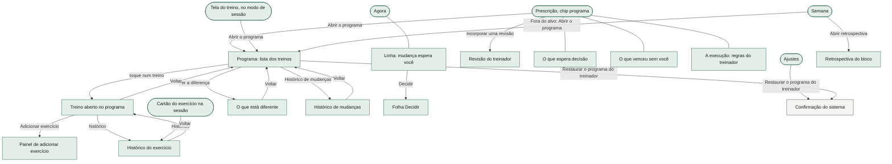

As telas cheias se empilham: o histórico abre por cima do programa, e o Voltar do sistema (ou a seta da tela) fecha a camada de cima e devolve a posição de leitura de onde se veio (mecânica da área 01). Dentro do programa, Voltar num treino aberto, na diferença ou no histórico de mudanças volta à lista; Voltar na lista fecha o programa. A fila, a regra e a porta do programa vivem dentro do chip **programa** da Prescrição; os chips comida, alimentos e semana são da área 06.

## 3. Fluxos, um por funcionalidade

### 3.1 Qual treino vem (a sequência, com a aula fora da ordem)

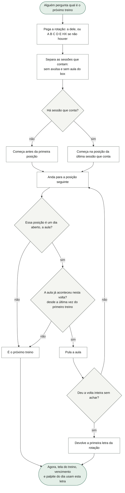

A sequência anda por **sessão registrada**, nunca por dia da semana: ele treina 5 a 6 vezes por semana e a semana fixa quebraria na primeira vez que pulasse um dia. Sessão avulsa (fora do plano) é presença e não move a fila. A aula do box (o dia marcado como aberto, hoje o HX) fica **fora da ordem** por decisão do dono de 14/10: ele vai ao box na quinta ou no sábado, sem dia fixo, e antes uma aula feita com a sequência no C a fazia pular D e E. Agora a aula não move o ponteiro; quando a sequência chega na posição dela, ela é oferecida, a menos que já tenha acontecido "nesta volta" (desde a última vez do primeiro treino da rotação) — aí a volta fecha e o próximo é o A. Se o dia de hoje já tem sessão registrada ou aberta, quem diz a letra de hoje é a sessão, não a rotação; e se hoje é dia de treino ou de descanso é resolvido pela cadência e pelo palpite do dia (áreas 06 e 10). O botão de mudar o dia de hoje e o cabeçalho que mostram essa letra são da área 10.

### 3.2 Abrir o programa e andar entre os quatro modos

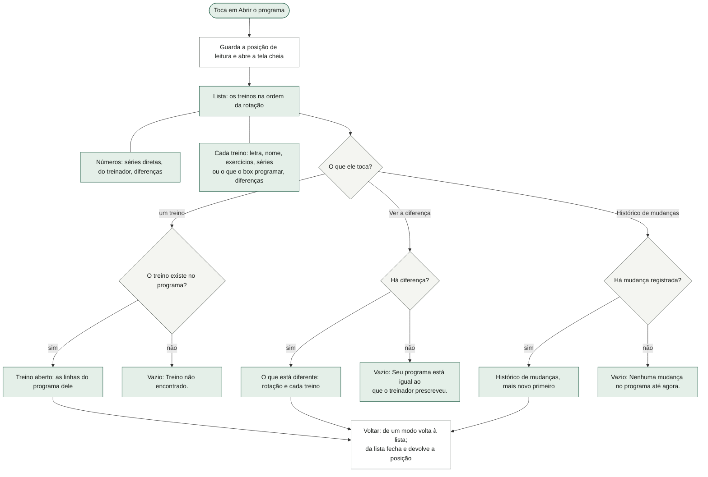

Abaixo dos números a tela diz a frase que a define: "Aqui a mudança é direta: vale a partir do próximo treino. Para mudar só o treino de hoje, use a edição na tela de hoje." As "séries diretas" só somam exercícios com músculo declarado (as estações e movimentos do box não entram); com o programa do código são 90 contra 90. O total "do treinador" é o alvo calculado (3.17). A contagem de diferenças soma as diferenças de cada treino da rotação mais 1 se a rotação mudou. Só aparecem na lista os treinos que estão na rotação. Nada desta tela depende de rede.

### 3.3 Mudar séries, faixa, descanso e ordem no programa

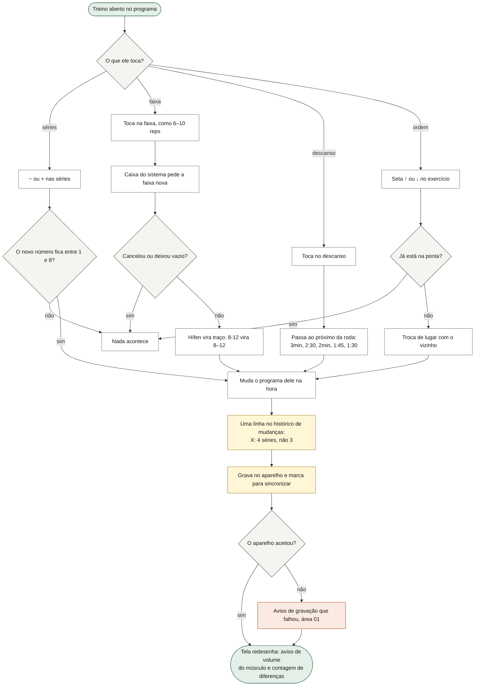

Não há desfazer: para voltar, ele faz a mudança contrária ou usa **restaurar este treino** (3.8). O texto do histórico de mudanças usa a mesma gramática da fila ("o que vale primeiro, e o que era depois"): "X: 4 séries, não 3", "X: 8–12 repetições, não 6–10", "X: descanso de 2min, não 3min", "X: mais cedo no treino". A faixa aceita qualquer texto; um valor que não seja "número–número" deixa o selo de subir carga mudo (ver riscos). Um descanso fora da roda (por exemplo 75 s vindo de uma revisão) vai para 3min no primeiro toque. Se uma sessão daquele treino estiver aberta, a mudança aparece nela na hora, porque a tela da sessão lê o programa ao vivo (a confirmar o efeito sobre as mudanças de hoje já feitas — ver riscos).

### 3.4 Trocar um exercício no programa

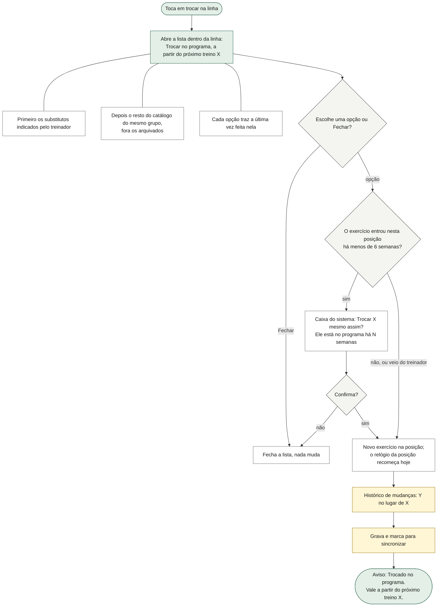

A lista de substitutos é a tabela do treinador (cada exercício do programa tem pelo menos dois substitutos, com uma frase do que muda ao trocar) seguida dos outros exercícios do catálogo com o mesmo grupo muscular — sem essa segunda camada, um exercício cadastrado por ele nunca apareceria. Um exercício que veio do treinador (relógio zero, "desde o começo") nunca pede confirmação: está no programa desde antes de o app existir. A troca no programa não mexe no histórico: o exercício novo tem histórico próprio, e o antigo continua com o dele. Trocar só hoje é outra coisa (edição do dia, área 03).

### 3.5 Remover um exercício do programa

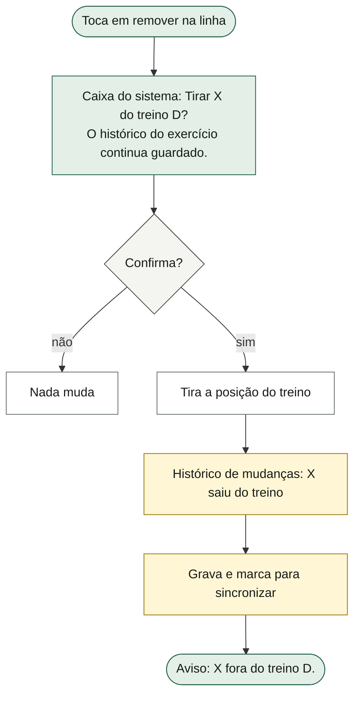

O exercício continua no catálogo e o histórico dele não é tocado; ele pode voltar pelo **Adicionar exercício**. A confirmação é a caixa do sistema (OK/Cancelar), não o painel de pare do resto do app.

### 3.6 Adicionar exercício e cadastrar exercício novo

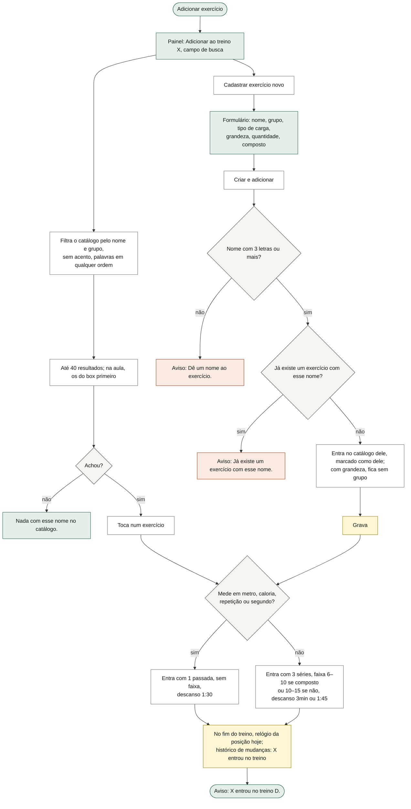

O mesmo painel serve à edição do dia (área 03): lá a adição é só de hoje e vira mudança do dia; aqui, com o programa aberto num treino, é permanente. A busca ignora os arquivados; a linha mostra o grupo (ou "sem grupo"), a grandeza quando há ("1.000 m") e "já está neste treino" quando for o caso; num dia aberto mostra também a referência do box (área 05). O id do exercício novo nasce do nome (sem acento, minúsculo, hífens) e nunca mais muda. Um nome igual ao de um exercício **arquivado** é aceito e reaproveita o id dele — o histórico arquivado volta a ficar visível. A lista de grupos do formulário vem dos grupos que existem hoje na rotação. Não há como apagar, arquivar nem mudar grupo/composto de um exercício depois de criado (só o nome, 3.20, e o tipo de carga, no cartão da área 03).

### 3.7 Mudar a ordem dos treinos e criar treino novo

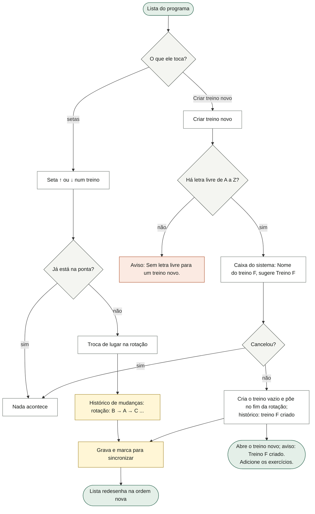

Mudar a ordem dos treinos muda qual vem a seguir já no próximo cálculo (3.1). A "primeira letra livre" é procurada entre as letras que existem no programa; com o programa do código (A, B, C, D, E, HX) a primeira livre é **F** — letra que, no histórico dele, já foi o treino de posteriores e glúteos (ver riscos). Nome vazio vira "Treino F". O treino novo não tem prescrição do treinador; por isso conta como "treino criado por você" na diferença e o restaurar o apaga.

### 3.8 Restaurar um treino e restaurar tudo

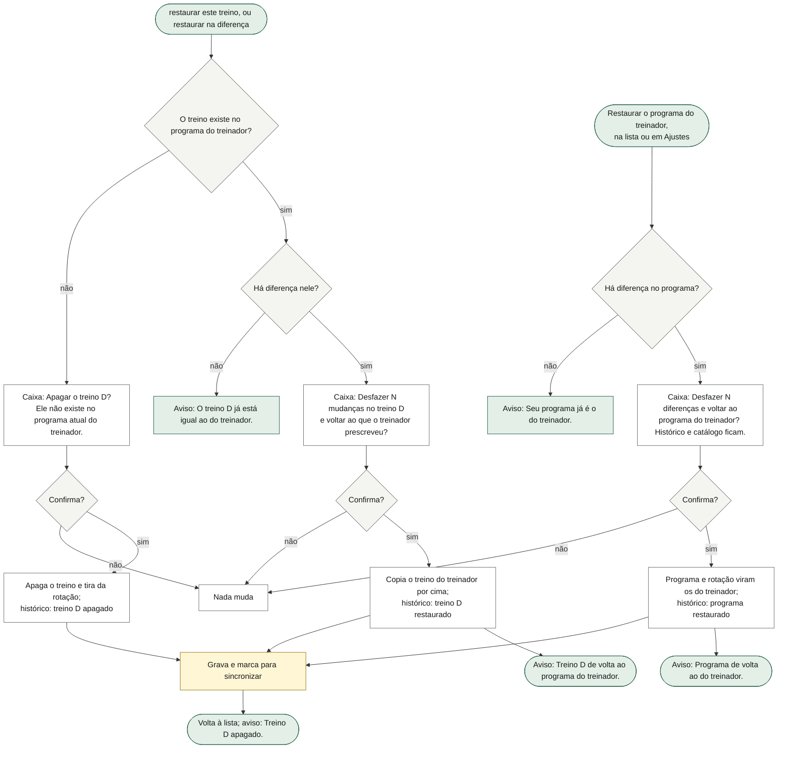

"O programa do treinador" é o do código até uma revisão colada entrar; depois é o da revisão (3.10). Restaurar devolve, portanto, a última revisão, e não o código. Restaurar tudo também apaga os treinos que ele criou e devolve a rotação do treinador. O histórico de séries, as sessões, o catálogo dele e o histórico de mudanças nunca são tocados. As mudanças que esperam decisão na fila **não** são limpas pelo restaurar. Em Ajustes o botão fica ao lado de "Restaurar o plano do nutricionista", que é da área 06.

### 3.9 A diferença para o treinador

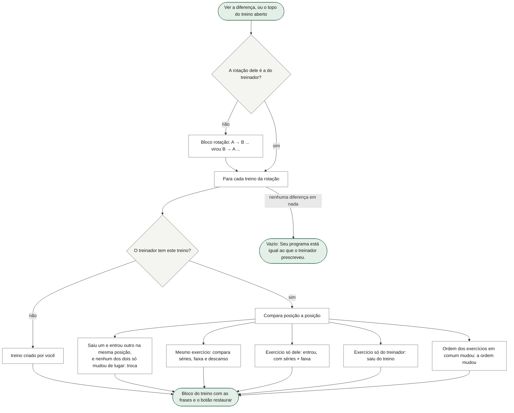

As frases saem na mesma gramática da fila e do histórico de mudanças: "Hack no lugar de Pendulum", "X: 4 séries, não 3", "X: 8–12 repetições, não 6–10", "X: descanso de 2min, não 3min", "X entrou · 3 × 10–15", "X saiu do treino", "a ordem mudou". A mesma lista aparece no topo do treino aberto ("N diferenças do treinador" + **restaurar este treino**) e serve à revisão para dizer quais mudanças dele serão substituídas. O RIR e a grandeza (metro, caloria…) não entram na comparação.

### 3.10 A revisão do treinador: colar, ler e casar os nomes

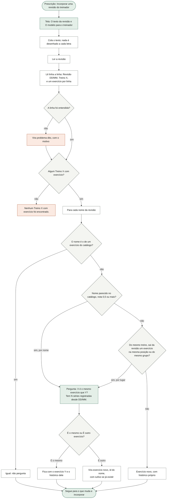

Formato (o modelo que a tela mostra): um bloco por treino, começando com "Treino A · nome" (e "(aberto)" ou "o que o box programar" marca a aula), um exercício por linha começando com "-", "•", "*" ou "1." e os campos separados por "·", "|" ou ";", em qualquer ordem depois do nome. Obrigatório: séries × repetições ("3 x 6-10", "3×8", "3 séries de 8 a 12"). Opcionais: "RIR 1-2", descanso ("3 min", "2:30", "90 s"), um grupo muscular (texto só com letras) e "dica: …". Um treino que aparece duas vezes vira problema. A pergunta existe porque responder errado manda o histórico para o exercício errado (defeito F300, que já aconteceu); por isso a tela diz quantas séries o candidato já tem. A parecença compara palavras (sem acento, sem "de/do/da/no/na/com/e/ou…"), aceita os sinônimos do treinador (hip thrust = elevação pélvica, puxada = pulldown, RDL = terra romeno) e vale pelo menos 0,6 quando um nome está contido no outro ("Flexora sentada" em "Cadeira flexora sentada"). Um exercício do catálogo nunca é proposto para dois nomes; os arquivados não entram na parecença. O texto colado e as respostas vivem só na tela: fechar o app ou a tela perde tudo, e nada foi gravado.

### 3.11 A revisão: o que muda e incorporar

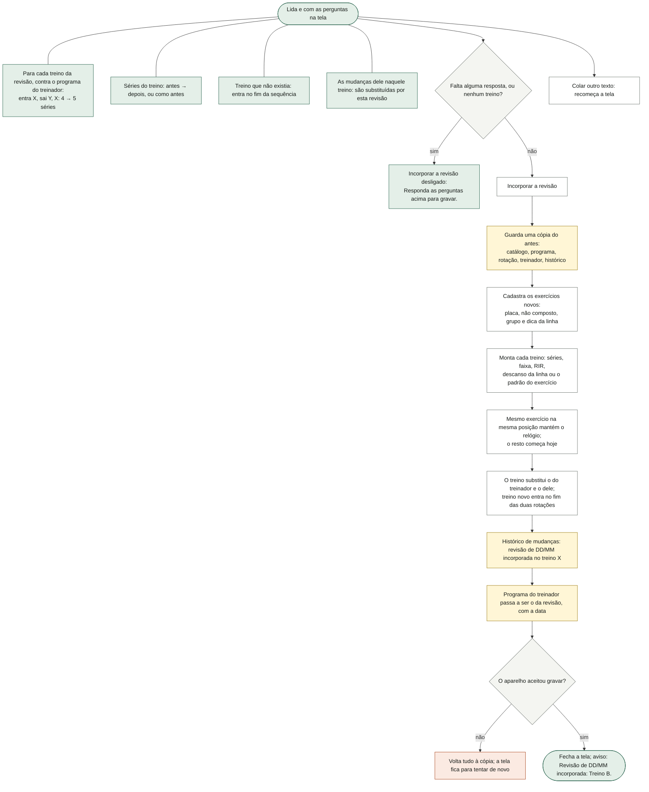

A revisão só toca os treinos que ela traz: os outros ficam como estão no programa dele e no do treinador. Linhas não entendidas **não** bloqueiam a gravação (a tela diz "o que não foi entendido fica de fora: corrija o texto e leia de novo"); um exercício cuja linha falhou aparece como "sai X" no que muda. É a única ação desta área que confere a gravação e desfaz tudo se o aparelho recusar (armazenamento cheio). Depois de incorporada, "igual ao treinador", o alvo de séries e o restaurar passam a ler o programa da revisão. A revisão não limpa a fila de mudanças pendentes daquele treino nem as mudanças de hoje (ver riscos). Funciona sem rede; vai para o outro aparelho na próxima sincronia, como documento inteiro (área 02).

### 3.12 Como uma mudança do dia entra na fila (fim da sessão)

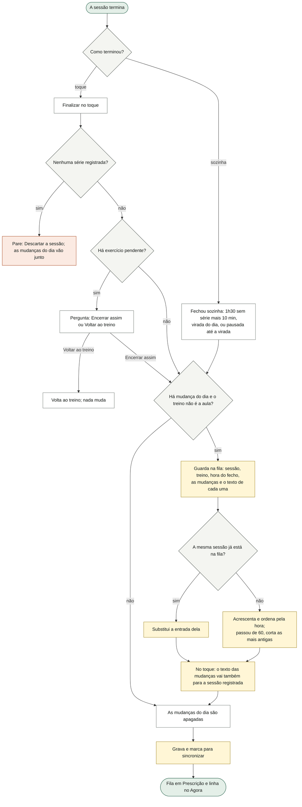

O encerramento em si (pendências, pare, palavras do fecho, duração) é da área 03; aqui está só o **carregador**. A pergunta "isto fica no programa?" saiu do fim do treino (decisão D1): ela interrompia quem acabou de treinar com a pergunta menos urgente do produto. No lugar dela, os dois fechos carregam a mudança para a fila, e é isso que impede que finalizar no toque descarte a mudança em silêncio (defeito F280). A aula não entra na fila: no dia aberto o que foi adicionado É o dia, não emenda a ele. Uma sessão gera no máximo uma entrada, chaveada pela própria sessão; fechar duas vezes atualiza. Observação: no fecho automático o texto das mudanças **não** vai para a sessão registrada (só no toque) — ver riscos. Se o app fechar no meio de uma sessão com mudanças, elas sobrevivem no dado do dia e o fecho automático da abertura seguinte as carrega.

### 3.13 Quando a mudança vence (por posição, não por prazo)

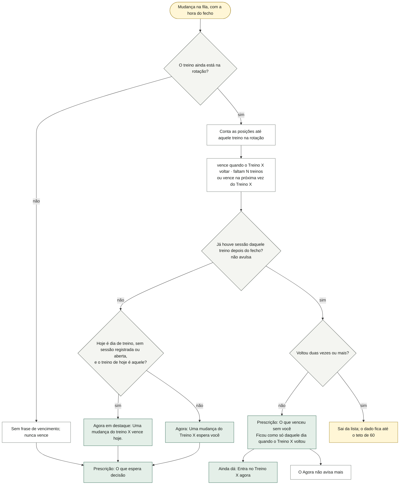

Decisão do dono: a mudança vence **quando aquele treino voltar** na sequência, porque decidir se uma mudança fica se faz quando aquele dia está de novo na frente. Não há campo de vencimento nem relógio: "voltou" é um fato no dado — uma sessão daquele treino registrada depois do fecho. A sessão que criou a mudança não conta (a mudança é copiada depois do início dela) e a avulsa também não. Vencer não grava nada: "fica só naquele dia" é o estado em que a mudança já está, porque nunca entrou no programa. Por isso uma mudança vencida com o app fechado é detectada na abertura seguinte sem esforço. A frase "faltam N treinos" conta as posições pela ordem da rotação, sem datas (a conta em datas existe no domínio mas não é usada — ver riscos). "Hoje é dia de treino" vem da resolução do dia (fato, sessão aberta, escolha manual, cadência — áreas 06 e 10).

### 3.14 Decidir na Prescrição

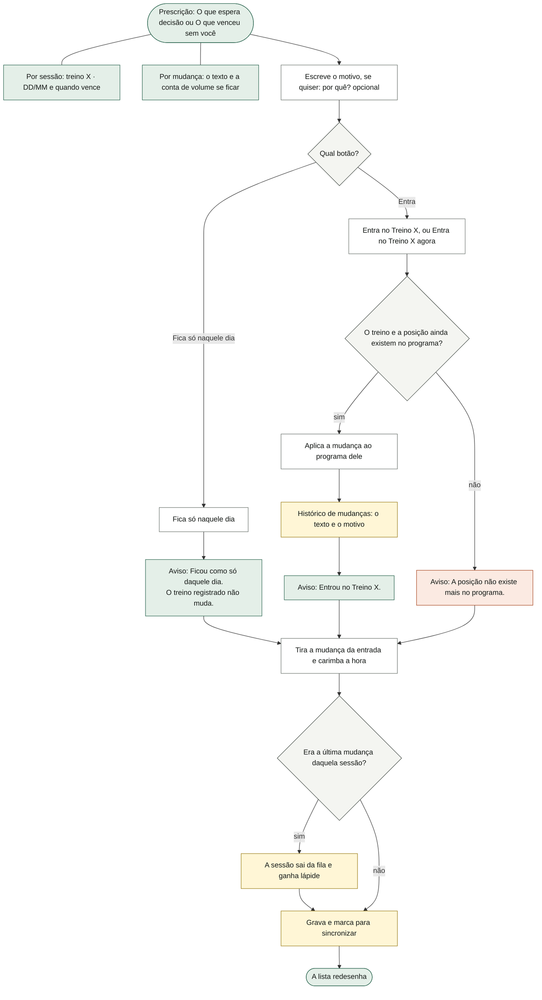

As respostas são **por mudança**, não por sessão: uma sessão pode ter subido uma série de lateral (que ele quer manter) e trocado o agachamento porque a máquina estava ocupada (que não quer). As duas respostas têm o mesmo tamanho, sem resposta padrão. Aplicar no programa: série, faixa e descanso trocam o número; troca põe o novo exercício e recomeça o relógio da posição; remover tira a posição; mover põe na posição de destino; adicionar põe **no fim** do treino com o relógio de hoje. "Fica só naquele dia" não desfaz nada: a sessão continua como foi registrada; o que se decide é o programa. A lápide da sessão resolvida impede o outro aparelho de trazer a pergunta de volta (área 02). No bloco "O que venceu sem você" só existe a resposta "entra … agora": "só daquele dia" já é o que aconteceu. Quando a fila está vazia, a tela diz "Nenhuma mudança esperando decisão.", "a última mudança que entrou no programa foi em DD/MM" (a data mais recente do histórico de mudanças, qualquer que seja a origem) e "O que você mudar num treino aparece aqui depois que a sessão fechar." O motivo vive só na tela até o toque: fechar o app perde o texto.

### 3.15 Decidir pelo Agora (a linha e a folha)

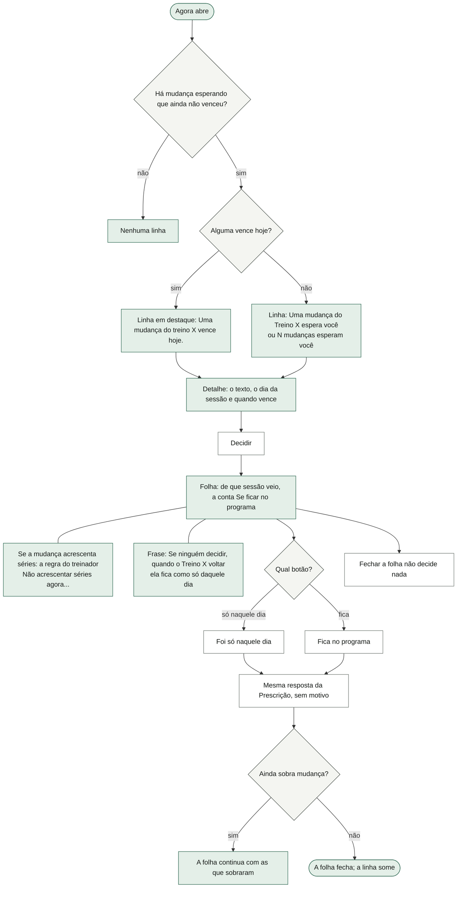

O lugar da linha no Agora (abaixo do cartão de cima, nunca disputando o topo) é da área 10; a leitura e o verbo são os desta área, os mesmos da Prescrição. O Agora não avisa o que já venceu: isso é dito só em Prescrição. Os rótulos dos botões na folha ("Foi só naquele dia" / "Fica no programa") diferem dos da Prescrição ("Fica só naquele dia" / "Entra no Treino X"), e a folha não tem campo de motivo (ver riscos). A regra das séries a mais é a do treinador ("Não acrescente séries agora"), condensada.

### 3.16 As regras de execução na Prescrição

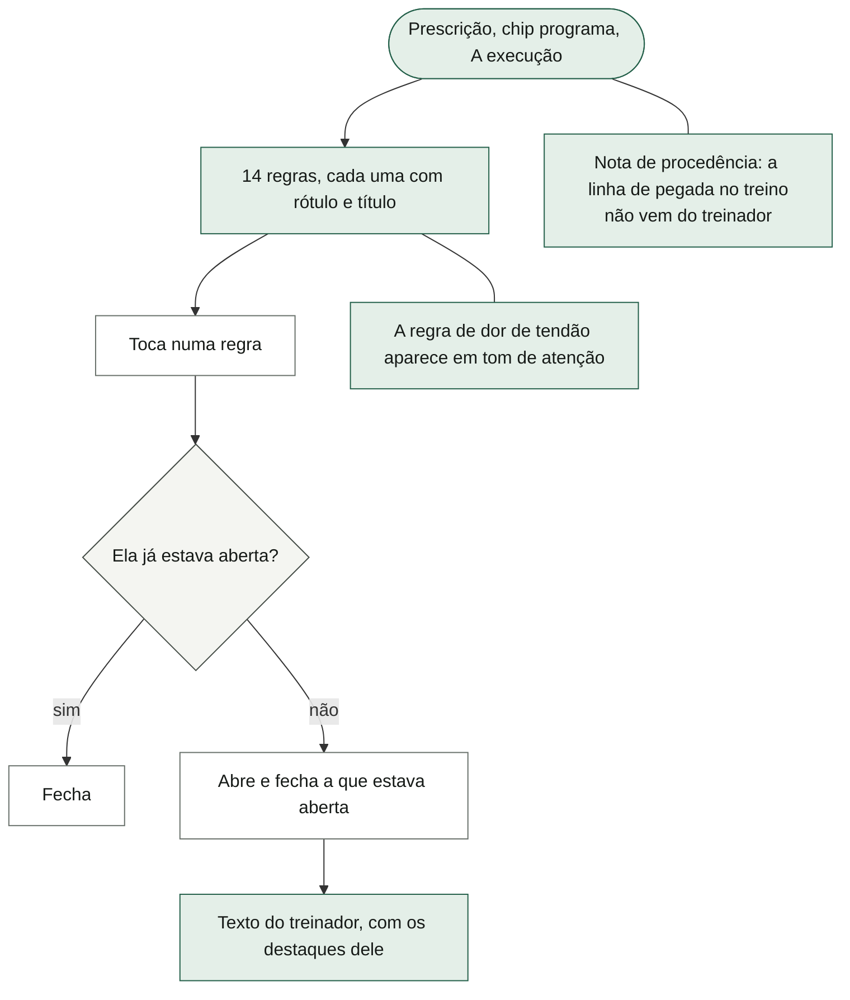

As regras são texto fixo do código, na voz do treinador, e não mudam com a revisão colada (a revisão só traz treinos). A pegada mostrada no cartão do exercício é referência de execução levantada por duas revisões independentes, não do treinador, e por isso mora em campo próprio e a procedência é dita uma vez aqui. Só uma regra fica aberta por vez; a escolha vive na tela e volta ao fechado ao sair. O bloco "O alvo por tipo de dia", logo acima, é da área 06.

### 3.17 Volume e alvo por músculo

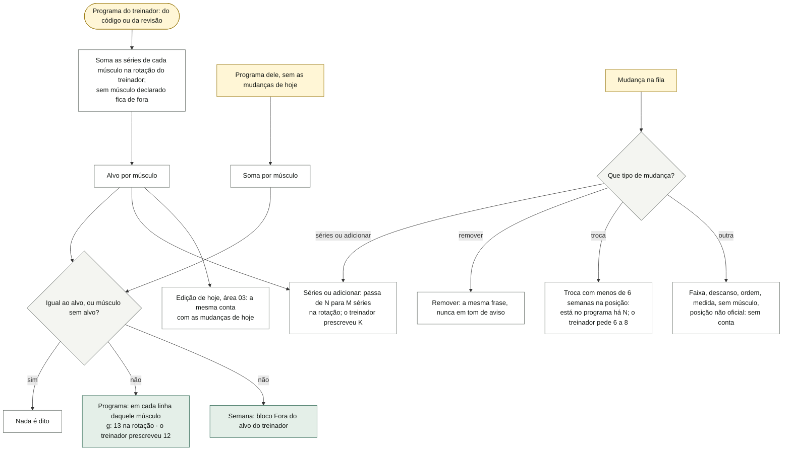

O alvo é **calculado** do programa do treinador, nunca transcrito — transcrever criaria uma segunda verdade que sai de sincronia na primeira mudança. Com o programa do código: peito superior 10, delt lateral 12, dorsal 10, panturrilha 10, posterior 7, tríceps 6, bíceps 6, abdômen 6, costas espessura 6, quadríceps 5, glúteo 3, delt posterior 3, delt anterior 2, peito 2, adutores 2 — 90 no total. A conta é de **séries diretas**: tríceps também trabalha no supino e a tela diz isso. As estações e movimentos do box não têm músculo de propósito, para o painel não contar burpee como série de peito. A frase diz "na rotação" e não "na semana", porque a rotação só é uma semana quando ele fecha todas em sete dias. A conta de uma mudança na fila é a do programa **depois** de ela entrar, que é o que se decide. O painel de séries registradas por músculo na semana, a média das 4 semanas e a "leitura da semana" (inversões e priorizados abaixo da média) são da área 09; esta área só fornece o alvo e o bloco "fora do alvo".

### 3.18 Histórico de um exercício

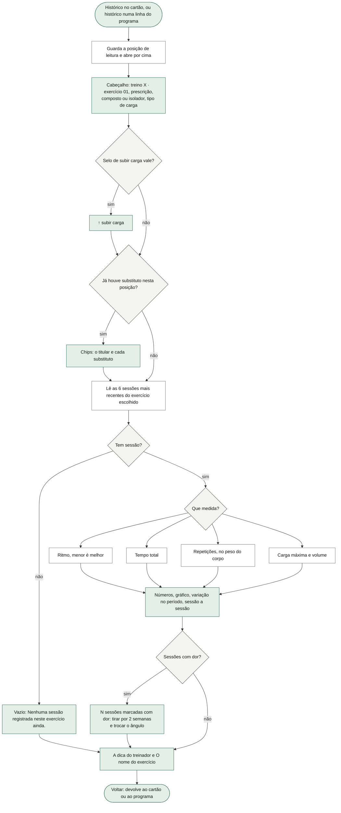

O histórico é indexado pelo **exercício**, nunca pela posição: inserir, mover ou trocar não desloca o histórico de ninguém, e o substituto tem histórico próprio. Os chips de substitutos aparecem quando há registros feitos naquela posição com outro exercício. A medida vem do registro antes de vir do catálogo (o catálogo muda, o que foi feito não). Seis sessões é o que cabe na largura do iPhone sem virar linha ilegível. A variação de cada sessão e a do período não ganham cor favorável ("o app não comemora"). A sessão aberta não entra na própria referência. A porta do programa existe porque, com a aba de treino fora, o cartão só existe dentro do modo de sessão, e corrigir uma série de três semanas atrás não é tarefa de quem está treinando.

### 3.19 Corrigir ou apagar uma sessão pelo histórico

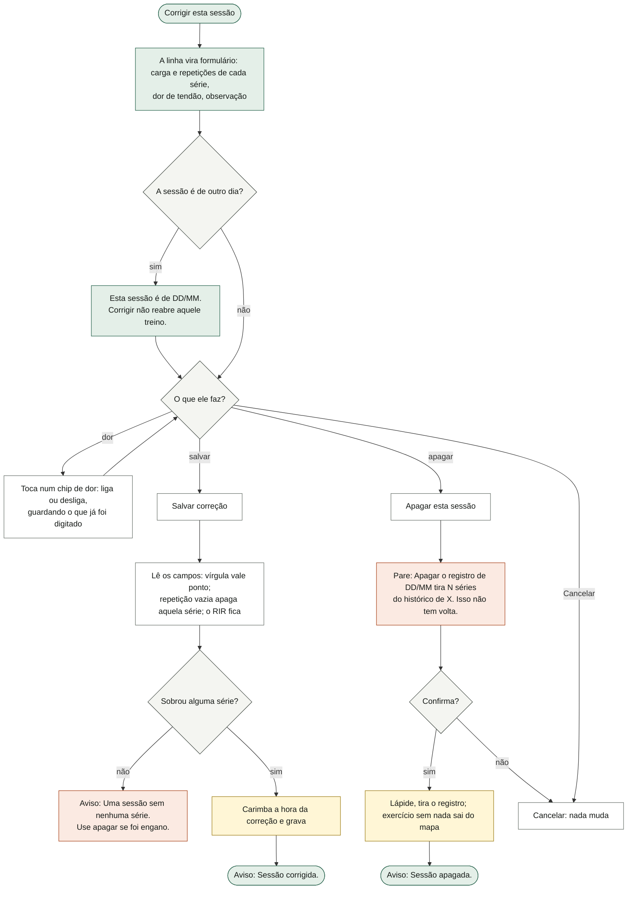

O que se corrige é o registro daquele exercício naquele dia (todas as séries dele), não a sessão inteira; a presença da sessão no calendário não muda. O carimbo de correção é o que a fusão usa para decidir que esta versão vence a do outro aparelho; a lápide impede que o outro aparelho ressuscite o registro apagado (área 02). Só as 6 sessões que a tela mostra podem ser corrigidas por aqui; a correção no lugar da sessão passada, sem limite, é da área 11. Corrigir não reabre aquele treino nem mexe na fila ou no programa.

### 3.20 Renomear um exercício

```mermaid
flowchart TD
  N1(["O nome do exercício, no fim do histórico"])
  N2["Digita o nome novo e toca Salvar,<br/>ou Voltar ao nome do treinador"]
  D1{"Três letras ou mais?"}
  N3["Aviso: O nome precisa de três letras ou mais."]
  D2{"Outro exercício não arquivado já tem esse nome?"}
  N4["Aviso: Já existe um exercício com esse nome."]
  D3{"É o nome que o código dá a ele?"}
  N5["Tira o nome trocado do catálogo dele"]
  N6["Grava o nome novo no mesmo exercício"]
  N7["Remonta o catálogo e grava"]
  N8(["Aviso: Nome do treinador de volta."])
  N9(["Aviso: Nome trocado."])

  N1 --> N2 --> D1
  D1 -->|"não"| N3
  D1 -->|"sim"| D2
  D2 -->|"sim"| N4
  D2 -->|"não"| D3
  D3 -->|"sim"| N5 --> N7 --> N8
  D3 -->|"não"| N6 --> N7
  N7 --> N9

  classDef tela fill:#E4EFE8,stroke:#24604A,color:#161A17
  classDef acao fill:#FFFFFF,stroke:#69716B,color:#161A17
  classDef dado fill:#FFF6D6,stroke:#9A7A12,color:#161A17
  classDef erro fill:#FBEAE2,stroke:#A63F17,color:#161A17
  classDef decisao fill:#F4F5F1,stroke:#434B45,color:#161A17
  class N1,N2,N8,N9 tela
  class N5,N6 acao
  class N7 dado
  class N3,N4 erro
  class D1,D2,D3 decisao
```

Renomear troca só o rótulo. A identidade é o id, que nasceu do nome uma vez e nunca mais muda: histórico, posição no programa, foto do aparelho e tipo de carga continuam no mesmo lugar. Recalcular o id pelo nome novo criaria um exercício vazio e deixaria o passado órfão — o erro que a migração 2→3 existiu para consertar. O botão "Voltar a …" só aparece quando o nome do código foi sobrescrito. O nome aparece trocado em todo lugar (troca, busca, programa, fila, revisão).

### 3.21 O selo de subir carga, a pausa e a dor seguida (progressão)

```mermaid
flowchart TD
  U1(["Cartão do exercício ou histórico é desenhado"])
  D1{"O movimento mede em metro, caloria,<br/>repetição ou segundo?"}
  D2{"Último registro deste exercício há 14 dias ou mais?"}
  D3{"A última sessão tem pelo menos as séries prescritas?"}
  D4{"Todas bateram o topo da faixa, com carga acima de zero?"}
  U2["↑ subir carga"]
  U3["Sem selo"]
  U4["Cartão: N dias sem este exercício"]
  U5["Tela do treino: N dias desde o último treino salvo,<br/>o selo fica suspenso nesta volta"]
  D5{"No cartão: deload ligado ou exercício substituto?"}
  D6{"A mesma dor nas duas últimas sessões?"}
  U6["Cartão para a régua até escolher:<br/>substituir, pular ou fazer mesmo assim, área 03"]

  U1 --> D1
  D1 -->|"sim"| U3
  D1 -->|"não"| D2
  D2 -->|"sim"| U4 --> U3
  D2 -->|"não"| D3
  D3 -->|"não"| U3
  D3 -->|"sim"| D4
  D4 -->|"não"| U3
  D4 -->|"sim"| D5
  D5 -->|"sim"| U3
  D5 -->|"não"| U2
  U1 --> D6
  D6 -->|"sim"| U6
  U1 --- U5

  classDef tela fill:#E4EFE8,stroke:#24604A,color:#161A17
  classDef acao fill:#FFFFFF,stroke:#69716B,color:#161A17
  classDef decisao fill:#F4F5F1,stroke:#434B45,color:#161A17
  class U1,U2,U4,U5,U6 tela
  class U3 acao
  class D1,D2,D3,D4,D5,D6 decisao
```

É a regra 2 do treinador, dupla progressão: sobe repetição mantendo a carga até todas as séries baterem o topo da faixa, e só então sobe a carga no menor incremento e recomeça perto da parte baixa. O app existe em boa parte para **frear**: músculo fica forte mais rápido do que tendão consegue se adaptar. Voltando de pausa longa (14 dias ou mais sem aquele exercício) repetir a última carga já é o trabalho da volta, e o selo some; o aviso de pausa no cartão não aparece quando há dor repetida nem em substituto. Exercício com grandeza própria (corrida, sled, remo) não ganha selo: o que melhora é o relógio. A dor repetida, o deload (metade das séries, arredondando para cima, mesma carga) e o desenho do cartão são da área 03; aqui estão as regras. O selo do histórico não confere o deload (ver riscos). A estimativa de força (e1RM por Epley) que alimenta a regra calórica é da área 09; as funções por exercício que existem para o histórico não são usadas hoje.

### 3.22 A retrospectiva do bloco

```mermaid
flowchart TD
  T1(["Semana: A retrospectiva do bloco"])
  T2["Ciclo: sessões ÷ treinos da rotação + 1;<br/>a rotação tem N treinos por volta"]
  T3["Abrir retrospectiva"]
  T4["Início do bloco: a sessão que abre o bloco atual<br/>de 48 sessões sem deload"]
  T5["Para cada treino da rotação e cada exercício do programa"]
  T6["Registros do exercício desde o início do bloco;<br/>soma volume e conta as dores"]
  D1{"Dois registros ou mais?"}
  T7["Compara o primeiro e o último:<br/>carga máxima, tempo ou ritmo"]
  D2{"Melhorou na direção da unidade?"}
  T8["O que evoluiu, ordenado pelo ganho, até 8"]
  D3{"Igual, com 3 sessões ou mais?"}
  T9["Os parados no bloco"]
  T10["Tela: N sessões em X semanas, treinos por semana,<br/>volume acumulado, exercícios que subiram"]
  D4{"Nada em nenhuma lista?"}
  T11["Vazio: Ainda não há sessões suficientes neste bloco"]
  T12["A dor no bloco e as sessões em deload"]
  T13(["Fechar ou Voltar"])

  T1 --- T2
  T1 --> T3 --> T4 --> T5 --> T6 --> D1
  D1 -->|"não"| T10
  D1 -->|"sim"| T7 --> D2
  D2 -->|"sim"| T8 --> T10
  D2 -->|"não"| D3
  D3 -->|"sim"| T9 --> T10
  D3 -->|"não"| T10
  T10 --> D4
  D4 -->|"sim"| T11 --> T12
  D4 -->|"não"| T12
  T12 --> T13

  classDef tela fill:#E4EFE8,stroke:#24604A,color:#161A17
  classDef acao fill:#FFFFFF,stroke:#69716B,color:#161A17
  classDef decisao fill:#F4F5F1,stroke:#434B45,color:#161A17
  class T1,T2,T8,T9,T10,T11,T12,T13 tela
  class T3,T4,T5,T6,T7 acao
  class D1,D2,D3,D4 decisao
```

48 sessões de trabalho é o ciclo do programa; o bloco não obriga deload ("deload por evidência, não por calendário"), é o momento de olhar. "Os parados" não é acusação, e a tela diz isso: carga igual pode ser exatamente o certo. A tela não tem ação nenhuma além de fechar. Sem nenhuma sessão, ela abre com o bloco começando em 1969 ("0 sessões em 2962,1 semanas"), defeito já gravado em teste. Também conta em dobro o exercício que está em dois dias e ignora substitutos (ver riscos). A contagem "faltam N sessões para fechar o bloco" que aparece na tela do treino é da área 03, com a mesma conta de 48.

### 3.23 O catálogo de exercícios: de onde vem cada exercício

```mermaid
flowchart TD
  X1(["Um id de exercício"])
  X2["Catálogo do código: os 36 do programa, as 9 estações da prova,<br/>17 movimentos do box, 17 que saíram do programa,<br/>e todos os substitutos: 182 no total"]
  X3["Por cima, o catálogo dele: nomes trocados,<br/>exercícios cadastrados, os da revisão, os arquivados"]
  X4["Catálogo efetivo"]
  D1{"O id existe nele?"}
  X5["Exercício com nome, grupo, tipo de carga,<br/>composto, dica, pegada e grandeza"]
  X6["Fantasma: o próprio id como nome, sem grupo;<br/>a tela não quebra e o histórico aparece"]
  D2{"Arquivado?"}
  X7["Fora da troca, da adição, da busca<br/>e da parecença da revisão"]
  X8["Aparece na troca, na adição e na busca"]
  X9["A posição no programa decide séries, faixa, descanso,<br/>RIR e a grandeza do dia; o tipo de carga corrigido vence"]

  X1 --> D1
  X2 --> X4
  X3 --> X4
  X4 --> D1
  D1 -->|"sim"| X5 --> D2
  D1 -->|"não"| X6
  D2 -->|"sim"| X7
  D2 -->|"não"| X8
  X5 --> X9

  classDef tela fill:#E4EFE8,stroke:#24604A,color:#161A17
  classDef acao fill:#FFFFFF,stroke:#69716B,color:#161A17
  classDef dado fill:#FFF6D6,stroke:#9A7A12,color:#161A17
  classDef decisao fill:#F4F5F1,stroke:#434B45,color:#161A17
  class X5,X6,X7,X8 tela
  class X4,X9 acao
  class X1,X2,X3 dado
  class D1,D2 decisao
```

O catálogo do código é montado uma vez: primeiro os exercícios do programa, depois as estações da prova e os movimentos do box (sem músculo, com grandeza e quantidade padrão), depois os que saíram do programa mas têm meses de histórico (marcados como substitutos, não arquivados, porque vários continuam sendo o substituto indicado), e por fim os substitutos da tabela do treinador, que herdam grupo e tipo de carga de quem substituem. A pegada (53 exercícios) entra por nome, por último. O catálogo dele vem por cima, campo a campo, e é remontado sempre que muda. Os **arquivados** nasceram na migração 2→3: histórico do programa de 2025 que não tinha mais para onde ir. O **fantasma** é o que acontece com um id que não está em lugar nenhum (por exemplo, dado vindo de outro aparelho com versão nova do código): a tela mostra o id cru em vez de quebrar.

## 4. Estados da tela

| estado | quando acontece | o que a tela mostra |
|---|---|---|
| Programa: lista igual ao treinador | Nenhuma diferença | Números "90 · 90 · 0"; "Seu programa está igual ao que o treinador prescreveu." |
| Programa: lista com diferenças | Qualquer mudança dele ou rotação diferente | Terceiro número em âmbar; cada treino diz "· N diferenças"; texto "N diferenças em relação ao que ele prescreveu." |
| Programa: treino aberto, igual | Treino sem diferença | Só as linhas e **Adicionar exercício**. |
| Programa: treino aberto com diferença | Treino diverge do treinador | Bloco "N diferenças do treinador" com as frases e **restaurar este treino**. |
| Programa: treino não encontrado | Letra que não existe mais | "Treino não encontrado." |
| Programa: aula do box | Dia aberto | Meta "o que o box programar", sem conta de séries. |
| Programa: dia só de estações | Exercícios todos sem músculo | Meta "N estações". |
| Programa: músculo fora do alvo | Soma do músculo ≠ alvo | Em cada linha do músculo: "g: N na rotação · o treinador prescreveu M", em âmbar quando acima. |
| Programa: lista de troca aberta | Toque em **trocar** | Opções dentro da linha e **Fechar**. |
| Programa: painel de adicionar | **Adicionar exercício** | Busca, resultados (até 40), "Nada com esse nome no catálogo." quando vazio, **Cadastrar exercício novo**. |
| Programa: formulário de exercício novo | **Cadastrar exercício novo** | Nome, grupo, tipo de carga, grandeza, quantidade, composto, **Criar e adicionar**. |
| Diferença: vazia | Sem diferenças | "Seu programa está igual ao que o treinador prescreveu." |
| Histórico de mudanças: vazio | Nenhuma mudança registrada | "Nenhuma mudança no programa até agora." |
| Revisão: colar | Acabou de abrir ou **Colar outro texto** | Campo de texto, **Ler a revisão**, o modelo. |
| Revisão: lida sem treino | Texto sem "Treino X" com exercício | "Nenhum Treino X com exercício foi encontrado no texto." e **Incorporar** desligado. |
| Revisão: com problemas | Linhas não entendidas | "Uma linha não foi entendida" / "N linhas…", cada uma com o motivo. |
| Revisão: perguntando | Nomes com candidato | "Antes de gravar, uma pergunta por nome"; **Incorporar** desligado com "Responda as perguntas acima para gravar." |
| Revisão: pronta | Todas respondidas | O que muda por treino, mudanças dele substituídas, exercícios novos, **Incorporar a revisão** ligado. |
| Revisão: aparelho recusou | Armazenamento cheio ao gravar | Tudo volta; a tela fica; aviso de gravação da área 01. |
| Fila: vazia | Nada esperando nem vencido | "Nenhuma mudança esperando decisão.", data da última que entrou (se houver) e a explicação. |
| Fila: esperando | Mudanças não vencidas | "O que espera decisão" com nota "N sessões", cada mudança com os dois botões e o campo de motivo. |
| Fila: venceu sem você | Treino voltou uma vez | "O que venceu sem você", a frase do vencimento, o prazo e **Entra no Treino X agora**. |
| Agora: linha informativa | Algo esperando, nada vencendo hoje | "Uma mudança do Treino D espera você" + **Decidir**. |
| Agora: linha urgente | Vence hoje | "Uma mudança do treino D vence hoje." em destaque. |
| Folha Decidir | **Decidir** | Uma seção por sessão (com a origem quando há mais de uma), conta, regra das séries, botões e a frase "Se ninguém decidir…". |
| Histórico: vazio | Exercício sem registro | "Nenhuma sessão registrada neste exercício ainda. O gráfico aparece depois do primeiro treino salvo." e o renome. |
| Histórico: com sessões | 1 a 6 sessões | Números, gráfico, legenda, sessão a sessão (mais nova primeiro). |
| Histórico: com substitutos | Registros de substitutos nesta posição | Chips do titular e de cada substituto; marca "substituto" quando é o escolhido. |
| Histórico: com dor | Alguma das 6 com dor | Bloco âmbar "N sessões marcadas com dor" e a regra das 2 semanas. |
| Histórico: corrigindo | **Corrigir esta sessão** | Campos da sessão, "Esta sessão é de DD/MM…" se de outro dia, botões de salvar, cancelar e apagar. |
| Histórico: selo | Regra de progressão vale | "↑ subir carga" no topo. |
| Retrospectiva: com dados | Exercícios com 2+ registros no bloco | "O que evoluiu" e/ou "Os parados no bloco". |
| Retrospectiva: vazia | Menos de 2 registros por exercício | "Ainda não há sessões suficientes neste bloco para comparar começo e fim…" |
| Retrospectiva: sem sessão nenhuma | Instalação nova | Título "0 sessões em 2962,1 semanas" com o bloco em 31/12/1969 (defeito). |

## 5. Dados

### O que esta área guarda

| campo | formato | quem escreve | quem mais lê |
|---|---|---|---|
| `S.prog` | Mapa letra → treino: `{ name, tag, aberto?: 1, ex: [ { id, s, r, d, rir?, u?, q?, desde, bi? } ] }`. `s` séries, `r` faixa ("6–10"), `d` descanso em segundos, `rir` alvo ("1–2"), `u`/`q` grandeza e quantidade do dia, `desde` quando o exercício entrou naquela posição (0 = veio do treinador), `bi` bi-set com o seguinte. | Tela do programa, revisão, respostas da fila, migrações; semeado do código no primeiro uso. | Área 03 (o treino de hoje = programa + mudanças do dia), 05 (dia aberto), 09 (painel de músculos), 10 (cartão e palpite), 11 (letras do calendário, lançamento retroativo). |
| `S.rot` | Lista de letras, como `['A','B','C','D','E','HX']`. | Mudar a ordem, criar treino, restaurar, revisão. | Todas que perguntam qual treino vem; a 09 (ciclo), a 11. |
| `S.ex` | Mapa id → campos parciais do exercício: `{ n?, g?, car?, c?, cue?, u?, q?, meu?: 1, arq?: 1 }`. Renome guarda só `n`; cadastrado tem tudo e `meu: 1`; da revisão tem tudo sem `meu`; arquivado tem `arq: 1`. | Cadastrar, renomear, revisão, migração 2→3. | Todas as áreas que mostram nome de exercício (03, 05, 09, 11). |
| `S.progLog` | Lista `{ t, day, txt, motivo?, m? }`, até 300 (os mais antigos saem). `day` é a letra, ou "-" no restaurar tudo. | Toda ação da tela do programa, respostas "entra", revisão. | Só esta área (histórico de mudanças, "a última que entrou"). Vai na cópia de segurança (área 01). |
| `S.progTreinador` | `{ em, data, rot, dias }` ou `null`. `dias` tem a forma de `S.prog`. `null` = vale o do código. | Só a revisão. | Só esta área (alvo, diferença, restaurar). |
| `S.promoPendente` | Lista ordenada pelo fecho, até 60: `{ sid, day, t, mods, resumoMods, m }`. `mods` são as mudanças do dia (troca, séries, faixa, descanso, remover, mover, medida, adicionar), `resumoMods` o texto de cada uma. Era um objeto só até o plano 10 (migração converteu). | Fim de sessão (área 03 chama o carregador desta área) e respostas. | Área 10 (linha do Agora e folha). |

Nada desta área fica fora do estado: não há cache próprio nem chave local. O que é só de tela (`view.prog`, `view.revisao`, `view.hist`, `view.edit`, `view.retro`, o motivo digitado, a regra aberta) se perde ao fechar o app, e nada disso é dado.

### O que só lê de outras áreas

- `S.logs` (histórico por exercício, área 03): histórico, progressão, retrospectiva, "tem N séries registradas" da revisão, substitutos usados numa posição, "última vez" na troca. A correção e o apagar pelo histórico **escrevem** nele (3.19).
- `S.done` (sessões, área 03/11): sequência, vencimento, retrospectiva, ciclo.
- `S.mods` (mudanças de hoje, área 03): o treino de hoje e o carregador da fila.
- `S.sessao` (sessão aberta, área 03): exclui a sessão aberta da própria referência; "hoje já tem sessão".
- `S.deload` (área 03): o selo some no cartão; metade das séries.
- `S.carga` (tipo de carga corrigido, área 03): marca do histórico e unidade.
- `S.fotos` (foto do aparelho, área 03): miniatura nas opções de troca.
- `S.cadencia` e o dia de comida (áreas 06 e 10): se hoje é dia de treino, para "vence hoje".

### Como atravessa a sincronia (área 02)

- `S.prog`, `S.rot`, `S.progTreinador`: **documentos**. Vêm inteiros do lado com o carimbo de estado (`mtime`) mais novo. O carimbo muda a cada gravação de qualquer coisa (inclusive cada série), então quem gravou por último em qualquer área leva o programa inteiro — editar o programa num aparelho e treinar no outro antes de sincronizar perde a edição (ver riscos).
- `S.ex`: **mapa por exercício**. União das chaves; em conflito na mesma chave, vence o lado com `mtime` mais novo. Nada é apagado, então não há lápide.
- `S.progLog`: **coleção** com chave `prog:<t>:<dia>` e carimbo `m`; só cresce; teto 300 nos dois lados.
- `S.promoPendente`: **coleção** com chave `promo:<sid>` (a sessão), carimbo `m` atualizado a cada resposta, **lápide** quando a última mudança da sessão é respondida, teto 60. A chave é a sessão e não o dia porque o dia é editável no meio do treino. A mesma sessão fechada nos dois aparelhos vira uma pergunta só.
- Registro corrigido pelo histórico: carimbo `m` no registro; apagado: lápide com a chave do registro.

## 6. Regras

1. **O programa do treinador** é congelado no código: seis treinos na rotação A B C D E HX, domingo de descanso. A 20 séries, B 22, C 17, D 17, E 14, HX nenhuma (aberto: "o que o box programar") = **90 séries diretas** por rotação. O E é curto de propósito porque no dia seguinte tem HYROX. Origem: treinador (revisão de setembro de 2026).
2. Quando uma revisão colada entra, ela passa a ser o "programa do treinador" para o alvo, a diferença e o restaurar (decisão do dono, 14/10). Sem revisão, vale o do código.
3. **O programa dele** nasce cópia do treinador com o relógio de todas as posições em 0 e diverge conforme ele decide. Se o estado chegar sem programa ou sem rotação (backup antigo, aparelho novo), ele é semeado de novo e a rotação volta a A B C D E HX.
4. Editar na tela do programa muda o oficial **na hora** e vale a partir do próximo treino; editar no treino de hoje é só do dia e vai para a fila (área 03). A tela repete essa distinção.
5. Séries: de **1 a 8**, no programa e no dia.
6. Descanso, pelas categorias do treinador: grande composto **3 min (180 s)**, máquina multiarticular **2:30 (150 s)**, intermediário **2 min (120 s)**, isolador **1:45 (105 s)**, curto **1:30 (90 s)**. O critério real é o desempenho, o cronômetro é lembrete.
7. Ao adicionar: musculação entra com **3 séries**, faixa **6–10** se composto ou **10–15** se não, descanso 3 min (composto) ou 1:45; movimento com grandeza entra com **1 passada**, sem faixa, descanso 1:30, com a quantidade padrão do catálogo.
8. **Regra das 6 a 8 semanas** (regra 5 do treinador): trocar no programa um exercício que entrou na posição há **menos de 6 semanas** pede confirmação; exercício que veio do treinador (relógio 0) nunca pede. Na fila, a troca só mostra o freio dentro das 6 semanas. Semanas = dias desde a entrada ÷ 7, para baixo; "menos de 1 semana" abaixo de 7 dias.
9. Troca no programa (pela tela, pela fila ou pela revisão com exercício diferente na posição) recomeça o relógio da posição.
10. **Alvo por músculo** = soma das séries de cada grupo na rotação do treinador; exercício sem grupo fica fora. Comparação "igual ao treinador" e "acima" (âmbar) quando passa; remoção nunca pinta aviso, mesmo terminando acima.
11. **Hierarquia muscular** (treinador, setembro de 2026): máxima — peito superior, delt lateral; secundária — dorsal, panturrilha, posterior, glúteo; direcionada — delt anterior (trabalho direto em volume controlado, não entra em "priorizado"); ponto forte — quadríceps; estímulo indireto basta — trapézio, tibial; o resto é normal. Usada para ordenar o painel (área 09).
12. **Diferença**: troca é "saiu um e entrou outro na mesma posição, sem que um dos dois só tenha mudado de lugar"; ordem se compara só entre os exercícios em comum; rotação diferente conta 1 diferença.
13. Restaurar um treino que o treinador não tem **apaga** o treino e o tira da rotação. Restaurar tudo devolve programa e rotação do treinador; histórico, sessões, catálogo e histórico de mudanças ficam.
14. Criar treino: a primeira letra de **A a Z** que não está no programa; nome padrão "Treino X"; entra vazio no fim da rotação.
15. **Revisão, leitura**: séries × repetições obrigatório; RIR, descanso ("N min", "m:ss", "N s"), grupo e "dica:" opcionais, em qualquer ordem; o que não se entende vira problema dito, nunca chute; treino repetido é problema.
16. **Revisão, casar nomes**: nome que dá o mesmo id de um exercício do catálogo é o mesmo, sem pergunta; senão, candidato por nome com parecença **≥ 0,5** (palavras em comum ÷ total; contido vale pelo menos 0,6); senão, candidato por lugar (mesma posição no mesmo treino, ou mesmo grupo); senão, novo. Um exercício nunca é candidato de dois nomes; arquivados fora da parecença. Origem: F263 e F300.
17. **Revisão, gravação**: exercícios novos com id do nome (sufixo -2, -3… se já existir), tipo de carga placa, não composto, grupo e dica da linha; descanso ausente vira o padrão do exercício (isolador 1:45 para os novos); o relógio da posição só se mantém se o mesmo exercício estava na mesma posição; o treino da revisão substitui inteiro o do treinador e o dele; treino novo entra no fim das duas rotações; recusa do aparelho desfaz tudo.
18. **Fila, nascimento**: nos dois fechos (toque e automático), quando há mudança do dia e o treino **não** é a aula; uma entrada por sessão (chave = a sessão), ordenada pela hora do fecho, até **60**. Sessão descartada (sem série) não deixa mudança.
19. **Vencimento por posição** (decisão do dono, "quando aquele treino voltar"): venceu quando existe sessão daquele treino, não avulsa, registrada depois do fecho. "Faltam N treinos" = posições pela ordem da rotação até aquele treino; 0 = "a próxima sessão". **Vence hoje** quando hoje é dia de treino, ainda não há sessão registrada nem aberta, e o treino de hoje é aquele.
20. Venceu: fica como só daquele dia (sem gravar nada) e ainda pode entrar até a próxima vez daquele treino; voltou **duas vezes**, a linha sai da lista (decisão 8). O Agora só avisa o que ainda não venceu.
21. Resposta é por mudança; motivo opcional vai ao histórico de mudanças; a última resposta de uma sessão deixa lápide.
22. **Dupla progressão** (regra 2 do treinador): selo "subir carga" quando a última sessão do exercício tem pelo menos as séries prescritas e **todas** bateram o topo da faixa com carga acima de zero.
23. **Pausa longa**: 14 dias ou mais desde o último registro do exercício suspende o selo; o cartão diz "N dias sem este exercício" (exceto com dor repetida ou em substituto).
24. Sem selo: movimento com grandeza, deload ligado (no cartão), exercício substituto (no cartão e no histórico só o titular).
25. **Dor seguida**: a mesma dor (cotovelo, ombro anterior, patelar) nas duas últimas sessões do exercício; a regra do treinador manda tirar o exercício por **2 semanas** e trocar o ângulo. O freio na régua é da área 03.
26. **Deload**: metade das séries arredondando para cima, mesma carga (regra do treinador: 5 a 7 dias, 50 a 60% das séries, 3 a 4 na reserva, por evidência).
27. **Bloco**: 48 sessões de trabalho (sem deload) é o ciclo; a retrospectiva começa na sessão que abre o bloco atual. Evoluiu = carga máxima final maior que a inicial (ou ritmo menor, ou tempo maior); parado = igual com 3 sessões ou mais; mostra até 8 que evoluíram, ordenados pelo ganho. Ciclo = sessões registradas ÷ treinos da rotação, para baixo, + 1.
28. **Histórico do exercício**: as **6** sessões mais recentes; métrica pelo tipo — ritmo (menor é melhor) em metro/caloria com ritmo, tempo sob tensão em segundo/repetição, repetições no peso do corpo, volume (carga × repetições) no resto.
29. **Renomear**: 3 letras ou mais; nome não pode repetir o de outro exercício não arquivado (sem diferenciar maiúscula); voltar ao nome do código apaga a troca. O id nunca muda.
30. **Cadastrar**: nome com 3 letras ou mais; recusa se já existe exercício não arquivado com o mesmo id; com grandeza, fica sem grupo muscular.
31. **Histórico de mudanças**: até 300 linhas.
32. **Regras de execução**: 14 textos do treinador (regra 1 RIR, regra 2 dupla progressão, regra 3 excêntrica, regra 4 descanso, regra 5 6 a 8 semanas, volume "não acrescente séries agora — 90 por semana", HYROX, fadiga — 2 a 3 sessões de queda, dor > 72 h, sessões > 90 min —, atenção — dor de tendão —, aquecimento — 3 a 4 aproximações —, deload, bike 2× por semana, prioridades, sucesso).
33. **Ids estáveis**: o id é o nome sem acento, minúsculo, com hífens; nasce uma vez e é a chave do histórico, da foto, do tipo de carga e da posição.

## 7. Ligações com as outras áreas

| área | o que esta recebe dela | o que esta entrega a ela |
|---|---|---|
| 01 · Fundação | Gravar, aviso de gravação que falhou, painel de pare, camadas de tela cheia e Voltar, posição de leitura, migrações (2→3 arquivados, 4→5 troca de letras D/E, 8→9 revisão do B, 9→10 fila vira lista), cópia de segurança e importação. | Os campos `prog`, `rot`, `ex`, `progLog`, `progTreinador`, `promoPendente` para normalizar, exportar e importar; a semente do programa. |
| 02 · Sincronia | A fusão: documentos, mapa do catálogo, coleções com lápide e teto. | As chaves naturais da fila e do histórico de mudanças; a lápide da pergunta resolvida e do registro apagado. |
| 03 · Sessão de treino | As mudanças do dia (`S.mods`), o fim da sessão que chama o carregador, o histórico de séries, o deload, o tipo de carga, a foto do aparelho. | O treino como deve ser executado (programa resolvido contra o catálogo), o próximo treino, a lista de substitutos, o texto de cada mudança, a conta de impacto, o selo de subir carga, a pausa, a dor seguida, o painel de adicionar e cadastrar, o histórico do exercício. |
| 05 · Aula do box | — | A marca de dia aberto, os movimentos do box e as estações no catálogo, a ordem de busca do box; a aula fica fora da sequência e fora da fila. |
| 06 · Comida | A cadência da semana e a escolha manual do dia (para "vence hoje"); o chip programa convive com os chips de comida na Prescrição. | A letra do treino de hoje, via resolução do dia. |
| 09 · Semana | Mostra o bloco "Fora do alvo do treinador" e o cartão da retrospectiva. | O alvo por músculo, a hierarquia, o impacto oficial, a retrospectiva e o ciclo; a contagem por músculo usa o grupo do catálogo. |
| 10 · Agora | O lugar da linha e da folha. | A leitura da fila para a linha ("espera você" / "vence hoje") e o verbo de decidir; o próximo treino. |
| 11 · Dias | O detalhe da sessão mostra as mudanças do dia registradas nela; correção no lugar. | Nome dos exercícios e letra/nome dos treinos; o texto das mudanças gravado na sessão (só no fecho no toque). |

## 8. Como serviço individual

**Nome:** Programa de Treino (com o Catálogo de Exercícios como módulo que pode virar serviço próprio, porque quase todas as áreas o consultam).

**O que possui:** o programa dele, a rotação, o programa do treinador (código + revisão), o catálogo dele por cima do catálogo do código, o histórico de mudanças, a fila de mudanças que esperam decisão. Lê (não possui) o histórico de séries e as sessões, que são do serviço de Sessão.

**Operações (API):**

| verbo | recebe | devolve |
|---|---|---|
| `GET /programa` | — | treinos, rotação, totais (séries diretas, alvo, diferenças) |
| `GET /programa/treinos/{letra}` | letra; opcional "com as mudanças de hoje" | treino resolvido contra o catálogo |
| `PATCH /programa/treinos/{letra}/posicoes/{i}` | séries, faixa ou descanso | posição nova + linha do histórico de mudanças |
| `POST /programa/treinos/{letra}/posicoes/{i}/mover` | direção | ordem nova |
| `POST /programa/treinos/{letra}/posicoes/{i}/trocar` | id do exercício novo, confirmação das 6 semanas | posição nova ou "precisa confirmar: N semanas" |
| `DELETE /programa/treinos/{letra}/posicoes/{i}` | — | treino sem a posição |
| `POST /programa/treinos/{letra}/posicoes` | id do exercício | posição criada com os padrões |
| `POST /programa/treinos` | nome | letra criada |
| `PUT /programa/rotacao` | ordem | rotação nova |
| `POST /programa/treinos/{letra}/restaurar` e `POST /programa/restaurar` | — | número de diferenças desfeitas |
| `GET /programa/diferenca` | — | blocos de diferença |
| `GET /programa/mudancas` | — | histórico de mudanças |
| `GET /programa/proximo` | sessões registradas (ou evento) | letra do próximo treino |
| `POST /revisoes/leitura` | texto | treinos lidos, problemas, correspondências propostas |
| `POST /revisoes` | texto + respostas | o que mudou; falha atômica |
| `GET /fila` | — | entradas com vencimento, venceu, conta de volume |
| `POST /fila/{sessao}/mudancas/{i}` | permanente sim/não, motivo | resultado ("entrou", "posição não existe", "só daquele dia") |
| `GET /catalogo?busca=` | texto, dia | exercícios (sem arquivados) |
| `GET /catalogo/{id}/substitutos` | id | indicados + mesmo grupo |
| `POST /catalogo` | nome, grupo, carga, grandeza, quantidade, composto | id |
| `PATCH /catalogo/{id}/nome` | nome | nome efetivo |
| `GET /alvo` | — | séries por músculo do treinador |
| `GET /impacto` | mudança | frase de antes e depois, ou nada |
| `GET /progressao/{id}` | — | selo, pausa, dor seguida |
| `GET /retrospectiva` | — | bloco, evoluídos, parados, dores |

**Eventos que emitiria:** `ProgramaMudou` (letra, texto, motivo), `RotacaoMudou`, `RevisaoIncorporada` (data, treinos), `MudancaEnfileirada` (sessão, treino), `MudancaRespondida` (sessão, índice, permanente), `ExercicioCadastrado`, `ExercicioRenomeado`.

**Eventos que escutaria:** `SessaoEncerrada` (sessão, letra, mudanças do dia, modo de fecho) — para enfileirar; `SessaoRegistrada` / `SessaoApagada` — para o próximo treino e o vencimento; `SerieRegistrada` / `RegistroCorrigido` — para progressão e retrospectiva; `DeloadMudou`.

**O que hoje está acoplado e precisaria ser separado:**
- O "treino como aparece" mistura programa, mudanças do dia e catálogo numa função só, usada por quase todas as áreas; separar exige um contrato "programa resolvido" e outro "mudanças do dia por cima".
- O catálogo efetivo é uma variável global remontada à mão depois de cada mudança do catálogo.
- O carregador da fila e o texto das mudanças são chamados de dentro do fim de sessão (área 03); viraria o evento `SessaoEncerrada`.
- A aplicação de uma mudança ao programa (`aplicaAoOficial`) conhece a forma das mudanças do dia da área 03.
- Histórico, progressão e retrospectiva leem `S.logs` e `S.done` diretamente; a correção pelo histórico escreve neles — essa escrita pertence ao serviço de Sessão.
- O "dia em foco" da tela (`view.day`) é compartilhado entre a sessão e o histórico aberto pela Prescrição.
- Confirmações por caixa do sistema (`confirm`/`prompt`) dentro das ações; o serviço precisaria devolver "precisa confirmar" e deixar a pergunta para a interface.
- O programa é documento na fusão: como serviço próprio, ganharia carimbo próprio (independente do `mtime` do estado inteiro), o que resolve a perda descrita nos riscos.

## 9. Riscos e dívidas que apareceram na leitura

1. **Bug — a troca aceita primeiro faz perder a mudança de séries do mesmo exercício.** No mesmo treino de hoje, troque o exercício X por Y e mude as séries dessa posição; encerre. Na fila, toque **Entra no Treino A** na troca e depois na de séries: a segunda responde "A posição não existe mais no programa." e some. A mudança de séries procura a posição pelo exercício original, que a troca já tirou. Na ordem inversa funciona.
2. **Bug — o histórico aberto pelo programa pode ser de outro exercício.** Com mudança de hoje no Treino A (por exemplo, remover ou mover o 1º exercício na edição do dia), abra Prescrição › Abrir o programa › Treino A › **histórico** na 2ª linha: a tela lê a posição no treino de hoje (com as mudanças), não no programa, e mostra outro exercício.
3. **A confirmar — abrir o histórico pela Prescrição muda o "dia em foco" do app** e não o devolve ao fechar. Com sessão do A aberta, abrir o histórico de uma linha do C deixa a tela do treino apontando para o C até algo reposicionar.
4. **Criar treino novo reaproveita a letra F** (o teste até espera isso), e o próprio código diz que F já significou o treino de posteriores e glúteos no histórico dele e que reaproveitar a letra mistura o calendário. Nenhuma migração renomeou as sessões antigas com F. O mesmo vale para "Treino F" vindo de uma revisão e para apagar e recriar um treino.
5. **Retrospectiva conta em dobro** o exercício que está em dois dias da rotação (elevação lateral na máquina e no cabo em A e D, as duas panturrilhas em B e D, a extensão de tríceps acima da cabeça em A e E): linha repetida em "O que evoluiu" e volume acumulado em dobro.
6. **Retrospectiva só lê os exercícios do programa atual** (e um formato de chave antigo `id~nome`): substitutos, exercícios que saíram do programa no meio do bloco e movimentos da aula não aparecem.
7. **Retrospectiva sem sessão**: "0 sessões em 2962,1 semanas" a partir de 31/12/1969 (já gravado como defeito em `tests/fluxo/retro.test.js`).
8. **Início do bloco** conta sessões avulsas e retroativas (só exclui deload), enquanto as "48 sessões de trabalho" da tela do treino excluem avulsas: os dois blocos podem não coincidir. "N sessões" no título conta também deload e avulsa.
9. **O fecho automático não grava na sessão o que mudou no dia** (só o fecho no toque grava); o detalhe da sessão (área 11) fica sem as mudanças justamente no caminho mais comum (16 das 35 sessões fecharam sozinhas, segundo o código).
10. **"Entra no treino" de uma mudança de adicionar** põe sempre no fim (ignora a posição), sem grandeza/quantidade e sem RIR; uma mudança de **medida** sempre responde "A posição não existe mais no programa" (não é tratada). O registro no histórico de mudanças também é escrito para mudanças que não foram aplicadas, se várias vierem juntas (hoje vem uma por vez).
11. **"Faltam N treinos" conta a posição da aula** mesmo quando ela já aconteceu na volta ou será pulada; a conta pode dizer um treino a mais.
12. **Código sem chamador**: a conta de vencimento em datas (`quandoAquelaVolta`, testada) e as funções de força por exercício (`melhorE1rm`, `e1rmPorSemana`, importada e não usada); `CTX.abreHistorico` é apelido morto (já anotado em `tests/fluxo/portas.test.js`).
13. **O selo de subir carga não confere o RIR planejado**, embora a regra 2 do treinador exija "o RIR planejado" e a migração 5→6 diga que o RIR por série existe para isso. Faixa de um número só ("10", possível pela revisão ou digitação) nunca dá selo; a faixa digitada não tem validação.
14. **O selo no histórico aparece em deload** (o cartão esconde). O RIR por série (terceiro número) não aparece no histórico; só o RIR antigo por sessão, que a migração esvaziou.
15. **Correção pelo histórico só alcança as 6 sessões mais recentes**; mais antigas, só pela área 11.
16. **Confirmações por caixa do sistema** (remover, trocar com menos de 6 semanas, restaurar, criar treino, faixa) — o resto do app usa o painel de pare e a pergunta com botões nomeados. **Falso sucesso**: as edições do programa e as respostas da fila mostram aviso de sucesso mesmo se a gravação falhar; só a revisão confere e desfaz.
17. **Revisão grava mesmo com linhas não entendidas**; um exercício com a linha errada "sai" do treino e um treino com todas as linhas erradas fica vazio (dito na tela como "sai X", mas gravável).
18. **Revisão ignora grupo e dica para exercício que já existe**; o exercício novo nasce como placa e isolador (descanso 1:45 sem descanso na linha) e sem a marca de "cadastrado por ele". O relógio das 6 a 8 semanas recomeça para exercício que apenas mudou de posição.
19. **Revisão e restaurar não mexem na fila**: mudanças pendentes do treino substituído continuam e podem ser aplicadas sobre o programa novo. **A confirmar**: editar o programa ou incorporar revisão com sessão aberta daquele treino muda a sessão na hora; mudanças de hoje ficam com o "de" desatualizado ou deixam de casar com a posição.
20. **Sincronia — o programa é documento inteiro pelo carimbo do estado**: editar o programa no notebook e registrar uma série no iPhone antes de sincronizar faz a edição sumir, enquanto o histórico de mudanças (coleção) continua dizendo que ela aconteceu.
21. **Sincronia — fila respondida em dois aparelhos**: responder mudanças diferentes da mesma sessão em cada aparelho faz o lado de carimbo mais novo trazer de volta a mudança que o outro já tinha aplicado; responder "entra" de novo aplica duas vezes (num adicionar, duplica o exercício).
22. **Rótulos diferentes para a mesma resposta**: Prescrição "Fica só naquele dia" / "Entra no Treino X"; folha do Agora "Foi só naquele dia" / "Fica no programa"; a folha não tem motivo. Chaves de lista pelo texto da mudança (duas mudanças iguais na mesma sessão colidem no desenho).
23. **Histórico de mudanças** mostra "treino - · …" na linha de "programa restaurado". "A última mudança que entrou" usa qualquer linha do histórico (inclusive mover a rotação), não só as que vieram da fila.
24. **Fila de treino que saiu da rotação** (treino apagado): sem frase de vencimento e nunca vence; fica até sair pelo teto de 60. Linhas que "fecharam" (voltou duas vezes) também ficam no dado até o teto.
25. **Catálogo**: não há como apagar ou arquivar exercício cadastrado nem corrigir grupo/composto; a lista de grupos do formulário só tem os grupos presentes na rotação (não dá para cadastrar trapézio, tibial, glúteo médio) e pode incluir um grupo vazio.
26. **A confirmar — "Colar outro texto"** reabre a revisão como destino novo e sobrescreve a posição de leitura guardada da Prescrição.

## 10. Índice técnico

### Arquivos

| arquivo | papel |
|---|---|
| `src/dominio/programa.ts` | Programa do treinador (`PROGRAMA`, `ROT_BASE`, descansos), regras (`RULES`), substitutos (`ALT`), egressos (`LEGADO`), estações e box, pegada, catálogo do código (`EX_BASE`), hierarquia, regiões, tipos de carga, dores, semente do programa, catálogo efetivo e fantasma. |
| `src/dominio/dia.ts` | Rotação, última do plano, **próximo treino** (aula fora da ordem), cadência prevista e resolução do dia (esta parte é das áreas 06/10). |
| `src/dominio/prescricao.ts` | Vencimento por posição (`venceuPorPosicao`, `quandoAquelaVolta` sem chamador). |
| `src/dominio/revisao.ts` | Ler a revisão, parecença, casar nomes, o que muda, modelo. |
| `src/dominio/volume.ts` | Alvo, séries por grupo, impacto, impacto de uma mudança; contagem registrada e leitura da semana (consumidas pela 09). |
| `src/dominio/progressao.ts` | Histórico sem a sessão aberta, última série, pausa, dor seguida, selo, deload. |
| `src/dominio/forca.ts` | e1RM por Epley; a parte por exercício (`melhorE1rm`, `e1rmPorSemana`) sem uso; a tendência é da 09. |
| `src/dominio/tipos.ts` | `Exercicio`, `Slot`, `SlotResolvido`, `Treino`, `Mod`, `EntradaProgLog`, `PromoPendente`, campos do `Estado`. |
| `src/ui/telas/programa.jsx` | Tela do programa: `Lista`, `Dia`, `Diff`, `Hist`. |
| `src/ui/telas/revisao.jsx` | Tela da revisão: `Colar`, `Lida`. |
| `src/ui/telas/historico.jsx` | Histórico do exercício: `Renome`, `Sessao`, `Edicao`. |
| `src/ui/telas/retrospectiva.jsx` | Retrospectiva do bloco. |
| `src/ui/telas/prescricao.jsx` | Chip programa: porta do programa e da revisão, fila, venceu, regras (`Regra`). |
| `src/ui/folhas/decidir.jsx` | Folha Decidir do Agora (compartilhada com a 10). |
| `src/ui/instrumento/edicao.jsx` | `LinhaEditavel`, `Troca`, `AddEx` (compartilhados com a 03). |
| `src/ui/telas/semana.jsx` | Bloco "Fora do alvo" e cartão da retrospectiva (tela da 09). |
| `src/ui/telas/ajustes.jsx` | Botão "Restaurar o programa do treinador" (tela da 01). |
| `src/dominio/migracoes.ts` | `migraPlano` (1→2), `migraPlano3` (arquivados), `migraPlano5` (letras D/E), `migraPlano9` (revisão do B), `listaDePromo` e `migraPlano10` (fila vira lista). |
| `src/dominio/sincronia.ts` | `chaveDePromo`, `chaveDeProgLog`, `funde` (documentos, `uneMapa` do catálogo, coleções). |

### Funções de `src/main.jsx` (linhas do commit 8ec19a4)

- Programa e catálogo: `rot` 134, `diaAberto` 205, `montaCatalogo` 248, `exDe` 249, `nomeEx` 250, `nomeDoCodigo` 253, `renomeiaExercicio` 270, `treino` 302, `garanteProgramaERotacao` 1168, `ultimaDoPlano` 1506, `nextDay` 1512, `id` 1515.
- Fila: `guardaPromo` 722, `soltaPromo` 746; carregador dentro de `fechaSessao` 772 e `finalizarSessao` 1034; resumo na sessão em `encerraDeVerdade` 1091.
- Substitutos e histórico: `altOf` 1583, `logKey` 1596, `altList` 1601, `variantsOf` 1624, `ultimoDe` 1633, `historico` 1112, `opcaoDeTroca` 2094, `chartSVG` 1734, `textoDaSerie` 1685, `fmtLast` 1694.
- Progressão: `setsFor` 1640, `pausaGeral` 1642, `sessoesDeTrabalho` 1643, `pausaEx` 1665, `dorSeguida` 1667, `lastSet` 1668, `lastOf` 1669, `cargaTipo` 1670, `isCorpo` 1674, `shouldUp` 1675; uso em `vmExercicio` 1898 (campos `up`, `pausaTxt`).
- Volume: `semanasDe` 2618, `baseTreinador` 2627, `rotTreinador` 2630, `alvo` 2634, `alvoTotal` 2641, `seriesDe` 2644, `impactoSeries` 2646, `impactoDoMod` 3095, `seriesOficiais` 3112, `semanasNoPrograma` 3121, `impactoOficial` 3276, `seriesPorMusculo` 4152.
- Adicionar e cadastrar: `slotOriginal` 2752, `descansoPadrao` 2779, `abrirAddEx` 2942, `fecharAddEx` 2943, `setBuscaDeExercicio` 2952, `buscaEx` 2954, `addExercicio` 2962, `abrirNovoEx` 2992, `criarExercicioCom` 3005, `criarExercicio` 3031, `catalogoDeAdicao` 9655, `gruposDoPlano` 3829.
- Mudanças e aplicação: `textoMod` 3061, `MOTIVOS` (≈3081), `aplicaAoOficial` 3149.
- Tela do programa: `difDoDia` 3187, `difTotal` 3233, `seriesDoDia` 3243, `estacoesDoDia` 3248, `metaDoDia` 3253, `totalSeries` 3263, `abrirPrograma` 3267, `fecharPrograma` 3272, `modoPrograma` 3273, `programaLista` 9765, `programaDia` 9794, `trocaDoPrograma` 9827, `programaDiff` 9849, `programaHist` 9865.
- Ações do programa: `logProg` 3451, `progSeries` 3457, `moverProg` 3467, `progRemove` 3477, `progTroca` 3487, `progSetTroca` 3489, `progReps` 3504, `progDesc` 3516, `moverDia` 3526, `criarTreino` 3537, `restaurarDia` 3554, `restaurarTudo` 3574.
- Revisão: `catalogoParaRevisao` 3316, `seriesDoExercicio` 3323, `idsDaRevisao` 3332.
- Histórico e correção: `openHist` 3586, `editarSessao` 3591, `cancelarEdicao` 3592, `editDor` 3594, `guardaEdicaoCom` 3613, `guardaCamposEdicao` 3632, `salvarEdicao` 3642, `apagarSessao` 3656, `histKey` 3675, `closeHist` 3676.
- Retrospectiva: `inicioDoBloco` 6167, `retro` 6174, `abrirRetro` 6228, `fecharRetro` 6229.
- Vencimento: `fraseDoVencimento` 9400; `REGRA_DAS_SERIES` (≈10866); `diaResolvido` 2278 (da 10, usado aqui).

### Pontos de entrada `CTX.*`

`abreRevisao` 3294, `fechaRevisao` 3298, `textoDaRevisao` 3300, `leRevisao` 3301, `respondeRevisao` 3309, `modeloDaRevisao` 3314, `revisao` 3354, `incorporaRevisao` 3398, `abrePrograma` 7440, `abreHistorico` 7441 (morto), `guia` 7770 (campo `regras`; `alvos` é da 06), `restauraPrograma` 7795, `musculos` 7968 (campo `fora`; o resto é da 09), `abreRetro` 8598, `renomeiaExercicio` 9104, `historico` 9106, `fechaHist` 9249, `histKey` 9250, `editaLinha` 9251, `cancelaEdicao` 9252, `salvaEdicao` 9253, `apagaLinha` 9254, `editDor` 9255, `limpaNum` 9256, `respondeMudanca` 9300, `ultimaQueEntrou` 9329, `mudancasQueEsperam` 9336, `retrospectiva` 9409, `fechaRetro` 9464, `acoesAdd` 9744 (compartilhado com a 03), `programa` 9757, `acoesPrograma` 9884, `acoesProg` 9898, `decisaoNoAgora` 10875, `abreDecisao` 10909, `decideNoAgora` 10911, `esperandoDecisao` 10916 (os quatro com a 10), `abreHistoricoDaPrescricao` 11280, `cicloDoBloco` 11357. Uso de `acoes.openHist` no cartão: `CTX.acoesEx` 7433 (da 03).

### Componentes

`Programa`, `Revisao`, `Historico`, `Retrospectiva`, `Prescricao` (parte do chip programa), `FolhaDecidir`, `LinhaEditavel`, `Troca`, `AddEx`.

### Regras do domínio

- `programa.ts`: `ExercicioPrescrito`, `Substituto`, `Regra`, `Nivel`, `Carga`, `ROT_BASE`, `D_COMPOSTO` (e `D_MAQUINA`, `D_MEDIO`, `D_ISOLADOR`, `D_CURTO`), `PROGRAMA`, `RULES`, `ALT`, `LEGADO`, `slugEx`, `SIMULACAO_HYROX`, `MOVIMENTOS_DE_BOX`, `FREQUENTES_NO_BOX`, `EX_BASE`, `PRIORIDADES`, `NIVEIS`, `REGIOES`, `regiaoDe`, `ordemDe`, `ehPriorizado`, `nivelDe`, `PRIO`, `CARGAS`, `DORES`, `MODAIS`, `semeiaProg`, `montaCatalogo`, `exercicioFantasma`. (Os movimentos do box e `FREQUENTES_NO_BOX` são usados pela 05; `CARGAS` pela 03; `MODAIS` pelo cardio.)
- `dia.ts`: `rotacao`, `ultimaDoPlano`, `proximoTreino`.
- `prescricao.ts`: `HORIZONTE_PADRAO`, `quandoAquelaVolta`, `SessaoRegistrada`, `venceuPorPosicao`.
- `revisao.ts`: `ExDaRevisao`, `DiaDaRevisao`, `LeituraDaRevisao`, `lerRevisao`, `parecenca`, `Correspondencia`, `ExDoCatalogo`, `casaNomes`, `MudancaDoDia`, `mudancasDaRevisao`, `MODELO_DA_REVISAO`.
- `volume.ts`: `alvoDoPrograma`, `seriesDeGrupo`, `Impacto`, `impacto`, `ContextoDoImpacto`, `impactoDoMod` (`seriesPorMusculo`, `Leitura`, `Hierarquia`, `leituraDaSemana` ficam com a 09).
- `progressao.ts`: `PAUSA_DIAS`, `diasDesde`, `historico`, `lastSet`, `pausaEx`, `dorSeguida`, `shouldUp`, `setsFor`.
- `forca.ts` (por exercício): `e1rmDaSerie`, `e1rmDoLog`, `melhorE1rm`, `e1rmPorSemana`.
- `migracoes.ts`: `listaDePromo`, `migraPlano10`, `ARQUIVO`, `PLANO_1`, `ROT_PLANO_3`, `PROGRAMA_PLANO_3`, `TROCA_4_5`, `trocaLetra`, `REVISAO_B_PLANO_8`.
- `sincronia.ts`: `chaveDePromo`, `chaveDeProgLog`.
- `carga.ts` (usado): `topReps`, `temUnidade`, `unidadeDe`, `maxLoad`, `volOf`, `repsOf`, `tutOf`, `ritmoDe`.
- `formato.ts` (usado): `semanasDesde`, `fmtDesc`, `casaBusca`.

### Campos `S.*` e `view.*`

- Possui: `S.prog`, `S.rot`, `S.ex`, `S.progLog`, `S.progTreinador`, `S.promoPendente`.
- Lê: `S.logs` (e escreve na correção), `S.done`, `S.mods`, `S.sessao`, `S.deload`, `S.carga`, `S.fotos`, `S.cadencia`, `S.dia`, `S.apagados` (lápides), `S.mtime`.
- Tela: `view.prog` (`{ day, modo: 'lista' | 'diff' | 'historico' }`), `view.revisao` (`{ texto, lida, casa, respostas }`), `view.hist` (`{ day, i, key }`), `view.edit`, `view.retro`; compartilhados com a 03: `view.swapOpen`, `view.addEx`, `view.addQ`, `view.novoEx`, `view.editProg`, `view.day`, `view.open`; `view.pilha` (folha `decidir`).

### Testes que cobrem a área

- `tests/fluxo/programa.test.js` (12): chave do histórico é o exercício; inserir não desloca; catálogo conhece programa e substitutos; troca com indicado e grupo; cadastrado aparece na troca; programa do treinador congelado; fantasma; rotação vem do estado; estado sem programa nasce com o do treinador; programa editado sobrevive; plano 1 atravessa as migrações.
- `tests/fluxo/telaprograma.test.js` (29): lista e conta; séries, ordem, remover, trocar (relógio e confirmação de 6 semanas), adicionar; diferença (troca, campos, ordem); restaurar um treino e tudo; rotação; criar treino (letra F); apagar treino criado; aviso de alvo; persistência; "as duas edições não se confundem"; painel atribui ao exercício registrado; `ctx.restauraPrograma`; porta da Prescrição; histórico por cima do programa.
- `tests/fluxo/trocaprograma.test.js` (8): restaurar preserva histórico; RIR no backup; backup antigo nos ids da época; HYROX sem virar série; dia aberto sem promoção; estações no catálogo; adicionar no dia aberto; exercício por tempo sem linguagem de hipertrofia.
- `tests/fluxo/promocao.test.js` (10): finalizar carrega a troca; série a mais carregada; responder muda o programa; fecho automático guarda; espera em Prescrição sem interromper o boot; não interrompe treino; sair sem responder; finalizar sem resíduo; responder leva só ela; não responder mantém.
- `tests/fluxo/revisao.test.js` (8) e `tests/dominio/revisao.test.ts` (8): leitura, perguntas, "é a mesma"/"é outro", mudanças dele ditas antes, recusa do aparelho, restaurar volta à revisão, treino novo no fim e linha não entendida, Voltar; parecença, sinônimos, um candidato por nome.
- `tests/dominio/prescricao.test.ts` (13): vencimento em dias e por posição, domingo não gasta posição, vence hoje, sessão que criou não vence, avulsa não vence.
- `tests/dominio/volume.test.ts` (23): alvo calculado, prioridades, impacto por tipo de mudança (séries, adicionar, remover, troca, sem músculo), ids estáveis, RIR em todo prescrito, egressos nomeados, substitutos por exercício, HYROX sem série.
- `tests/dominio/progressao.test.ts` (11): selo, série faltando, carga zero, pausa, tempo, sem histórico, sessão aberta, última série, dor seguida, pausa por exercício, deload.
- `tests/dominio/fusao.test.ts`: "a rotação decide qual treino vem", "treino avulso não move a fila", os quatro casos da aula fora da ordem.
- `tests/fluxo/agora.test.js`: casos 595 a 1117 (linha, folha, vence hoje, venceu, porta de volta, responder uma deixa a outra, lápide, encerrar informa).
- `tests/dominio/sincronia.test.ts`: "o programa vem inteiro do lado alterado por último", e os quatro da pergunta guardada (676–716).
- `tests/fluxo/retro.test.js`: `ctx.abreRetro/retrospectiva/fechaRetro` e o defeito da época zero; `tests/fluxo/ritmo.test.js` (retro em ritmo); `tests/fluxo/edicao.test.js` (cadastro e histórico pelo cartão); `tests/fluxo/portas.test.js` (apelido morto); `tests/dominio/migracoes.test.ts` (plano 10, fila).
