# 05 · A aula do box

> Em uma frase: é o dia que o box programa (o sábado, `HX`), que nasce vazio e se monta na hora com os movimentos da lousa, cada um medido na sua grandeza (metros, calorias, repetições ou segundos), e que se registra rápido no fim da aula, com o quadro e a foto da lousa guardados junto.

Leitura feita no commit `8ec19a4`. Onde o texto diz **(sonda)**, o comportamento foi conferido rodando o app montado (o mesmo harness dos testes de fluxo) com um script fora do repositório; nada no repositório foi alterado.

## 1. O que o usuário faz aqui

| funcionalidade | o que faz | onde fica | quando aparece / some |
|---|---|---|---|
| **O dia aberto** | O treino "HYROX" da sequência, com a etiqueta "o que o box programar". Nasce sem exercício nenhum: o que entra nele é o próprio dia. O topo conta **movimentos** (um traço antes da aula), e não "séries feitas de prescritas". | Tela do treino (dentro do modo de sessão), chip **HX** da sequência; no Agora, o cartão **Aula** com o botão **Fiz a aula →** | Sempre que o dia mostrado for o dia aberto. O vazio diz "Sábado é o que o box programar. Adicione o que entrou na aula, repita o sábado passado ou aplique um modelo." |
| **Na última aula** | Antes de começar, mostra o que entrou na última aula daquele dia e com quanto ("Na última aula, sáb 03/10": Wall balls 9kg · 100 reps …), com a frase "Peso guardado é peso do dia: a lousa muda toda semana." | Embaixo do vazio do dia aberto | Só com o dia ainda vazio e se houver aula anterior com alguma série. |
| **Adicionar movimento** | Abre o catálogo com busca. No dia aberto, os 16 movimentos mais frequentes do box vêm primeiro, cada linha diz a medida padrão ("1.000 m", "100 reps") e a referência do movimento ("última: 9kg · 100 reps em 03/10" ou "sem registro anterior"). Tocar põe o movimento no dia. | Botão **+ Adicionar movimento** no fim do dia aberto; painel "Adicionar ao treino HX" | O botão some enquanto o painel está aberto ou no modo de edição. |
| **Cadastrar movimento novo** | Cadastra um movimento que o app não conhece, com o tipo de carga e a **grandeza** (repetições com carga, metros, calorias, repetições, segundos) e a quantidade padrão, e já o põe no dia. | **Cadastrar exercício novo**, dentro do painel de adicionar | Sempre dentro do painel. |
| **A medida do dia** | Diz, por movimento, em que grandeza o box passou hoje e quanto em cada passada ("500 m", "15 cal"). Muda só aquele dia. | No cartão do movimento (área 03), link **Medida: 500 m** → "o que o box passou neste movimento" | Só em movimento que já tem grandeza. |
| **O ritmo** | Em metro e caloria, a série guarda o **tempo** e o app compara pelo ritmo: segundos por 100 m, ou por caloria. No cartão: "ritmo da última vez: 22,0 s / 100 m". | Cartão do movimento (rodapé) e histórico do movimento (área 04) | Quando há registro anterior com quantidade conhecida. |
| **Aulas salvas e o sábado passado** | Abre o painel **Montar a aula de hoje**, com as quatro portas abaixo. | Botão logo acima de **+ Adicionar movimento** | Some se não houver aula anterior, nem modelo salvo, nem movimento no dia (ver risco R2). |
| **Repetir o sábado passado** | Põe no dia os movimentos da última aula, com a medida de cada um e o número de passadas feitas, **sem carga nenhuma**. | Painel Montar a aula de hoje | Só se houver aula anterior com série (ver risco R1). |
| **Modelos de aula** | Aplicar um modelo salvo (põe os movimentos no dia), apagar um modelo, ou **Salvar a aula de hoje como modelo** (pede um nome). O modelo guarda os movimentos e como cada um se mede, nunca carga ou resultado. Se o dia veio de um quadro colado, o quadro vai junto e fica à vista na lista. | Painel Montar a aula de hoje | Salvar só aparece com movimento no dia; a lista, só com modelo salvo. |
| **Colar uma aula** | Cola o texto de uma aula escrita fora do app (o quadro do box transcrito como arquivo `{"lastro":"aula", …}`) e o app monta o dia, cadastra o vocabulário novo declarado e guarda o quadro. | Painel Montar a aula de hoje → **Colar uma aula** → caixa de texto → **Importar** / **Cancelar** | Só no dia aberto. |
| **O quadro do box** | Mostra, no alto do dia, o quadro transcrito (time cap, peso sugerido, blocos) enquanto a aula acontece. Ao encerrar, vira a nota da sessão. | Bloco "O quadro do box" acima dos cartões | Enquanto houver quadro colado para o dia aberto; some no fim da aula. |
| **A lousa fotografada** | Um toque fotografa a lousa; a foto fica no dia, neste aparelho, e ao fim da aula passa a ser parte dela. **Mandar para transcrever** entrega a foto ao compartilhar do sistema. **Refazer a foto** troca a foto. | Bloco da lousa, acima dos cartões: **Fotografar a lousa**; depois a foto, a legenda "foto da lousa · 15/10 9h12", **Mandar para transcrever**, **Refazer a foto** | Só no dia aberto. Mandar só aparece se o navegador tiver o compartilhar. |
| **Registrar a aula toda de uma vez** | A lista rápida: uma linha por movimento, com dois botões (carga e medida) que abrem o teclado próprio. O valor digitado vale para **todas** as passadas daquele movimento, e a linha diz isso ("5 passadas · o mesmo em todas"). | Botão **Registrar a aula toda de uma vez** acima dos cartões; **Fechar** no fim da lista | Só no dia aberto, fora da edição e com movimento no dia. Aberta, esconde os cartões. |
| **Como a aula se registra** | A presença nasce na primeira série (ou no **Iniciar treino**); encerrar (no toque ou sozinho) fecha a sessão, copia o quadro para a nota e a foto da lousa para a sessão, e **não** pergunta se algo "fica no programa". | Botões **Encerrar**, **Pausar** da tela do treino; o fechamento automático é da área 03 | Sempre que há sessão aberta no dia aberto. |

## 2. Mapa da área

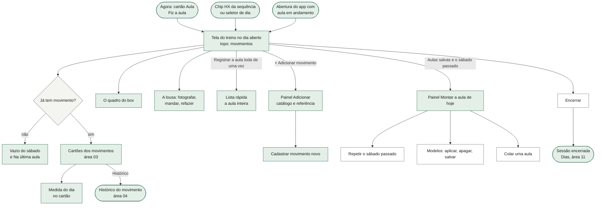

A tela do treino é a mesma da musculação (área 03), desenhada dentro do modo de sessão. O que muda no dia aberto: o topo conta movimentos; o rótulo da lista é "o que o box passou hoje"; aparecem o quadro, a lousa, a lista rápida, o painel de aulas e o botão de adicionar; somem o "+ série", a régua, o RIR e a aproximação dos cartões de movimento com grandeza.

## 3. Fluxos, um por funcionalidade

### 3.1 O dia aberto: o que a tela mostra

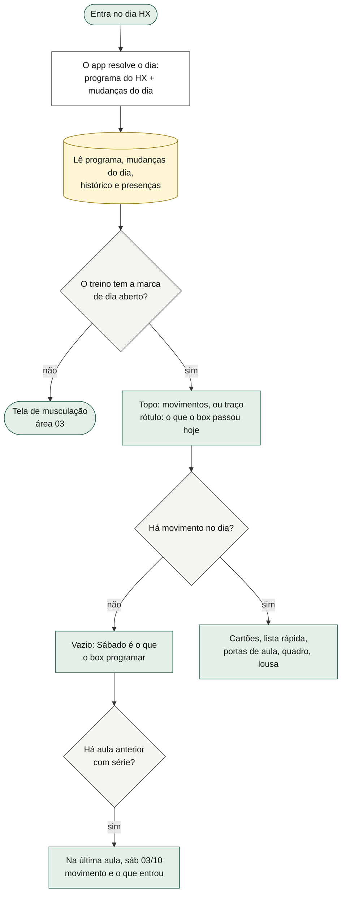

O dia aberto é um treino do programa com a marca `aberto: 1`. No programa do código ele é o `HX`: nome "HYROX", etiqueta "o que o box programar", lista vazia. A revisão colada do treinador também pode marcar um dia como aberto (área 04). Tudo o que entra no dia é guardado como **mudança do dia** (a mesma lista de mudanças da edição de musculação, área 03), e por isso o dia "vazio" do programa continua vazio: a aula de cada semana mora nas mudanças e some quando a sessão fecha. O topo é reescrito a cada tecla sem redesenhar (para não fechar o teclado), e no dia aberto ele continua contando movimentos. As portas do dia aberto não verificam se o HX é o próximo da sequência: dá para montar a aula numa quinta-feira tocando no chip HX (a regra "a aula fica fora da ordem" é da área 04).

### 3.2 Adicionar movimento (catálogo, frequentes, referência, cadastro)

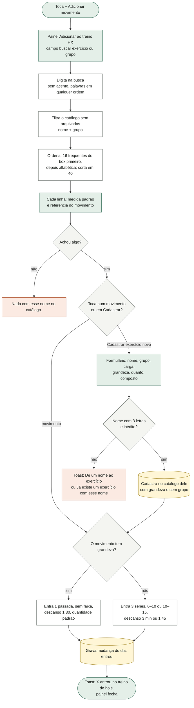

A referência de cada linha ("última: … em dd/mm") é o último registro daquele movimento fora da sessão aberta, escrito como a série se lê: em metro e caloria aparecem o trabalho e o relógio ("500 m · 110s"), em repetição e segundo só o que saiu ("9kg · 100 reps"); várias séries são separadas por " · ". Sem registro, "sem registro anterior" (a tela diz que não sabe em vez de fingir). A referência e a ordem dos frequentes só existem no dia aberto; nos dias de musculação a lista é alfabética e sem referência. Quando o movimento já está no dia, a linha diz "· já está neste treino", mas tocar adiciona de novo (é o caso da corrida que aparece três vezes). No cadastro, um movimento com grandeza nunca recebe grupo muscular, para não contar no volume por músculo. Adicionar pela tela do programa é permanente e pertence à área 04.

### 3.3 A medida do dia e o ritmo

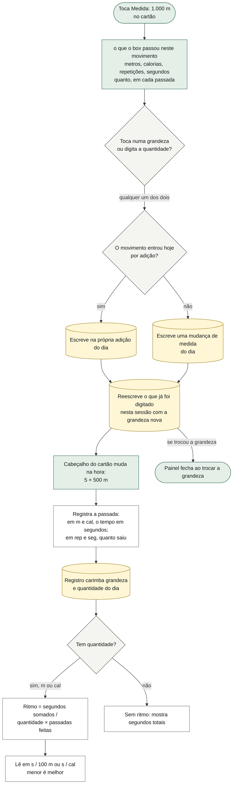

A grandeza do dia vence a do catálogo: o mesmo remo é 500 m num sábado e 15 cal no outro. O catálogo só diz com que valor o campo nasce. A quantidade digitada não redesenha a tela a cada tecla (só o cabeçalho é reescrito), para o teclado do iPhone não fechar. Apagar o campo de quantidade não apaga a quantidade (campo vazio é lido como "sem mudança"). Não há como voltar a "repetições com carga" por aqui, e um movimento sem grandeza não tem o link Medida. O ritmo é a única leitura de um movimento cronometrado: compara 5 × 500 m com 1 × 1000 m no mesmo eixo, e cair é melhorar. O histórico do movimento com o gráfico de eixo invertido, a legenda "menor é melhor" e o delta sem cor de vitória é tela da área 04, que usa esta regra.

### 3.4 Repetir o sábado passado

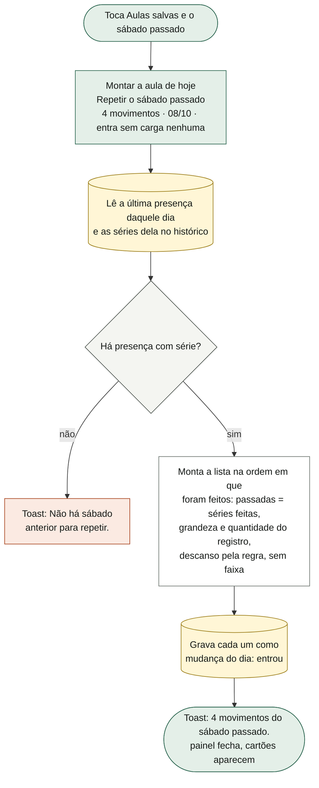

"A última presença" é a mais recente da lista de presenças daquele dia, **incluindo a sessão em andamento**. Se ele tocou **Iniciar treino** antes de abrir o painel, a sessão nova (ainda sem série) é a última, e a porta some do painel; chamada mesmo assim, diz "Não há sábado anterior para repetir." (sonda; risco R1). Os movimentos entram sem carga e sem resultado: nenhuma série é registrada só por repetir. Repetir duas vezes duplica os movimentos.

### 3.5 Modelos de aula: salvar, aplicar, apagar

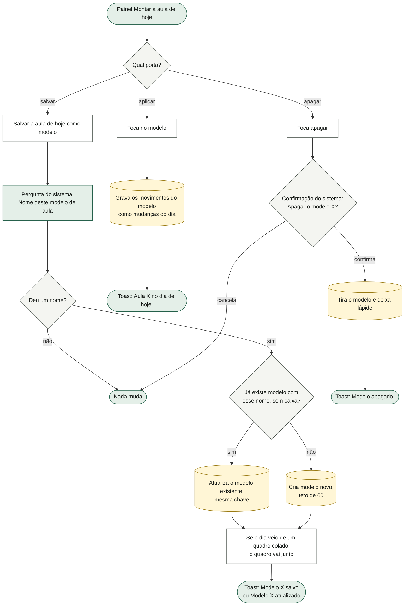

O modelo guarda, por movimento: qual é, quantas passadas, descanso, faixa, grandeza e quantidade, exatamente como estão no dia. Nunca guarda carga nem resultado ("registro que aparece sozinho é o jeito mais rápido de encher o histórico de número que ninguém fez"). Salvar sem movimento no dia diz "Não há movimento nenhum para salvar." (o botão nem aparece nesse caso). Aplicar não verifica se os movimentos já estão no dia: aplicar duas vezes duplica. Apagar avisa "As sessões já registradas com ele não mudam." e deixa lápide, para a sincronia não trazer o modelo de volta. A lista mostra os modelos do mais novo para o mais velho, com o quadro à vista. O nome é pedido pela caixa de texto do sistema e o apagar pela confirmação do sistema, não pelo painel do app.

### 3.6 Colar uma aula (o quadro transcrito)

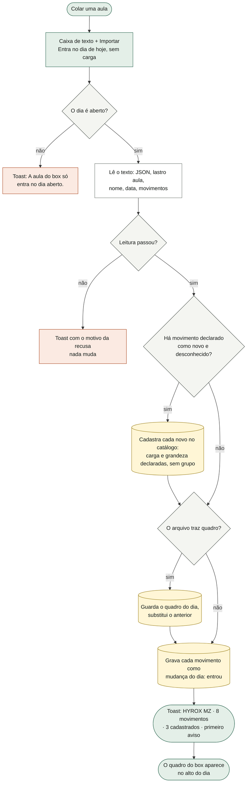

O formato e o porquê estão em `docs/AULA-IMPORTACAO.md`. A leitura **recusa o arquivo inteiro** ao primeiro problema, com a frase pronta para a tela:

| problema | frase |
|---|---|
| não é JSON | "JSON inválido. Confira se copiou o arquivo inteiro." |
| não diz `"lastro": "aula"` | "Isto não é uma aula deste app." |
| sem nome | "A aula precisa de um nome." |
| data fora de AAAA-MM-DD | "A data precisa ser AAAA-MM-DD." |
| sem movimento | "A aula não tem movimento nenhum." |
| movimento sem nome, ou nome que não vira identificador | "movimento N: falta o nome." / "… não vira identificador." |
| grandeza fora das quatro | "movimento N (X): grandeza "y" não existe. São seg, m, cal, rep." |
| quantidade zero, negativa ou sem grandeza | "… quantidade inválida." / "… tem quantidade mas não diz em que grandeza." |
| passadas fracionárias ou menores que 1 | "… número de passadas inválido." |
| descanso negativo | "… descanso inválido." |
| movimento desconhecido sem `novo` | ""X" não existe no catálogo. Para entrar, o arquivo precisa declará-lo em "novo"." |
| `novo` com carga fora da lista | ""X": tipo de carregamento "y" não existe. São pino, lado, barra, halter, halter1, corpo, assist." |

Passam com **aviso**: versão maior que 1 ("O arquivo diz versão N, e este app lê a 1. Confira o resultado.") e `novo` para movimento que já existe ("o cadastro do arquivo foi ignorado": o catálogo vence o arquivo). Só o primeiro aviso aparece no toast. Um movimento novo declarado numa linha vale para as linhas seguintes do mesmo arquivo. A aula entra sempre no dia aberto de hoje: a `data` do arquivo só é guardada junto do quadro e não é usada para nada (risco R12). Colar duas aulas no mesmo dia soma os movimentos, e o segundo quadro substitui o primeiro (sonda; risco R11). Entra prescrição sem carga, como nas outras portas, e nada vira modelo sozinho.

### 3.7 A lousa fotografada

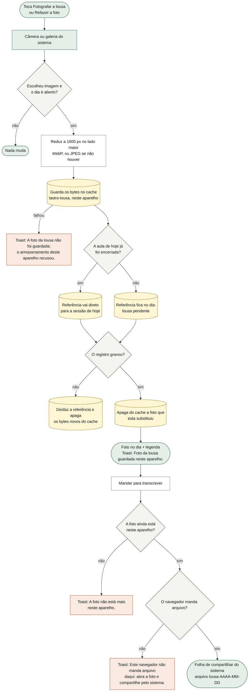

"Foto agora, transcrição quando der" (decisão do dono, 14/10): o toque fotografa e acaba ali, nada espera resposta. A transcrição é feita fora do app e volta pela porta **Colar uma aula** (3.6). A versão da foto é o instante; se coincidir com a anterior, anda um milissegundo. "Aula de hoje já encerrada" quer dizer: não há sessão aberta naquele dia e há uma presença daquele dia hoje. A falha do redutor (arquivo que não é imagem) também cai na frase de armazenamento recusado. Se o registro não grava (armazenamento cheio), quem avisa é o painel de gravação da área 01, e a lousa não finge que ficou. Os bytes nunca saem do aparelho: não sobem para a nuvem nem vão na cópia de segurança. Em outro aparelho, o dia aberto mostra a legenda e os botões sem imagem, sem explicar; o detalhe da sessão diz "A foto da lousa não está neste aparelho." O botão Mandar só aparece se o navegador tiver o compartilhar; se tiver mas não aceitar arquivo, a frase diz o caminho em vez de fingir que mandou. Cancelar o compartilhar não diz nada.

### 3.8 Registrar a aula toda de uma vez (lista rápida)

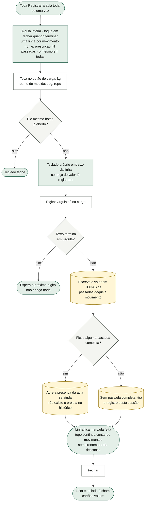

A janela real de registro de uma aula é **depois** dela, ofegante e curta; por isso uma linha por movimento, e não um cartão por passada. Escrever o mesmo número em todas as passadas é dito por extenso na linha ("o mesmo em todas"); quem quiser diferenciar round a round abre o cartão. Num movimento com grandeza basta a medida para a passada contar (a carga é opcional); num movimento de musculação no dia aberto, carga e repetição. Não há botão de salvar: cada tecla grava, como no resto do app. O tempo é digitado em segundos inteiros (4:12 são 252). Com deload ativo, o número de passadas é a metade arredondada para cima. Abrir a lista esconde os cartões; fechá-la fecha também o teclado dela.

### 3.9 Na última aula (antes de começar)

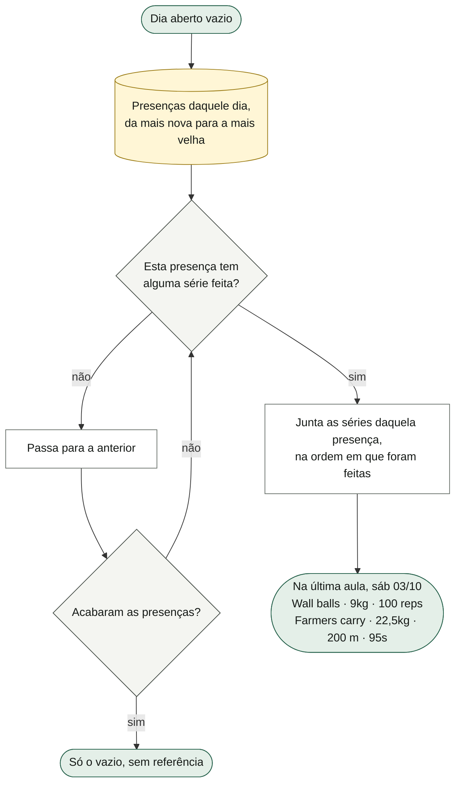

Responde "quando eu chegar lá, saber qual é o wall ball que eu costumo pegar" (P4 da pesquisa com o dono). Diferente da porta Repetir (3.4), esta pula as presenças sem série, então a sessão recém-iniciada não a apaga. Some assim que o primeiro movimento entra no dia.

### 3.10 Como a aula se registra e se fecha

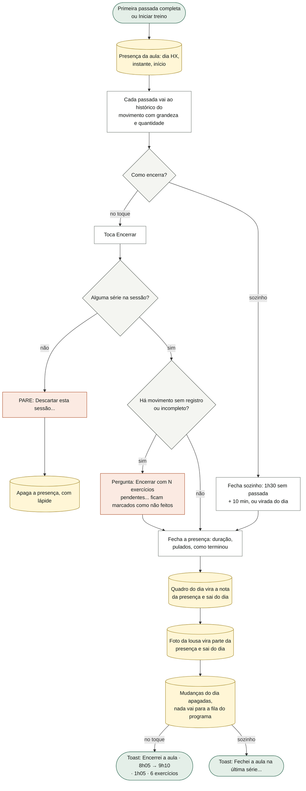

O ciclo de vida da sessão (iniciar, pausar, fechar sozinho, sessão esquecida, descartar) é da área 03; aqui só o que é próprio da aula. Num dia aberto "o que foi adicionado É o dia, não uma emenda a ele": nenhum dos dois fechos enfileira os movimentos como mudança esperando decisão (os testes cobram os dois). Duas diferenças entre os fechos ficaram: o fecho no toque pergunta pelos movimentos sem registro (sonda: "Encerrar com 1 exercício pendente: Wall balls…") e grava a lista "X: entrou no dia" na presença; o fecho sozinho não faz nenhuma das duas (risco R6). A presença entra no histórico como "Aula" em Dias (área 11), e a aula não move a sequência (área 04). Se a aula não chegar a ter nenhuma série, nada fecha: os movimentos montados, o quadro e a lousa continuam presos ao dia HX até a próxima aula (risco R3).

## 4. Estados da tela

| estado | quando acontece | o que a tela mostra |
|---|---|---|
| Dia aberto vazio, sem histórico | primeira aula, nada salvo | topo "–" movimentos; "nada prescrito"; o texto do vazio; **Fotografar a lousa**; **+ Adicionar movimento**. O botão de aulas salvas **não aparece** (e com ele a porta Colar) |
| Dia aberto vazio, com aula anterior | já houve aula com série | o vazio + "Na última aula, sáb dd/mm" com a lista; o botão **Aulas salvas e o sábado passado** |
| Dia aberto montado | algum movimento entrou | topo com o número de movimentos ("4"), em destaque depois da primeira passada; os cartões; **Registrar a aula toda de uma vez**; o botão de aulas; **+ Adicionar movimento** |
| Painel Montar a aula de hoje aberto | tocou no botão de aulas | Repetir (se houver), Modelos (se houver), Salvar (se houver movimento), Colar uma aula, Fechar |
| Colando | tocou em Colar uma aula | caixa de texto, **Importar**, **Cancelar**, a nota "Entra no dia de hoje, sem carga…" |
| Com quadro | aula colada trazia quadro | bloco "O quadro do box" acima dos cartões, com o texto literal |
| Lousa pendente | fotografou e a aula ainda não acabou | a foto (quando já carregou), "foto da lousa · dd/mm 9h12", **Mandar para transcrever** (se houver compartilhar), **Refazer a foto** e a explicação |
| Lousa de outro aparelho | a referência chegou pela sincronia, os bytes não | só a legenda e os botões, sem imagem |
| Painel Adicionar aberto | tocou em + Adicionar movimento | busca, até 40 linhas (frequentes primeiro, medida e referência), **Cadastrar exercício novo**, Fechar; esconde a lista rápida e o painel de aulas |
| Busca sem resultado | consulta não casa | "Nada com esse nome no catálogo." |
| Lista rápida aberta | tocou em Registrar a aula toda | as linhas, o teclado embaixo da linha tocada, **Fechar**; os cartões somem |
| Medida aberta | tocou em Medida no cartão | as quatro grandezas, o campo "quanto, em cada passada" e a explicação do que a série guarda |
| Editando hoje | **Editar treino de hoje** (só se a aula é a próxima ou já tem sessão) | a edição do dia (área 03); somem quadro, lousa, lista rápida, aulas e o botão de adicionar |
| Aula encerrada hoje | sessão do dia aberto fechada | a tela passa para o próximo da sequência; voltando ao HX, o dia está vazio de novo (as mudanças foram apagadas), e a lousa continua visível enquanto for hoje, agora a da sessão; fotografar de novo vai para a sessão |
| Sessão da aula em Dias | detalhe da presença (área 11) | título "Aula", meta "aula · sábado, dd/mm", a foto da lousa ou "A foto da lousa não está neste aparelho."; a nota (quadro) **não aparece** (risco R5) |

## 5. Dados

### O que esta área guarda

| campo | formato | quem mais lê |
|---|---|---|
| `S.aulas` | lista de modelos `{ id: 'a' + instante, nome, t: criado, m: alterado, mov: [{ id, s, d?, r?, u?, q? }], quadro? }`, teto 60 | sincronia (02), cópia de segurança e "Apagar tudo" que a preserva (01) |
| `S.quadro` | `{ day: 'HX', texto, data?: 'AAAA-MM-DD', t }` ou nada | sincronia (02), backup (01) |
| `S.lousa` | `{ day: 'HX', d: 'AAAA-MM-DD', v: instante, ext: 'webp' ou 'jpg', t }` ou nada | sincronia (02), backup (01) |
| Cache `lastro-lousa` | bytes da foto em `./lousa/AAAA-MM-DD-<v>.<ext>`, lado maior 1600 px | service worker, que o poupa na limpeza (01). Só neste aparelho |
| `S.mods` (no dia aberto) | `{ day: 'HX', t, list }` com mudanças `add` (`{ k:'add', id, s, r, d, pos, n: instante, u, q }`) e `med` (`{ k:'med', slot, u, q }`) | a sessão (03), que aplica e apaga no fim |
| `S.ex` (cadastros) | `{ n, g: '', car, c: 0, cue: '', meu: 1, u?, q? }` por movimento cadastrado à mão ou pelo arquivo | catálogo (04), sincronia (02) |
| Na presença `S.done[]` | `obs` = texto do quadro; `lousa` = `{ d, v, ext }`; `mods` = frases "X: entrou no dia" (só no fecho no toque); `m` = carimbo | Dias (11), sincronia (02), Agora (10) |
| No registro `S.logs[id][]` | `u` e `q` carimbados na hora; a série `[carga, resultado]` em que o resultado é segundos (m, cal) ou quanto saiu (rep, seg) | histórico e retrospectiva (04), força (09), Dias (11) |
| `S.draft` | o rascunho de digitação, inclusive o da lista rápida | sessão (03) |
| `view.addEx`, `view.addQ`, `view.novoEx` | painel de adicionar aberto, texto da busca, formulário de cadastro aberto | só tela |
| `view.aulas`, `view.colaAula` | painel Montar a aula aberto; caixa de colar aberta | só tela |
| `view.rapido`, `view.teclado` (alvo `rapida`) | lista rápida aberta; teclado próprio na linha i, posição 0 (carga) ou 1 (medida) | só tela |
| `view.medida` | posição cujo painel Medida está aberto | só tela |

### O que só lê de outras áreas

- O programa (`S.prog`, marca `aberto`) e a sequência (`proximoTreino`, área 04).
- O catálogo efetivo (`CAT`, `EX_BASE`, `SIMULACAO_HYROX`, `MOVIMENTOS_DE_BOX`, `FREQUENTES_NO_BOX`, área 04).
- O histórico de cada movimento sem a sessão aberta (`historico`), as presenças (`S.done`), a sessão aberta (`S.sessao`) e o deload (`S.deload`, que corta as passadas pela metade).
- O tipo de carga corrigido por exercício (`S.carga`) para o rótulo da carga na lista rápida.

### Como cada dado atravessa a sincronia

- `S.aulas`: **coleção com chave** `aula:<id>`, carimbo `m`, união dos dois lados, **lápide ao apagar**, teto 60 depois de ordenar por tempo. Dois modelos com o mesmo nome criados em aparelhos diferentes têm chaves diferentes e ficam os dois.
- `S.quadro` e `S.lousa`: **documentos do dia**; vence o de carimbo `t` mais novo, e um lado vazio **nunca** vence um lado com valor (o teste de fusão cobra "o lado mais novo não tinha lousa, e ela não sumiu"). Consequência no risco R4.
- Bytes da lousa: **não atravessam**. Nem nuvem, nem backup.
- `S.mods`, `S.draft`, `S.sessao`: documentos que vêm inteiros do lado com o estado mais novo (área 02).
- `S.ex`: mapa unido por exercício (área 02).
- `S.done` e `S.logs`: coleções com chave e carimbo `m`; a nota, a lousa e a lista de mudanças viajam dentro da presença.

## 6. Regras

1. **O dia aberto.** Um treino com `aberto: 1` se decide no dia. No programa do código é o `HX` ("HYROX", "o que o box programar", sem exercício), sexta posição da sequência `A B C D E HX`. Fonte: treinador (o HYROX é o sexto treino) e dono ("o sábado é o que o box programar").
2. **Quatro grandezas, e não há quinta:** `seg`, `m`, `cal`, `rep`, rotuladas "seg", "m", "cal", "reps". Sem grandeza é série de musculação. Desenho (`tipos.ts`).
3. **A direção é da grandeza, nunca do exercício.** Em `m` e `cal` a quantidade é fixa e a série guarda o **tempo em segundos**: menos é melhor. Em `rep` e `seg` a janela é fixa e a série guarda **quanto saiu**: mais é melhor.
4. **Caloria não converte para metro.** "1000 m de remo" e "20 cal de remo" não se normalizam (a relação potência e ritmo não é linear). Desenho.
5. **Ritmo** = soma dos segundos das passadas feitas ÷ (quantidade × número de passadas feitas). Sem quantidade, sem passada feita ou com zero segundos, não há ritmo. Lê-se em **s / 100 m** (fator 100) no metro e **s / cal** (fator 1) na caloria; seg e rep não têm ritmo.
6. **A medida do dia vence a do catálogo.** O catálogo só dá o valor com que o campo nasce. A mudança vale só para aquele dia e, se o movimento entrou por adição, é escrita na própria adição.
7. **O registro carimba** a grandeza e a quantidade (só se maior que zero) do dia em que foi feito; mudar a grandeza no meio da sessão reescreve o que já foi digitado.
8. **Como um movimento entra no dia.** Com grandeza: 1 passada, sem faixa, descanso de **90 s**, quantidade padrão do catálogo. Sem grandeza: 3 séries, faixa **6–10** se composto ou **10–15** se não, descanso de **180 s** ou **105 s**. Fonte: categorias de descanso do treinador; "3 minutos entre um wall ball e outro seriam a prescrição de hipertrofia de volta".
9. **O catálogo de adição** mostra até **40** movimentos, sem os arquivados, casando cada palavra da busca em nome ou grupo, sem acento e em qualquer ordem. No dia aberto, os **16 frequentes do box** vêm primeiro, nesta ordem: Corrida, Wall balls, Remo ergômetro, Ski erg, Sled push, Sled pull, Farmers carry, Lunges com sandbag, Burpee broad jump, Kettlebell swing, Box jump, Burpee, Assault bike, Bike erg, Double under, Thruster. A procedência da linha é a medida ("1.000 m"), e não o grupo.
10. **A referência do movimento** é "última: <séries> em dd/mm" do último registro fora da sessão aberta, ou "sem registro anterior". Só no dia aberto.
11. **Na última aula** usa a presença mais recente daquele dia que tenha alguma série, com as linhas na ordem em que foram feitas; data como "sáb 03/10". Só com o dia vazio.
12. **Repetir o sábado passado** usa a última presença daquele dia (inclusive a aberta): passadas = séries feitas, mínimo 1; grandeza e quantidade do registro; descanso pela regra 8; sem faixa; **sem carga e sem resultado**.
13. **Modelos guardam prescrição, nunca resultado.** Mesmo nome (sem diferenciar maiúscula) atualiza em vez de duplicar; teto de **60**; o quadro do dia vai junto; apagar deixa lápide. Fonte: dono e desenho ("66 interações para montar cinco movimentos em cinco rounds" foi a medida que motivou).
14. **Aula colada**: só no dia aberto; o arquivo é **recusado inteiro** ao primeiro problema; movimento desconhecido só entra se o arquivo o declarar em `novo` com carga e grandeza; **o catálogo vence o arquivo**; cadastro do arquivo nasce sem grupo, não composto, "cadastrado por ele"; o peso sugerido da lousa (`20/15`) fica só no texto do quadro. Fonte: `docs/AULA-IMPORTACAO.md`.
15. **O quadro tem duas vidas**: no alto do dia durante a aula; depois, a nota da presença. É a única chance, porque o quadro não se reconstrói pela prescrição.
16. **A lousa**: lado maior **1600 px**, WebP (ou JPEG); a foto fica **só neste aparelho**; vira parte da presença quando a aula fecha; tirada depois de a aula de hoje fechar, vai direto para ela; refazer apaga a anterior do cache só depois de a nova estar gravada; se o registro falha, a referência volta e os bytes novos saem do cache. Fonte: decisão do dono, 14/10.
17. **Lista rápida**: um valor por movimento vale para **todas** as passadas, dito na linha; não dispara o descanso; vírgula só na carga; texto terminando em vírgula não grava; teclado próprio, que começa do valor já registrado.
18. **Sem promoção.** No dia aberto, nenhum fecho (no toque ou sozinho) põe os movimentos na fila de "isto fica no programa?". Fonte: decisão D1 e a razão do dia aberto.
19. **A aula não é musculação para o resto do app:** movimento com grandeza não tem grupo (fora do alvo e do volume por músculo), não produz e1RM (fora da tendência de força e da regra calórica, área 09), não ganha o selo de subir carga, não tem RIR, régua, aproximação nem "+ série"; o volume da sessão e da retrospectiva não o soma (mas o topo da tela soma, risco R7).
20. **A aula fica fora da ordem** da sequência (decisão do dono, 14/10). A regra é da área 04.

## 7. Ligações com as outras áreas

| área | o que esta recebe dela | o que esta entrega a ela |
|---|---|---|
| 01 Fundação | gravar (`save`, `queueSave`), o painel de pare e o de falha de gravação, o toast, a pilha de telas, o backup e o "Apagar tudo" (que preserva modelos, quadro e lousa), o service worker que poupa `lastro-lousa` | os campos `S.aulas`, `S.quadro`, `S.lousa` para normalizar e exportar; o cache `lastro-lousa` |
| 02 Sincronia | a fusão (coleção dos modelos com lápide; documentos do quadro e da lousa) | a chave `aula:<id>` e as regras de quem vence |
| 03 Sessão de treino | a tela do treino e o modo, o cartão do movimento, o teclado próprio, a projeção das séries, o ciclo da sessão, a edição do dia, o fecho | o dia montado (mudanças `add`/`med`), a medida do dia no cartão, a lista rápida, a cópia do quadro e da lousa no fecho |
| 04 Programa | o dia `HX` e a marca `aberto`, a sequência com a aula fora da ordem, o catálogo e os vocabulários do box, o histórico do movimento e a retrospectiva | a regra das grandezas e do ritmo, que o histórico e o gráfico usam; os movimentos cadastrados |
| 09 Semana e nutricionista | — | os movimentos com grandeza ficam fora da força e do volume por músculo |
| 10 Agora | o cartão **Aula** ("O que o box programar. O quadro do dia vira a nota da sessão.", **Fiz a aula →**) | a marca do dia aberto, que decide esse cartão |
| 11 Dias | o detalhe da presença (mostra "Aula" e a foto da lousa), o registro de uma aula num dia passado | a presença com nota e lousa |

## 8. Como serviço individual

**Nome:** Serviço da Aula do Box (`aula`).

**O que ele possui:** os modelos de aula; o quadro do dia; a foto da lousa (referência e bytes); a composição do dia aberto (os movimentos e a medida de cada um); as regras de grandeza e ritmo (que podem virar uma biblioteca comum, "Grandezas", usada também pelo histórico).

**Operações (como API):**

| verbo | recebe | devolve |
|---|---|---|
| `montarDia` | dia, lista de movimentos `{ id, passadas, descanso?, grandeza?, quantidade? }` | o dia aberto montado |
| `adicionarMovimento` | dia, id do movimento | o movimento como entrou (passadas, faixa, descanso, medida) |
| `definirMedida` | dia, posição, grandeza?, quantidade? | o movimento com a medida nova |
| `buscarCatalogo` | dia, texto | até 40 linhas com medida e referência |
| `referencia` | id do movimento | "última: … em …" ou "sem registro anterior" |
| `ultimaAula` | dia | data e linhas da última aula com série, ou nada |
| `repetirUltimaAula` | dia | movimentos postos, ou recusa "não há sábado anterior" |
| `salvarModelo` / `aplicarModelo` / `apagarModelo` | dia e nome / id e dia / id | modelo salvo ou atualizado / movimentos postos / lápide |
| `importarAula` | texto | `{ ok, erro?, avisos, aula: { nome, data?, quadro?, mov, novos } }` |
| `fotografarLousa` | dia, imagem | referência `{ d, v, ext }` |
| `lerLousa` / `compartilharLousa` | referência | bytes / resultado do compartilhar |
| `registrarRapido` | dia, posição, campo (carga ou medida), valor | as passadas preenchidas |
| `fecharAula` | presença | nota (quadro) e lousa anexadas; dia limpo |
| `ritmo` | registro | segundos por unidade e a escala de leitura |

**Eventos que emitiria:** `aula.movimentoEntrou`, `aula.medidaMudou`, `aula.quadroColado`, `aula.lousaFotografada`, `aula.modeloSalvo`, `aula.modeloApagado`, `aula.movimentoCadastrado` (para o catálogo), `aula.fechada` (com nota e lousa).

**Eventos que escutaria:** `sessao.aberta` e `sessao.encerrada` (da área 03, para anexar quadro e lousa e limpar o dia); `catalogo.mudou` (04); `sincronia.fundiu` (02); `dia.virou` (para limpar o que ficou preso, ver R3).

**O que hoje está acoplado e precisaria ser separado:**

- O dia aberto é feito com a **mesma lista de mudanças do dia** da edição de musculação (`S.mods`), e o fim dele é o fim da sessão de musculação. A aula não tem objeto próprio: o "dia da aula" é a letra `HX` + as mudanças.
- Quadro, lousa e mudanças são chaveados pela **letra do dia** (`day: 'HX'`), não pela data: o que não fecha numa sessão vaza para a próxima aula.
- O código do quadro e da lousa vive dentro do fecho da sessão (`fechaSessao`, área 03); a pergunta das pendências e a lista de mudanças do fecho no toque não sabem do dia aberto.
- A medida do dia mora no cartão genérico do exercício (área 03) e escreve direto nas mudanças.
- O cadastro do vocabulário novo escreve direto no catálogo dele (`S.ex`, área 04).
- O descanso padrão, os vocabulários do box e a lista de frequentes moram no domínio do programa (`programa.ts`).
- O ritmo e as grandezas moram em `carga.ts`, junto com as agregações de musculação; o histórico (04) aplica a regra sem separar grandezas.
- O nome do modelo vem de `window.prompt` e o apagar de `window.confirm`, fora do painel do app.
- `ultimaAulaDe` e `referenciaDaUltimaAula` varrem todo o histórico a cada desenho.

## 9. Riscos e dívidas que apareceram na leitura

Só registro, sem conserto. "(sonda)" = conferido rodando o app.

- **R1 · "Repetir o sábado passado" some depois de Iniciar treino (sonda).** No dia HX com aula anterior, tocar **Iniciar treino** e abrir o painel: a porta sumiu; chamada, diz "Não há sábado anterior para repetir." A busca da última aula pega a presença mais recente do dia, que é a recém-aberta e sem série. Pior: depois da primeira passada, "repetir" devolveria os movimentos da própria aula de hoje.
- **R2 · No primeiro sábado, "Colar uma aula" é inalcançável (sonda).** Sem aula anterior, sem modelo e sem movimento no dia, o botão **Aulas salvas e o sábado passado** não aparece, e a porta de colar mora dentro dele. Contorno: adicionar um movimento qualquer antes.
- **R3 · O que não fecha numa sessão vaza para a próxima aula (sonda).** Colar uma aula com quadro (ou montar movimentos, ou fotografar a lousa) e não registrar nenhuma passada; uma semana depois, no HX, o quadro velho e os movimentos continuam lá, e o quadro e a foto viram a nota e a lousa da aula seguinte. Nada limpa por data.
- **R4 · Com dois aparelhos, quadro e lousa ressuscitam depois do fechamento (sonda na fusão).** A aula fecha no aparelho A (quadro e lousa saem do dia); quando A funde com uma versão da nuvem que outro aparelho gravou, o lado vazio perde para o lado com valor e os dois voltam ao dia. Voltando, a foto e a nota se repetem na próxima aula; e "Refazer a foto" sobre uma lousa ressuscitada apagaria do cache os bytes que a sessão anterior ainda referencia (**a confirmar:** por leitura do código, não rodado).
- **R5 · A nota da aula é gravada e nenhuma tela a mostra (sonda).** O quadro vira o campo de nota da presença, mas o detalhe da sessão e o dia em Dias não leem esse campo (procurei em `detalheDaSessao`, `CTX.diaAberto` e no histórico). **A confirmar** se há outra tela que eu não achei; o teste só confere o dado.
- **R6 · O fecho no toque trata a aula como prescrição (sonda).** Repetir uma aula com dois movimentos, registrar só um e tocar **Encerrar**: pergunta "Encerrar com 1 exercício pendente: Wall balls. Ele fica marcado como não feito no histórico." (o tipo diz "não há pendência"), e a presença grava "Corrida: entrou no dia", "Wall balls: entrou no dia" como mudanças. O fecho sozinho não grava essa lista: os dois fechos discordam.
- **R7 · O volume do topo soma segundos como quilos (sonda).** Sled push com 50 kg e 110 s: o topo mostra "volume 5,5k", e o detalhe da mesma sessão mostra "–".
- **R8 · O histórico mistura metro e caloria do mesmo movimento (sonda).** Remo 500 m em 110 s numa aula e 15 cal em 60 s na seguinte: o histórico mostra "ritmo 400,0 s / 100 m" e "+1718%". A grandeza da leitura vem do primeiro registro e o resto não é separado. Tela da área 04; a causa nasce na medida do dia. O comentário do tipo promete "duas séries históricas diferentes, separadas para sempre", e elas moram no mesmo histórico.
- **R9 · Aula colada sem descanso ganha 3 minutos nos movimentos compostos (sonda).** Wall balls colado sem `d` fica com descanso de 180 s (o padrão do cartão para composto), contra os 90 s da regra 8.
- **R10 · Cadastro pelo arquivo sem grandeza cria movimento de musculação sem grupo.** `novo` sem `u` é aceito; o catálogo fica sem grandeza, e na próxima adição pelo catálogo o movimento entra como "3 × 10–15", com RIR e régua (sonda: "Squat jump" sem `u`).
- **R11 · Duas aulas coladas: o segundo quadro apaga o primeiro (sonda).**
- **R12 · A data do arquivo é ignorada.** A aula entra sempre no dia de hoje, contra o "nunca se assume hoje" do formato; a data só fica guardada junto do quadro e ninguém a lê.
- **R13 · Só o primeiro aviso da leitura aparece no toast.**
- **R14 · Os bytes da lousa nunca são apagados** quando a sessão é apagada (Dias) nem no "Apagar tudo", e não há poda: o cache só cresce. E não há cópia: trocar de aparelho perde todas as fotos da lousa (é decisão, mas o risco fica).
- **R15 · Medida sem volta.** Não há "repetições com carga" na Medida; apagar o campo de quantidade não apaga; movimento sem grandeza não tem o link.
- **R16 · Tempo só em segundos inteiros**, sem minutos e segundos (a dica "4:12 são 252" só existe no texto da Corrida).
- **R17 · "ritmo da última vez" sem quantidade mostra soma de segundos** com o rótulo "ritmo".
- **R18 · Palavras de musculação na aula:** "Treino HX iniciado. O tempo começa agora." no Iniciar treino; "na prescrição · Treino HX" no cartão do Agora; "Adicionar ao treino HX"; "6 exercícios" no toast de encerrar.
- **R19 · Montar a aula fora do dia previsto:** dá para adicionar no chip HX, mas **Editar treino de hoje** (remover, reordenar, mudar passadas) só aparece depois da primeira passada ou quando a aula é a próxima da sequência. Um movimento posto por engano não sai antes disso.
- **R20 · Lousa de outro aparelho** aparece no dia aberto só como legenda e botões, sem dizer que a foto não está ali; no detalhe da sessão, "não está neste aparelho" também aparece por um instante enquanto a foto carrega.
- **R21 · Mensagem imprecisa:** arquivo que não é imagem cai em "o armazenamento deste aparelho recusou".
- **R22 · Modelos com o mesmo nome criados em dois aparelhos** não se juntam (chaves diferentes); o teto de 60 corta os mais velhos sem lápide (**a confirmar** se os dois lados convergem, a fusão corta pelo mesmo teto).
- **R23 · Nome e apagar do modelo** usam a caixa e a confirmação do sistema, fora do padrão de painel do app.

## 10. Índice técnico

### Arquivos

| arquivo | papel |
|---|---|
| `src/main.jsx` | o casco: montagem do dia aberto, portas de aula, medida, lista rápida, lousa, fecho |
| `src/dominio/aula.ts` | leitura pura da aula colada (`leAula`), com recusas e avisos |
| `src/dominio/carga.ts` | as grandezas e o ritmo (não existe `src/dominio/unidade*`: a regra mora aqui; o teste é `unidade.test.ts`) |
| `src/dominio/tipos.ts` | `Unidade`, `Treino.aberto`, `Slot.u/q`, `Log.u/q`, `Mod` `med` e `add`, `ModeloDeAula`, `Estado.aulas/quadro/lousa`, `Sessao.lousa` |
| `src/dominio/programa.ts` | `HX` no `PROGRAMA`, `ROT_BASE`, `D_CURTO`, `SIMULACAO_HYROX`, `MOVIMENTOS_DE_BOX`, `FREQUENTES_NO_BOX`, `slugEx` |
| `src/dominio/dia.ts` | `proximoTreino` com a aula fora da ordem (área 04) |
| `src/dominio/progressao.ts` | `setsFor` (deload), `shouldUp` sem selo para grandeza |
| `src/dominio/sincronia.ts` | `chaveDeAula`, teto `aulas: 60`, fusão de modelos, quadro e lousa |
| `src/dominio/formato.ts` | `casaBusca`, `normalizaBusca` (busca do catálogo) |
| `src/infra/lousa.ts` | cache `lastro-lousa`: reduzir, guardar, ler, esquecer, endereço |
| `src/infra/fotos.ts` | `reduzPara` (WebP ou JPEG) |
| `src/sw.js` | lista `FOTOS` que poupa `lastro-lousa` |
| `src/ui/telas/treino.jsx` | `Treino`: topo de movimentos, quadro, lousa, vazio, Na última aula, botões do dia aberto |
| `src/ui/instrumento/edicao.jsx` | `RegistroRapido`, `Aulas`, `AddEx` |
| `src/ui/exercicio.jsx` | `Medida` (o painel da medida do dia), linha "passada" e "ritmo da última vez" (cartão é da 03) |
| `src/ui/telas/agora.jsx` | cartão `aula` (área 10) |
| `src/ui/telas/sessao.jsx` | a lousa no detalhe da presença (área 11) |
| `docs/AULA-IMPORTACAO.md` | o formato do arquivo da aula |

### Funções de `src/main.jsx` (linha no commit `8ec19a4`)

| função | linha | papel aqui |
|---|---|---|
| `aplicaMods` | 170 | aplica `add` (com `u`, `q`) e `med` ao dia |
| `diaAberto` | 205 | o dia tem a marca `aberto` |
| `treino` | 302 | grandeza do slot vence a do catálogo |
| `oTreino` | 760 | "a aula" nas frases de fecho |
| `fechaSessao` | 772 | sem promoção no dia aberto; quadro vira `obs`; lousa vai à presença |
| `projeta` | 865 | carimba `u` e `q` no registro |
| `finalizarSessao` | 1034 | sem fila no dia aberto; pergunta de pendentes (R6) |
| `encerraDeVerdade` | 1091 | grava `mods` na presença (R6) |
| `textoDaSerie`, `fmtLast` | 1685, 1694 | texto da série com grandeza; referência |
| `atualizaEstado` | 1877 | topo em movimentos no dia aberto |
| `vmExercicio` | 1898 | medida, ritmo, sem RIR/régua/+ série |
| `descansoPadrao` | 2779 | 90 s com grandeza |
| `movimentosDoDia` | 2785 | o dia na forma do modelo |
| `ultimaAulaDe` | 2801 | última presença do dia (R1) |
| `poeMovimentos` | 2826 | lista vira mudanças `add` |
| `repetirUltimaAula` | 2837 | porta Repetir |
| `salvarAulaComoModelo` | 2852 | salvar modelo |
| `importaAulaColada` | 2891 | Colar uma aula |
| `aplicarModeloDeAula`, `apagarModeloDeAula` | 2922, 2928 | modelos |
| `abrirAulas` | 2940 | painel Montar a aula |
| `abrirAddEx`, `fecharAddEx`, `setBuscaDeExercicio`, `buscaEx` | 2942–2954 | painel Adicionar |
| `addExercicio` | 2962 | como o movimento entra (dia; programa é da 04) |
| `abrirNovoEx`, `criarExercicioCom`, `criarExercicio` | 2992, 3005, 3031 | cadastro com grandeza |
| `textoMod` | 3061 | frase do `med` ("medido em 500 m") e do `add` |
| `metaDoDia` | 3253 | "o que o box programar" |
| `anotaSerieRapida`, `abreTecladoRapido`, `abrirRapido` | 4831, 4863, 4877 | lista rápida |
| `abrirMedida`, `poeMedida`, `textoDaPrescricao`, `atualizaPrescricao`, `numeroDoCampo` | 5078, 5093, 5138, 5148, 5157 | medida do dia |
| `tiraFotoDaLousa`, `lousaDoDia` | 5225, 5268 | lousa |
| `teclaDoTeclado` | 5464 | alvo `rapida` do teclado próprio |
| `volumeDoDia` | 7256 | topo de volume (R7) |
| `referenciaDoBox`, `referenciaDaUltimaAula`, `catalogoDeAdicao` | 9618, 9632, 9655 | referência, Na última aula, catálogo |

### Pontos de entrada `CTX.*`

`CTX.treino` (7268; campos `aberto`, `movimentos`, `addEx`, `ultimaAula`, `rapido`, `aulas`, `quadro`, `lousa`), `CTX.tiraFotoDaLousa` (5265), `CTX.mandaLousa` (5279), `CTX.acoesRapido` (9727), `CTX.acoesAulas` (9734), `CTX.acoesAdd` (9744), `CTX.edicaoDoDia` (9559, campo `addEx`), `CTX.diaAberto` só pela ligação (8777, área 11), `CTX.detalheDaSessao` (8883, campo `lousa`, área 11), `CTX.historico` (9106, ritmo, área 04), `CTX.abreTreinoDeHoje` (11378, porta do Agora).

### Regras do domínio e da infra

- `aula.ts`: `UNIDADES`, `CARREGAMENTOS`, `MovimentoNovo`, `AulaLida`, `Leitura`, `leAula`.
- `carga.ts`: `isTime`, `unidadeDe`, `temUnidade`, `cronometrado`, `menosEhMelhor`, `ROTULO_UNIDADE`, `ritmoDe`, `ESCALA_RITMO`, `tutOf`.
- `programa.ts`: `SIMULACAO_HYROX`, `MOVIMENTOS_DE_BOX`, `FREQUENTES_NO_BOX`, `D_CURTO`, `slugEx` (uso), o `HX` de `PROGRAMA`.
- `tipos.ts`: `Unidade`, `ModeloDeAula` (e `Treino.aberto`, `Mod` `med`).
- `sincronia.ts`: `chaveDeAula` (e a fusão de `aulas`, `quadro`, `lousa` dentro de `funde`).
- `lousa.ts`: `CACHE_LOUSA`, `reduz`, `guarda`, `le`, `esquece`, `urlDaLousa`, `carrega`.

### Campos `S.*` e `view.*`

- `S.aulas`, `S.quadro`, `S.lousa` (donos); `S.mods` no dia aberto, `S.ex` (cadastros), `S.done[].obs/.lousa/.mods`, `S.logs[].u/.q` (escritos aqui, donos em outras áreas).
- `view.aulas`, `view.colaAula`, `view.rapido`, `view.addEx`, `view.addQ`, `view.novoEx`, `view.medida`, `view.teclado` (alvo `rapida`).

### Componentes

`Treino` (parte do dia aberto), `RegistroRapido`, `Aulas`, `AddEx`, `Medida` (interno de `exercicio.jsx`).

### Testes

- `tests/dominio/aula.test.ts` (16): a leitura, as recusas, "o catálogo vence o arquivo", "o mesmo movimento novo em várias linhas cadastra uma vez só", "versão futura avisa em vez de recusar".
- `tests/dominio/unidade.test.ts` (13): grandezas, direção, ritmo e escala, sem e1RM, sem selo de subir carga.
- `tests/fluxo/aula.test.js` (19): repetir, modelos (salvar, sobrescrever, aplicar, lápide), portas só no dia aberto, lista rápida (teclado próprio, vírgula, todas as passadas), topo em movimentos, "aula que fecha sozinha não enfileira" e "a aula encerrada no toque também não".
- `tests/fluxo/aulaimport.test.js` (14): a aula colada preenche o dia, cadastro do vocabulário, corrida três vezes, o quadro na tela e na nota, salvar com quadro, duas aulas somam, recusas.
- `tests/fluxo/ritmo.test.js` (21): ritmo no histórico, eixo invertido, retrospectiva, medida do dia alcança o digitado, cartão sem RIR, vocabulário do box, prioridade dos frequentes, busca, "cada movimento diz o que entrou da última vez", "antes da aula, a última aula".
- `tests/fluxo/lousa.test.js` (7): fotografar, virar parte da sessão, foto depois do fecho, refazer, recusa do aparelho, fora do dia aberto, mandar para transcrever.
- `tests/dominio/sincronia.test.ts`: "a lousa da aula em curso: vence a mais nova, venha do lado que vier".

### Itens do inventário que esta área cobre

`CTX`: `tiraFotoDaLousa`, `mandaLousa`, `acoesRapido`, `acoesAulas`, `acoesAdd` (e as partes do dia aberto de `treino` e `edicaoDoDia`). Funções: `diaAberto` (205), `descansoPadrao`, `movimentosDoDia`, `ultimaAulaDe`, `poeMovimentos`, `repetirUltimaAula`, `salvarAulaComoModelo`, `importaAulaColada`, `aplicarModeloDeAula`, `apagarModeloDeAula`, `abrirAulas`, `abrirAddEx`, `fecharAddEx`, `setBuscaDeExercicio`, `buscaEx`, `abrirNovoEx`, `criarExercicioCom`, `criarExercicio`, `anotaSerieRapida`, `abreTecladoRapido`, `abrirRapido`, `abrirMedida`, `poeMedida`, `textoDaPrescricao`, `atualizaPrescricao`, `numeroDoCampo`, `tiraFotoDaLousa`, `lousaDoDia`, `textoDaSerie`, `fmtLast`, `referenciaDoBox`, `referenciaDaUltimaAula`, `catalogoDeAdicao`, `oTreino`; em parte `addExercicio`, `textoMod`, `metaDoDia`, `atualizaEstado`, `fechaSessao`, `aplicaMods`, `volumeDoDia`. Domínio: todo `aula.ts` e `lousa.ts`; de `carga.ts` as grandezas e o ritmo; de `programa.ts` os vocabulários do box. `S.aulas`, `S.quadro`, `S.lousa`; `view.aulas`, `view.colaAula`, `view.rapido`, `view.addEx`, `view.addQ`, `view.novoEx`, `view.medida`. Componentes `RegistroRapido`, `Aulas`, `AddEx`.

Fora do inventário e desta área (nomes parecidos, não esquecer): `abrirCardioRapido` e `view.cardioRapido` são do cardio (área 10); `pesoRapido`, `registraPesoRapido` e `FolhaPesoRapido` são do peso no descanso (área 07).
