# 06 · Comida

> Em uma frase: esta parte guarda o plano alimentar do nutricionista e a biblioteca de alimentos, mostra a comida de hoje no turno certo, registra o que ele comeu de verdade (refeição por refeição, a porção, a água, o tipo do dia), fecha cada dia num histórico que não se reescreve, deixa pôr em dia o dia que ficou sem marca e entrega a adesão e a lista de compras.

Fronteiras, para não duplicar: a regra calórica, o veredito e o passo de ±150 kcal são da **área 09** (aqui só o arroz que recebe o passo); a composição do Agora (cartão de cima, ordem das seções, os 14 dias) é da **área 10** (aqui a linha da comida e a água como comportamento); o dia aberto em Dias é da **área 11** (aqui o que a folha de pôr em dia faz); a fusão entre aparelhos é da **área 02** (aqui as regras que valem para os dados de comida).

---

## 1. O que o usuário faz aqui

| # | Funcionalidade | O que faz | Onde fica | Quando aparece / some |
|---|---|---|---|---|
| 1 | **Ver a comida de hoje** | Lista as refeições de hoje em ordem de relógio, com a linha do treino no meio; diz "N kcal no plano de treino/descanso"; diz quando uma refeição foi empurrada ("Almoço foi para as 13:45, depois do treino"); marca o "pós-treino" na refeição certa. | Agora, seção "A comida de hoje" | Sempre. O pré-treino e o treino só entram em dia de treino. |
| 2 | **Marcar uma refeição pela linha** | Toque na linha abre ali mesmo: o que tem dentro, as kcal e os botões "Comi tudo", "Metade", "Não comi isso". "Não comi isso" troca os botões por uma pergunta ("Sabe o que comeu no lugar?") com "Sei o que comi", "Não sei", "Não comi nada". Um toque grava; não há "guardar". | Agora, cada linha de refeição (e os mesmos botões no cartão de cima, área 10) | Só uma linha aberta por vez. Os botões somem quando a refeição já tem marca. |
| 3 | **Desfazer a marca** | Tira a marca de hoje (e a porção), com lápide para os outros aparelhos. | Linha aberta ("Desfazer") e a leitura de volta no topo | Só em refeição marcada hoje. |
| 4 | **A leitura de volta** | Depois de um toque: "Almoço · comi tudo, marcado às 12h41, neste aparelho", com "Desfazer"; o que passou sem marca antes dele; o próximo do plano. | Agora, logo abaixo do cartão de cima | Enquanto a última marca existir e for de hoje. |
| 5 | **Outra porção (a folha da refeição)** | Mostra kcal e macros com a porção escolhida, o padrão da refeição ("feita em 14 dos últimos 20 dias com registro"), a nota do nutricionista, "A porção de hoje" (½, ¾, cheia, 1¼, 1½ — "isto não muda o plano. Zera sozinho na virada do dia."), o que tem dentro ("plano diz 250 g" quando a porção não é cheia) e o botão "marcar como feita" / "desmarcar". O "···" abre a edição da refeição (plano). | Agora, linha aberta → "Outra porção" | "Outra porção" só aparece em refeição ainda sem marca. |
| 6 | **A água** | "+1 copo" grava na hora. Tocar no número abre um contador (0 a 30) para corrigir. Mostra "Água · 3 de 14 copos", "750 ml de 3.500 ml" e 14 bolinhas. Se o aparelho recusa: "O 2º copo não foi gravado", com "Tentar de novo" e "Baixar a cópia de segurança". | Agora, linha "Água"; no modo de sessão, o chip "Água 3/14 · +1" enquanto descansa | Sempre no Agora; no modo, só enquanto o descanso conta. |
| 7 | **"Não contei a água"** | Fato "não contei", diferente de zero copo. | Só no dado (`setAgua(null)`) | **Não há botão na tela hoje** (ver §9). A tela só exibe "marcada como não contada" se o dado vier assim. |
| 8 | **O tipo do dia** | Pergunta "Hoje é dia de treino?" com o efeito de cada resposta antes do toque ("É descanso — o plano fica o de descanso: 5 refeições, 3.041 kcal"; "Vou treinar hoje — o pré-treino e o treino entram no plano…"). Com sessão registrada ou aberta, só diz "A sessão registrada manda no tipo do dia." | Folha do tipo do dia: toque na procedência do cabeçalho do Agora ("dia de treino, pelo padrão semanal · Treino A") ou no botão "treino" da aba Treino | Os dois botões somem quando há sessão registrada/aberta hoje. |
| 9 | **"Já fiz alguma coisa hoje"** | Cardio (abre o registro de cardio do Agora, área 10), Aula e Treino fora da prescrição (abrem o lançamento de hoje, área 11). | Folha do tipo do dia | Só quando o dia é de descanso. |
| 10 | **O turno do treino** | Manhã (hora do plano), tarde (12:15) ou noite (18:15), cada um dizendo quem vira o pós-treino ("pós · Almoço"). Anda o pré e o intra; a refeição que cai dentro do treino vai para depois dele. | Folha do tipo do dia, "O turno do treino" | Só em dia de treino. Escolher fecha a folha. Zera na virada da data. |
| 11 | **A demanda alta** | Liga/desliga o carboidrato extra do intra-treino ("Use no dia de perna pesada"). | Folha do tipo do dia, "A demanda alta" | Sempre (também em descanso, onde não muda nada no plano base). Zera na virada. |
| 12 | **Como foi o dia** | "segui o plano" / "saí, mas sei o que comi" / "saí e não sei quanto". O terceiro tira o dia da conta dos 14 dias. | Folha do tipo do dia, "Como foi o dia" | Sempre. Zera na virada. |
| 13 | **O plano alimentar** | Lista "05:45 · Pré-treino" com os itens ("pão 35 g · doce de leite 20 g · …"), a condição ("todo dia", "só em dia de treino", "só em dia de alta"), "criada por você" nas que ele criou, e as kcal. Embaixo, "o dia fecha em": dia de treino e dia sem treino, com kcal e macros; "Ajuste acumulado"; a regra do turno ("a refeição que cai dentro do treino vai para 15 min depois"). | Prescrição, chip "comida" | Sempre. |
| 14 | **Editar uma refeição** | Nome, horário, etiqueta, "Aparece em" (todo dia / só treino / só alta), nota; "O que tem dentro, para todo dia": cada item expande com a quantidade (passo de 5 g ou 10 ml, 0 a 2000), "só em dia de alta", "Trocar", "Remover"; "+ Adicionar alimento"; "Duplicar refeição"; "Remover do plano". Cada mudança grava na hora. | Folha "editar refeição": toque numa refeição da Prescrição, ou "···" na folha da refeição | — |
| 15 | **Criar uma refeição** | Folha "nova refeição" com os mesmos campos (sem itens) e "criar refeição". | Prescrição, "+ Adicionar refeição" | Os itens só podem ser postos depois de criada (reabrindo). |
| 16 | **O alvo por tipo de dia** | "Dia de treino — com pré-treino e intra-treino — 3.204 kcal"; "Dia de descanso — sem as refeições de treino — 3.041 kcal" (plano base). | Prescrição, chip "programa", seção "O alvo por tipo de dia" | Sempre. |
| 17 | **A biblioteca de alimentos** | Busca (sem acento, por pedaço), lista por categoria (mercearia, açougue, laticínios, padaria, hortifruti, suplementos, livre), "P · C · G · por 100 g", kcal; o que ele cadastrou em destaque ("ácido"). | Prescrição, chip "alimentos", "A biblioteca" | Sempre. "Nenhum alimento com esse nome." quando a busca não acha. |
| 18 | **Cadastrar / editar alimento** | Nome, categoria, unidade (gramas/mililitros), kcal, proteína, carboidrato, gordura por 100, "fator cru". "Esconder da biblioteca" (o da prescrição) ou "Remover da biblioteca" (o dele). | Folha do alimento: "+ Cadastrar alimento" ou toque num alimento | — |
| 19 | **Escolher alimento (o seletor)** | Busca e escolhe para pôr na refeição ("adicionar") ou no lugar de um item ("trocar por"); "+ Cadastrar alimento novo" cadastra e já põe na refeição. | Folha do seletor, a partir da edição da refeição | — |
| 20 | **A lista de compras** | Horizonte 3, 7, 15 dias ou "outro" (1 a 60); "previsão pela semana típica · 5 de treino e 2 de descanso em 7 dias"; linhas por categoria com quanto comprar, e "cru · 1,4 kg prontos" quando converte; toque marca/desmarca comprado; diz o que fica fora ("Dias de alta demanda não entram nesta previsão: maltodextrina / dextrose não aparece aqui."). | Prescrição, chip "alimentos", "A lista de compras" | "O plano está vazio, então não há o que comprar." quando não há linha. |
| 21 | **A semana típica** | Sete botões (dom a sáb), cada um "treino" ou "folga"; toque alterna. Alimenta o palpite do tipo do dia e a previsão das compras. | Prescrição, chip "semana" | Sempre. |
| 22 | **Restaurar o plano do nutricionista** | Pergunta e volta o plano à prescrição original, zerando o saldo de ajuste calórico. | Ajustes, "O que dá para restaurar" | Sempre. |
| 23 | **Pôr um dia em dia** | Folha "O que você comeu" de um dia passado: cada refeição com hora, resumo e as cinco marcas ("Tudo", "Metade", "Fora", "Não sei", "Não comi") e "porção · cheia" (abre ½ ¾ cheia 1¼ 1½). Dia sem registro abre pré-marcado como sugestão; o primeiro toque grava o dia inteiro. Uma frase diz o que ficou gravado ("Gravado: tudo em café da manhã, almoço…; não comi em jantar."). | Agora, "Pôr ontem em dia" (área 10); Dias, dia aberto, "Pôr este dia em dia" (área 11) | Não abre para data futura nem ilegível. |
| 24 | **O dia fecha sozinho** | Na virada da data, o dia de hoje vira linha do histórico com o total congelado. | Invisível (acontece na primeira leitura do dia novo) | Dia sem nada não vira linha. |
| 25 | **O padrão por refeição e os dias inteiros** | "Refeição por refeição" ("Lanche da tarde · 9 de 20"), a que menos aparece, os dias inteiros cumpridos por dia da semana, por treino/descanso e por turno, a curva da adesão ao lado da do peso. | Semana, chip "comida" (a tela é da área 09; as contas são daqui) | Precisa de pelo menos 14 dias com registro nos últimos 90. |
| 26 | **A refeição de antes do treino, no descanso** | Chip "Pré-treino: comi" marca "comi tudo"; tocado de novo, desfaz. | Modo de sessão, "Enquanto descansa" (área 03) | Só com o cronômetro de descanso correndo e se houver refeição "só treino" antes do treino. |

---

## 2. Mapa da área

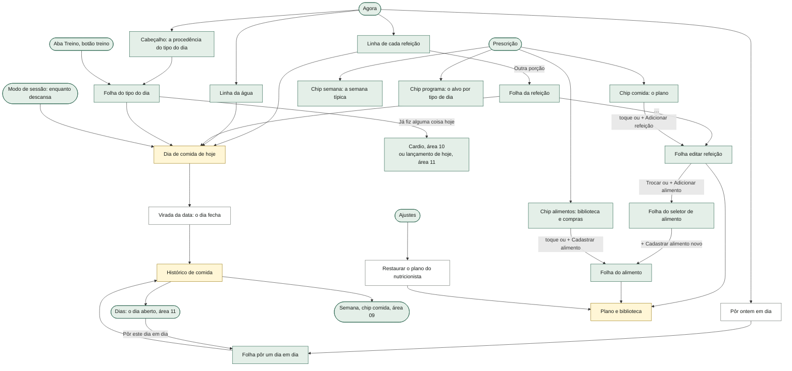

As folhas formam uma pilha de no máximo três níveis (refeição → editar refeição → seletor; cadastrar a partir do seletor **troca** a folha do topo em vez de empilhar uma quarta). O Voltar do sistema, o "×" e o toque no véu fecham a folha de cima (a pilha e o Voltar são da área 01).

---

## 3. Fluxos, um por funcionalidade

### 3.1 Marcar uma refeição pela linha do Agora

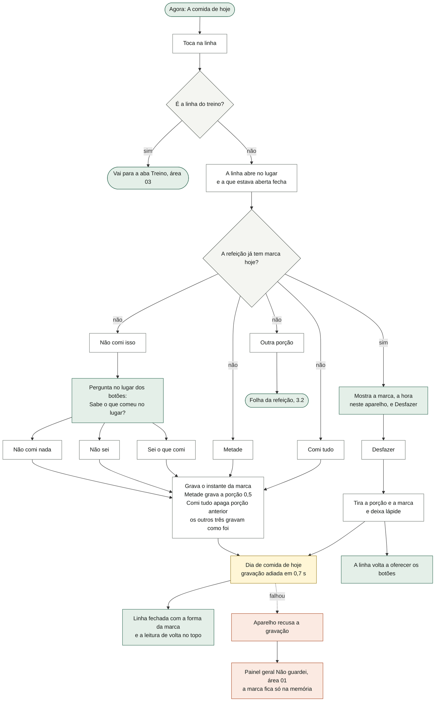

O que o diagrama não mostra: a marca grava sempre um instante **maior** que a lápide daquela refeição (se ele marcar, desmarcar e marcar de novo no mesmo milissegundo, o instante vira lápide + 1), para a fusão não apagar a marca que ele acabou de fazer. Um toque numa refeição já marcada que não seja "Desfazer" é ignorado. A linha mostra o estado com uma forma (círculo cheio com visto = comi tudo; meio cheio = metade; traço diagonal = fora do plano; traço = não comi; "?" = não sei; tracejado = sem marca; ponto = mais tarde; anel = agora). Só a porção 0,5 aparece como "metade"; ¾, 1¼ e 1½ aparecem como "comi tudo". A leitura de volta só nasce dos toques na linha e no cartão de cima (não da folha da refeição). Os mesmos botões no **cartão de cima** chamam o mesmo verbo (composição da área 10). Se o app fechar antes de 0,7 s, a marca não chegou ao disco (é o adiamento geral de gravação, área 01).

### 3.2 A folha da refeição (porção de hoje, marcar pela folha)

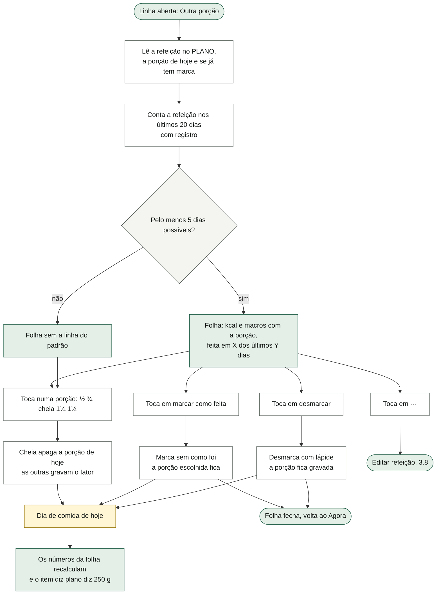

O que o diagrama não mostra: a folha lê a refeição **do plano**, não a de hoje — o horário no topo é o do plano (num treino à noite o pré-treino aparece às 05:45, embora no Agora esteja às 17:45) e o café continua listado mesmo no dia em que a cafeína saiu. O padrão é contagem crua, nunca percentual ("feita em 14 dos últimos 20 dias com registro"); "Não comi" e "Não sei" não contam como feita. Se a refeição não existir mais no plano, a folha não abre. Para registrar ¾ ou 1½, o caminho é escolher a porção aqui e tocar "marcar como feita" — tocar "Comi tudo" na linha apaga a porção escolhida.

### 3.3 A água

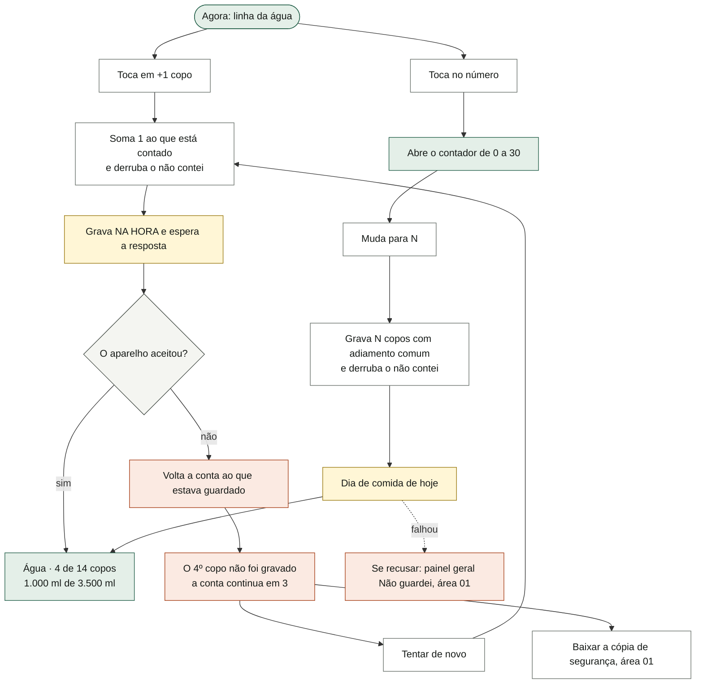

O que o diagrama não mostra: a meta (14 copos de 250 ml) está escrita na tela, não vem do plano. A conta não vem preenchida: dia novo começa em 0 e diz "nenhum copo marcado". "Não contei a água" existe no dado (é um fato, e não zero), mas nenhuma tela o oferece hoje. No modo de sessão, o chip "Água N/14 · +1" do descanso usa o mesmo "+1 copo" e diz a mesma falha ("O 2º copo não foi gravado: o aparelho recusou, e a conta continua em 1."). Em modo privado (aparelho que não guarda), não há painel de falha; o Agora avisa acima do cartão (área 10/01).

### 3.4 A folha do tipo do dia (tipo, turno, alta, como foi o dia)

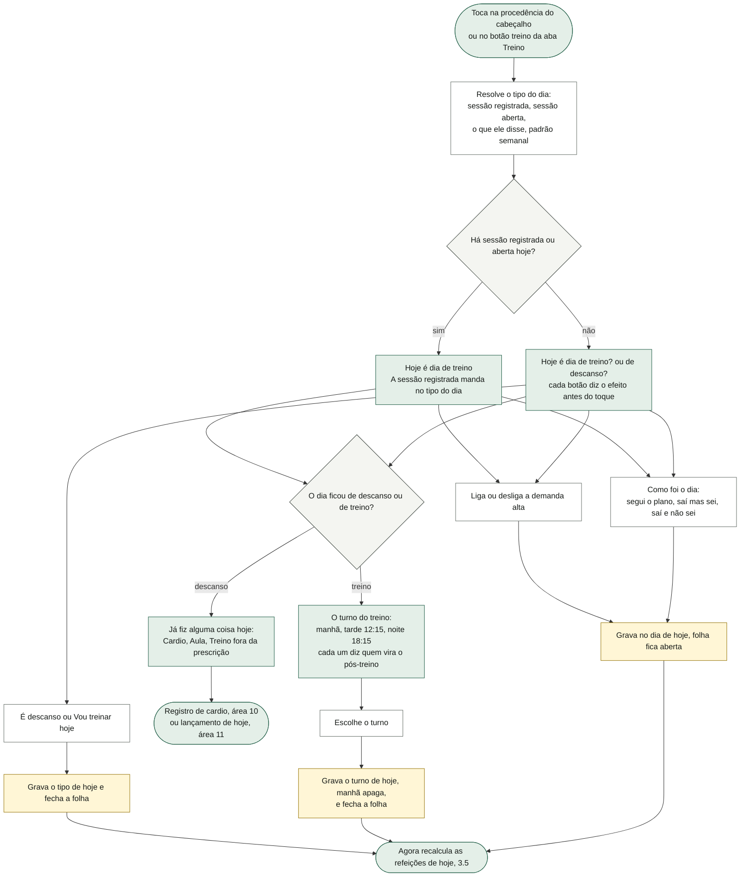

O que o diagrama não mostra: "dizer muda o plano da comida de hoje, e mais nada" — o tipo do dia escolhido aqui não escolhe QUAL treino (isso é da sequência, área 04). Depois de dizer "É descanso" ou "Vou treinar hoje", não há como voltar ao palpite (só trocar de resposta). Uma sessão registrada hoje vence o que ele disse **na tela**, mas o que fica gravado no dia é o que ele disse (ver §9, B1). O olho da folha diz de onde veio: "pelo padrão semanal: terça é dia de treino", "você disse que hoje é descanso" ou "hoje tem sessão registrada". Tipo, turno, alta e "como foi o dia" são ajustes **de hoje**: zeram na virada da data e vão congelados para o histórico.

### 3.5 Como o app monta as refeições de hoje (turno, alta, cafeína, pós-treino)

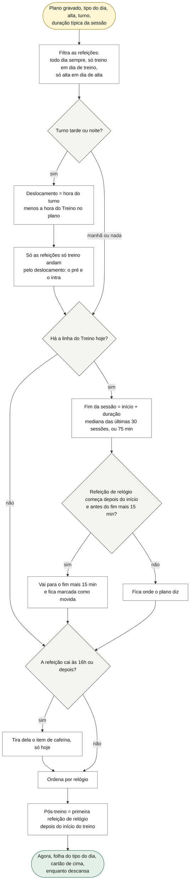

O que o diagrama não mostra: o plano nunca é tocado — sai uma cópia. Com o plano base e 75 min de sessão, os três turnos dão:

| turno | pré | treino | o que move | cafeína |
|---|---|---|---|---|
| manhã | 05:45 | 06:15 | nada (o café das 08:00 já está fora: 06:15 + 75 + 15 = 07:45) | fica |
| tarde | 11:45 | 12:15 | almoço 12:30 → 13:45 (vira o pós-treino) | fica (antes das 16h) |
| noite | 17:45 | 18:15 | jantar 19:30 → 19:45 (vira o pós-treino) | sai do pré |

A duração conta só sessões de 20 a 180 min (líquidas, sem pausas); subestimar empurra a refeição de menos, nunca de mais. Se ele apagar a refeição "Treino" do plano, não há deslocamento nem refeição empurrada. A regra "anda com o treino" é por **condição** ("só treino"), não por nome: uma refeição comum marcada como "só treino" também anda.

### 3.6 O dia fecha sozinho na virada da data

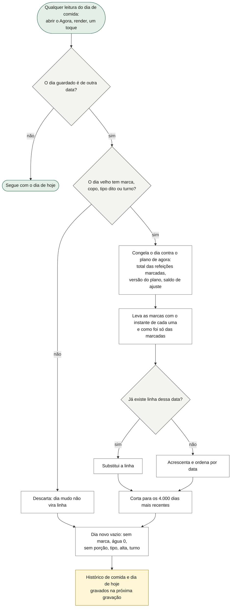

O que o diagrama não mostra: não existe tarefa agendada — o fechamento acontece na **primeira leitura** do dia novo, e é idempotente pela data (abrir o app três vezes não duplica). O total congelado protege o passado de mudanças no plano: cortar o arroz amanhã não reescreve o dia de hoje. Se o app nunca for aberto num dia, aquele dia simplesmente não existe no histórico (é "desconhecido", não zero). O "tipo do dia" que vai para o histórico é só o que ele **disse** na folha; o palpite e a sessão registrada não descem (ver §9, B1). Um dia com apenas "como foi o dia" ou apenas a demanda alta não vira linha.

### 3.7 Pôr um dia em dia — abrir e ler

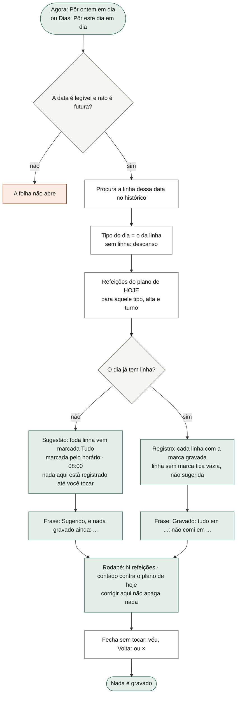

### 3.8 Pôr um dia em dia — o toque que grava

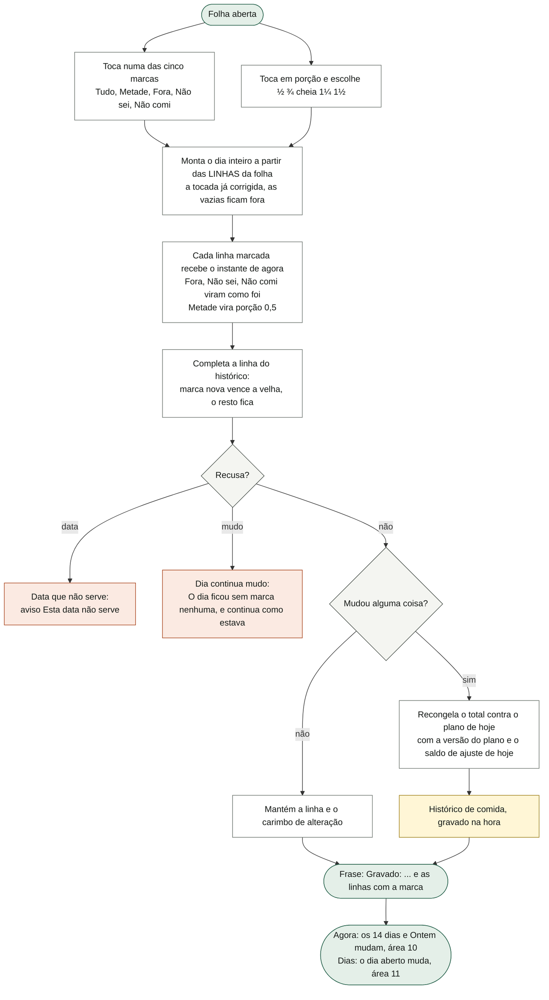

O que os dois diagramas não mostram: **o primeiro toque grava o dia inteiro como estava sugerido** (decisão do dono, P3.i.6) — não há botão "guardar" e não há "Cancelar"; fechar sem tocar não grava, mas depois de um toque fechar não desfaz. **Não há "limpar a marca"**: nenhuma marca sai do registro por esta folha. A régua de porções abre dentro da folha (uma linha por vez), sem abrir folha nova. "Não comi" é o que destrava o portão dos 14 dias (dia com "Não comi" é dia **conhecido**); "Não sei" pesa zero na adesão e o dia continua contando. A folha não deixa dizer a água, o tipo do dia, o turno, a alta nem "como foi o dia" daquele dia; o "como foi o dia" que já estava na linha é reenviado como está. Se o aparelho recusar a gravação, o histórico na memória já mudou e o aviso é o painel geral (área 01). Limite conhecido: trocar uma linha de "Fora/Não sei/Não comi" para "Tudo/Metade", ou de "Metade"/porção diferente de cheia para "Tudo" cheio, **não pega** (ver §9, B2).

### 3.9 Editar uma refeição do plano (e criar uma nova)

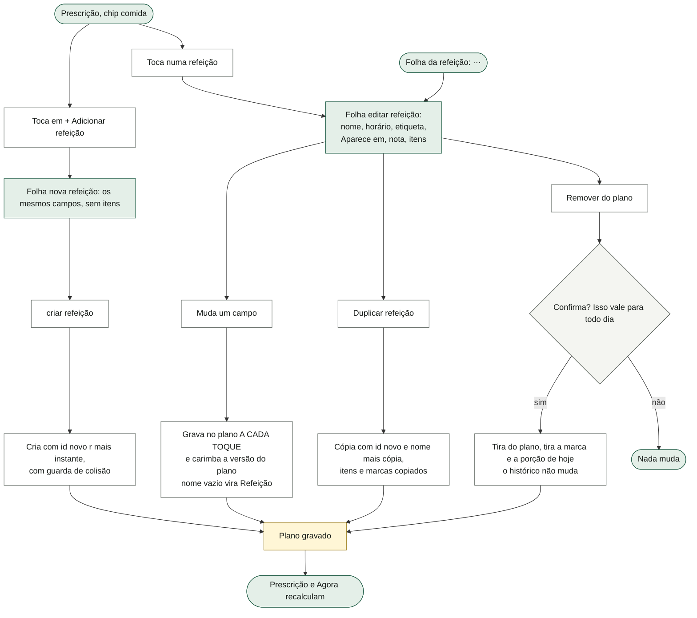

O que o diagrama não mostra: "editar é permanente, ajustar é de hoje" (lei 6) — tudo nesta folha muda o plano de **todo dia**, e a tela diz isso ("O que tem dentro, para todo dia"; "a edição vale daqui para a frente"). Nova refeição nasce às 12:00, "todo dia", sem itens; fechar a folha nova sem "criar refeição" não grava nada. A refeição criada por ele aparece com "criada por você" (qualquer id que não esteja na prescrição original). Remover uma refeição não pede de volta o que o ajuste calórico tinha posto nela. A versão do plano é carimbada mesmo quando ele cancela a remoção (ver §9, B6).

### 3.10 Os itens dentro da refeição

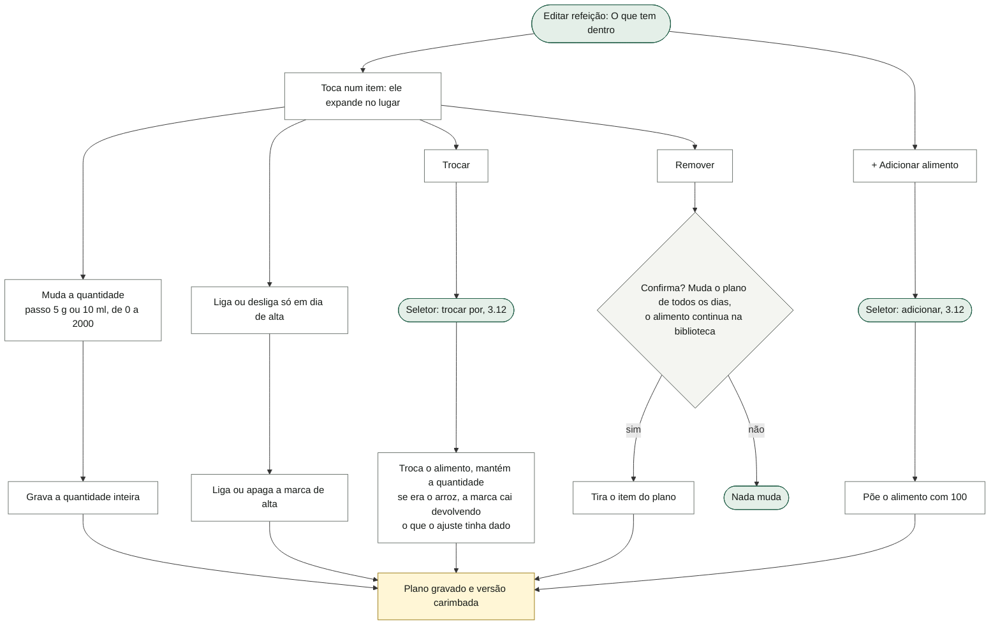

O que o diagrama não mostra: um item cujo alimento não existe mais (escondido ou removido) aparece em âmbar no editor e soma zero no total. Trocar mantém a marca "só em dia de alta" (ela diz QUANDO o item aparece) e mantém a marca de cafeína (o dono não decidiu; ela não aparece em tela nenhuma). A marca de arroz não pode ser posta pela tela: só vem da prescrição (ver 3.16). Mudar a quantidade de um prato de arroz com ajuste em vigor muda o que fica como "prescrito" (o número é do dono).

### 3.11 A biblioteca de alimentos e a folha do alimento

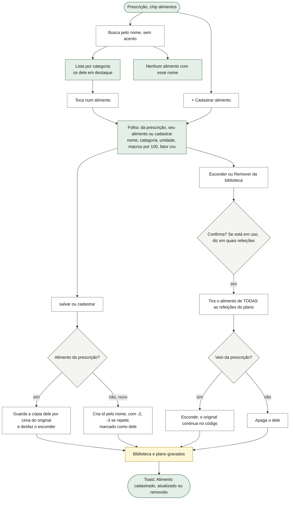

O que o diagrama não mostra: os números digitados aceitam vírgula; texto que não é número vira 0; nome vazio vira "Alimento". Mudar um alimento recalcula tudo o que o usa daqui para a frente (dias já fechados ficam com o total congelado). A folha de um alimento da prescrição diz "restaurar o plano no GUIA devolve o original" — isso não é verdade hoje (ver §9, B4). Remover alimento não carimba a versão do plano (ver §9, B5).

### 3.12 O seletor de alimento (e cadastrar a partir da busca)

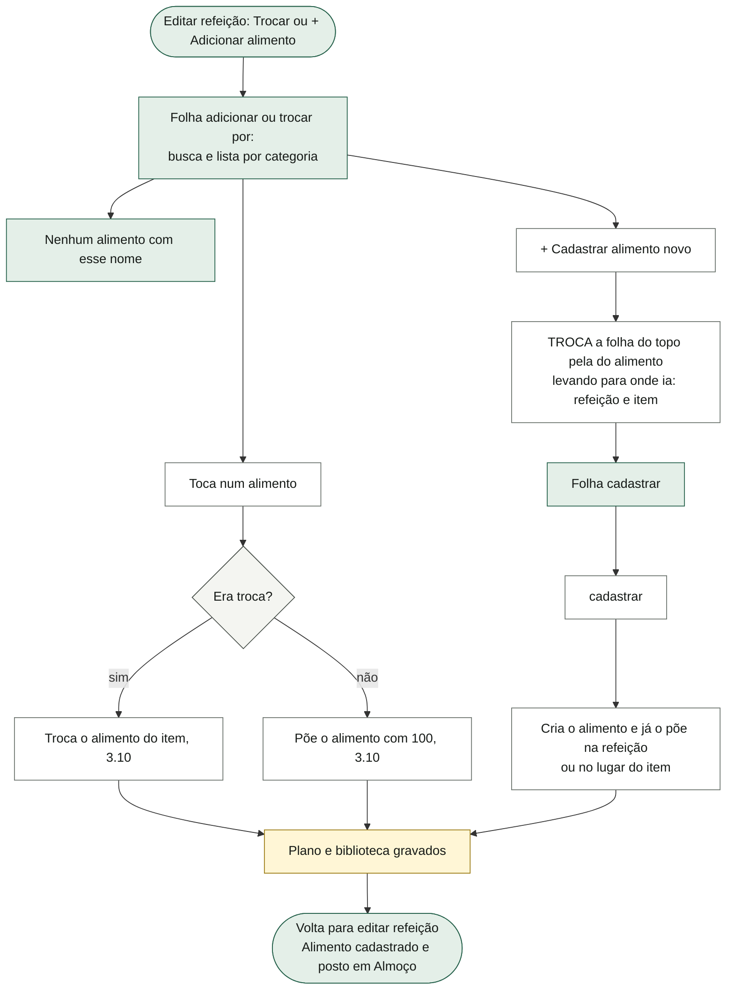

O que o diagrama não mostra: escolher fecha o seletor e volta para a edição da refeição. A busca acha por pedaço do nome e sem acento, em ordem alfabética (pt-BR). O destino da folha é passado como `alvo` e não como `ref` (prop reservada do Preact) — o código registra que, com `ref`, escolher um alimento não fazia nada.

### 3.13 A lista de compras

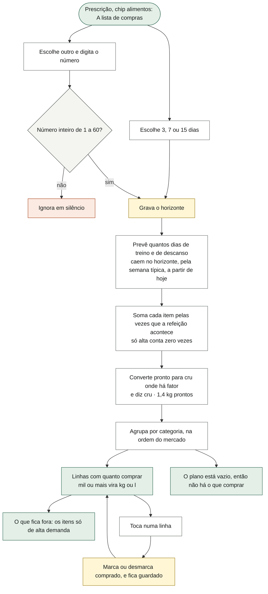

O que o diagrama não mostra: a lista é **derivada, nunca guardada** — só o horizonte e o "comprado" são gravados. A previsão é a semana típica (palpite): "A rotação decide qual treino vem; a cadência só estima quantos serão." Um horizonte guardado fora de 3/7/15 abre como "outro" com o número. "Comprado" nunca zera sozinho (ver §9, B11). A conversão usa o fator da biblioteca: arroz 0,36, macarrão 0,42, cuscuz 0,3625, feijão 0,43, frango 1,3125, suíno 1,34, tilápia 1,25.

### 3.14 A semana típica

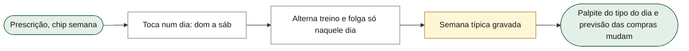

O padrão de fábrica é domingo de descanso e segunda a sábado de treino. A procedência da tela diz que isto "serve para prever as compras", mas ele também decide o palpite do tipo do dia no Agora (o pontilhado do cabeçalho) e, por ele, quais refeições entram hoje.

### 3.15 Restaurar o plano do nutricionista

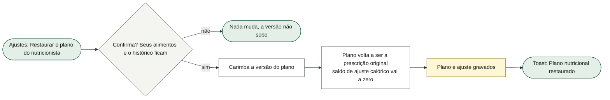

Não toca na biblioteca (alimentos editados continuam editados, escondidos continuam escondidos), nem no histórico de comida, nem no registro dos passos de ajuste (área 09). Ver §9, B4 e B22.

### 3.16 O arroz que recebe o passo calórico (ligação com a área 09)

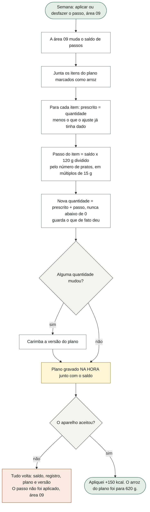

O que o diagrama não mostra: com o plano base (dois pratos de 250 g), o saldo dá 130 g (−2), 190 g (−1), 250 g (0), 310 g (+1), 370 g (+2) por prato. Aplicar o mesmo saldo duas vezes não acumula; desfazer devolve exatamente o que foi somado, mesmo que ele tenha mexido no plano no meio (a marca `ajq` guarda o que cada prato recebeu; decisão do dono de 08/10: o número que fica no prato "é meu"). Trocar o alimento de um prato de arroz tira a marca **devolvendo** o que o ajuste deu (3.10); remover o item ou a refeição leva os gramas junto. O plano base dá 3.204 kcal num dia de treino; as kcal "depois do passo" são calculadas numa cópia do plano antes do toque (área 09).

### 3.17 Enquanto descansa (ligação com a área 03)

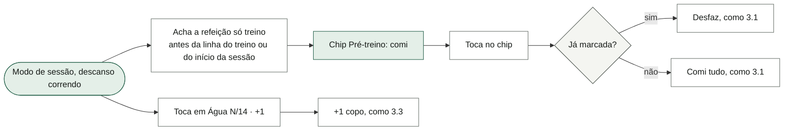

O chip some fora do modo e quando o cronômetro para. Em dia de descanso dito, não há refeição "só treino" e o chip da refeição não aparece.

### 3.18 A adesão e o padrão (as leituras)

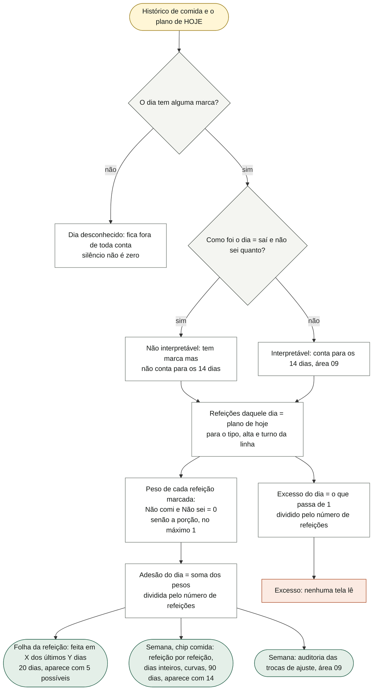

O que o diagrama não mostra: o denominador da adesão é o **plano de hoje**, lido a cada vez — uma refeição nova (a ceia, por exemplo) muda o denominador de todo dia passado sem reescrever nada; o que fica congelado é só o total de kcal e macros. A contagem por refeição ("qual eu mais falho") e a contagem de "dias inteiros cumpridos" (adesão de pelo menos 0,999) são sempre contagens ("9 de 20"), nunca percentuais, sem cor avaliativa. A "a que menos aparece" só é dita se tiver pelo menos 5 dias possíveis e não tiver sido feita em todos. A curva semanal da adesão é a média da adesão dos dias com registro de cada semana (em %, só para a linha) — o rótulo da tela diz "dias cumpridos por semana" (ver §9, B25).

---

## 4. Estados da tela

| Estado | Quando acontece | O que a tela mostra |
|---|---|---|
| Linha de refeição fechada, sem marca, horário à frente | Refeição ainda não chegou | Forma de ponto, "mais tarde", as kcal da refeição |
| Linha "agora" | É o assunto do cartão de cima (janela de 30 min, área 10) | Forma de anel, "agora" |
| Linha "sem marca" | Horário passou e não há marca | Forma tracejada, "sem marca" |
| Linha marcada | Tem marca hoje | Forma da marca e "comi tudo · 12h41" (ou metade, fora do plano, não comi, não sei) |
| Linha aberta, sem marca | Toque na linha | Procedência ("no plano às 12h30" ou "depois do treino, às 13h45"), resumo com kcal, "Comi tudo", "Metade", "Não comi isso", "Outra porção" |
| Linha aberta, pergunta | Tocou "Não comi isso" | "Sabe o que comeu no lugar?" + três botões + "Sem saber, a refeição conta como marcada e pesa zero na adesão — melhor que um número inventado." |
| Linha aberta, marcada | Toque numa linha marcada | "comi tudo, marcado às 12h41, neste aparelho" + "Desfazer" |
| Linha do treino | Dia de treino | Nome do treino, "N/M séries" ou "sessão aberta/registrado/não começou"; toque vai para Treino |
| Refeição empurrada | Turno tarde/noite com choque | Nota acima da lista: "Almoço foi para as 13:45, depois do treino" |
| Selo pós-treino | Dia de treino | "pós-treino" pequeno na refeição de relógio depois do treino |
| Leitura de volta | Logo depois de um toque na linha ou no cartão | Nome · marca, "marcado às …, neste aparelho", "Desfazer", "Antes dele, sem marca hoje: …", "Próximo no plano: …" |
| Água sem copo | Dia novo | "Água" · "nenhum copo marcado · meta: 14 copos de 250 ml" |
| Água não contada | Dado veio com o fato (sem porta na tela) | "marcada como não contada · meta: 14 copos de 250 ml" |
| Água com copos | Pelo menos 1 | "Água · 3 de 14 copos", "750 ml de 3.500 ml", bolinhas cheias |
| Água corrigindo | Toque no número | Contador de 0 a 30 |
| Água falhou | Aparelho recusou o "+1" | "O 2º copo não foi gravado" + "Tentar de novo" + "Baixar a cópia de segurança" |
| Folha da refeição sem padrão | Menos de 5 dias possíveis nos últimos 20 | Sem a linha "feita em …" |
| Folha da refeição com porção | Porção diferente de cheia | Cada item com "· plano diz 250 g" |
| Folha do tipo do dia, palpite | Sem sessão e sem resposta | Olho "pelo padrão semanal: …", "É um palpite até você dizer.", dois botões com o efeito |
| Folha do tipo do dia, dito | Ele respondeu | Olho "você disse que hoje é …", o botão escolhido aceso |
| Folha do tipo do dia, fato | Sessão registrada ou aberta | "Hoje é dia de treino" / "A sessão registrada manda no tipo do dia.", sem botões de tipo |
| Folha do tipo do dia, descanso | Tipo resolvido = descanso | "Já fiz alguma coisa hoje" com Cardio, Aula, Treino fora da prescrição; sem turno |
| Folha do tipo do dia, treino | Tipo resolvido = treino | "O turno do treino" com os três turnos |
| Prescrição › comida | Sempre | Lista de refeições, "+ Adicionar refeição", "o dia fecha em", "Ajuste acumulado: nenhum passo de ±150 kcal aplicado" ou "+150 kcal · 2 passos" |
| Editor de refeição sem itens | Refeição existente vazia | "Nenhum alimento nesta refeição ainda." |
| Item com alimento sumido | Alimento escondido/removido | Nome do item em âmbar |
| Biblioteca/seletor sem resultado | Busca não acha | "Nenhum alimento com esse nome." |
| Folha do alimento da prescrição | Toque num alimento base | Olho "da prescrição", "Esconder da biblioteca", nota sobre a cópia |
| Folha do alimento dele | Toque num alimento cadastrado | Olho "seu alimento", "Remover da biblioteca" |
| Compras vazias | Plano sem itens no horizonte | "O plano está vazio, então não há o que comprar." |
| Compras com "outro" | Escolheu "outro" ou horizonte guardado fora de 3/7/15 | Campo "dias até a próxima compra" |
| Linha comprada | Toque numa linha | Linha com o estilo de comprado |
| Pôr em dia, dia sem linha | Data sem registro | Tudo pré-marcado, "marcada pelo horário · 08:00", "nada aqui está registrado até você tocar…", "Sugerido, e nada gravado ainda: …" |
| Pôr em dia, dia com linha | Data já registrada | Marcas gravadas, linhas sem marca como "fica sem marca", "Gravado: …" |
| Pôr em dia, régua aberta | Toque em "porção · …" | ½ ¾ cheia 1¼ 1½ dentro da linha |
| Pôr em dia, recusa "mudo" | Toque que não deixou nenhuma marca | Toast "O dia ficou sem marca nenhuma, e continua como estava." |
| Pôr em dia, data inválida | Futura ou ilegível | A folha não abre (toast "Esta data não serve." se o toque chegar) |
| Semana › comida sem dia | Nenhum dia com registro em 90 | "Ainda não há dia fechado. O dia entra aqui depois da virada da data — o de hoje ainda está aberto." |
| Semana › comida com poucos dias | Menos de 14 dias com registro | "Faltam N dias com registro para o padrão querer dizer alguma coisa…" |
| Aparelho que não guarda | Aba privada/armazenamento bloqueado | Aviso acima do cartão: "O que você marcar vale até fechar esta aba — e não entra na conta dos 14 dias." (área 10) |

---

## 5. Dados

### O que esta área GUARDA (tudo dentro do estado `lastro-v1`, sem chave local própria)

| Campo | Formato | Quem mais lê |
|---|---|---|
| `S.comida.plano` | Lista de refeições `{ id, t 'HH:MM', n nome, tag etiqueta, quando 'sempre' \| 'treino' \| 'alta', nota?, itens }`. Item: `{ f id do alimento, q quantidade, arroz?, alta?, caf? cafeína, ajq? quanto de q veio do ajuste }`. Semeado de `PLANO_BASE` (7 refeições: pré 05:45, treino 06:15, café 08:00, almoço 12:30, lanche 16:00, jantar 19:30, ceia 21:30). | 09 (arroz, kcal do dia de treino, passo), 10 (Agora), 11 (dia aberto), 01 (endereço vazio, cópia, migrações) |
| `S.comida.alimentos` | `{ id: campos parciais do alimento }` — a cópia dele por cima de um alimento base, ou o alimento que ele criou (com `meu: 1`). Alimento: `{ id, n, cat, u 'g' \| 'ml', kcal, p, c, g por 100, cru fator }`. | — |
| `S.comida.ocultos` | `{ id: 1 }` — alimentos da prescrição que ele escondeu. | — |
| `S.comida.v` | Instante da versão do plano (nasce na primeira leitura; sobe a cada mudança do plano ou da biblioteca, monotônico). | — (gravado em cada dia como `pv`) |
| `S.dia` | O dia de hoje: `{ data 'AAAA-MM-DD', done { refeição: instante }, agua copos, aguaNaoContada?, escala { refeição: fator }, como? { refeição: 'fora' \| 'nao' \| 'nsei' }, cadencia? 'treino' \| 'descanso' \| null (o que ele disse), alta? 1/0, aderencia? 'fora' \| 'perdido', turno? 'tarde' \| 'noite' }`. Zera sozinho com a data. | 10 (Agora, cartão, 14 dias), 03 (enquanto descansa), 04/10 (tipo do dia via `diaDeHoje`), 01 (endereço vazio) |
| `S.comidaHist` | Lista de dias passados em ordem de data, até 4.000: `{ d data, done { refeição: instante }, agua, aguaNaoContada?, escala, como?, cadencia?, alta?, turno?, aderencia?, tot { kcal, p, c, g } congelado, pv versão do plano, aj? saldo de passos naquele dia, m instante da alteração }`. | 09 (14 dias, auditoria, curvas), 10 (14 dias, "Ontem"), 11 (mês e dia aberto), 01 (cópia, endereço vazio) |
| `S.compras` | `{ comprado { id do alimento: 1 }, dias horizonte (padrão 7), removidas {} e extras [] — existem mas nada os escreve }` | — |
| `S.cadencia` | 7 posições, domingo primeiro, cada uma `'treino'` ou `'descanso'`. Padrão: descanso, e seis de treino. | 04/10 (palpite do tipo do dia), 11 (palpite do dia vazio em Dias) |
| `S.apagados['comida:AAAA-MM-DD:refeição']` | Lápide de desmarcar uma refeição: instante. | 02 (fusão) |

Estado de tela (não guardado): `view.linhaComida` (a linha aberta), `view.perguntaDe` (a linha com a pergunta do "Não comi isso"), `view.ultimaMarca` `{ id, k, data }` (a leitura de volta), `view.aguaCorrige`, `view.aguaFalhou` (número do copo que falhou), `view.pilha` (as folhas abertas: `refeicao`, `dia`, `editaRefeicao`, `seletor`, `editaAlimento`, `poeODia`). Estado interno das folhas (Preact): o item expandido no editor, os campos do editor de refeição/alimento, o texto da busca, a régua aberta na folha de pôr em dia, o "outro" das compras.

### O que só LÊ de outras áreas

- `S.ajuste` (saldo de passos, área 09) — para congelar `aj` no dia, para o "Ajuste acumulado" e para pôr o arroz; e `S.ajusteHist` indiretamente (a área 09). Restaurar o plano **escreve** `S.ajuste = 0` (ver §8).
- `S.done` (sessões, área 03): a duração típica (mediana das últimas 30) e se há sessão registrada hoje (tipo do dia).
- `S.sessao` (área 03): sessão aberta → dia de treino; início da sessão para achar a refeição de antes no descanso.
- `S.rot`/programa (área 04): qual é o próximo treino, para o efeito "na sequência, o próximo é o Treino B".
- `S.body.peso` (área 07): a curva do peso ao lado da adesão na Semana.

### Como cada dado atravessa a sincronia (área 02)

| Dado | Como funde | Lápide |
|---|---|---|
| `S.comida` (plano, biblioteca, escondidos, versão) | **Documento inteiro**: vem do lado com o `mtime` do estado mais novo. O `mtime` sobe a cada gravação de qualquer coisa. | Não |
| `S.cadencia`, `S.compras` | Documento inteiro, mesma regra. | Não |
| `S.dia` (hoje) | Se os dois lados estão na **mesma data**: campo a campo — marcas por união; `como` viaja com a marca; água fica com o **maior**; "não contei" só sobrevive se nenhum dos dois contou; porção, tipo, alta, turno e "como foi o dia" vêm do lado mais novo. Datas diferentes: vem inteiro do lado mais novo. | Sim, por refeição: `comida:<data>:<refeição>` (vence marca mais velha que ela) |
| `S.comidaHist` | Coleção pela data (`comida:<data>`), com a mesma fusão campo a campo; porção, `tot`, `pv`, tipo, alta, turno, `aj`, "como foi o dia" e `m` vêm do lado com `m` mais novo; `como` solto (sem marca) é descartado; teto de 4.000. | Sim: por refeição e por dia (a de dia só nasce no "Apagar tudo", área 01) |
| `S.apagados` | União das lápides (área 02). | — |

---

## 6. Regras

Origem: **N** = prescrição do nutricionista (agente do dono), **D** = decisão do dono, **R** = desenho/redesenho (frentes, "a D"), **C** = escrito no código sem fonte declarada.

1. **Escopo por condição, não por dia da semana.** Cada refeição tem "todo dia", "só treino" ou "só alta"; cada item pode ser "só em dia de alta". (N/R)
2. **Macros por 100 g ou 100 ml.** Item soma `quantidade × porção ÷ 100 × macros`. Alimento que não existe soma zero (não derruba a tela). (C)
3. **O alvo sai do plano**, nunca de um número escrito à parte. Plano base: **3.204 kcal** em dia de treino (168 P · 423 C · 91 G), **3.041 kcal** em dia sem treino (163 P · 395 C · 88 G), **3.299 kcal** em dia de treino com alta. (N/R)
4. **Tipo do dia, em ordem de precedência:** sessão registrada hoje (fora as "livres") → sessão aberta hoje → o que ele disse → semana típica (palpite, dito como palpite). (R)
5. **Semana típica padrão:** domingo descanso, segunda a sábado treino. (C)
6. **Turnos:** manhã = sem deslocamento (a hora é a do plano); tarde = treino às **12:15**; noite = **18:15**. Deslocamento = hora do turno − hora da refeição "Treino" no plano; só as refeições "só treino" andam (o pré e o intra, mantendo o intervalo). (N para a regra; horários C)
7. **Refeição dentro do treino:** a refeição de relógio que começa depois do início e antes de `fim + 15 min` vai para `fim + 15 min` (`FOLGA_POS` = **15**). Fim = início + duração típica: **mediana** das durações das últimas **30** sessões, contando só as de **20 a 180 min**; sem histórico, **75 min**. (N)
8. **Cafeína:** item de cafeína sai da refeição de hoje que cair às **16:00** ou depois (ele dorme por volta das 23h). Não sai do plano. (N)
9. **Pós-treino é papel, não refeição:** a primeira refeição de relógio depois do início do treino; calculado, nunca gravado; não existe em descanso. (N)
10. **Marcar grava o instante**, sempre maior que a lápide daquela refeição (lápide + 1 ms no mínimo). **Desmarcar deixa lápide.** (C, para a fusão)
11. **As cinco marcas:** tudo (marca sem nada mais); metade (marca + porção 0,5); fora ("comi, mas não foi isto"); não sei; não comi. "Comi tudo" apaga a porção anterior. (D, 06/10; R)
12. **Total do que foi comido:** "não comi" fica fora; "fora do plano" e "não sei" entram com os números do plano (os únicos que o app tem). (R)
13. **Adesão do dia:** cada refeição marcada pesa a porção, **no máximo 1**; "não comi" e "não sei" pesam **0** e ficam no denominador; o denominador é o número de refeições do **plano de hoje** para aquele tipo/alta/turno; dia sem marca dá "sem valor", não zero. O excedente acima de 1 é medido à parte (excesso). (N; D para "não sei", decisão 2)
14. **Dia interpretável (conta para os 14 dias):** tem pelo menos uma marca, e "como foi o dia" não é "saí e não sei quanto". "Não comi" e "Não sei" contam; não há limiar de "não sei". O portão de **11 em 14** é da área 09. (N)
15. **Padrão por refeição:** contagem, nunca percentual, sem cor; dia sem marca fora do denominador; "não comi"/"não sei" no denominador e fora do numerador. Folha da refeição: últimos **20** dias, aparece com pelo menos **5** possíveis. Semana: últimos **90** dias, aparece com pelo menos **14** dias com registro; "a que menos aparece" com pelo menos **5** possíveis e não feita em todos. (R; literatura citada no código)
16. **Dia inteiro cumprido:** adesão de pelo menos **0,999**. (C)
17. **Porções de hoje:** ½, ¾, cheia, 1¼, 1½; "isto não muda o plano"; zeram na virada. Cheia apaga a chave. (R)
18. **Água:** copo de **250 ml**, meta de **14 copos** (3.500 ml), contador de **0 a 30**; "+1 copo" grava na hora e, se o aparelho recusar, a conta volta ao que estava guardado. Contar derruba o "não contei". (C para a meta; R para a falha, estado 8)
19. **Editar é permanente, ajustar é de hoje** (lei 6): quantidade, itens, horário e condição mudam o plano de todo dia; porção, tipo do dia, turno, alta e "como foi o dia" valem só hoje. (R)
20. **Virada do dia:** acontece na primeira leitura do dia novo; dia sem marca, sem copo, sem tipo dito e sem turno não vira linha; idempotente pela data; o histórico guarda no máximo **4.000** dias. (R)
21. **Total congelado:** calculado no fechamento contra o plano daquele instante, com o carimbo da versão (`pv`) e o saldo de ajuste (`aj`). Mudar o plano depois não reescreve o passado. (R; medido no código: 1.348 → 1.220 kcal num dia já vivido sem o congelamento)
22. **Versão do plano:** sobe a cada mudança do plano, da biblioteca ou do arroz, sempre pelo menos +1 (nunca fica parada). (C)
23. **Pôr um dia em dia:** data futura e data ilegível recusadas; completa, nunca apaga ("marca nova vence a velha, chave a chave; o resto fica"); dia que continua mudo não vira linha; o total é recontado contra o **plano de hoje** com carimbo novo; chamada que não muda nada não mexe no carimbo; o primeiro toque grava o dia inteiro sugerido; dia sem linha abre com tudo sugerido como "Tudo"; dia sem linha é lido como descanso. O Agora oferece só **ontem**; a lista de dias tem **14** dias. (D, 06/10: as cinco decisões; R frente 2)
24. **Arroz:** passo de **120 g** por passo de ±150 kcal (150 ÷ 1,28 ≈ 117, arredondado), **repartido** entre os itens marcados como arroz, arredondado a **15 g** por item, nunca abaixo de 0; grava o que deu (`ajq`); desfazer devolve exatamente; aplicar duas vezes não acumula. Trocar o alimento de um prato de arroz tira a marca devolvendo os gramas; a marca de alta fica; a de cafeína fica. (N; D 08/10)
25. **Compras:** derivada; vezes = dias de treino/descanso previstos pela semana típica no horizonte, a partir de hoje; alta = 0 vezes; comprar = pronto × fator cru (fator 0 não converte), com "cru · X prontos"; 1.000 ou mais vira kg/l com uma casa; horizonte de **1 a 60** dias, padrão **7**, atalhos 3/7/15. (C/R)
26. **Biblioteca:** catálogo = base do código menos os escondidos, mais os dele por cima; alimento da prescrição se edita (cópia) e se esconde, não se apaga; o dele se apaga; remover alimento em uso tira-o de todas as refeições, com aviso; id novo = nome em slug, com "-2", "-3" se repetir. (R)
27. **Id de refeição nova** = "r" + instante, com guarda de colisão (duplicar e criar usam a mesma). (C)
28. **Restaurar o plano** volta a prescrição original e zera o saldo de ajuste; não toca biblioteca nem histórico; a versão só sobe se ele confirmar. (R)
29. **Folhas:** no máximo três níveis; cadastrar a partir da busca troca a folha. (R)
30. **Remover refeição** pede confirmação, tira a marca e a porção de hoje daquela refeição; o histórico não muda. Remover item pede confirmação. (R)

---

## 7. Ligações com as outras áreas

| Área | O que esta recebe dela | O que esta entrega a ela |
|---|---|---|
| 01 · Fundação | A gravação (`save`, adiamento de 0,7 s, painel "Não guardei"), a pilha de folhas e o Voltar, o toast, `normalizaEstado` (semeia plano, biblioteca, compras, semana), as migrações de comida (3→4 semeia, 7→8 tira "/ pós-treino" do nome do café, 9→10 dá instante às marcas, 10→11 põe a ceia, 11→12 grava `ajq`), a cópia de segurança, "Apagar tudo" | `S.comida`, `S.dia`, `S.comidaHist`, `S.compras`, `S.cadencia` para a cópia e o endereço vazio ("7 momentos · 3.204 kcal em dia de treino"); "Apagar tudo" mantém plano, biblioteca, compras e semana e apaga o histórico de comida e o dia |
| 02 · Sincronia | A fusão do dia aberto e do histórico campo a campo; documentos pelo `mtime` | As lápides de refeição desmarcada; a forma dos dados |
| 03 · Sessão | As sessões (duração típica; sessão registrada/aberta decide o tipo do dia; início da sessão) | O chip da refeição de antes do treino e o "+1 copo" no descanso |
| 04 · Programa | O próximo treino na sequência (para o texto do efeito) | A semana típica (`S.cadencia`) usada pelo palpite; a seção "O alvo por tipo de dia" mora no chip "programa" da Prescrição |
| 07 · Corpo | O peso semanal (curva ao lado da adesão) | — |
| 09 · Semana e regra | O saldo de passos (`S.ajuste`) e a escrita no arroz (`aplicaArroz`), o rótulo "ajuste +150 kcal" | O plano (arroz, kcal do dia de treino), os dias interpretáveis (portão 11 em 14), o padrão por refeição, os recortes, as curvas e a auditoria das trocas (`dadosDeComida`) |
| 10 · Agora | O cartão de cima (quando a refeição é "agora"), o cabeçalho com a procedência, os 14 dias e "Ontem" | As refeições de hoje no turno, as marcas, a água, os verbos da linha, a folha do tipo do dia, a folha de pôr em dia |
| 11 · Dias | O dia aberto e o mês (a porta "Pôr este dia em dia"), o lançamento de um treino de hoje (a partir de "Já fiz") | A leitura de um dia passado (`poeODiaEmDia`), o histórico de comida, "dia interpretável" para a célula do mês |

---

## 8. Como serviço individual

**Nome:** `nutricao` (serviço de Comida), com três agregados: **Plano** (documento), **Diário** (dia aberto + histórico, coleção por data) e **Compras** (estado mínimo; a lista é derivada).

**O que ele possui:** `S.comida` (plano, biblioteca, escondidos, versão), `S.dia`, `S.comidaHist`, `S.compras`, `S.cadencia` e as lápides `comida:*`.

**Operações (API):**

| Verbo | Recebe | Devolve |
|---|---|---|
| `GET /plano` | — | refeições em ordem de relógio, kcal de cada, "criada por você", totais por tipo de dia, versão |
| `GET /dia/hoje` | tipo do dia resolvido, duração típica | refeições de hoje (turno, cafeína, movidas, pós-treino), marcas, porções, água, alvo |
| `POST /dia/hoje/refeicoes/{id}/marca` | `{ marca: tudo \| metade \| fora \| nsei \| nao }` | dia atualizado, leitura de volta |
| `DELETE /dia/hoje/refeicoes/{id}/marca` | — | dia atualizado + lápide |
| `PUT /dia/hoje/refeicoes/{id}/porcao` | `{ fator: 0,5 a 1,5 }` | dia atualizado |
| `POST /dia/hoje/agua` | `{ mais: 1 }` ou `{ copos: N }` ou `{ naoContei: true }` | conta gravada, ou recusa com a conta que ficou |
| `PUT /dia/hoje/enquadramento` | `{ tipo?, turno?, alta?, comoFoi? }` | dia atualizado |
| `POST /dia/fechar` | data de hoje | linha do histórico (ou nada, se mudo) |
| `GET /dias/{data}` | data | linhas da folha de pôr em dia (sugestão ou registro), frase |
| `PUT /dias/{data}` | marcas por refeição, porções | linha nova/atualizada, ou recusa `data` \| `futuro` \| `mudo` |
| `GET /historico?janela=N` | janela | dias com marcas, adesão, padrão por refeição, recortes, curvas |
| `GET /dias-conhecidos?janela=14` | data de hoje | contagem de dias interpretáveis |
| `POST/PUT/DELETE /plano/refeicoes[/{id}]` | campos | plano + versão |
| `POST/PUT/DELETE /plano/refeicoes/{id}/itens[/{idx}]` | alimento, quantidade, alta | plano + versão |
| `POST /plano/refeicoes/{id}/duplicar` | — | refeição nova |
| `POST /plano/restaurar` | — | plano original (e pedir à regra que zere o saldo) |
| `POST /plano/arroz` | saldo de passos | quantidades novas por prato, se mudou |
| `GET/POST/PUT/DELETE /alimentos[/{id}]` | campos, busca | catálogo efetivo, aviso de uso |
| `GET /compras?dias=N` | horizonte | linhas, previsão, o que fica fora |
| `PUT /compras/{alimento}/comprado` | — | estado |
| `PUT /semana-tipica/{dia}` | treino/folga | semana |

**Eventos que emitiria:** `RefeicaoMarcada`, `RefeicaoDesmarcada` (com lápide), `PorcaoAjustada`, `AguaContada`, `AguaNaoContada`, `TipoDoDiaDito`, `TurnoEscolhido`, `AltaDemandaMudou`, `ComoFoiODiaMudou`, `DiaDeComidaFechado`, `DiaPostoEmDia`, `PlanoMudou` (com a versão), `AlimentoMudou`, `SemanaTipicaMudou`, `DiasConhecidosMudou`.

**Eventos que escutaria:** `PassoCaloricoAplicado`/`Desfeito` (09 → pôr o arroz), `SessaoRegistrada`/`SessaoAberta`/`SessaoFechada` (03 → tipo do dia e duração típica), `ProximoTreinoMudou` (04, só para texto), `DataVirou` (relógio → fechar o dia), `EstadoApagado` (01), `FusaoConcluida` (02).

**O que hoje está acoplado e precisaria ser separado:**

- **O fechamento do dia acontece dentro de uma leitura.** `diaDeComida()` é chamado em todo render e muta `S.comidaHist`/`S.dia` sem gravar; precisa virar um evento explícito (`DataVirou`) com gravação própria.
- **O tipo do dia é calculado fora da área** (`diaDeHoje` em `src/dominio/dia.ts`, lendo `S.done`, `S.sessao`, `S.rot` e `S.dia.cadencia`), e o que desce ao histórico é só o que ele disse. O serviço precisaria receber o tipo **resolvido** (e a origem) como entrada.
- **A área 09 escreve no plano** (`aplicaArroz` mexe nos itens; `gravaOPasso` tira e repõe o plano inteiro num desfazer). E o restaurar do plano escreve `S.ajuste = 0`, que é da 09. A fronteira natural é a 09 emitir o saldo e este serviço aplicar no arroz e responder se mudou.
- **O congelamento depende do saldo de ajuste** (`aj` em cada dia vem de `S.ajuste`); a auditoria da 09 lê esse campo. Precisaria de um contrato explícito (o saldo em vigor no dia).
- **A duração típica lê `S.done`** (área 03) diretamente.
- **A pilha de folhas** (`pilha`, `abreFolha`, `trocaFolha`, `fechaFolha`, `fechaTudo`) mora na seção "edição de COMIDA" de `main.jsx`, mas é do app inteiro.
- **`dadosDeComida` vive dentro de `CTX.dados`** (o view-model da Semana) e mistura com o veredito; separar a leitura do histórico da leitura da regra.
- **Os documentos dependem do `mtime` global**: qualquer gravação (um copo de água) decide de que lado vem o plano inteiro. Como serviço, o plano precisaria do próprio carimbo.
- **Dias e o Agora chamam `poeODiaEmDia` para classificar** um dia (célula cheia/parte); a classificação deveria ser uma leitura própria, não o view-model de uma folha.
- **Constantes de tela**: a meta de água (14 copos de 250 ml) está duplicada (`agora.jsx` e `COPOS_DO_DIA` em `main.jsx`); deveria ser dado do plano.

---

## 9. Riscos e dívidas que apareceram na leitura

Só registro; nada foi consertado.

- **B1 · O dia fecha com o tipo "dito", não com o tipo resolvido (parece bug).** `S.dia.cadencia` só é escrito pela folha do tipo do dia; `fechaDia` usa `dia.cadencia === 'treino'`. Num dia de treino pelo padrão semanal ou pela sessão registrada, sem tocar na folha, a linha do histórico fica sem tipo: o total congelado sai **sem o pré-treino e o intra**, e a adesão desse dia usa as refeições de descanso (a marca do pré-treino é ignorada como "refeição que não existe mais"). Nos recortes da Semana o mesmo dia conta como "treino" (sem tipo → treino), e no Dia aberto aparece "Plano do dia". E se ele disse "É descanso" de manhã e depois treinou, o histórico guarda "descanso". Para reproduzir: numa terça (padrão treino), marcar "Pré-treino" e "Café da manhã" sem abrir a folha do tipo do dia; virar a data; a linha do histórico não tem `cadencia`, o `tot` não inclui o pré e a folha de pôr em dia desse dia não mostra o pré. **A confirmar** com o dono qual tipo deve descer.
- **B2 · Pôr em dia não volta uma linha para "Tudo" (bug, conferido rodando `poeComidaNoDia`).** O merge une `como` e `escala` com o que já estava e o toque "Tudo" não manda nenhum dos dois; além disso, numa linha em "Metade" o toque "Tudo" reenvia a porção 0,5 da própria linha. Para reproduzir: abrir "Pôr ontem em dia", tocar "Fora" no almoço, depois "Tudo" — continua "fora do plano". O mesmo de "Metade" para "Tudo" ou de porção 1½ para "cheia". Entre "Fora", "Não sei" e "Não comi" a troca funciona.
- **B3 · Pôr em dia de um dia sem linha lê o dia como descanso**, sem pré e sem treino, e a folha não deixa dizer que foi dia de treino (nem a água, a alta, o turno, "como foi o dia"). Mesmo com sessão registrada naquele dia (`S.done`), a folha não olha. **A confirmar** se é limite aceito.
- **B4 · Esconder um alimento da prescrição e restaurar o plano deixa o plano apontando para o escondido.** Restaurar não toca em `ocultos`, então, se ele escondeu "Arroz branco cozido", o plano restaurado tem o arroz somando **0 kcal**, sem aparecer no resumo da refeição. E a folha do alimento promete "restaurar o plano no GUIA devolve o original" — o restaurar mora em Ajustes e não devolve o alimento original (a cópia editada continua por cima).
- **B5 · Remover um alimento não carimba a versão do plano**, embora tire itens do plano (`removeAlimento` não chama `planoMudou`).
- **B6 · Remover refeição carimba a versão antes de perguntar** — cancelar sobe a versão sem o plano mudar (o mesmo erro que o código registra ter corrigido em `restauraPlano`). `setQuantidade`, `alternaAlta`, `adicionaItem`, `trocaItem` e `duplicaRefeicao` também carimbam antes de conferir se a refeição/item existe, e o editor de refeição carimba a cada tecla.
- **B7 · Remover refeição apaga a marca de hoje sem lápide** e deixa o `como` dela solto no dia aberto; o outro aparelho, na fusão do mesmo dia, traz a marca de volta (e ela conta em "Hoje tem refeição marcada" e nos 14 dias, embora a refeição não exista mais).
- **B8 · "Corrigir →" no cartão do dia fechado abre o editor do PLANO** (permanente, com "Remover do plano"), não a correção da marca de hoje. Para reproduzir: marcar todas as refeições de hoje → cartão "dia fechado" → "Corrigir →". (Composição da área 10; a folha é daqui.)
- **B9 · "Não contei a água" não tem porta na tela**: `setAgua(null)` não é chamado por nenhuma tela; o fato só chega por dado.
- **B10 · Corrigir a água pelo contador não sabe se gravou** (adiamento comum); só o "+1 copo" espera a resposta. Nenhuma escrita de comida declara o que está gravando, então o painel de falha diz "a última mudança".
- **B11 · "Comprado" nunca zera** — não há "nova compra" nem limpeza; na semana seguinte tudo continua riscado. `S.compras.removidas` e `extras` existem no tipo e no estado mas nada os escreve. O comentário do tipo diz horizonte "7, 14 ou 30"; a tela oferece 3/7/15/outro (1 a 60). Número inválido no "outro" é ignorado em silêncio.
- **B12 · Compras: uma refeição inteira "só alta" não entra na lista e não é citada** no "o que fica fora" (que só lista itens marcados "só em dia de alta").
- **B13 · Prescrição › comida: as kcal de cada refeição incluem os itens só de alta** (`totalDaRefeicao(r, cat, true)`): a refeição "Treino" aparece com **95 kcal** (toda da maltodextrina, que só entra em dia de alta) e a lista soma 3.300 kcal, enquanto "o dia fecha em" diz 3.204.
- **B14 · A folha da refeição mostra o horário e os itens do plano**, não os de hoje (pré às 05:45 com café num treino à noite). "Marcar como feita" pela folha não gera a leitura de volta no Agora. Porções ¾, 1¼ e 1½ aparecem como "comi tudo" na linha. A lista de itens usa o id do alimento como chave: dois itens do mesmo alimento na mesma refeição colidem.
- **B15 · Dois aparelhos em datas diferentes:** a fusão só une o dia aberto quando as datas batem; senão vale o dia do lado mais novo, e o dia ainda não fechado do outro aparelho pode se perder. **A confirmar** (área 02).
- **B16 · O plano é documento decidido pelo `mtime` do estado inteiro:** editar o plano no iPhone e depois marcar um copo no iPad (com o plano velho) faz o plano velho vencer. Vale também para biblioteca, compras e semana. (Área 02.)
- **B17 · `tot`, `pv` e o excesso são gravados/calculados e nenhuma tela os lê**: a promessa de dizer "este dia foi calculado contra um plano diferente do atual" não existe na tela, e o "comi mais que o plano" não aparece em lugar nenhum.
- **B18 · `CTX.diasDeComidaFechados` não tem chamador** na interface (código morto ou porta futura).
- **B19 · O fechamento ignora dia que só tem "como foi o dia", alta ou "não contei"**, diferente de `poeComidaNoDia`, que considera "não contei" e "como foi o dia".
- **B20 · A meta de água (14 copos de 250 ml) é constante de tela, duplicada** em dois arquivos, sem fonte declarada. **A confirmar** a origem.
- **B21 · Restaurar o plano zera o saldo sem registrar no histórico dos passos** (o último passo continua "não desfeito" no registro) e não grava na hora com volta, como o passo faz.
- **B22 · Duplicar uma refeição com arroz copia a marca e o `ajq`**: duplicar o almoço cria um terceiro prato de arroz com o ajuste já dado; o próximo passo se reparte por três e o "arroz do plano" passa a somar três pratos. **A confirmar** se é desejado.
- **B23 · Trocar a condição de uma refeição comum para "só treino" faz ela andar com o turno** (a regra é por condição). Consequência de desenho, não dita na tela.
- **B24 · A curva da Semana diz "dias cumpridos por semana", mas o número é a média da adesão ponderada** (área 09 desenha; a conta é daqui).
- **B25 · Depois de responder o tipo do dia, não há volta ao palpite**; e a demanda alta é oferecida em dia de descanso, onde não muda nada no plano base.
- **B26 · Editor de refeição grava a cada tecla**: apagar o nome para digitar outro grava "Refeição" no plano por um instante (e carimba a versão a cada letra).

---

## 10. Índice técnico

### Arquivos

| Arquivo | Papel |
|---|---|
| `src/dominio/nutricao/tipos.ts` | Tipos: `Alimento`, `Quando`, `Turno`, `Item` (com `arroz`, `alta`, `caf`, `ajq`), `Refeicao`, `Totais`, `ComoFoiARefeicao`, `DiaComida`, `DiaComidaHist`, `LinhaCompra` |
| `src/dominio/nutricao/alimentos.ts` | `CATEGORIAS`, `ALIMENTOS_BASE` (33 alimentos, com fator cru), `TURNOS`, `PLANO_BASE` (7 refeições) |
| `src/dominio/nutricao/calculo.ts` | Toda a conta: totais, condições, turno, cafeína, pós-treino, arroz, compras, fechamento, pôr em dia, adesão, padrão, janela, recortes, auditoria |
| `src/dominio/dia.ts` | `CADENCIA_PADRAO`, `cadenciaPrevista`, `diaDeHoje` (tipo do dia), `previsaoDoHorizonte` (compras) — compartilhado com 04/10 |
| `src/dominio/sincronia.ts` | `chaveDeDiaComida`, `chaveDeRefeicaoFeita`, `uneDiasDeComida` (interna), a fusão do dia aberto em `funde` (área 02) |
| `src/dominio/migracoes.ts` | `migraPlano4`, `migraPlano8` (`NOME_POS_PLANO_7`), `migraPlano10`, `migraPlano11` (`CEIA_PLANO_11`), `migraPlano12` (`PASSO_ARROZ_PLANO_12`, `GRADE_ARROZ_PLANO_12`) — área 01 |
| `src/main.jsx` | Seções "O CONTEXTO" (dia de comida, versão, catálogo), "ações do dia", "a água em linha", "a linha da comida", "as folhas" (`CTX.refeicao`, `CTX.seletorDeDia`), "COMIDA", "DADOS" (`dadosDeComida`), "GUIA", "edição de COMIDA", "pôr um dia em dia", "enquanto descansa" |
| `src/ui/folhas/refeicao.jsx` | `FolhaRefeicao` (porção de hoje, `PORCOES`), `FolhaDia` (tipo do dia, já fiz, turno, alta, como foi o dia) |
| `src/ui/folhas/editores.jsx` | `FolhaEditaRefeicao` (`QUANDO`), `FolhaSeletor`, `FolhaEditaAlimento` |
| `src/ui/folhas/poeodia.jsx` | `FolhaPoeODia` (`MARCAS`, `PORCAO_TXT`) |
| `src/ui/telas/prescricao.jsx` | Chips "comida" (plano, "o dia fecha em"), "alimentos" (`Biblioteca`, `Compras`, `HORIZONTES`), "semana" (`SEMANA`), e "O alvo por tipo de dia" no chip "programa" |
| `src/ui/telas/agora.jsx` | A linha da comida, a leitura de volta, a água (`COPO` = 250, `COPOS` = 14), "Pôr ontem em dia" — composição da área 10 |
| `src/ui/instrumento/forma.jsx` | `Forma` e `NOME_DA_MARCA` (as formas das marcas) |
| `src/ui/exercicio.jsx` | `Descansa` (chips do descanso) — área 03 |
| `src/ui/telas/ajustes.jsx` | Botão "Restaurar o plano do nutricionista" |
| `src/ui/telas/semana.jsx` | Chip "comida" (desenho da 09, dados de `dadosDeComida`) |
| `src/ui/telas/dia.jsx`, `dias.jsx` | "a comida do dia" e "Pôr este dia em dia" (área 11) |

### Funções de `src/main.jsx` (linhas do commit `8ec19a4`)

`hojeISO` 2172 · `diaDeComida` 2182 · `fechaDiaDeComida` 2206 · `duracaoDoTreino` 2229 · `versaoDoPlano` 2242 · `planoMudou` 2255 · `catalogoAlimentos` 2258 · `planoDeComida` 2269 · `cadenciaDaSemana` 2274 · `diaResolvido` 2278 · `ehLinhaDeTreino` 2283 · `folhaAberta` 6942 (as folhas) · `dadosDeComida` 7452 · `pilha` 8198 · `idAlimento` 8214 · `achaRefeicao` 8222 · `idRefeicao` 8237 · `fraseDoDia` 10771 · constantes `PORCOES_DO_DIA` 10636, `PALAVRA_DA_MARCA` 10767, `COPOS_DO_DIA` 11393.
Usadas daqui, de outras áreas: `lapide` 130, `save` 1493, `queueSave` 1560 (01); `rotuloDoAjuste` 4106, `arrozAtual` 4115, `aplicaArroz` 4139, `gravaOPasso` 7648, `sinalDoPasso` 7731, `kcalDeTreinoCom` 7739, `passoEmVigor` 7753 (09); `abrirAdicionar` 3870 (11).

### `CTX.*` cobertos

Do dia: `ehLinhaDeTreino` 2408, `marcaRefeicao` 2428, `setAgua` 2458, `abreRefeicao` 2464, `agua` 2472, `maisUmCopo` 2477, `abreCorrecaoDaAgua` 2492, `linhaDaComida` 2500, `abreLinhaDaComida` 2508, `marcaLinhaDaComida` 2518, `editaRefeicao` 2535, `novaRefeicao` 2536, `setEscala` 2540, `abreSeletorDeDia` 2547, `setCadenciaDeHoje` 2548, `setAlta` 2553, `jaFizHoje` 2559, `setAderencia` 2568, `setTurno` 2574.
Folhas e Prescrição: `refeicao` 6963, `seletorDeDia` 6984, `planoCompleto` 7116, `resumoDoPlano` 7150, `alimentosFiltrados` 7208, `compras` 7215, `setHorizonteCompras` 7239, `marcaCompra` 7244, `novoAlimento` 7248, `editaAlimento` 7249, `guia` 7770 (os alvos; as regras são da 04), `alternaCadencia` 7788, `restauraPlano` 7796.
Edição: `abreFolha` 8200, `trocaFolha` 8209, `fechaFolha` 8210, `fechaTudo` 8211 (pilha, do app inteiro), `refeicaoParaEditar` 8250, `salvaRefeicao` 8271, `duplicaRefeicao` 8284, `removeRefeicao` 8297, `setQuantidade` 8314, `removeItem` 8322, `alternaAlta` 8341, `adicionaItem` 8349, `trocaItem` 8358, `alimentoParaEditar` 8388, `salvaAlimento` 8405, `removeAlimento` 8437, `alimentosParaSeletor` 8462.
Pôr em dia: `diasDeComidaFechados` 10664 (sem chamador), `abrePoeODia` 10692, `poeODiaEmDia` 10694, `marcaNoDiaPassado` 10821.
Ligações (o comportamento está aqui, a composição em outra área): `hoje` 2362 (10), `cabecalhoDeHoje` 2339 (10), `dados` 7535 (parte `comida`; 09), `fatosDoDia` 10510 (10), `quatorzeDias` 11285 (10), `enquantoDescansa` 11394 e `preNoDescanso` 11415 (03), `diaAberto` 8777 (parte `comida`; 11).

### Regras do domínio

`calculo.ts`: `VAZIO`, `somaTotais`, `totalDoItem`, `itemEntra`, `refeicaoEntra`, `totalDaRefeicao`, `totalDoDia`, `totalRegistrado`, `minutosDe`, `horaDe`, `deslocamentoDoTurno`, `DURACAO_PADRAO`, `duracaoDaSessao`, `FOLGA_POS`, `CORTE_CAFEINA`, `refeicoesDeHoje`, `posTreinoDe`, `refeicoesMovidas`, `resumoDaRefeicao`, `PASSO_ARROZ`, `arrozDoAjuste`, `ajusteNoItem`, `quantidadePrescrita`, `aplicaAjusteNoArroz`, `tiraMarcaDeArroz`, `listaDeCompras`, `fmtKg`, `fechaDia`, `ComidaDoDia`, `PostoNoDia`, `poeComidaNoDia`, `aderenciaDoDia`, `excessoDoDia`, `PadraoDeRefeicao`, `padraoPorRefeicao`, `diaInterpretavel`, `diasInterpretaveis`, `janelaDoHistorico`, `aderenciaPorSemana`, `contagemDaRefeicao`, `Recorte`, `recorteDoHistorico`, `TrocaDeAjuste`, `trocasDeAjuste` (a auditoria é lida pela 09); internas `semCumprimento`, `pesoDaRefeicao`.
`alimentos.ts`: `CATEGORIAS`, `ALIMENTOS_BASE`, `TURNOS`, `PLANO_BASE`. `tipos.ts`: todos. `tipos.ts` geral: `EstadoComida`, `EstadoCompras`. `dia.ts`: `CADENCIA_PADRAO`, `cadenciaPrevista`, `diaDeHoje`, `previsaoDoHorizonte`. `sincronia.ts`: `chaveDeDiaComida`, `chaveDeRefeicaoFeita`.

### Campos `S.*` e `view.*`

`S.comida` (`plano`, `alimentos`, `ocultos`, `v`), `S.dia`, `S.comidaHist`, `S.compras`, `S.cadencia`; lidos: `S.ajuste`, `S.ajusteHist`, `S.done`, `S.sessao`, `S.rot`, `S.body`, `S.apagados` (escreve as lápides `comida:*`).
`view.linhaComida`, `view.perguntaDe`, `view.ultimaMarca`, `view.aguaCorrige`, `view.aguaFalhou`, `view.pilha` (compartilhado); escreve `view.cardioRapido` pelo "Já fiz → Cardio" (área 10).
Não inventariados e da área: os campos internos `S.comida.v`, `S.compras.comprado/dias/removidas/extras`, `S.dia.como/aguaNaoContada/aderencia/turno`, e a constante `COPOS_DO_DIA`.

### Testes que cobrem a área

- `tests/dominio/nutricao.test.ts` — o plano veio inteiro; categorias e unidades; itens apontam para alimento; escala de porção; alimento desconhecido soma zero; refeição de treino e item de alta; ordem de relógio; resumo; o arroz (passos mensuráveis, reparte entre pratos, desfazer exato, não acumula, esbarrar no zero, perder a marca devolve, `ajq` não entra em conta); a lista de compras (vezes, cru com procedência, sem fator, horizonte zero, kg); a migração 3→4; dias interpretáveis; `fechaDia` congela.
- `tests/dominio/turno.test.ts` — os três turnos; manhã é o plano; o pré e o intra andam; almoço e jantar empurrados; a sessão mais longa empurra mais; a mediana; a cafeína; o plano nunca é tocado; o papel de pós-treino; o número de refeições não muda.
- `tests/dominio/diario.test.ts` — total congelado; adesão ponderada e com teto; ausência não é zero; padrão por refeição; o ajuste em vigor no dia; a janela; dia mudo; recortes; adesão por semana; auditoria; instantes; `como` só para marcadas; "não contei"; a ceia muda o denominador; "não comi", "fora", "não sei" em todas as leituras; `poeComidaNoDia` (linha nova, instante de quem chama, futuro, ilegível, completa, vence chave a chave, recongela, mudo, sem mudança não carimba, ordem, `ajuste` nulo preserva).
- `tests/fluxo/diario.test.js` — a virada fecha o dia; o passado não se reescreve; dia mudo; não duplica; atravessa o backup; a fusão soma dois aparelhos (histórico e dia aberto); o padrão na folha da refeição (e quando não aparece).
- `tests/fluxo/turno.test.js` — os turnos na folha, quem vira o pós-treino, reordena, selo, ajuste de hoje, almoço empurrado, voltar à manhã, sem turno em descanso, migração 7→8, `setTurno`, `setAlta` (alvo soma o intra), catálogo efetivo em `ctx.hoje`, o dia aberto é o mesmo objeto, `movidas`, `cadenciaTxt`.
- `tests/fluxo/planoalimentar.test.js` — o que tem dentro e o "só em dia de alta"; "criada por você"; ajuste acumulado; horizonte 3/7/15/outro; horizonte guardado fora dos três; o que fica fora.
- `tests/fluxo/descansa.test.js` — a refeição de antes do treino no descanso, "comi" e desfazer, "+1" com falha.
- `tests/fluxo/fusao.test.js` — a metade de comida no backup e na migração; a timeline; marcar e persistir; a água; a folha da refeição e a porção de hoje; a virada; apagar histórico não apaga o plano; a semana típica; o alvo sai do plano; editar quantidade; adicionar, cadastrar, escolher na busca, cadastrar da busca sem quarta folha; remover alimento em uso; alimento da prescrição; remover refeição limpa o dia; `trocaItem` (arroz cai, alta fica, cafeína fica); guardas de índice; `refeicaoParaEditar`; `salvaRefeicao`; `duplicaRefeicao`; guarda de id; `alternaAlta`; busca sem acento; `planoCompleto`; `resumoDoPlano`; `alternaCadencia`; `marcaCompra`; `setHorizonteCompras`; o copo que não foi gravado.
- `tests/fluxo/agora.test.js` — pôr em dia (sugestão, registro, futuro, primeiro toque grava tudo, "não comi" e "não sei" contam, não apaga, porção acima de 1, dia mudo inalcançável, Dias abre a folha, cinco marcas, nada gravado, frase com as sete, sem "Cancelar"); a linha (abre no lugar, "Metade", "Não comi isso", "Desfazer" com lápide, estados); a refeição empurrada; os 14 dias; a folha do tipo do dia e "Já fiz"; o cartão da refeição grava e lê de volta.
- `tests/dominio/sincronia.test.ts` — instante na fusão do dia aberto; desmarcar não é desfeito; `como` com a lápide; "não comi" e "não sei" atravessam; quem contou a água vence; porção do lado mais novo; a ceia do aparelho atrasado; a refeição marcada sobrevive à ausência temporária.
- `tests/dominio/fusao.test.ts` — sessão aberta é dia de treino; cadência por dia da semana; horizonte das compras; observar não mexe na comida.
- `tests/dominio/migracoes.test.ts` — 9→10, 10→11 (a ceia, 197,3 kcal), 11→12 (desfazer exato).
- `tests/fluxo/telas.test.js` — `ehLinhaDeTreino`. `tests/dominio/agora.test.ts` — a refeição da janela de 30 min (área 10).
