# 07 · Corpo e medidas

> Em uma frase: esta parte guarda o que o corpo mede (o peso da manhã, a cintura e as outras medidas de fita, a bioimpedância), deixa registrar cada medida em um ou dois toques, no dia certo e sem duplicar o dia, e transforma o peso solto do dia na leitura que importa: a média da semana, o ritmo, a semana que ainda não tem média e a curva da Evolução.

Fronteiras, para não duplicar: o veredito do nutricionista, os portões e o passo de ±150 kcal que leem o peso são da **área 09** (aqui só a série de pesagens que eles leem); as fotos do corpo (a seção "As fotos" do Corpo, Comparar, a sessão de fotos) são da **área 08** (aqui só a ligação); a composição do Agora é da **área 10** (aqui o comportamento da linha "Peso da manhã"); o modo de sessão e o atalho "Peso de hoje" no descanso são da **área 03** (aqui a folha e o registro); gravar, o painel de falha, o painel de pare, o teclado como componente e a cópia de segurança são da **área 01**; a fusão entre aparelhos é da **área 02**.

---

## 1. O que o usuário faz aqui

| # | Funcionalidade | O que faz | Onde fica | Quando aparece / some |
|---|---|---|---|---|
| 1 | **Ver como está o peso** | Seção "O peso da manhã": a nota "2 pesagens da manhã nesta semana", as células "média da semana" e "ritmo por semana" (ritmo em verde-ácido quando entre +0,15 e +0,40, âmbar fora), a barrinha das últimas 14 semanas (média de cada semana) e a procedência "da balança de casa, em semi-jejum, antes do treino · a média da semana é o número que conta · registre 3 a 4 por semana". | Aba Corpo, primeira seção | Sempre. Sem nenhuma pesagem nas 14 semanas, a barrinha vira "Nenhuma medida registrada ainda." Média e ritmo mostram "—" quando não valem (ver §6). |
| 2 | **Registrar o peso de hoje** | Passo de 100 g (botões − e +, entre 20 e 250 kg) e o botão "Registrar hoje". Um toque grava. | Aba Corpo, "O peso da manhã" | Sempre. O número parte do peso do dia (se já houver), senão do último, senão de 75 kg. |
| 3 | **Digitar o número** | Abre o teclado próprio de doze teclas (7 8 9 / 4 5 6 / 1 2 3 / , 0 ⌫) e "pronto". Escreve no mesmo rascunho do passo; quem grava continua sendo "Registrar…". | Botão "Digitar o número" em cada medida do Corpo e na folha do peso no descanso | O botão some enquanto o teclado está aberto. Um teclado por vez. |
| 4 | **Peso de outro dia** | Abre o seletor de data nativo do aparelho; diz o que o dia já tem ("neste dia: 73,4 kg · registrar substitui" ou "nenhuma medida neste dia") e a regra "Nunca uma data futura: o dia ainda não aconteceu." O botão de registrar passa a dizer "Registrar ontem" / "Registrar em ter 14", e o link vira "registrando em ontem · trocar". | Link abaixo do passo, em cada medida ("Peso de outro dia", "Cintura de outro dia", "Braço de outro dia"…) | O seletor fica aberto até registrar. Depois de gravar, a data volta para hoje sozinha. |
| 5 | **Corrigir a medida de um dia** | Registrar num dia que já tem medida substitui a anterior (uma medida por dia, por grandeza). O aviso diz "Peso de ontem atualizado para 73,8 kg." | Mesmo botão "Registrar…" | Quando o dia escolhido já tem medida. |
| 6 | **Remover uma medida** | A lista das 4 medidas mais recentes ("08/10 · 73,4 kg · Remover"). "Remover" abre o painel de pare: "Apagar o peso de 08/10 (73,4 kg) tira ele da média da semana e do ritmo. As outras medidas ficam." com "Apagar o peso de 08/10" e "Deixar como está". | Abaixo das células de cada medida (peso, cintura, fita) | Só quando a grandeza tem medida. Só as 4 últimas. |
| 7 | **A semana sem média** | Em vez de média falsa: "Sem média · esta semana · 1 pesagem", o que falta ("Faltam 2 dias na semana e 1 pesagem para a média valer. Sem ela, a sequência de três semanas se quebra e a regra do nutricionista volta a 'pedir pesagens'."), os dias da semana (com pesagem e hora, "sem pesagem", "ainda dá tempo") e "A prescrição pede 3 a 4 pesagens por semana. No medido, nas quatro semanas anteriores, foram 1,25." | Topo da seção "O peso da manhã" | Quando já existe alguma pesagem e a semana em curso tem menos de 2. Some com a segunda pesagem da semana. |
| 8 | **A cintura** | Passo de 0,5 cm, "Registrar hoje", "Cintura de outro dia", células "última medida" e "no mês" (variação em cm normalizada para 30 dias), a frase "+0,40 cm no mês" ou "faltam 3 semanas de medida para concluir", e a procedência "meça sempre no mesmo ponto, em jejum, sem prender a barriga…". Nota "1× por semana, em jejum". | Aba Corpo, "A cintura" | Sempre. Parte de 85 cm sem medida. |
| 9 | **Como você mediu** | Na primeira medida de um ponto de fita: campo "Como eu medi" ("onde você passou a fita"). Depois: o lembrete "como você mediu: na altura do umbigo" com "Mudar como eu medi". O texto só vai junto com a próxima medida registrada. | Cintura e cada medida de fita ligada | Só nas medidas de fita. |
| 10 | **As outras medidas com fita** | Braço já vem ligado, com seção própria igual à da cintura (células "última medida" e "desde a primeira"). Coxa, panturrilha, peito e quadril aparecem em "As outras medidas com fita" ("ligue as que você tira sozinho") com "sem medida" e "Ligar". Ligar abre a seção daquela medida. | Aba Corpo, depois da cintura | A lista some quando não sobra ponto desligado. Ponto com medida fica ligado para sempre. |
| 11 | **A bioimpedância** | Cinco campos (Peso · kg · o que esta balança mostrou; Massa muscular esquelética · kg; Massa de gordura · kg; Percentual de gordura · %; Água corporal total · litros · pode ficar vazio), com os números da leitura anterior já no lugar e "era 17,4 · −0,6" ao lado; a data ("em"); "Guardar os cinco". | Aba Corpo, "A bioimpedância" (nota "uma vez por mês · anterior: 03/09") | Sempre. Sem leitura anterior, os campos nascem vazios. |
| 12 | **Evolução** | Tela cheia com a curva do peso de 9 semanas (linha = média da semana; pontos = pesagens do dia; faixa = alvo de +0,15 a +0,30 kg/semana), "A taxa, semana a semana" das 4 últimas semanas, a frase que aponta para Semana, "Ir para Semana" e, se houver fotos para comparar, "Comparar fotos". | Botão "Evolução" no cabeçalho do Corpo | Sempre acessível. Fecha pelo Voltar. |
| 13 | **O vazio de verdade** | "3 semanas até a regra poder decidir", "São 6 pesagens, em 3 semanas, para o primeiro veredito existir.", quatro linhas "primeira" (Peso, Cintura e outras medidas, Bioimpedância, Fotos) e, sem conta, "Se você já tem histórico em outro aparelho, entrar na conta traz tudo de volta antes de registrar qualquer coisa aqui." | Topo da aba Corpo | Só quando não há nenhuma medida em nenhuma grandeza e nenhuma sessão de fotos. Some com o primeiro registro. |
| 14 | **O peso de hoje no descanso** | Folha curta "O peso de hoje" ("a sessão continua aberta"), com o mesmo passo de 100 g, "Anotar", "Digitar o número" e "De manhã, antes de treinar, com a mesma roupa." Sempre grava em HOJE. | Atalho "Peso de hoje" no cartão do exercício, enquanto descansa (área 03) | Só no modo de sessão, com descanso armado. Fecha sozinha quando grava. |
| 15 | **A pesagem no Agora** | Linha "Peso da manhã · sem marca" ("antes de treinar, depois do pré · última: 73,8 em 12/10 · 2 nesta semana") com "Anotar", que leva à aba Corpo; ou, já pesado, "Peso da manhã · 73,6 kg" ("anotado às 6h40 · 2 nesta semana"), sem botão. | Agora, abaixo do cartão de cima (composição da área 10) | Sem peso hoje, some depois da hora (ver §6, regra 27). |
| 16 | **As fotos (ligação)** | A seção "As fotos" fica dentro do Corpo, depois da bioimpedância. | Aba Corpo, última seção | Comportamento da área 08. |

---

## 2. Mapa da área

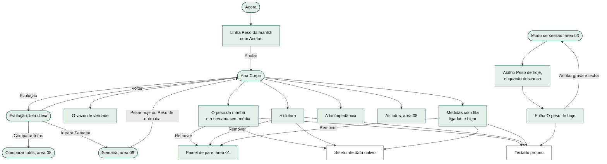

A aba Corpo é uma tela só, de cima para baixo: cabeçalho ("como está · Corpo" com o botão "Evolução"), o vazio (quando há), o peso da manhã, a cintura, as medidas de fita ligadas, "As outras medidas com fita", a bioimpedância e as fotos. A Evolução é a única tela cheia própria da área; a folha do peso no descanso é a única folha.

---

## 3. Fluxos, um por funcionalidade

### 3.1 Registrar o peso de hoje (o passo de 100 g)

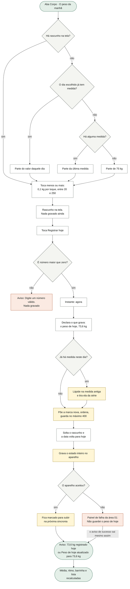

O que o diagrama não mostra: o passo e o teclado escrevem num rascunho de tela que não é guardado; fechar o app ou trocar de aparelho antes de "Registrar" perde o número (trocar de aba não perde: o rascunho continua lá até o app recarregar). O mesmo verbo serve à cintura e às medidas de fita, só muda a grandeza, o passo (0,5 cm) e o nome no aviso ("Cintura de hoje atualizado para 85,5 cm"). Vírgula é aceita ("73,4"). Não há teto: o passo para em 250, mas o teclado deixa entrar 743 (ver §9). Gravar é o estado inteiro de uma vez: se o app fechar no meio, ou entrou a medida inteira ou nada. A sincronia sobe depois (área 02); sem rede, nada muda aqui.

### 3.2 Digitar o número (o teclado próprio)

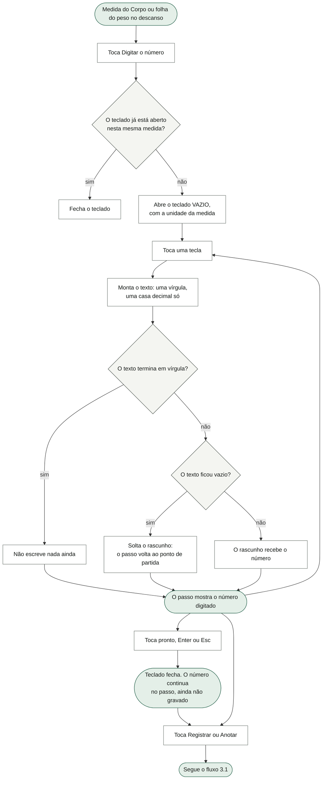

O que o diagrama não mostra: o teclado aqui nasce vazio de propósito (na série de treino ele nasce com o valor registrado): o passo já mostra o número atual logo acima, e pré-encher faria apagar dígitos antes de digitar. A razão de existir está escrita no código: a primeira pesagem parte de 75 kg, e quem pesa 73,6 chegava lá com catorze toques no menos. Apagar tudo no teclado não apaga medida nenhuma; só solta o rascunho. No notebook, o teclado físico funciona (o ponto vira vírgula). O teclado é o mesmo componente da sessão de treino (área 03/01); aqui só muda o alvo ("corpo" + a grandeza). Abrir o teclado de outra medida troca o alvo: há um teclado por vez.

### 3.3 Peso de outro dia (a data da medida) e corrigir um dia

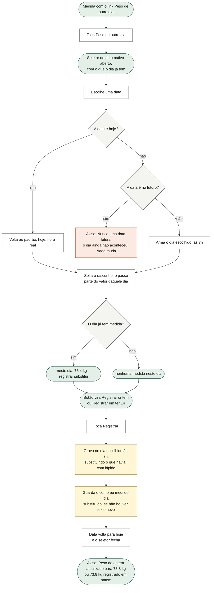

O que o diagrama não mostra: a data é por grandeza (armar ontem no peso não mexe na cintura). O seletor é o nativo do aparelho porque a medida esquecida pode ser de semanas atrás; o próprio campo impede o futuro (`max` = hoje), e o app ainda recusa com aviso se chegar uma data futura. Escolher hoje de volta às 6h funciona (hoje às 7h estaria no futuro; por isso hoje volta ao padrão "agora"). A data é estado de tela: fechar o app desarma. Uma vez aberto, o seletor não tem botão de fechar — só fecha ao registrar (ver §9). A tela Semana (área 09) tem duas portas para cá: "Pesar hoje" (abre o Corpo) e "Peso de outro dia" (abre o Corpo já com o seletor do peso aberto). Em dois aparelhos, corrigir um dia passado tem um risco sério descrito em §9, item 1.

### 3.4 Remover uma medida

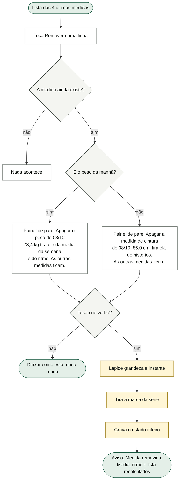

O que o diagrama não mostra: não há desfazer; a medida apagada não volta, e a lápide impede que o outro aparelho a ressuscite na fusão (área 02). Nome e unidade saem da tabela das grandezas, nunca de um "se é peso, senão cintura" (era assim, e o aviso de remover um percentual de gordura perguntava pela cintura em cm). Só as 4 medidas mais recentes têm "Remover"; medida mais antiga não tem porta na tela. A bioimpedância não tem lista nem "Remover" na tela (ver §9). O painel de pare e o "Deixar como está" são da área 01.

### 3.5 A média da semana, o ritmo e a semana sem média (o que o app calcula)

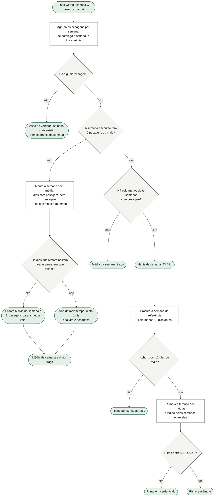

O que o diagrama não mostra: tudo isso é conta feita na hora a partir da série de pesagens; nada é guardado. "Hoje" conta como dia que ainda dá tempo enquanto ele não se pesou hoje. A frase do "medido" é o número de pesagens das 4 semanas fechadas anteriores dividido por 4 (duas casas). O ritmo do Corpo é uma conta diferente da taxa da Evolução e da regra do nutricionista (área 09): ele compara a semana atual com a mais recente que esteja a pelo menos 12 dias, e usa semanas com qualquer número de pesagens; a taxa da Evolução e da regra é semana contra semana, só com médias válidas (ver §9). Na primeira semana da vida do app, mesmo com duas pesagens, a média aparece como traço, porque a conta do ritmo exige duas semanas (ver §9, item 2). A barrinha das 14 semanas usa a média de qualquer semana com pesagem, arredondada a 100 g.

### 3.6 A cintura e as medidas com fita (ligar e "como eu medi")

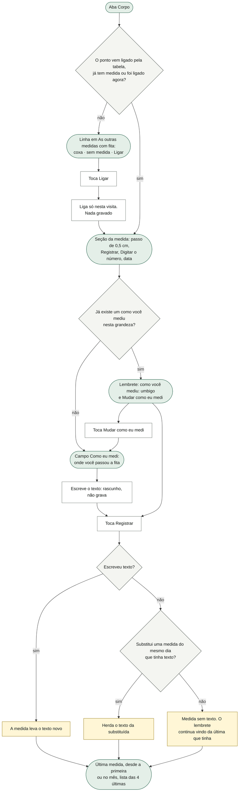

O que o diagrama não mostra: o registro em si é o fluxo 3.1 (mesmo verbo, mesma substituição, mesma lápide). A cintura tem células próprias ("última medida" e "no mês", que só conclui com pelo menos 21 dias entre semanas); as outras fitas mostram "última medida" e "desde a primeira" (última menos a primeira). Ligar não grava nada: um ponto ligado e nunca medido volta a "desligado" quando o app recarrega; um ponto com medida fica ligado pelo próprio dado. Não há "desligar". Nenhuma medida de fita entra em regra nenhuma (a cintura saiu do algoritmo do nutricionista; ver área 09). O texto "como eu medi" é texto do teclado do sistema; escrever não repinta a tela a cada letra e não grava sozinho: só vai junto com a próxima medida, e morre com a lápide dela.

### 3.7 A bioimpedância (os cinco números de uma vez)

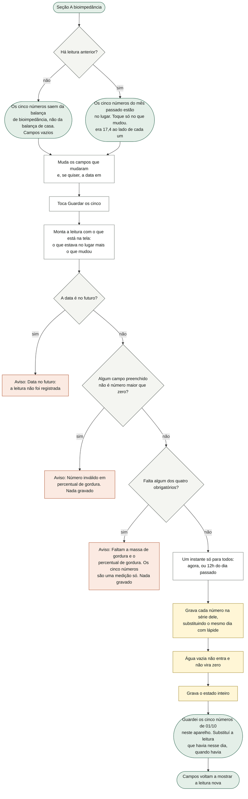

O que o diagrama não mostra: a recusa é atômica — ou entram os quatro obrigatórios (e a água, se houver) ou nada entra; o número inválido é conferido antes da falta. Os cinco ficam em cinco séries separadas, mas com o mesmo instante, e é isso que os faz "uma leitura" (e é por ele que a fusão casa o mesmo dia de dois aparelhos). Hoje leva a hora real (houve um defeito: com meio-dia para todos os dias, antes do meio-dia a leitura de hoje caía no futuro e era recusada; há caso de teste com relógio às 7h). O peso desta balança é registro separado do peso da manhã e não entra na média da semana — a procedência diz isso na tela. Os campos são texto com teclado decimal do sistema (não o teclado próprio). O que ele digitou é rascunho da própria tela: sair da aba Corpo perde o rascunho ("Nada está registrado até você tocar em Guardar os cinco."). Depois de guardar, a data escolhida não volta para hoje (ver §9).

### 3.8 Evolução

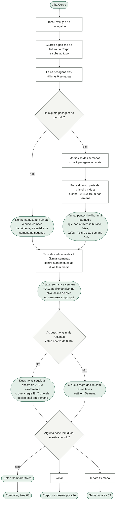

O que o diagrama não mostra: a Evolução só lê; não grava nada e não tem toque no gráfico (cada número que o gráfico mostra está em texto na lista). O cabeçalho diz "a pesagem da manhã · 4 semanas · 11 pesagens" (semanas com qualquer pesagem). O eixo vai até o fim da semana em curso, para a média dela (desenhada no meio da semana) não sair pela borda; a escala vertical tem no mínimo 0,6 kg. A semana em curso aparece como "em curso · 1 pesagem". A lista das taxas aparece mesmo sem pesagem nenhuma ("nenhuma pesagem · sem taxa: a semana não tem média"). "Ir para Semana" fecha a Evolução e vai para a aba Semana. Comparar abre por cima da Evolução (área 08). O Voltar do sistema fecha a Evolução (área 01).

### 3.9 O vazio de verdade

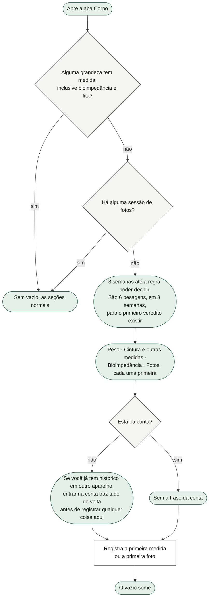

O que o diagrama não mostra: o vazio fica no topo e as seções continuam embaixo (o peso, a cintura, a bioimpedância e as fotos podem ser usadas direto). As quatro linhas: "Peso — de manhã, antes de treinar, mesma roupa"; "Cintura e outras medidas — sem frequência prescrita · quando você quiser"; "Bioimpedância — uma vez por mês"; "Fotos — a cada 14 dias, 9 poses, menos de 5 min" (o número de poses é o do protocolo dele, área 08). Não há barra de progresso nem "comece agora". Com o vazio, a cobrança "Sem média" da semana não aparece (só aparece quando há alguma pesagem). Acontece em aparelho novo ou depois de "apagar tudo" (área 01). A conta e a descida do histórico são da área 02.

### 3.10 O peso de hoje no descanso

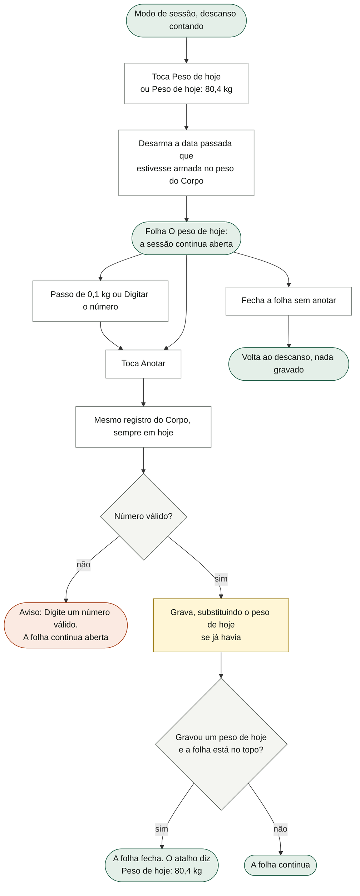

O que o diagrama não mostra: a razão da folha está no código — 7 de 11 pesagens entraram entre 6h28 e 7h52, no meio do treino. A folha usa o mesmo rascunho, o mesmo teclado e o mesmo verbo do Corpo; só não oferece outro dia ("o peso de outro dia mora na tela do corpo"). Abrir a folha desarma de vez a data passada que estivesse armada no Corpo, mas não solta o rascunho (ver §9). Se o aparelho recusar a gravação, a marca fica na memória e a folha fecha mesmo assim; o painel de falha é da área 01. O atalho, quando ele aparece e o modo de sessão são da área 03.

### 3.11 A pesagem no Agora (a linha "Peso da manhã")

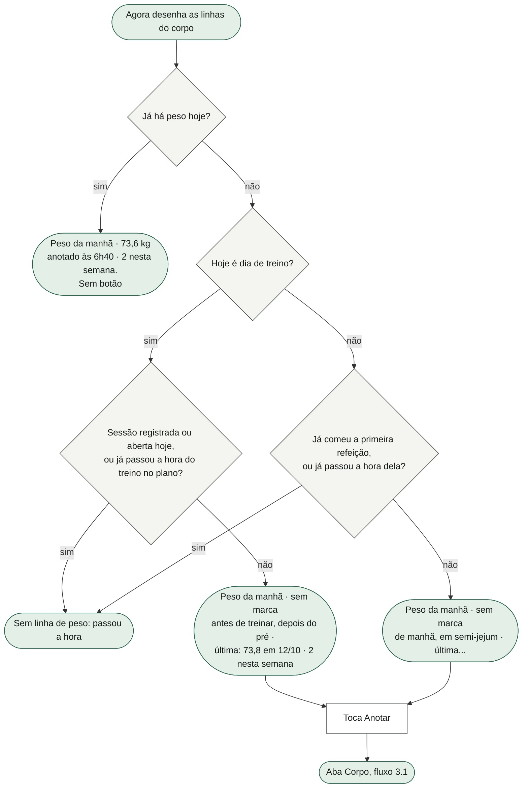

O que o diagrama não mostra: a linha é calculada nesta área, mas o lugar e a ordem no Agora são da área 10, e o tipo do dia, o plano de comida e a hora do treino vêm das áreas 06 e 10. "Anotar" não abre folha: leva à aba Corpo. A linha não pede nada depois da hora porque um peso tirado à tarde não se compara com os da manhã. A linha das fotos, na mesma lista, é da área 08.

### 3.12 As fotos dentro do Corpo (ligação com a área 08)

A seção "As fotos" fica no fim do Corpo e é toda da área 08 (dias desde a última sessão, cadência de 14 dias, os pontos das poses, "Nova sessão"/"Continuar", "Comparar", o aviso de fotos que só existem neste aparelho com "Subir agora"/"Entrar na conta"). O que esta área faz com as fotos: (a) uma sessão de fotos tira o Corpo do vazio de verdade; (b) a Evolução mostra "Comparar fotos" quando alguma pose tem duas sessões; (c) a área 08 lê daqui a média da semana do peso e da cintura para pôr ao lado das fotos.

---

## 4. Estados da tela

| Estado | Quando acontece | O que a tela mostra |
|---|---|---|
| Vazio de verdade | Nenhuma medida em nenhuma das 12 grandezas e nenhuma sessão de fotos | Bloco "3 semanas até a regra poder decidir" no topo, com as quatro linhas "primeira" e, sem conta, a frase de entrar na conta; as seções continuam abaixo, com "Nenhuma medida registrada ainda." |
| Semana sem média | Há pesagem no histórico, e a semana em curso (domingo a sábado) tem 0 ou 1 | Bloco "Sem média · esta semana · 1 pesagem", o que falta, os dias, "A prescrição pede 3 a 4 pesagens por semana."; média e ritmo "—" |
| Semana sem tempo | Idem, e os dias que restam não bastam | "Não dá mais tempo: resta 1 dia e falta 1 pesagem. Sem ela, a sequência…" |
| Primeira semana com média | Só existe a semana em curso, com 2+ pesagens | Média "—" e ritmo "—" (sem bloco de semana sem média) — ver §9 |
| Média sem ritmo | Semana em curso com 2+ pesagens, mas nenhuma semana anterior a 12 dias ou mais | Média "73,4 kg", ritmo "—" |
| Normal | Semana em curso com 2+ e referência a 12+ dias | Média e ritmo; ritmo verde-ácido entre +0,15 e +0,40, âmbar fora |
| Rascunho | Mexeu no passo ou digitou | O passo mostra o número novo; nada gravado |
| Teclado aberto | "Digitar o número" | O teclado no lugar do botão, visor com a unidade |
| Outro dia armado | Escolheu data passada | Seletor aberto com "neste dia: …" ou "nenhuma medida neste dia"; botão "Registrar ontem"/"Registrar em ter 14" |
| Data futura recusada | Data futura chegou ao seletor | Aviso "Nunca uma data futura: o dia ainda não aconteceu."; nada muda |
| Valor inválido | Rascunho que não é número maior que zero | Aviso "Digite um número válido."; nada gravado |
| Gravado | Registrar com sucesso | Aviso "73,6 kg registrado hoje." / "Peso de hoje atualizado para 73,6 kg."; rascunho e data voltam ao padrão |
| Gravação recusada pelo aparelho | Armazenamento cheio ou recusa | O aviso de sucesso e, por cima, o painel de falha da área 01 ("Não guardei o peso de hoje… O valor continua aqui, 73,6 kg, enquanto o app estiver aberto") |
| Pare de remover | Tocou "Remover" | Painel de pare com a frase do estrago e "Deixar como está" |
| Ponto de fita desligado | Coxa, panturrilha, peito, quadril sem medida e sem "Ligar" nesta visita | Linha em "As outras medidas com fita" com "Ligar" |
| Primeira medida de fita | Ponto ligado sem "como você mediu" | Campo "Como eu medi" com a explicação |
| Lembrete de fita | Já existe um "como você mediu" | "como você mediu: …" e "Mudar como eu medi" |
| Bio sem leitura anterior | Nenhuma leitura | Campos vazios; "Os cinco números saem da balança de bioimpedância…"; nota "uma vez por mês · nenhuma leitura ainda" |
| Bio com leitura anterior | Há leitura | Valores no lugar; "Os cinco números do mês passado estão no lugar. Toque só no que mudou."; "era X · ±d" ao lado de cada um; nota "anterior: 03/09" |
| Bio recusada | Falta obrigatório, número inválido ou data futura | Aviso dizendo qual e por quê; os campos ficam como estavam |
| Bio guardada | Leitura completa | "Guardei os cinco números de 01/10 neste aparelho." (+ "Substituí a leitura que havia nesse dia."); campos mostram a leitura nova |
| Evolução vazia | Nenhuma pesagem em 9 semanas | "Nenhuma pesagem ainda. A curva começa na primeira, e a média da semana na segunda."; a lista das 4 semanas com "sem taxa" |
| Evolução com curva | Há pesagem | Curva, pontas ("02/08 · 71,5" e "esta semana · 73,6"), procedência, taxas, frase, botões |
| Folha do descanso | Atalho "Peso de hoje" | Folha curta; fecha ao gravar; continua aberta com aviso se inválido |
| Agora sem peso hoje, na hora | Antes da hora do treino / da primeira refeição | "Peso da manhã · sem marca" com "Anotar" |
| Agora com peso hoje | Já pesou | "Peso da manhã · 73,6 kg · anotado às 6h40 · N nesta semana" |
| Agora depois da hora | Não pesou e a hora passou | Nenhuma linha de peso |

---

## 5. Dados

### O que esta área GUARDA (dentro do estado `lastro-v1`, área 01)

- **`S.body`** — um objeto com **12 séries**, uma por grandeza, na ordem da tabela `MEDIDAS_DO_CORPO`: `peso`, `cintura`, `bioPeso`, `bioMusculo`, `bioGordura`, `bioGorduraPct`, `bioAgua`, `braco`, `coxa`, `panturrilha`, `peito`, `quadril`. Cada série é uma lista de marcas `{ t, v, m, onde? }`:
  - `t` — o instante da medida (ms). Hoje = a hora real; dia passado = 7h (peso e fita) ou 12h (bioimpedância).
  - `v` — o valor (kg, cm, % ou litros, conforme a tabela).
  - `m` — quando a marca foi gravada (carimbo da fusão).
  - `onde` — o "como eu medi", só nas medidas de fita, quando ele escreveu.
  - A lista fica ordenada por `t` e com no máximo 400 marcas (as mais antigas saem).
  - Quem mais lê: área 09 (`S.body.peso` para o veredito, os portões e a lista das semanas da régua; `S.body.cintura` só como informação), área 08 (média da semana do peso e da cintura ao lado das fotos), área 01 (estado vazio, normalização, cópia de segurança, importação pela lista branca `corpoDoBackup`, apagar tudo, o resumo do acervo, o "endereço vazio"), área 02 (fusão), área 03 (o atalho "Peso de hoje: 80,4 kg").
- **`S.apagados`** (compartilhado, área 01/02) — esta área escreve lápides `"<grandeza>:<instante>"` ao remover uma medida e ao substituir a medida do mesmo dia.
- **Estado de tela (não guardado):** `view.bodyForm` (rascunho do passo/teclado por grandeza), `view.bodyDia` (dia armado por grandeza), `view.bodyDiaAberto` (qual seletor de data está aberto), `view.bodyOnde` (rascunho do "como eu medi"), `view.fitaLigadas` (pontos ligados nesta visita), `view.teclado` com alvo `{ tipo: 'corpo', campo }` (compartilhado com a área 03), `view.evolucao` (a tela cheia), `view.pilha` com a folha `pesoRapido` (a pilha é da área 01).
- **Estado local dos componentes:** o rascunho dos cinco campos da bioimpedância e a data dela (`Corpo`), e o "mudando" do "como eu medi" (`ComoMedi`). Somem ao sair da aba.
- **Sem chave local própria, sem cache.** Nada desta área mora fora do estado.

### O que só LÊ de outras áreas

- `S.protocolo.sessoes` e `S.protocolo.poses` (área 08) — para o vazio de verdade, o número de poses e o "Comparar fotos" da Evolução; `CADENCIA_DIAS` = 14.
- `NUVEM.sessao()` (área 02) — para a frase "entrar na conta…" do vazio.
- O dia resolvido (tipo do dia), o plano de hoje (horário da linha do treino e da primeira refeição) e as marcas de comida de hoje (áreas 06 e 10), a sessão aberta/registrada (área 03) — só para a linha do Agora.
- `CTX.protocoloFotos()` (área 08) — a seção "As fotos" desenhada dentro do Corpo.

### Como cada dado atravessa a sincronia (área 02)

- Cada grandeza de `S.body` é uma **coleção com chave natural** `"<grandeza>:<instante>"`, unida campo a campo; presente dos dois lados, vence o `m` mais novo; teto de 400 por grandeza também na fusão.
- **Lápide ao apagar e ao substituir**: a mesma chave; a lápide mata o que tiver `m` igual ou menor que ela. Lápides envelhecem (90 dias, área 02).
- O `onde` é atributo da marca: viaja com ela e morre com a lápide dela (não há campo de topo).
- Os cinco da bioimpedância somam como o peso; o peso da manhã e o da bioimpedância não se misturam.
- Duas medidas do mesmo dia em dois aparelhos, com instantes diferentes, **sobrevivem as duas** (a regra "uma por dia" só existe no momento de registrar) — ver §9.

---

## 6. Regras

1. **O peso que decide é o da manhã** (`S.body.peso`). O peso da balança de bioimpedância é série separada e não entra na média, no ritmo nem na regra do nutricionista. (Decisão do dono e desenho; procedência escrita na tela.)
2. **A semana vai de domingo 00:00 a sábado** (`weekStart`), para a grade do calendário e a conta da média dizerem o mesmo. (Desenho.)
3. **Média da semana vale com pelo menos 2 pesagens** (`MIN_PESAGENS` = 2). (Nutricionista: "média de uma pesagem só não é média".)
4. **A prescrição pede 3 a 4 pesagens por semana** ("registre 3 a 4 por semana"). É texto, não cobrança automática. (Nutricionista.)
5. **Média e ritmo no Corpo aparecem só quando a semana em curso tem média**; senão "—". A média mostrada é a da semana em curso.
6. **Ritmo por semana** = (média da semana atual − média da semana de referência) ÷ (dias entre elas ÷ 7), com a referência sendo a semana mais recente a **12 dias ou mais** da atual; com menos de 12 dias, "—". Cor: verde-ácido entre **+0,15 e +0,40** (inclusive), âmbar fora. Duas casas, com sinal.
7. **Semana sem média**: restam = 6 − dia da semana de hoje (domingo = 0) + 1 se ainda não pesou hoje; faltam = 2 − pesagens da semana. Se restam ≥ faltam: "Faltam N dias na semana e N pesagens para a média valer."; senão "Não dá mais tempo…". O "medido" = pesagens das 4 semanas fechadas antes ÷ 4, duas casas. Só aparece com alguma pesagem no histórico. (Desenho D, estado 9.)
8. **Uma medida por dia, por grandeza**: registrar num dia que já tem medida substitui todas as daquele dia e deixa lápide em cada substituída. (Desenho; correção de defeito de fusão.)
9. **O "como eu medi" do dia substituído é herdado** quando a correção vem sem texto novo.
10. **O instante**: hoje = a hora real (as medidas do dia mantêm ordem); dia passado = 7h (peso e fita: "é quando ele pesa"); dia passado na bioimpedância = 12h ("a hora não foi medida, e meio-dia não encosta em borda de fuso"); bioimpedância hoje = agora.
11. **Nunca data futura**, em nenhuma medida (o seletor tem `max` = hoje e o verbo recusa com aviso).
12. **Valor válido**: número maior que zero; vírgula vale ponto. Sem teto no verbo. O passo limita a **20–250** (mesmo limite para kg e cm).
13. **Passo**: peso **0,1 kg**; cintura e fitas **0,5 cm**. **Partida** sem medida: peso **75 kg**, cintura **85 cm**, braço **35**, coxa **56**, panturrilha **37**, peito **100**, quadril **96** cm. Bioimpedância **sem partida** ("um padrão seria o app inventando leitura de balança").
14. **Ponto de partida do passo**: o valor do dia escolhido, se houver; senão a última medida; senão a partida da tabela.
15. **Teclado próprio** nasce vazio; uma vírgula e **uma casa decimal só**; o ponto do teclado físico vira vírgula; Enter e Esc fecham; texto terminado em vírgula não escreve; vazio solta o rascunho. Modelo "livre com vírgula" (não o de registradora), reversível em `DECIMAL_FIXA`. (§6.1/§6.2 do desenho, com divergência declarada.)
16. **Lista das últimas**: as **4** marcas mais recentes de cada grandeza, da mais nova para a mais antiga, cada uma com "Remover".
17. **Remover pede o painel de pare**, com nome e unidade da tabela; só o peso diz "tira ele da média da semana e do ritmo". (Decisão 13, família "vai destruir".)
18. **Teto de 400 marcas** por grandeza, no registro e na fusão.
19. **Cintura no mês** = variação entre a média da última semana e a de uma semana de referência a **24 dias ou mais** (se houver), normalizada para **30 dias**; só conclui com pelo menos **21 dias** entre elas; senão "faltam 3 semanas de medida para concluir". Usa média semanal porque "fita erra de posicionamento mais do que a balança varia de água". **A cintura não entra em regra**. (Nutricionista: saiu do algoritmo.)
20. **Medidas com fita**: seis pontos, todos em cm — cintura e braço vêm ligados; coxa, panturrilha, peito e quadril esperam "Ligar". Ligado = tabela diz ligado, ou já tem medida, ou foi ligado nesta visita. Nenhuma tem frequência prescrita nem entra em regra; "desde a primeira" = última − primeira. (Dono, P6: "braço, cintura, essas coisas principais que dá pra eu medir sozinho"; Direção D; decisão 2a do dono, 01/10.)
21. **"Como você mediu"** = o texto da medida **mais recente que tem um**; medida sem texto não apaga o lembrete.
22. **Bioimpedância**: cinco números de uma leitura; **quatro obrigatórios** (peso, massa muscular esquelética, massa de gordura, percentual de gordura) e **água corporal opcional** — vazia não entra e não vira zero. Número inválido (não número ou ≤ 0) em qualquer campo, inclusive o opcional, recusa a leitura inteira; falta de obrigatório também. **Um instante só** para os cinco. Os valores da leitura anterior ficam no lugar; o "era" mostra a diferença com uma casa e some quando é zero. Frequência dita: "uma vez por mês". (Dono, 5.a' P3.)
23. **Evolução**: janela de **9 semanas** (desde o domingo de 8 semanas atrás até agora); a linha só tem ponto em semana com 2+ pesagens e não atravessa buraco (semanas a mais de 7 dias e 2 h); os pontos são as pesagens do dia; a faixa parte da primeira média válida e sobe **+0,15** e **+0,30** kg por semana.
24. **Taxa, semana a semana**: as **4** últimas semanas (a em curso primeiro); taxa = média da semana − média da anterior, só se as duas têm 2+; classes: abaixo de **0,15** "abaixo do alvo", acima de **0,30** "acima do alvo", senão "no alvo"; sem taxa, "sem taxa: a semana não tem média" ou "sem taxa: a semana anterior não tem média". A diferença tira o ruído do ponto flutuante (arredonda a um milionésimo de kg). (Alvo do nutricionista, 0,15 a 0,30.)
25. **Frase da Evolução**: se as duas taxas mais recentes que existem estão abaixo de **0,10**, a frase diz que é exatamente o que a regra lê; senão só aponta Semana.
26. **Vazio de verdade**: 3 semanas × 2 pesagens = **6 pesagens** para o primeiro veredito existir (duas taxas seguidas precisam de três semanas de média). Some com qualquer medida de qualquer grandeza ou qualquer sessão de fotos.
27. **Linha do Agora**: com peso hoje, mostra o valor e a hora; sem peso hoje, só aparece **antes da hora** — em dia de treino, enquanto não há sessão registrada/aberta hoje e não passou a hora do treino no plano; em dia de descanso, enquanto não comeu a primeira refeição e não passou a hora dela. (Pesagem é de manhã em semi-jejum, F42.)
28. **Peso no descanso**: sempre hoje; abrir a folha desarma a data passada do peso; fecha só se gravou.
29. **Depois de gravar uma medida**, o rascunho, a data e o texto do "como eu medi" daquela grandeza voltam ao padrão ("deixar uma data passada armada seria a próxima pesagem caindo no dia errado").

---

## 7. Ligações com as outras áreas

| Área | O que esta recebe dela | O que esta entrega a ela |
|---|---|---|
| 01 · Fundação | Gravar o estado (`save`), declarar o que grava (`declaraGravacao`) e o painel de falha, o painel de pare, o aviso (toast), o componente do teclado, a tela cheia e o Voltar, a posição de leitura (`entraNoDestino`/`saiDoDestino`), a pilha de folhas | A forma de `S.body` (`corpoVazio`, `corpoDoBackup`, `MARCAS_DO_CORPO`) para o estado inicial, a normalização, a importação, o apagar tudo e o endereço vazio; a contagem de pesagens, cinturas e leituras de bioimpedância no resumo do acervo |
| 02 · Sincronia | A fusão das 12 séries por chave e carimbo, as lápides, o estado da conta (`NUVEM.sessao`) | Marcas com `t`, `v`, `m` e `onde`; lápides `<grandeza>:<instante>`; a lista das grandezas |
| 03 · Sessão de treino | A porta "Peso de hoje" no descanso, o modo de sessão por baixo da folha | A folha "O peso de hoje", o registro e o valor de hoje para o atalho |
| 06 · Comida | O plano de hoje e as marcas de comida (para a hora da linha do Agora) | — |
| 08 · Fotos do corpo | As sessões e poses (vazio, "Comparar fotos"), a seção "As fotos" desenhada no Corpo | A média da semana do peso e da cintura para pôr ao lado das fotos; o lugar da seção dentro do Corpo |
| 09 · Semana | As portas "Pesar hoje" e "Peso de outro dia" do vazio da régua; o destino de "Ir para Semana" | A série `S.body.peso` (veredito, portões, semanas da régua), `MIN_PESAGENS`, `mediasSemanais`, `taxasSemanais`, `semRuido` (moram em `corpo.ts`); a cintura como informação |
| 10 · Agora | O lugar da linha no Agora; o tipo do dia resolvido e o cabeçalho de hoje | `linhasDoCorpo` (a linha "Peso da manhã"; a das fotos é da 08) |
| 11 · Dias | — | — (Dias não mostra medidas) |

---

## 8. Como serviço individual

**Nome:** Serviço de Medidas Corporais (`corpo`).

**O que ele possui:** as 12 séries de `S.body` (marcas com instante, valor, carimbo e "como eu medi"), as lápides de medida, a tabela das grandezas (`MEDIDAS_DO_CORPO`: nome, unidade, se é da balança, se é obrigatória, se é fita e se vem ligada, partida) e as leituras derivadas do peso (média semanal, ritmo, semana em curso, Evolução, cintura no mês).

**Operações (como uma API):**

| Verbo | Recebe | Devolve |
|---|---|---|
| `registrarMedida` | grandeza, valor, dia (opcional, padrão hoje), como eu medi (opcional) | a marca gravada e se substituiu a do dia; ou recusa (valor inválido, data futura, grandeza que não aceita) |
| `registrarLeituraBio` | os cinco valores (texto com vírgula aceito), instante (opcional) | `{ ok, em, gravadas }` ou `{ ok: false, falta, invalidas, futuro }` |
| `removerMedida` | grandeza, instante | ok + lápide criada |
| `medidaDoDia` | grandeza, dia | a marca daquele dia ou nada |
| `ultimasMedidas` | grandeza, quantas | as N mais recentes |
| `comoMediu` | grandeza | o texto vigente ou nada |
| `mediasSemanais` | grandeza, semanas | `[{ semana, n, media }]` |
| `ritmoDoPeso` | — | média atual, referência, kg por semana, se tem 12 dias |
| `semanaEmCurso` | instante | o que falta, os trechos, o medido; ou nada se a semana vale |
| `leituraDaEvolucao` | instante, semanas | semanas válidas, pontos, taxas das 4 últimas |
| `cinturaNoMes` | — | variação normalizada ou nada |
| `estaVazio` | — | sim/não (hoje depende também das fotos) |
| `leituraBioAnterior` | — | os cinco valores e a data da última leitura |

**Eventos que emitiria:** `MedidaRegistrada { grandeza, t, v, substituiu }`, `MedidaRemovida { grandeza, t }`, `LeituraBioRegistrada { t, grandezas }`, `SemanaDePesoMudou { semana, n, media, valida }` (o que a área 09 precisa para recalcular o veredito), `PesoDeHojeRegistrado { v }` (para o Agora e o atalho do descanso).

**Eventos que escutaria:** `FusaoConcluida` (área 02: recalcular leituras), `EstadoImportado` e `TudoApagado` (área 01), `SessaoDeFotosCriada`/`ApagadaTodas` (área 08: o vazio), `ViradaDoDia` e `ViradaDaSemana` (o relógio: semana em curso, linha do Agora, "hoje" volta a ser o padrão).

**O que hoje está acoplado e precisaria ser separado:**

- `CTX.corpo()` devolve também o **cardio** da semana (área 10) e os **músculos** (área 09) — resto da antiga tela de Dados; a tela de Corpo não os usa.
- O verbo de registrar (`addBody`) **lê o estado de tela** (`view.bodyForm`, `view.bodyDia`, `view.bodyOnde`) em vez de receber valor e dia por argumento; a bioimpedância já recebe por argumento. Um serviço precisaria de uma assinatura só.
- `src/dominio/corpo.ts` mistura as regras do corpo com o **veredito e os portões** da área 09 no mesmo arquivo; `MIN_PESAGENS`, `mediasSemanais` e `taxasSemanais` são compartilhados.
- O **teclado** é um só para a sessão e o corpo (`view.teclado`, `teclaDoTeclado` decide pelo alvo); a folha do descanso depende da pilha de folhas e do modo de sessão.
- O **vazio de verdade** depende de `S.protocolo` (fotos) e de `NUVEM` (conta).
- A **linha do Agora** depende do dia resolvido, do plano de comida e da sessão (`CTX.hoje`, `diaResolvido`, `minutosDe`).
- `CORPO_PADRAO`, `CAMPO_DA_BIO` (rótulos), `POR_EXTENSO` e as frases dos avisos vivem em `main.jsx`, não no domínio.
- Gravar é o estado inteiro (`save`); não há gravação por medida, e o aviso de sucesso não sabe se a gravação foi aceita.
- A Evolução usa a posição de leitura e o Voltar da casca (área 01) e o "Comparar" da área 08.

---

## 9. Riscos e dívidas que apareceram na leitura

1. **Possível bug — corrigir a medida de um DIA PASSADO pode sumir na próxima sincronia.** Ao substituir, `gravaMarca` põe a lápide na chave `<grandeza>:<instante>` com `Date.now()` e grava a marca nova com `m = Date.now()`. Num dia passado o instante é sempre o mesmo (7h; 12h na bioimpedância), então a marca nova tem **a mesma chave** da lápide, e os dois carimbos saem no mesmo milissegundo quase sempre. A fusão mata o que tem carimbo **menor ou igual** à lápide (`uneLista`), inclusive do lado local. Caminho: Corpo → "Peso de outro dia" → escolher ontem, que já tem peso → "Registrar ontem" → sincronizar → o peso de ontem desaparece dos dois aparelhos. O mesmo vale para corrigir uma leitura de bioimpedância de dia passado. Os testes de substituição usam hoje (instantes diferentes) e não pegam. **A confirmar** com um caso de teste.
2. **Possível bug — na primeira semana com duas pesagens, a média aparece "—".** `CTX.corpo` exige `pesoRitmo().ok`, que precisa de duas semanas com pesagem. Caminho: aparelho vazio → registrar o peso em dois dias da mesma semana → "média da semana: —" e nenhum bloco "Sem média" explicando.
3. **O ritmo do Corpo não é a taxa da regra.** Ele usa semanas com qualquer número de pesagens (até 1) e compara com uma semana a 12+ dias, e pinta de verde-ácido até **0,40**, enquanto a Evolução chama de "acima do alvo" tudo acima de **0,30** e a regra (área 09) lê semana contra semana só com médias válidas. A mesma semana pode aparecer "no verde" no Corpo e "acima do alvo" na Evolução. O comentário diz "DENTRO DA FAIXA que o nutricionista prescreveu", mas a faixa é 0,15–0,30. **A confirmar** com o dono qual é a faixa da cor.
4. **O aviso de sucesso sai mesmo quando o aparelho recusa a gravação.** `addBody` e `registraBio` mostram o aviso depois de `save()` sem olhar o resultado; na bioimpedância a frase é "Guardei os cinco números de 01/10 **neste aparelho**", o oposto do painel de falha. `registraBio` e `delBody` também não declaram o que gravam, então o painel diz "a última mudança" em vez de nomear a leitura.
5. **A leitura atômica pode deixar a água velha.** Ao substituir uma leitura do mesmo dia com a água vazia, a água da leitura antiga fica (só as grandezas preenchidas são substituídas), com outro instante: o dia passa a ter 4 números novos e uma água antiga, e o aviso diz "Substituí a leitura que havia nesse dia".
6. **A bioimpedância não tem lista nem "Remover" na tela.** Uma leitura errada só se corrige registrando o mesmo dia de novo. E tocar "Guardar os cinco" sem mudar nada grava os números do mês passado como leitura nova de hoje (os valores no lugar vão junto), sem desfazer.
7. **A data da bioimpedância não volta para hoje depois de guardar** (estado do componente; só o rascunho é limpo). Enquanto a aba Corpo estiver montada, a próxima leitura parte do dia passado escolhido — diferente do peso, que volta sozinho.
8. **Só as 4 últimas medidas têm "Remover".** Um 743 digitado no lugar de 74,3 que já tenha 4 medidas depois dele não tem mais porta na tela. E o teclado não tem teto (o passo para em 250, o teclado não), então o 743 entra.
9. **Dois aparelhos, mesmo dia, duas medidas.** Sem rede, pesar no celular e registrar também no notebook no mesmo dia gera duas marcas com instantes diferentes; a fusão guarda as duas, e a semana conta **2 pesagens** de uma manhã só (a média "vale" com um dia). Some na próxima vez que ele registrar naquele dia.
10. **O seletor de data não fecha sem registrar.** Depois de "Peso de outro dia", o link some e não há botão de fechar; só registrar fecha. E a porta "Peso de outro dia" da Semana (área 09) usa um verbo que **alterna**: se o seletor do peso já estiver aberto, ela o fecha.
11. **A folha do descanso desarma a data do Corpo, mas leva o rascunho.** Se ele tinha deixado no Corpo um número no passo para outro dia, a folha "O peso de hoje" abre com esse número.
12. **A barrinha diz "Nenhuma medida registrada ainda." se todas as medidas são de mais de 14 semanas atrás**, embora a lista das últimas mostre medidas.
13. **Teto de 400 marcas por grandeza, sem aviso.** Com peso diário, o histórico acima de ~13 meses sai em silêncio (no registro e na fusão).
14. **O resumo do acervo (Ajustes, área 01) não conta as medidas de fita** além da cintura (braço, coxa…), a mesma omissão que a bioimpedância teve até ganhar tela.
15. **A frase da Evolução "duas taxas seguidas"** pega as duas taxas mais recentes que existem, que podem não ser vizinhas (ex.: semana atual e a de duas semanas atrás, com a do meio sem taxa); usa 0,10 escrito à mão em vez de `BAIXO`.
16. **Textos:** "73,4 kg registrado **em ontem**" (o aviso põe "em" antes de "ontem"); a cintura diz "1× por semana, em jejum" enquanto o vazio e a tabela dizem "sem frequência prescrita"; "faltam 3 semanas de medida para concluir" é fixo, mesmo com 2 semanas medidas; na linha do Agora o "1 nesta semana"/"N nesta semana" tem um ternário que devolve o mesmo texto nos dois ramos.
17. **Comentários velhos no código:** `normalizaEstado` e `delBody` falam em "SETE séries" (são doze); `registraBio` diz "ESTE VERBO EXISTE E A TELA NÃO" (a tela existe); a interface `Semana` diz "segunda-feira 00:00", mas a semana começa no domingo; um bloco de documentação de `CTX.registraBio` ficou solto antes do de `CTX.bioimpedancia` (sem acento).
18. **`bio.ultima` e `bio.tem`** são calculados em `CTX.bioimpedancia` e não são usados pela tela.
19. **Ligar uma fita é só desta visita.** Ligar e não medir faz o ponto voltar a "desligado" ao recarregar — é desenho declarado, mas não está dito na tela; não há como desligar um ponto que já tem medida.

---

## 10. Índice técnico

### Arquivos

- `src/ui/telas/corpo.jsx` — a aba Corpo: `Corpo`, `Medida` (passo, teclado, data, barrinha, células, lista), `SemanaSemMedia`, `ComoMedi`, `Fotos` (desenho da seção da área 08).
- `src/ui/telas/evolucao.jsx` — a tela cheia Evolução: `Evolucao`, `Curva` (SVG).
- `src/ui/folhas/pesorapido.jsx` — a folha `FolhaPesoRapido`.
- `src/dominio/corpo.ts` — a tabela das grandezas e as leituras do corpo (fora `veredito`, `vereditoDasSemanas`, `portoesDaRegra`, `semanasDaRegra`, `leituraVigente`, `ajusteDoVeredito`, que são da 09).
- `src/dominio/tipos.ts` — `Marca`, `QualMarca`, `Corpo`, o campo `body` de `Estado`.
- `src/dominio/teclado.ts` — `teclar`, `DECIMAL_FIXA` (compartilhado com 03).
- `src/dominio/formato.ts` — `weekStart` (domingo), `fmtDec`, `fmtSig`, `fmtDec2`, `fmtSig2`, `fmtDate`, `fmtHoraDita`, `DIAS_CURTOS`.
- `src/dominio/sincronia.ts` — `chaveDeMarca`, a fusão de `body` (área 02).
- `src/ui/instrumento/primitivos.jsx` — `Stepper`, `Sparkline`, `GradeMetricas`, `Secao`, `Procedencia`, `Vazio` (área 01).
- `src/ui/instrumento/teclado.jsx` — `Teclado` (área 01/03).
- `src/main.jsx` — o estado, os verbos e os `CTX.*` abaixo.

### Funções de `src/main.jsx` (linhas do commit `8ec19a4`)

- As medidas do corpo: `corpoVazio` 327, `corpoDoBackup` 334, normalização de `S.body` em `normalizaEstado` (~393).
- Leituras: `pesoRitmo` 4037, `cinturaMes` 4039, `CORPO_PADRAO` 4165, `unidadeDoCorpo` 4169.
- A data da medida: `diaNormalizado` 4185, `diaDaMedida` 4188, `instanteDaMedida` 4195, `rotuloDoDia` 4199, `medidaDoDia` 4206, `acaoDaMedida` 4211, `diaDaMedidaVM` 4217, `baseDoCorpo` 4241, `valorDoCorpo` 4261.
- Gravar: `gravaMarca` 4276, `addBody` 4294, `registraBio` 4373, `POR_EXTENSO` 4420, `ARTIGO_DA_BIO` 4422, `nomeNaFrase` 4423, `listaComE` 4424, `comUnidade` 4434, `delBody` 4496.
- Teclado: `numeroDoCampo` 5157 (compartilhada), `teclaDoTeclado` 5464 (ramo `corpo`), `fechaTeclado` 5497, `abreTecladoDeCorpo` 5538.
- DADOS (corpo): `serieSemanal` 7812, `medidasRecentes` 7827, `ehFita` 8087, `CAMPO_DA_BIO` 8135.
- Usadas daqui, de outras áreas: `lapide` 130, `hojeISO` 2172, `declaraGravacao` 1447, `save` 1493, `pare` 4452, `toast` 4691, `entraNoDestino` 11448, `saiDoDestino` 11456.

### `CTX.*` cobertos

`corpoVazio` 7841, `corpo` 7862 (fora `cardio` e `musculos`), `tecladoDoCorpo` 8042, `abreTecladoDeCorpo` 8048, `tecla` 8051 e `fechaTeclado` 8052 (o mesmo teclado da 03; o alvo de corpo é daqui), `setPeso` 8054, `setCintura` 8055, `abreDiaCorpo` 8056, `setDiaCorpo` 8057, `registraPeso` 8082, `registraCintura` 8083, `setMedida` 8088, `registraMedida` 8092, `ligaMedida` 8093, `setOnde` 8102, `bioimpedancia` 8143, `registraBio` 8180, `apagaMedida` 8181, `abreEvolucao` 10217, `fechaEvolucao` 10218, `evolucao` 10220, `linhasDoCorpo` 11023 (a linha do peso; a das fotos é da 08), `abrePesoNoDescanso` 11420, `pesoRapido` 11428, `registraPesoRapido` 11432 (os três últimos também listados pela 03, que tem a porta). Lidos daqui: `protocoloFotos` (08), `enquantoDescansa` 11394 (03, o campo `peso`).

### Regras do domínio (`src/dominio/corpo.ts`)

`MedidaDoCorpo`, `MEDIDAS_DO_CORPO`, `MARCAS_DO_CORPO`, `MARCAS_DA_BIO`, `MEDIDAS_DE_FITA`, `medidaDoCorpo`, `ondeMediu`, `Semana`, `Ritmo`, `Cintura`, `ALVO_MIN`/`ALVO_MAX`, `BAIXO`/`ALTO` (lidos pela Evolução e pela 09), `MIN_PESAGENS`, `TaxaSemanal`, `semRuido`, `taxasSemanais` (usada pela 09), `TrechoDaSemana`, `SemanaEmCurso`, `semanaEmCurso`, `TaxaDaEvolucao`, `LeituraDaEvolucao`, `leituraDaEvolucao`, `mediasSemanais`, `pesoRitmo`, `cinturaMes`. Da 09 no mesmo arquivo: `Veredito`, `Ajuste`, `Sinais`, `LeituraDeGordura`, `VALIDADE_LEITURA`, `JANELA_MIN`, `leituraVigente`, `MIN_REGISTRADOS`, `ajusteDoVeredito`, `veredito`, `Portao`, `FontesDosPortoes`, `portoesDaRegra`, `SemanaDaRegra`, `semanasDaRegra`.

### Campos `S.*` e `view.*`

- `S.body` (12 séries), `S.apagados` (lápides de medida, compartilhado).
- `view.bodyForm`, `view.bodyDia`, `view.bodyDiaAberto`, `view.bodyOnde`, `view.fitaLigadas`, `view.evolucao`, `view.teclado` (alvo `corpo`, compartilhado com 03), `view.pilha` (folha `pesoRapido`).
- Fora do inventário (estado de componente): o rascunho e a data da bioimpedância em `Corpo`; `mudando` em `ComoMedi`.

### Testes que cobrem a área

- `tests/fluxo/corpo.test.js` — o registro ("registro aceita vírgula e substitui a medida do mesmo dia", "entrada inválida não grava", "registrar peso grava o número que o stepper mostra", "o botão de registrar na tela chega até o histórico", "cintura usa o stepper dela"); a data ("o padrão continua sendo hoje, num toque", "dá para registrar numa data bem anterior", "escolher ontem grava no dia certo", "data no futuro é recusada", "às 6h, voltar a data para HOJE funciona", "depois de gravar, a data volta para hoje sozinha", "o seletor diz o que o dia escolhido já tem", "escolher um dia já medido parte do valor daquele dia", "a data é por medida"); remover ("pesagem errada pode ser apagada", "ctx.apagaMedida avisa antes…", "…deixa lápide", "…nomeia a grandeza certa, na unidade certa, em todas", "apagar uma medida pede pelo painel de pare"); bioimpedância (de "as cinco da bioimpedância seguem sem valor de partida" a "registrar DE MANHÃ funciona" e "a bioimpedância traz o mês passado no lugar"); teclado ("peso e cintura têm porta para o teclado próprio", "a primeira pesagem deixa de custar catorze toques", "o teclado do corpo escreve no rascunho", "apagar tudo no teclado volta ao ponto de partida"); fita ("braço vem ligado…", "ligar abre a medida…", "a primeira medida guarda como ele mediu", "corrigir o número do mesmo dia não apaga o como-eu-medi", "as portas das medidas com fita recusam o que não é fita"); Evolução ("Evolução no cabeçalho do Corpo abre a leitura, e o Voltar fecha", "da Evolução, Ir para Semana…", "sem pesagem, a Evolução diz o que vai aparecer"); vazio e semana ("o vazio de verdade do Corpo diz quanto custa sair dele", "a semana com uma pesagem só diz o que falta", "sem pesagem nenhuma, quem fala é o vazio"); "os dois pesos têm nome e procedência". (Os casos de veredito e cardio do mesmo arquivo são das áreas 09 e 10.)
- `tests/dominio/corpo.test.ts` — "cintura usa média semanal", "cintura com menos de 21 dias de base não conclui nada", "o ritmo é medido sobre pelo menos 12 dias", "seis pontos com fita…", "o lembrete de como ele mediu…", "a Evolução lê as médias que a regra lê…", "a classe da taxa segue o alvo do nutricionista, de 0,15 a 0,30", "uma pesagem só na semana…", "pesado hoje, hoje não conta mais como dia que dá tempo", "sem dias que bastem…", "com a semana valendo, não há o que cobrar", "o medido é a média das quatro semanas fechadas antes desta". (Os de veredito, portões e leitura de gordura são da 09.)
- `tests/dominio/campos.test.ts` — o registro dos campos: `corpo.jsx · onde-` (texto do sistema) e `corpo.jsx · bio-` (decimal).
- `tests/dominio/teclado.test.ts`, `tests/fluxo/teclado.test.js` — o teclado (compartilhado com 03); `tests/fluxo/portas.test.js` — "o pronto do teclado do Corpo fecha o teclado".
- `tests/fluxo/descansa.test.js` — "o peso de hoje abre a folha curta, grava HOJE mesmo com outro dia armado, e fecha", "número inválido não fecha a folha".
- `tests/fluxo/agora.test.js` — "a pesagem da manhã é linha com Anotar…", "com peso hoje, a linha diz o valor e quando", "a pesagem segue a hora e some depois do café…".
- `tests/fluxo/gravacao.test.js` — o painel de falha com "Não guardei o peso de hoje" (área 01, usando o registro do peso).
- `tests/fluxo/ajuste.test.js` — "o vazio lista as semanas, e as duas saídas levam ao Corpo" (porta da 09 para cá).
- `tests/fluxo/dados.test.js` — "as doze medidas do corpo saem e voltam pelo nome, uma a uma" (cópia de segurança, área 01).
- `tests/dominio/sincronia.test.ts` — "a pesagem corrigida vence a original do mesmo dia", "as cinco medidas da bioimpedância somam…", "a lápide alcança a medida da bioimpedância", "o peso da manhã e o da bioimpedância não se misturam", "o como-eu-medi viaja com a medida na fusão, e morre com a lápide dela" (área 02).
- `tests/dominio/migracoes.test.ts` — "9→10 abre as cinco chaves da bioimpedância…", "o peso da manhã sobrevive intocado…" (área 01).
- `tests/dominio/spark.test.ts` — "variação de peso vira variação visível de altura" (a barrinha).
- `tests/fluxo/protocolo.test.js` — "o peso ao lado da foto é a média da semana, e vem do registro corporal" (leitura da 08).
- `tests/fluxo/fluxo.test.js`, `tests/fluxo/endereco.test.js` — usam o registro do peso de passagem.
