# 08 · Fotos do corpo

> Em uma frase: o protocolo de nove poses que fotografa o corpo a cada 14 dias sempre do mesmo jeito, guarda as fotos com o horário, e põe duas sessões lado a lado para responder "está funcionando?", incluindo a pergunta da gordura visual que a regra do nutricionista usa.

A foto é a terceira série sobre o mesmo assunto do peso e da cintura (área 07), e a única que não vira número. Por isso o que o app precisa garantir não é uma média, é que **duas fotos possam ser comparadas**: mesma pose, mesma ordem, a foto anterior à vista na hora de disparar, e um ajuste fino (girar e recortar) depois, sem nunca mexer nos pixels.

---

## 1. O que o usuário faz aqui

| Funcionalidade | O que faz | Onde fica | Quando aparece / some |
|---|---|---|---|
| **Ver o resumo das fotos** | Mostra "dias desde a última" (em âmbar quando passa de 14), "cadência: a cada 14 dias", os nove pontos da última sessão (cheios = pose feita) e a nota "DD/MM · X de 9" (ou "nenhuma sessão ainda"). | Aba **Corpo**, seção **"As fotos"** | Sempre, no fim da aba Corpo. |
| **Lembrete no Agora** | Linha **"Fotos do corpo · faz N dias"**, com "a cada 14 dias · a hora de cada foto fica anotada" e o botão **Nova sessão**. | **Agora**, logo abaixo do cartão de cima, junto da linha do peso | Só quando já existe ao menos uma sessão e a última tem 14 dias ou mais. Some quando há sessão hoje. Não segue a hora do dia (ele fotografa à noite). |
| **Começar / continuar uma sessão** | O botão da seção diz **Nova sessão**, **Continuar · X de 9** (sessão de hoje pela metade) ou **Refazer alguma pose** (sessão de hoje completa). | Corpo → As fotos; Agora → linha das fotos | Sempre na aba Corpo. |
| **A montagem** | Antes da primeira foto do dia: as seis regras que não mudam entre sessões (distância 3,0 m, altura da lente, 80 cm da parede, luz, horário, roupa), a ordem das nove poses numa linha e **"Gire sempre para o mesmo lado"**. O botão **Começar a sessão** também liga o som do iPhone. | Tela cheia "A montagem" | Só quando hoje ainda não tem foto nenhuma. |
| **A tela da pose** | Título "Pose N de 9 · nome", os nove pontos (feita, falta, não guardada, volta no fim), a **referência** (a foto mais recente da mesma pose antes de hoje) e, se já tirou, a de **hoje** ao lado; a execução ("corpo a 90° · braços estendidos à frente" e três passos), o que a pose revela e o erro comum. Botões **‹ anterior** e **Próxima ›**. | Tela cheia da sessão de fotos | Depois da montagem, ou direto quando hoje já tem foto. |
| **Tirar com sobreposição** (câmera do app) | Abre a câmera traseira dentro do app, com a foto anterior por cima do quadro vivo, grade, temporizador (sem / 3 s / 10 s, padrão 10 s), contagem com bipe e voz, disparo com som de obturador e clarão. Depois de cada foto avança sozinha para a próxima pose sem fechar a câmera, mostra e diz o giro ("↻ gire 90°"). | Botão **tirar com sobreposição** (ou **refazer com sobreposição**) na tela da pose | Só se o aparelho tiver câmera acessível ao navegador. |
| **Usar a câmera do sistema** | Abre a câmera do iPhone (ou o seletor de arquivo no computador); a foto entra pelo mesmo caminho. | Botão **usar a câmera do sistema** (secundário) ou **tirar a foto / refazer esta foto** (principal, quando não há câmera do app) | Sempre. |
| **A foto preta** | Se a câmera do app entregar um quadro quase todo preto, a foto não é guardada: a pose vai para o fim da fila, a tela diz "A frente relaxado saiu preta. Ela volta no fim." e a voz diz para seguir. | Câmera do app | Só no disparo pela câmera do app. |
| **A pose que não coube** | Se o aparelho recusar a foto (espaço cheio) ou o registro não gravar, a sessão para e diz qual pose não foi guardada e por quê, com **Tentar de novo** (e **Baixar cópia** quando o problema foi o registro). | Tela da pose e câmera do app | Quando a gravação falha. |
| **Refazer uma pose** | Tirar de novo uma pose que já tem foto hoje troca a foto. | Tela da pose ou câmera | Sempre que a pose do dia já tem foto. |
| **Apagar uma foto** | Pede confirmação ("Apagar a foto de frente relaxado de DD/MM tira ela deste aparelho e dos outros na próxima sincronização, e a comparação perde esse par. Isso não tem volta.") e apaga. A última foto apagada leva a sessão junto. | Botão **Apagar** abaixo da foto de hoje | Só quando a pose tem foto hoje. |
| **A nota da sessão** | Um campo livre ("voltando de gripe, outra academia, roupa diferente…") que vale para a sessão inteira e reaparece na comparação. | Tela da pose, seção "A nota da sessão" | Só grava depois da primeira foto do dia. |
| **O fim da sessão** | Quando as nove estão feitas: "Sessão guardada · 9 de 9 poses", o tempo real do primeiro ao último disparo, o estado da subida para a nuvem, o peso médio da semana, os botões **Comparar com DD/MM…** e **Responder a pergunta do nutricionista…** quando cabem, e a data da próxima sessão ("Nada aqui vence"). | Topo da tela da pose | Sessão de hoje completa. |
| **Comparar** | Escolhe a pose (fichas), as duas datas ("de … até …"), e mostra **lado a lado**, **cortina** (a nova por cima, com uma divisa que o dedo arrasta) ou **sobrepor** (transparência regulável). Abre no par mais longo; avisa quando o par escolhido é curto; avisa quando o par "recuou" porque a pose não existe nas sessões mais antigas. Embaixo de cada foto: data, hora, peso e cintura médios da semana. | Tela cheia "Comparar" | Botão **Comparar** em Corpo (quando alguma pose tem duas sessões), **Comparar fotos** na Evolução, **Responder** na Semana, e os botões do fim da sessão. |
| **A pergunta da gordura visual** | "Comparando com N dias atrás: a gordura visual aumentou claramente?" — **Sim / Não / Incerto**. A resposta vale 14 dias e entra na regra calórica (área 09). | Dentro de Comparar | Só quando o par em tela tem de 10 a 28 dias. |
| **Ajustar a foto** | Girar até ±6°, aproximar até 2×, arrastar para reenquadrar, contra uma foto de outra data sobreposta (ligada por padrão) e uma grade. **Salvar** grava o ajuste; **Voltar ao original** zera; sair pelo Voltar descarta. Não há brilho, contraste nem filtro. | Tela cheia "ajustar", aberta por **Ajustar** na tela da pose ou embaixo de cada lado da comparação | Só quando a foto existe. |
| **Aviso "fotos só neste aparelho"** | Sem conta: "As N fotos do corpo existem só neste aparelho" + **Entrar na conta**. Com conta: "N fotos ainda não subiram para a cópia remota" + **Subir agora**. | Corpo → As fotos | Some quando tudo subiu, ou quando não há foto nenhuma. |
| **Foto que não chegou** | No lugar da foto: "buscando a foto…", "a nuvem não devolveu a foto" (com **Tentar de novo**) ou "a foto está na nuvem, e este aparelho não entrou na conta". | Qualquer quadro de foto da área | Quando há referência mas os bytes não estão neste aparelho. |

---

## 2. Mapa da área

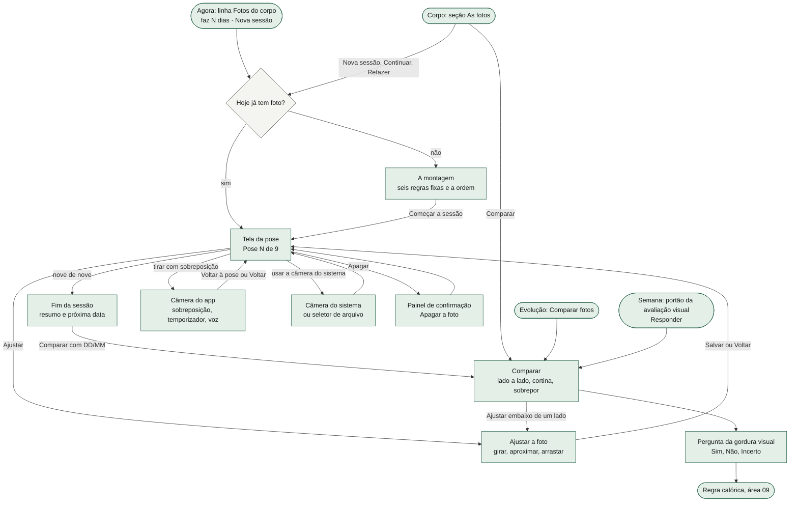

Todas as telas da área são **telas cheias** (sem a barra de abas): sessão de fotos, câmera, ajustar e comparar. Saem pelo Voltar do cabeçalho ou pelo Voltar do sistema, que fecha a de cima primeiro: câmera, depois ajustar, depois a sessão de fotos, depois comparar, depois a Evolução (a ordem das camadas é da área 01). Ao sair, a página volta à posição de leitura em que estava.

---

## 3. Fluxos, um por funcionalidade

### 3.1 Abrir a sessão de fotos e a montagem

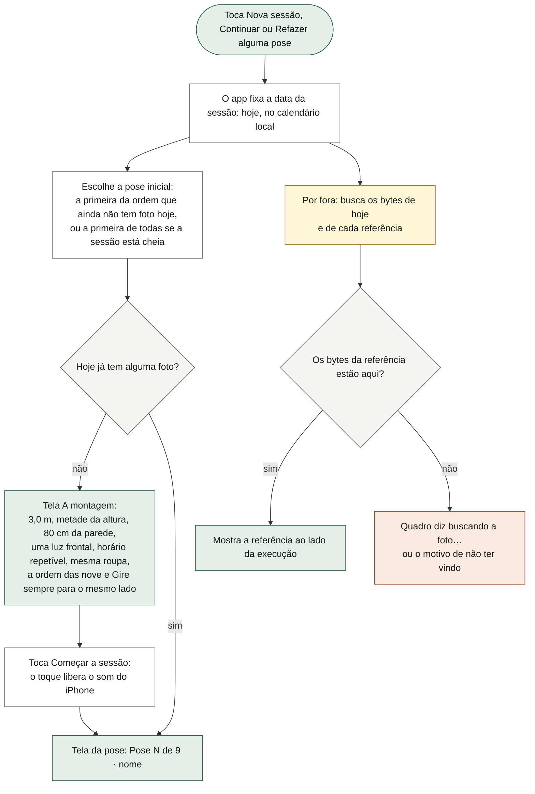

O que o diagrama não mostra: a montagem reaparece **em toda sessão nova** (cada dia sem foto), não só na primeira vida do app; o que some é a pergunta, não a lembrança. A data da sessão é fixada ao abrir: se ele abrir às 23h50 e fotografar depois da meia-noite, as fotos ficam no dia em que abriu. Não existe caminho para completar uma sessão de um dia anterior: abrir a sessão sempre abre a de hoje (uma sessão pela metade de ontem fica pela metade). A sessão em si **não nasce ao abrir**: nasce na primeira foto. Tocar num dos nove pontos leva direto àquela pose (e sobe ao topo); **‹ anterior** e **Próxima ›** andam uma pose sem rolar a página, para o polegar não perder o botão.

### 3.2 Câmera do app: abrir, permissão e erros

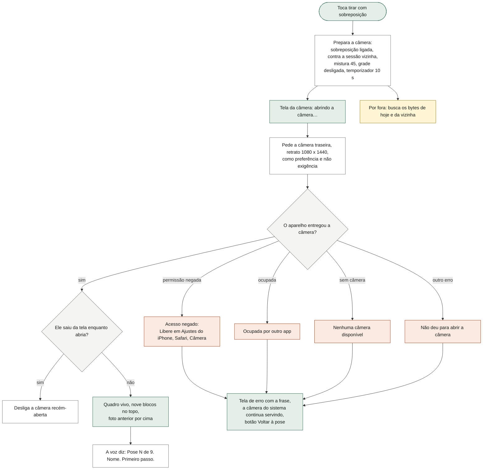

O que o diagrama não mostra: a **vizinha** contra a qual se alinha é a sessão anterior mais recente que tem aquela pose; na sessão mais antiga de todas, é a seguinte. O chip **sobrepor** e o seletor **Alinhar contra** (qualquer outra data com a pose) só aparecem se existe outra sessão com a pose; a **Mistura** vai de 10 a 90. Sem câmera acessível ao navegador, o botão da câmera do app nem aparece e a do sistema vira o botão principal. Toda saída da tela (Voltar do cabeçalho, Voltar do sistema, **Voltar à pose**) desliga a câmera e cancela a contagem; o indicador de câmera do iOS apaga. O texto da permissão negada promete que "a sessão começa do zero, sem perder nada": as fotos já tiradas estão gravadas.

### 3.3 Câmera do app: temporizador, contagem e disparo

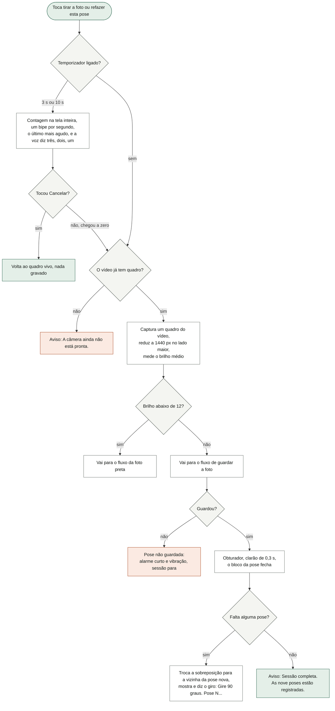

O que o diagrama não mostra: o toque no disparo também libera o som (o iPhone só toca áudio depois de um toque). O bipe é de 660 Hz e o do último segundo de 1320 Hz; o obturador é um ruído curto de 0,09 s. Os três sinais do disparo (som, clarão, bloco fechando) dizem a mesma coisa por canais diferentes: com o som desligado, o clarão e o bloco valem. Sem síntese de voz no aparelho, tudo funciona igual, em silêncio. O giro é calculado entre a pose que acabou e a próxima, sempre no mesmo sentido (0° → 90° → 180° → 270°; de 270° de volta a 0° também é "gire 90°"), e fica grande na tela até o próximo disparo. A câmera **não fecha** depois de cada foto: a sessão inteira acontece dentro dela. A pose seguinte é a primeira que falta, deixando para o fim as que voltaram por foto preta.

### 3.4 A foto preta

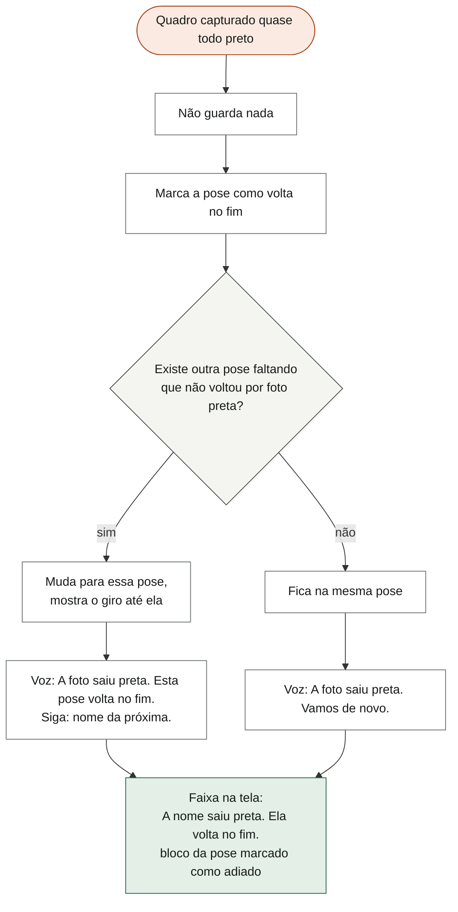

O que o diagrama não mostra: a causa é a captura antes de o vídeo entregar o primeiro quadro; ele está a três metros e não vê a tela, por isso a voz. O limite é brilho médio abaixo de 12 numa escala de 0 a 255. A marca "volta no fim" vive só enquanto a tela está aberta: fechar o app esquece a fila, e ao voltar a pose é apenas "falta". A foto preta só é percebida na câmera do app; a do sistema não passa por essa checagem. Se o navegador não deixar ler os pixels, o brilho fica desconhecido e a foto é guardada normalmente.

### 3.5 Guardar a foto (os dois caminhos) e a pose que não coube

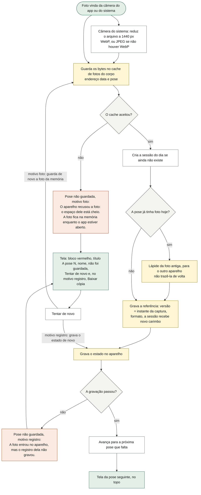

O que o diagrama não mostra: **não há botão de salvar**; cada foto é gravada na hora, e sair no meio deixa a sessão salva como está ("faltam N de 9 · a sessão fica salva como está"). Os bytes **nunca** entram no estado (ele é regravado a cada série e enviado inteiro a cada sincronia); no estado fica só a referência. Depois de guardar, a sincronia é agendada e a subida dos bytes para a nuvem acontece por fora (área 02). Na câmera do sistema, depois de guardar a tela volta ao topo; se a redução da imagem falhar (arquivo que o navegador não decodifica), aparece o aviso "Não deu para guardar a foto." e nada é gravado. No motivo **foto**, a foto reduzida fica só na memória: fechar o app a perde. No motivo **registro**, a referência já está no estado em memória e a próxima gravação qualquer a leva; **Baixar cópia** é a cópia de segurança da área 01. Quando "Tentar de novo" resolve o motivo registro, o aviso some mas a tela **não** avança de pose (fica na que acabou de ser guardada). Pela câmera do app, a pose que não coube toca o alarme curto com vibração (o mesmo som do fim do descanso, área 03) em vez do obturador.

### 3.6 Refazer e apagar

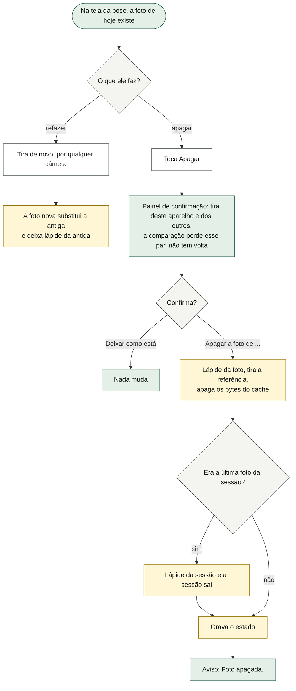

O que o diagrama não mostra: só dá para refazer ou apagar fotos **de hoje** (a sessão aberta é sempre a do dia). Fotos de sessões passadas só podem ser ajustadas. Apagar tira dos aparelhos mas **não** apaga o arquivo no bucket da nuvem (limite conhecido, área 02, item 12). O botão **Ajustar** vem antes de **Apagar** de propósito: quase todo motivo para apagar (saiu torta, saiu mais longe) é motivo para ajustar.

### 3.7 A nota da sessão

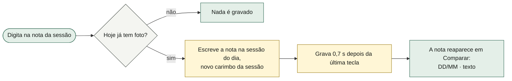

O que o diagrama não mostra: a nota é da sessão, não da pose; um campo, nunca um formulário. Na sincronia, vale a nota do lado cuja sessão tem carimbo mais novo. **A confirmar:** fechar o app nos 0,7 s seguintes à última tecla pode perder o final do texto (a espera da nota tem relógio próprio, que o "descarregar ao sair" da área 01 não alcança).

### 3.8 O fim da sessão

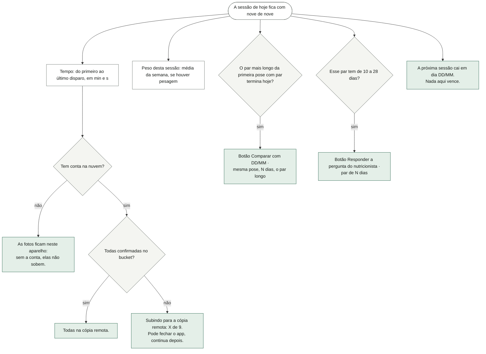

O que o diagrama não mostra: o resumo aparece no topo da tela da pose sempre que a sessão de hoje está completa, inclusive ao reabrir por **Refazer alguma pose**. O tempo só é mostrado quando as nove têm instante real de captura; se uma pose foi refeita horas depois, o tempo cresce junto. A próxima data é a data da sessão + 14 dias. Os dois botões abrem Comparar (ver §9, item 1: hoje eles abrem por trás da sessão de fotos). Fechar o app com fotos subindo é seguro: a subida continua na próxima sincronia.

### 3.9 Comparar: o par, os avisos e os modos

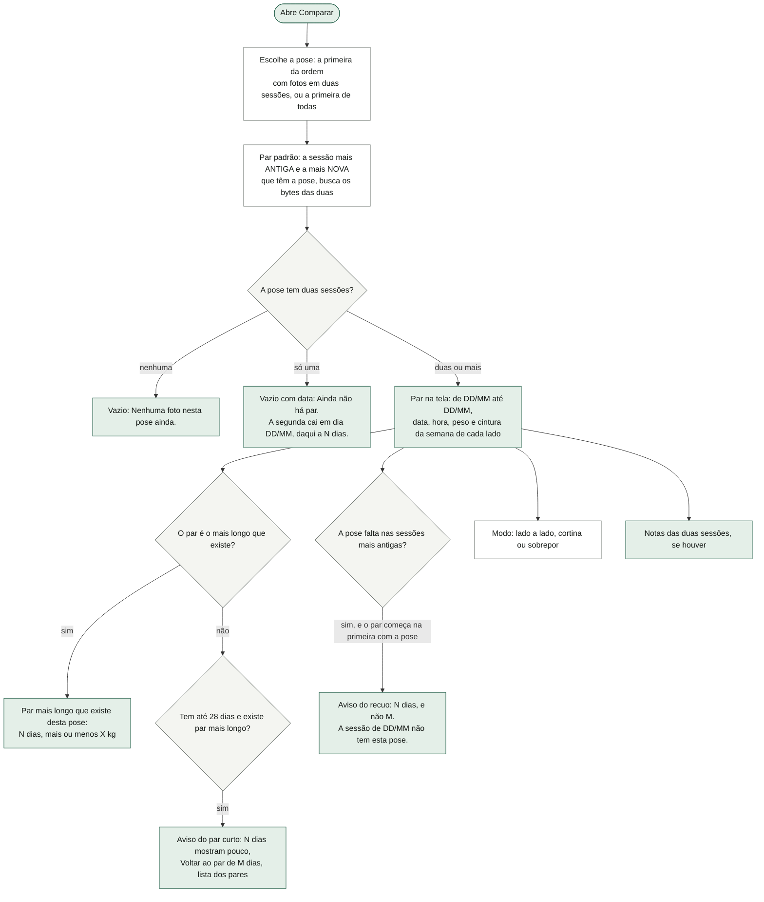

O que o diagrama não mostra: trocar a pose (fichas) remonta o par padrão dela; trocar uma data busca os bytes da data nova. As datas oferecidas são só as sessões que têm a pose. **Voltar ao par de M dias** devolve o par padrão. O aviso do par curto diz, quando o intervalo tem de 10 a 28 dias, "Serve para a pergunta do nutricionista; não serve para ver mudança"; abaixo de 10, "Não serve para ver mudança". O aviso não impede nada: avisar e obedecer. **Lado a lado** é para ler o corpo; **sobrepor** (mistura de 0 a 100, começa em 50) é para desconfiar da foto, porque se os pés andaram as silhuetas não se encaixam; **cortina** põe a foto nova por cima, cortada a partir de uma divisa (começa no meio, 0 a 100), com a data e a hora de cada lado. Peso e cintura são **médias da semana** daquela sessão, tiradas do registro corporal (área 07); sem pesagem, aparece "peso: sem medida" / "cintura: sem medida", nunca zero. A hora de cada foto aparece ao lado da data (decisão do dono, 14/10: ele fotografa à noite); fotos antigas sem instante real ficam sem hora. **Ajustar** embaixo de cada lado abre o ajuste daquela foto. O cabeçalho mostra "N sessões". Os textos fixos: "Comparar com a sessão anterior engana: em duas semanas a diferença é quase toda água e sono. Por isso o par que abre é o mais longo." e "peso e cintura são a média da semana de cada sessão, tirada do registro corporal — a sessão de fotos não pede número nenhum."

### 3.10 A pergunta da gordura visual

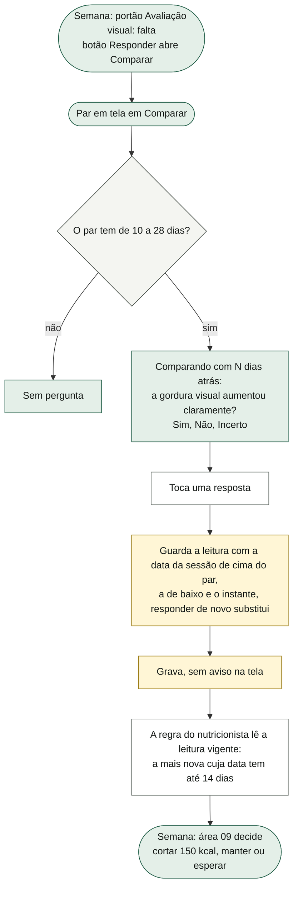

O que o diagrama não mostra: a pergunta mora aqui, e não num fechamento semanal, porque é aqui que as duas fotos estão à vista. A resposta já dada aparece marcada ao voltar ao mesmo par. A nota da pergunta diz: "A resposta vale por 14 dias e entra na régua calórica: o peso sozinho não corta. \"Incerto\" também é resposta: com ela, a regra mantém a comida como está." A validade conta **da data da sessão mais nova do par**, não de quando ele respondeu: responder hoje sobre um par antigo não torna o par recente. O que a regra faz com Sim/Não/Incerto é da área 09. Atenção: o "par" que o portão da Semana e o fim da sessão consideram é sempre o par **mais longo** da primeira pose com par; quando ele passa de 28 dias, os dois deixam de oferecer a pergunta mesmo havendo um par de 14 dias (ver §9, item 2).

### 3.11 Ajustar a foto

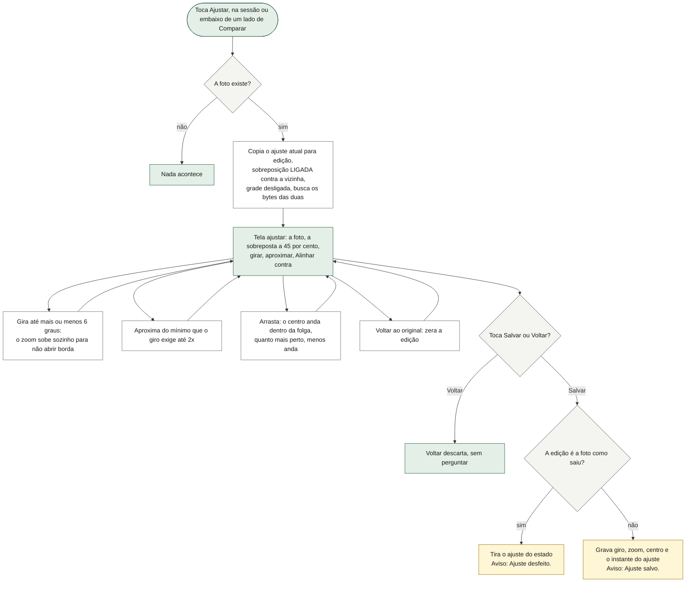

O que o diagrama não mostra: o ajuste é **dado, não pixel**: os bytes no aparelho e na nuvem continuam os da câmera, e todo lugar que mostra a foto (tela da pose, referência, câmera, os dois lados e as duas camadas de Comparar) aplica exatamente o mesmo desenho do ajuste. O quadro é sempre 3:4. Girar 6° obriga a aproximar 13% ("girar X° obriga a aproximar Y% para não abrir borda vazia — é o preço de endireitar"). No zoom mínimo não sobra folga para arrastar. Sem ajuste, a tela diz "Sem ajuste. A foto está como saiu da câmera." A sobreposição já vem ligada porque alinhar contra outra sessão é o motivo da tela; o chip **sobrepor** e **Alinhar contra** só existem se a pose tem outra sessão. Refazer a foto (bytes novos) descarta o ajuste da versão antiga na sincronia. Valores estranhos (de backup antigo ou de outro aparelho) nunca viram erro: viram o ajuste possível mais próximo.

### 3.12 Onde os bytes moram: ler, buscar e podar

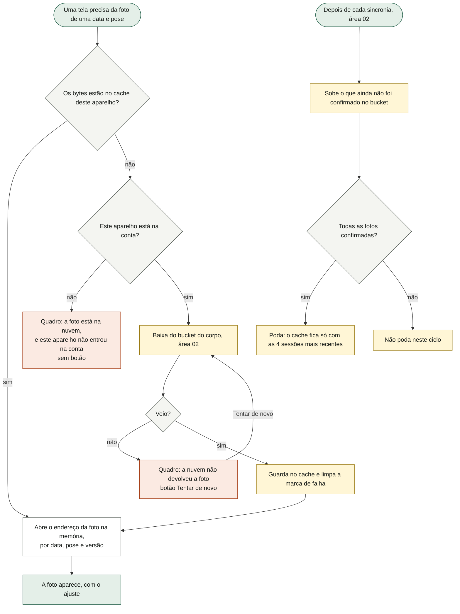

O que o diagrama não mostra: aqui o aparelho é o **cache** e o bucket é o arquivo permanente (9 fotos por sessão, 26 sessões por ano, uns 35 MB no primeiro ano, num armazenamento que o iOS pode despejar sob pressão de disco). Enquanto a busca não termina, o quadro diz "buscando a foto…"; um 404 (a foto ainda não subiu do outro aparelho) conta como "a nuvem não devolveu". **Tentar de novo** limpa as falhas daquela data (só dela) e busca de novo. As telas que buscam: abrir a sessão (hoje e cada referência), a câmera (hoje e a vizinha, e a nova vizinha depois de cada disparo), Comparar (as duas datas, e cada data trocada), Ajustar (a foto e a sobreposta). A subida, a poda e a contabilidade do que já subiu são da área 02; a poda nunca apaga byte que não foi confirmado no bucket, e uma única foto não confirmada segura a poda inteira. **Apagar todo o histórico** (área 01) poda o cache do corpo inteiro no próprio gesto. A redução é 1440 px no lado maior (1080 nas fotos de aparelho), qualidade 0,82, WebP ou, sem WebP, JPEG.

### 3.13 O aviso "fotos só neste aparelho" e as linhas do Agora e do Corpo

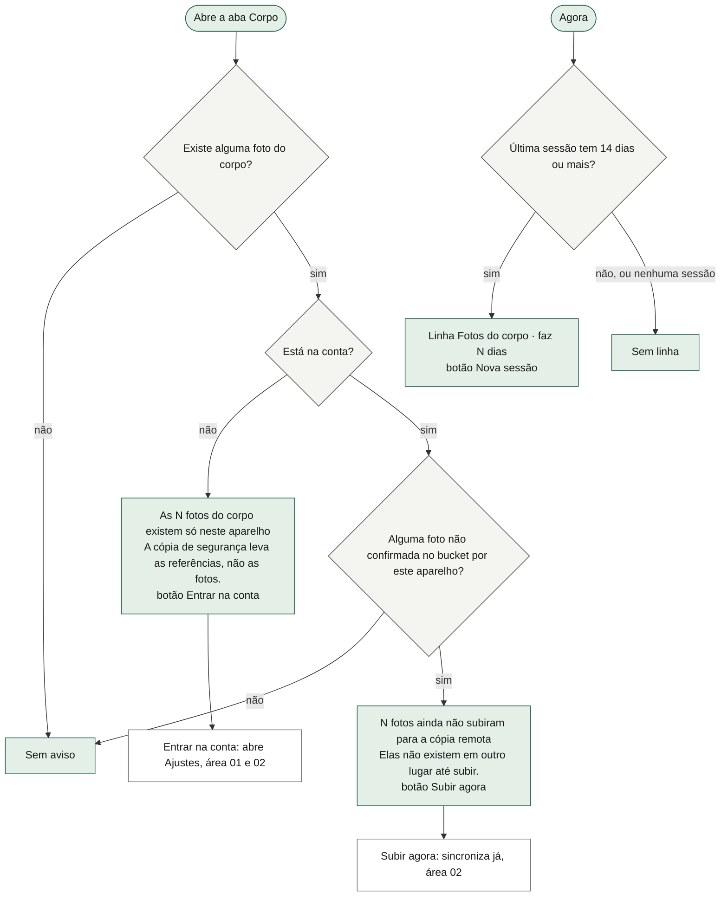

O que o diagrama não mostra: o aviso redesenha sozinho quando alguma foto termina de subir, mesmo se a rede cair no meio. Na seção "As fotos" do Corpo, dois textos fixos: "a hora de cada foto fica anotada · as marcas de fita no chão são o que faz duas sessões serem comparáveis" e "as fotos ficam neste aparelho e no seu bucket privado · não entram no backup em JSON". Os dias desde a última são **informação, não cobrança**: passar de 14 só pinta o número de âmbar; não há sequência, medalha nem parabéns. A linha do Agora não depende da hora (o peso sim, área 07/10); a contagem de dias é por viradas de dia no calendário, não por horas. No Corpo vazio (área 07), "Fotos · a cada 14 dias, 9 poses, menos de 5 min" aparece como uma das quatro coisas a começar, e ter uma sessão de fotos já tira o Corpo do vazio.

---

## 4. Estados da tela

| Estado | Quando acontece | O que a tela mostra |
|---|---|---|
| Corpo · nenhuma sessão | Nunca fotografou | "nenhuma sessão ainda", dias "–", cadência, botão **Nova sessão**, sem pontos e sem **Comparar** |
| Corpo · em dia | Última sessão há menos de 14 dias | Dias em cor normal, os nove pontos da última sessão, **Nova sessão** |
| Corpo · atrasado | Última sessão há mais de 14 dias | Número de dias em âmbar (só isso) |
| Corpo · sessão de hoje pela metade | Hoje tem algumas fotos | **Continuar · X de 9** |
| Corpo · sessão de hoje completa | Hoje tem as nove | **Refazer alguma pose** |
| Corpo · pode comparar | Alguma pose tem fotos em duas sessões | Botão **Comparar** |
| Corpo · só neste aparelho (sem conta) | Há fotos e não há conta | "As N fotos do corpo existem só neste aparelho" + **Entrar na conta** |
| Corpo · pendentes (com conta) | Alguma foto não confirmada no bucket | "N fotos ainda não subiram para a cópia remota" + **Subir agora** |
| Agora · fotos vencidas | Última sessão há 14 dias ou mais | Linha "Fotos do corpo · faz N dias" + **Nova sessão** |
| Montagem | Abriu a sessão e hoje não tem foto | As seis regras, a ordem das nove, **Começar a sessão**, a nota de que o toque liga o som |
| Pose · primeira vez | Não há foto anterior daquela pose | Quadro "primeira vez nesta pose", legenda "sem referência" |
| Pose · referência à vista | Há foto anterior com bytes aqui | A referência grande, legenda "referência · DD/MM" |
| Pose · referência a caminho | Referência existe, bytes ainda não | "buscando a foto…" no quadro |
| Pose · referência falhou | A nuvem não devolveu / sem conta | "a nuvem não devolveu a foto" + **Tentar de novo** / "a foto está na nuvem, e este aparelho não entrou na conta" |
| Pose · já tirada hoje | A pose tem foto hoje | Referência e "hoje" lado a lado; botões dizem "refazer…"; **Ajustar** e **Apagar** |
| Pose · faltando | Sessão incompleta | "faltam N de 9 · a sessão fica salva como está" |
| Pose · não guardada | O cache recusou ou o registro não gravou | Bloco de alerta "A pose N, nome, não foi guardada", texto do motivo, **Tentar de novo** (+ **Baixar cópia** no motivo registro); o ponto da pose fica marcado |
| Pose · fim | Sessão de hoje com nove de nove | Resumo "Sessão guardada · 9 de 9 poses", tempo, subida, peso, botões de comparar/responder, próxima data |
| Câmera · abrindo | Pediu a câmera e ainda não veio | Botão desabilitado "abrindo a câmera…" |
| Câmera · erro | Permissão negada, ocupada, sem câmera, outro | A frase do motivo, "a câmera do sistema continua servindo…", **Voltar à pose** |
| Câmera · pronta | Quadro vivo | Nove blocos, foto sobreposta, chips grade/sobrepor, temporizador, **tirar a foto** ou **refazer esta pose** |
| Câmera · contando | Disparo com temporizador | Número grande sobre o quadro (· no zero), botão **Cancelar** |
| Câmera · clarão | Disparo guardado | Clarão branco por 0,32 s, o bloco da pose fecha |
| Câmera · giro | Próxima pose pede girar | "↻ gire 90°" grande |
| Câmera · foto preta | Quadro quase todo preto | "A nome saiu preta. Ela volta no fim."; bloco marcado como adiado |
| Câmera · sessão completa | Última pose guardada | Aviso "Sessão completa. As nove poses estão registradas."; a câmera fica aberta |
| Comparar · sem foto na pose | A pose não tem nenhuma sessão | "Nenhuma foto nesta pose ainda." |
| Comparar · uma sessão só | A pose tem só uma sessão | "Ainda não há par. A primeira sessão foi em DD/MM (ou hoje). A segunda cai em dia DD/MM, daqui a N dias" (ou "já pode ser feita"), e quando o par serve à pergunta |
| Comparar · par longo | Par padrão | "Par mais longo que existe desta pose: N dias, ±X kg" + texto de por que o longo abre |
| Comparar · par escolhido | Outro par, mais longo que 28 dias ou o mais longo da pose | "N dias entre as duas · M sessões nesta pose" |
| Comparar · par curto | Par de até 28 dias e existe um mais longo | "N dias mostram pouco", o que serve, **Voltar ao par de M dias**, a lista dos pares |
| Comparar · recuou | A pose falta nas sessões mais antigas | "N dias, e não M" + quais sessões não têm a pose e onde o par começa |
| Comparar · pergunta | Par de 10 a 28 dias | A pergunta com Sim/Não/Incerto e a nota da validade |
| Comparar · lado sem foto | Data sem a pose (raro, datas da lista sempre têm) | "sem foto nesta pose", "–" na data |
| Comparar · sem medida | Semana da sessão sem pesagem/cintura | "peso: sem medida" / "cintura: sem medida" |
| Ajustar · sem ajuste | A foto está como saiu | "Sem ajuste. A foto está como saiu da câmera." |
| Ajustar · com ajuste | Giro, zoom ou centro mexidos | **Voltar ao original** e, com giro, o preço em zoom |
| Ajustar · sem outra sessão | A pose só existe nesta sessão | Sem chip sobrepor e sem **Alinhar contra** |

---

## 5. Dados

### O que esta área guarda

| Onde | Campo | Formato | Quem mais lê |
|---|---|---|---|
| Estado (`S`) | `S.protocolo.poses` | lista de ids de pose, ou `null` = a ordem do código (as nove de §6). Hoje nada no app a altera. | Corpo vazio (07, conta as poses) |
| Estado | `S.protocolo.sessoes` | lista ordenada por data de `{ d: 'AAAA-MM-DD' (local), t: instante da primeira foto, fotos: { idDaPose: { v: instante da captura (é a versão), ext: 'webp' ou 'jpeg', enq?: { r: giro em graus, z: zoom, cx, cy: centro do recorte 0 a 1, m: instante do ajuste } } }, obs?: nota, m: carimbo da última alteração }` | Agora e Corpo vazio (07, 10), endereço vazio e apagar tudo (01), a pergunta e o portão (09, via o par), sincronia (02) |
| Estado | `S.gordura` | lista ordenada por data de `{ d: data da sessão mais nova do par, de: data da mais antiga, v: 'sim' ou 'nao' ou 'incerto', t: instante da resposta }`, uma por `d` | Regra do nutricionista e portões (09), backup (01) |
| Estado | `S.apagados` (lápides) | `corpo:<data>` (sessão) e `corpo:<data>:<pose>` (foto) → instante | Sincronia (02) |
| Cache Storage | `lastro-corpo` | `./corpo/<data>/<pose>.<ext>` → os bytes (WebP ou JPEG, até 1440 px). **Sem versão no nome.** Fica com as 4 sessões mais recentes depois da poda. | Sincronia sobe, baixa e poda (02); apagar tudo poda (01) |
| Memória | endereços abertos | data:pose:versão → endereço de objeto da imagem; a versão no nome faz a foto refeita trocar na tela | Só esta área |
| Memória | falhas de foto | data\|pose → 'semconta' ou 'nuvem'; somem quando os bytes chegam | Só esta área (mora na seção de sincronia do código) |
| Memória (tela) | `view.protocolo` | `{ d, pose, montagem, naoGuardada?: { pose, motivo: 'foto' ou 'registro', reduzida }, adiadas?: { pose: 1 } }` | Navegação (01) |
| Memória (tela) | `view.camera` | `{ erro, pronta, fantasma, fantasmaD, opacidade (45), grade, timer (10), contagem, clarao, giro, preta }`, mais o fluxo de vídeo vivo e o relógio da contagem fora da vista | Navegação (01) |
| Memória (tela) | `view.comparar` | `{ pose, de, ate, sobrepor, opacidade (50), cortina, corte (50) }` | Navegação (01) |
| Memória (tela) | `view.ajuste` | `{ d, pose, enq (cópia em edição), grade, fantasma, fantasmaD }` | Navegação (01) |

### O que só lê de outras áreas

- `S.body.peso` e `S.body.cintura` (área 07): a média da semana de cada sessão, em Comparar e no fim da sessão.
- A contabilidade de fotos confirmadas no bucket por **este** aparelho (`sync.fotos`, chave `corpo:<data>:<pose>`, área 02): o aviso "só neste aparelho" e o "Subindo… X de 9".
- Se há conta (área 02): qual aviso mostrar e se vale buscar na nuvem.
- O dia de hoje no calendário local, o toast, o painel de confirmação, a gravação e o aviso de gravação falhou, a cópia de segurança, a posição de leitura (área 01).
- O som preparado no toque e o alarme curto (compartilhados com o descanso, área 03).
- `JANELA_MIN` 10, `JANELA_MAX` 28 e `VALIDADE_LEITURA` 14 (constantes da regra, área 09).

### Como cada dado atravessa a sincronia

- **Sessões de foto**: coleção com chave natural = a **data**. Cada pose, dentro, pela versão maior (`v`); empate de versão desempata pelo instante do ajuste (`enq.m`); nota e carimbo vêm do lado com `m` maior; `t` fica o menor. Poses tiradas em dois aparelhos no mesmo dia se somam. Sessão sem foto não sobrevive. Teto de 200 sessões. Lápide da sessão e de cada pose.
- **Ordem das poses**: documento inteiro, do lado que manda pelo carimbo do estado.
- **Leituras de gordura**: coleção com chave `gordura:<data>` e carimbo `t` (vence a resposta mais recente); teto 200. Nada cria lápide de leitura.
- **Bytes**: não estão no estado. Sobem para o bucket privado `corpo` em `uid/<data>/<pose>.<ext>` (sem versão; refazer sobrescreve), descem só quando uma tela pede. Nada apaga do bucket. Tudo isso é da área 02.
- **Cópia de segurança (JSON)**: leva `S.protocolo` e `S.gordura` (as referências), **não** os bytes; importar um backup antigo sem protocolo entra sem quebrar.
- **Apagar todo o histórico** (área 01): as sessões saem, a ordem das poses fica, as leituras de gordura **ficam**, o cache do corpo é podado inteiro.

---

## 6. Regras

1. **Cadência de 14 dias** entre sessões ("menos que isso é ruído de água e sono"). Desenho do protocolo. Usada no lembrete do Agora (14 ou mais), no âmbar do Corpo (mais de 14), na próxima data do fim da sessão e no vazio de Comparar.
2. **As nove poses, nesta ordem**, uma rotação contínua sempre para o mesmo lado, sem sair da marca do chão (menos de 5 min por sessão):
   1. Frente relaxado (referência, 0°, braços soltos ao lado)
   2. Frente duplo bíceps (músculo, 0°, cotovelos na altura do ombro)
   3. Abdômen e coxa (músculo, 0°, mãos atrás da cabeça)
   4. Perfil direito (referência, 90°, braços estendidos à frente)
   5. Perfil direito natural (postura, 90°, braços soltos ao lado)
   6. Costas relaxado (referência, 180°, braços soltos ao lado)
   7. Costas duplo bíceps (músculo, 180°, cotovelos abertos)
   8. Costas mãos na cintura (músculo, 180°, polegares na cintura)
   9. Perfil esquerdo (referência, 270°, braços estendidos à frente)

   Cada uma tem três passos de execução, o que revela e o erro comum. O "bloco" só diz a que pergunta a foto responde; não reordena nada.
3. **A montagem congelada**: câmera a 3,0 m da marca com a lente 2× (2,5 m com a 1×); lente na metade da altura dele (umbigo, não peito); 80 cm entre o corpo e a parede; uma luz, frontal, nada de cima; o horário que ele conseguir repetir (o app anota a hora); sempre a mesma roupa justa e lisa, descalço.
4. **A ordem dele manda quando é válida**: id de pose desconhecido é descartado em silêncio; ordem vazia ou toda desconhecida cai nas nove do código.
5. **A data da sessão é a local**, não UTC (uma sessão antes das 3h não cai no dia anterior). Uma sessão por data. A sessão **nasce na primeira foto** e **morre com a última** apagada.
6. **A sessão continua** da primeira pose da ordem que não tem foto; depois de cada foto avança sozinha. As que voltaram por foto preta vêm por último.
7. **Referência** = a foto mais recente da mesma pose em uma sessão **anterior** à data; procura para trás até achar (pose pulada não cega a seguinte); a própria sessão nunca é referência.
8. **Vizinha para alinhar** (câmera e ajuste) = a anterior mais recente com a pose; sem anterior, a seguinte; sem nenhuma outra, nada.
9. **Foto preta**: brilho médio abaixo de **12** (0 a 255) não é guardada.
10. **Tamanho**: lado maior de **1440 px** (as de aparelho são 1080), qualidade 0,82, WebP e, sem WebP, JPEG. Câmera do app pede a traseira em 1080 × 1440 **como preferência**.
11. **Temporizador**: sem, 3 s ou **10 s (padrão**, o tempo de andar três metros e parar de balançar). Um bipe por segundo (660 Hz; 1320 Hz no último), voz nos três últimos.
12. **Refazer** substitui e deixa lápide da foto antiga; **apagar** pede confirmação, deixa lápide, tira os bytes deste aparelho; a última foto leva a sessão (com lápide).
13. **Os bytes nunca entram no estado** (o teto do Safari para o estado é 5 MiB; o estado é regravado a cada série). No estado só a referência.
14. **O cache guarda as 4 sessões mais recentes**; a poda só roda com todas as fotos confirmadas no bucket. Subir é obrigação, baixar é sob demanda (área 02).
15. **Par padrão de Comparar = a sessão mais antiga e a mais nova com aquela pose**, nunca a anterior ("em duas semanas a diferença é quase toda água e sono"). Abre na primeira pose da ordem que tem par.
16. **Par curto**: até 28 dias e existindo um mais longo → aviso, sem bloquear. De 10 a 28 dias "serve para a pergunta"; abaixo de 10, não.
17. **Pergunta da gordura visual**: só com o par em tela entre **10 e 28 dias**; uma resposta por data da sessão mais nova do par (responder de novo substitui); vale **14 dias** contados dessa data; "Incerto" é resposta (a regra mantém a comida). Pedido do nutricionista; substituiu a cintura como segunda confirmação, porque medir cintura parou de acontecer.
18. **Peso e cintura ao lado da foto são a média da semana** (semana começando no domingo) da sessão, tirados de `S.body`; a sessão de fotos não pede número nenhum.
19. **A hora de cada foto** aparece na comparação (decisão do dono, 14/10). Fotos com versão anterior a 01/01/2020 (sem instante real) ficam sem hora e não contam no tempo do fim da sessão.
20. **Ajuste**: giro até **±6°**; zoom do mínimo que o giro exige (`cos θ + 4/3 · sen θ`, 1,13 a 6°) até **2×**; centro preso dentro da foto; arrasto em fração do quadro, dividido pelo zoom; quadro 3:4. Sem brilho, contraste, filtro nem corte livre. Ajuste igual à foto como saiu **não é gravado**.
21. **O fim da sessão** oferece o par longo só se ele termina na sessão de hoje, e a pergunta só se o par da avaliação (o mais longo da primeira pose com par) tiver de 10 a 28 dias.
22. **Atraso é informação, não cobrança**: sem sequência, medalha ou parabéns.

---

## 7. Ligações com as outras áreas

| Área | O que esta recebe dela | O que esta entrega a ela |
|---|---|---|
| 01 · Fundação | A gravação do estado (e o sinal de que falhou), o painel de confirmação, o toast, a cópia de segurança (**Baixar cópia**), as telas cheias e a ordem das camadas do Voltar, a posição de leitura, o dia de hoje, a normalização do estado (protocolo e gordura entram vazios se faltarem) | Os campos `S.protocolo` e `S.gordura`; o cache `lastro-corpo` para apagar tudo podar; o número de fotos no aviso de apagar tudo; as sessões de foto contam como "tem registro" no endereço vazio |
| 02 · Sincronia | Se há conta; a subida, a descida e a poda dos bytes; a contabilidade do que subiu; a junção das sessões, das poses e das leituras; o toast "Do outro aparelho: N fotos" | As referências, as lápides de foto e de sessão, os ajustes com carimbo, a lista de sessões para a poda |
| 03 · Sessão de treino | O som preparado no toque e o alarme curto com vibração (usado quando a pose não coube) | Nada |
| 07 · Corpo | `S.body.peso` e `S.body.cintura` para a média da semana; a aba Corpo e a Evolução que hospedam a seção e o botão **Comparar fotos**; o Corpo vazio | A seção "As fotos" inteira; a linha "Fotos" do Corpo vazio; tirar o Corpo do vazio quando há sessão |
| 09 · Semana e a regra | As janelas 10 a 28 dias e a validade de 14 dias; o portão "Avaliação visual" com **Responder** | A leitura vigente (Sim/Não/Incerto) para o veredito; o par da avaliação (datas) para o texto do portão |
| 10 · Agora | O lugar da linha, junto da linha do peso | A linha "Fotos do corpo · faz N dias" e o caminho **Nova sessão** |

---

## 8. Como serviço individual

**Nome:** Acompanhamento Visual (fotos do corpo).

**O que ele possui:**
- O catálogo das poses e a montagem (hoje congelados no código) e a ordem do usuário.
- As sessões de foto, as referências de cada pose (versão, formato) e os ajustes de enquadramento.
- As leituras de gordura visual (ele as coleta; a área 09 as consome).
- O armazenamento de bytes: o cache local e o bucket privado (com a área 02 hoje fazendo o transporte).

**Operações (como uma API):**

| Verbo | Recebe | Devolve |
|---|---|---|
| `obterProtocolo` | — | as poses na ordem em vigor, a montagem, a cadência |
| `abrirSessao` | data (hoje) | a sessão (ou vazia), a pose por onde continuar, se mostra a montagem, a referência de cada pose |
| `registrarFoto` | data, pose, bytes (já reduzidos), brilho | a referência nova, a próxima pose, ou o motivo de não guardar (foto preta, sem espaço, registro falhou) |
| `apagarFoto` | data, pose | ok; se a sessão morreu junto |
| `anotarSessao` | data, texto | ok |
| `ajustarFoto` | data, pose, giro, zoom, centro | o ajuste normalizado (ou removido, se é a identidade) |
| `parPadrao` / `comparar` | pose, datas opcionais | o par, o intervalo, os avisos (curto, recuou), a pergunta se cabe |
| `responderGorduraVisual` | par (de, até), resposta | a leitura gravada |
| `leituraVigente` | instante | 'sim', 'nao', 'incerto' ou nada (para a área 09) |
| `parDaAvaliacao` | — | as datas do par que a pergunta usa, ou nada |
| `garantirBytes` | datas | os endereços das fotos, ou o motivo da falha por foto |
| `estadoDoArquivo` | — | quantas fotos só existem aqui / ainda não subiram |
| `vencimento` | instante | dias desde a última, se vence (para o Agora) |

**Eventos que emitiria:** `SessaoDeFotosIniciada`, `FotoRegistrada`, `FotoRefeita`, `FotoApagada`, `SessaoDeFotosConcluida`, `FotoNaoGuardada`, `EnquadramentoAjustado`, `GorduraVisualRespondida`, `FotosPendentesDeEnvio`.

**Eventos que escutaria:** `MedidaRegistrada` (07, para a média da semana), `ContaEntrou` / `ContaSaiu` e `SincroniaConcluida` (02, para subir, podar e recalcular o aviso), `HistoricoApagado` (01, para podar tudo).

**O que hoje está acoplado e precisaria ser separado:**
- Toda a orquestração mora em `main.jsx`, lendo e escrevendo o estado global `S` e a vista `view` direto; as telas falam com um objeto de comandos único (`CTX`).
- As falhas de foto, a busca de bytes (`garanteBytesDoCorpo`) e o aviso "só neste aparelho" leem a contabilidade da sincronia (`sync.fotos`) e moram na seção de sincronização.
- A redução da imagem é compartilhada com as fotos de aparelho (`infra/fotos.ts`).
- O som (contexto de áudio e o alarme curto) é compartilhado com o cronômetro de descanso.
- O par da avaliação mora no meio do código da regra do nutricionista (`parDaAvaliacao`), e as janelas 10/28 e a validade 14 vêm de `dominio/corpo.ts` (área 09): a fronteira entre "o que é um par válido" (aqui) e "o que a regra faz com a resposta" (09) precisa ser contrato explícito.
- A média semanal lê `S.body` (07) direto.
- A ordem das telas cheias e das camadas do Voltar está em `main.jsx` e `navegacao.js` (01).
- A versão de cada foto é o instante da captura e serve também de quebra-cache e de carimbo de fusão; a lápide usa outro instante tirado no mesmo milissegundo (ver §9).

---

## 9. Riscos e dívidas que apareceram na leitura

Só registro; nada foi consertado.

1. **Provável bug — os botões do fim da sessão abrem Comparar por trás da sessão de fotos.** "Comparar com DD/MM…" e "Responder a pergunta do nutricionista…" abrem a comparação sem fechar a sessão de fotos, e a sessão de fotos tem prioridade sobre a comparação tanto na escolha da tela cheia quanto na pilha do Voltar. Reproduzir: completar as nove poses num dia que tenha par longo terminando hoje → tocar **Comparar com…** → a tela continua na sessão de fotos (só rola para o topo); tocar Voltar → aí a comparação aparece. Nenhum teste toca esses botões (o teste do fim só lê os textos). (`telaCheia` em `main.jsx` ~2591; `navegacao.js` 72–79; `protocolo.jsx` 105–106)
2. **Provável bug — a pergunta da gordura some dos caminhos guiados quando o par mais longo passa de 28 dias.** O portão da Semana e o fim da sessão olham só o par **mais longo** da primeira pose com par. Com sessões a cada 14 dias, a partir da quarta sessão (0, 14, 28, 42 dias) esse par tem 42 dias: o portão passa a dizer "ainda não há par de fotos de 10 a 28 dias — a pergunta precisa dele", **sem o botão Responder**, e o fim da sessão não oferece a pergunta, embora exista um par de 14 dias. Comparar também abre no par longo, sem pergunta; só escolhendo à mão a data de 14 dias atrás ela aparece. Como sem resposta a regra não corta (área 09), na prática o corte por ganho rápido fica travado depois de ~6 semanas de protocolo para quem não sabe desse caminho. Os testes cobrem só pares de duas sessões. (`parDaAvaliacao` ~4089; `fimDaSessaoDeFotos` ~10121; `portoesDaRegra` em `dominio/corpo.ts` ~470)
3. **Provável bug — desfazer um ajuste não atravessa a sincronia.** "Voltar ao original" + **Salvar** tira o ajuste do estado, e "sem ajuste" tem carimbo zero; na junção, o ajuste antigo do outro lado (carimbo maior que zero) vence e volta. Reproduzir: ajustar uma foto e sincronizar; em outro aparelho gravar qualquer coisa e sincronizar; no primeiro, desfazer o ajuste e sincronizar → o ajuste volta. Num aparelho só, sem escrita do outro lado no meio, não aparece. (`salvaAjuste` ~11543; `carimboDoAjuste` em `dominio/sincronia.ts` ~341)
4. **Registrados na área 02, e que aparecem aqui:** refazer uma pose cria a lápide e a versão nova no mesmo milissegundo, e a junção pode matar a foto nova (02, item 1); o aparelho que tinha a foto velha no cache sobe os bytes velhos por cima da refeita, porque o nome no cache e no bucket não tem versão (02, item 2); no segundo aparelho, o aviso "N fotos ainda não subiram" conta as fotos do outro e **Subir agora** não resolve, e a poda nunca roda lá (02, item 3); apagar uma foto não apaga o arquivo no bucket (02, item 12).
5. **Na foto preta, a sobreposição não acompanha a pose nova.** O caminho do disparo bom troca a data sobreposta para a vizinha da pose seguinte; o da foto preta muda de pose e mantém a data da pose anterior. Normalmente é a mesma sessão e não se nota; se aquela sessão não tiver a pose nova, a sobreposta fica vazia. (`capturaAgora` ~11761)
6. **"Tentar de novo" no motivo registro não avança de pose**, diferente do motivo foto e do disparo normal. (`tentaFotoDaPose` ~11821)
7. **A confirmar — a nota da sessão pode perder as últimas teclas** se o app for fechado em menos de 0,7 s: a espera dela tem relógio próprio, fora do que o app descarrega ao sair. (`setNotaDaSessao` ~10084)
8. **A confirmar no iPhone — a voz pode não sair na primeira vez.** O toque de **Começar a sessão** e o do disparo preparam o áudio da Web, não a síntese de voz; a primeira fala acontece depois de esperar a câmera abrir (fora do toque), e a contagem fala de dentro de um relógio. Se o iOS exigir toque para a primeira fala, ela fica muda.
9. **A confirmar — app para segundo plano com a câmera aberta ou contando.** O desligamento do app não fecha a câmera nem cancela a contagem; não há tratamento ao ir para segundo plano. Ao voltar, uma contagem congelada pode disparar num momento inesperado.
10. **Sessão presa ao dia em que abriu.** Abrir sempre abre a de hoje: uma sessão incompleta de ontem nunca pode ser completada, e uma sessão aberta antes da meia-noite grava as fotos de depois no dia anterior.
11. **Datas invertidas em Comparar.** Nada impede escolher "de" mais nova que "até", ou a mesma data dos dois lados; a pergunta então fala em "N dias atrás" ao contrário e grava a leitura com a data da sessão de baixo. Com a mesma data, aparece "0 dias mostram pouco".
12. **Texto fixo "As nove poses"** no aviso de sessão completa da câmera, mesmo se a ordem tiver outro tamanho. Hoje inofensivo, porque não há como mudar a ordem.
13. **A ordem das poses é editável no dado mas não no app**: `S.protocolo.poses` é normalizada, viaja na sincronia como documento e é respeitada por todas as contas, mas nenhuma tela a altera.
14. **Ajustar sem os bytes** mostra só "sem foto", sem o motivo real nem **Tentar de novo** (as outras telas dizem "buscando…" ou a falha). (`ajustefoto.jsx` 76)
15. **Sem Cache Storage**, guardar os bytes não faz nada e não dá erro: a referência entra no estado sem foto em lugar nenhum, e o quadro depois diz "a foto está na nuvem, e este aparelho não entrou na conta", que é falso. Ambiente raro.
16. **Uma foto sem bytes em lugar nenhum segura a poda para sempre** (a poda espera todas confirmadas), e o cache cresce sem teto.
17. **A confirmar a intenção — apagar todo o histórico mantém as leituras de gordura** enquanto apaga as sessões de foto que as originaram (o código as agrupa com a metade de comida, que sobrevive).
18. **O alarme do descanso é o som da pose que não coube**, enquanto o comentário do disparo diz que o alarme "é de outra coisa". Provavelmente intencional (é um sinal de problema a três metros); vale confirmar.
19. **O tempo do fim da sessão** é do primeiro ao último instante de captura; uma pose refeita horas depois infla o "N min do primeiro ao último disparo".

---

## 10. Índice técnico

### Arquivos

| Arquivo | Papel |
|---|---|
| `src/dominio/protocolo.ts` | Catálogo das nove poses, montagem, cadência, data local, completude, próxima pose, referência, vizinha, par padrão, média da semana, limite da foto preta |
| `src/dominio/enquadramento.ts` | Regras do ajuste: limites, zoom mínimo, folga, normalizar, identidade, o desenho único (`transform`), arrastar |
| `src/infra/corpo.ts` | Cache `lastro-corpo`: reduzir (1440), guardar, ler, ter, esquecer, abrir/soltar endereços, podar; 4 sessões no aparelho |
| `src/infra/camera.ts` | Câmera do app: ter câmera, abrir (traseira 1080 × 1440 ideal), traduzir erros, fechar, quadro pronto |
| `src/infra/fotos.ts` | `reduzPara` (redução em passos, WebP/JPEG, brilho médio), compartilhado com as fotos de aparelho |
| `src/infra/nuvem.ts` | `subirCorpo`, `baixaCorpo`, `apagaCorpo` (sem chamador) — área 02 |
| `src/ui/telas/protocolo.jsx` | `Protocolo`: montagem, tela da pose, pontos, fim, pose não guardada, nota, botões de captura, ajustar e apagar |
| `src/ui/telas/camera.jsx` | `Camera`: quadro vivo, blocos, sobreposição, grade, temporizador, contagem, clarão, giro, foto preta, erro |
| `src/ui/telas/comparar.jsx` | `Comparar`: fichas das poses, datas, lado a lado / cortina / sobrepor, pergunta da gordura, avisos de par curto e recuo, notas |
| `src/ui/telas/ajustefoto.jsx` | `AjusteFoto`: girar, aproximar, arrastar, grade, sobreposta, salvar, voltar ao original |
| `src/ui/instrumento/fotoajustada.jsx` | `FotoAjustada`: o único lugar que desenha a foto com o ajuste, e o quadro vazio com o motivo e **Tentar de novo** |
| `src/ui/telas/corpo.jsx` | `Fotos` (seção "As fotos", linhas 177–225), usada por `Corpo` |
| `src/ui/telas/agora.jsx` | A linha das fotos (linhas 323–342, junto com a do peso) |
| `src/ui/telas/evolucao.jsx` | Botão **Comparar fotos** (linhas 118–122) |
| `src/ui/telas/semana.jsx` | Botão **Responder** do portão (linha 206) |

### Funções de `src/main.jsx` (linhas do commit `8ec19a4`)

- Seção "o protocolo de fotos": `ordemDePoses` 9921, `sessaoFotoOuCria` 9924, `datasNecessarias` 9935, `andaPose` 9966, `marcaPoseNaoGuardada` 10001, `proximaComAdiadas` 10009, `guardaFotoDaPose` 10016, `tiraFotoDoCorpo` 10041, `fimDaSessaoDeFotos` 10102.
- Seção "comparar": `aplicaParPadrao` 10249, `vazioDeUmaSessao` 10287, `ladoDaComparacao` 10306.
- Seção "ajustar uma foto": `fotosDoAjuste` 11473, `datasDoFantasma` 11484.
- Seção "a câmera de dentro do app": `encerraCamera` 11599, `contaEDispara` 11654, `obturador` 11672, `clarao` 11686, `falaTexto` 11696, `giroEntre` 11709, `falaPose` 11716, `bipeDaContagem` 11726, `capturaAgora` 11752, `avisoDaPoseNaoGuardada` 11808; variáveis `streamCamera`, `contagemT` 11593–11594.
- Bytes e falhas (seção de sincronização, ligação com 02): `falhaDeFoto` 1336, `chaveDaFalha` 1337, `marcaFalha` 1338, `limpaFalha` 1343, `AVISO_DA_FALHA`, `avisoDaFoto` 1355, `podeTentarFoto` 1361, `garanteBytesDoCorpo` 1365; `reconciliaCorpo` 1290 (da 02).
- Outras: `fotosSoAqui` 11102; `parDaAvaliacao` 4089 e `sinaisDaRegra` 4069 (ligação com 09); `notaT` 10083; `preparaAudio` 6539 e `aviso` 6548 (compartilhadas com 03); `lapide` 130 e `hojeISO` 2172 (01).
- Trechos de outras áreas que tocam esta: normalização do protocolo e da gordura 377 e 412–418; importação do backup 4659–4662; apagar todo o histórico 6239–6343 (inclui `CORPO.poda([])`); Voltar do sistema 7078–7084; telas cheias `telaCheia` ~2591 e `emTelaCheia` 2332; `CTX.corpoVazio` 7841 (07).

### Pontos de entrada `CTX.*`

`abreProtocolo` 9945, `fechaProtocolo` 9960, `comecaSessaoDeFotos` 9963, `vaiParaPose` 9964, `posAnterior` 9976, `posProxima` 9977, `tiraFotoDoCorpo` 10054, `apagaFotoDoCorpo` 10056, `setNotaDaSessao` 10084, `sessaoDeFotos` 10138, `abreComparar` 10201, `fechaComparar` 10210, `setPoseComparada` 10257, `tentaFotos` 10259, `setDataComparada` 10267, `setSobrepor` 10272, `setCortina` 10279, `setCorte` 10280, `setOpacidade` 10281, `voltaAoParLongo` 10303, `comparacao` 10331, `setGordura` 10446, `linhasDoCorpo` 11023 (só a linha "fotos"; a do peso é 07/10), `protocoloFotos` 11069, `abreAjuste` 11490, `setDataDoFantasma` 11511, `fechaAjuste` 11517, `setGradeDoAjuste` 11518, `setFantasmaDoAjuste` 11519, `setGiroDoAjuste` 11521, `setZoomDoAjuste` 11528, `arrastaAjuste` 11533, `zeraAjuste` 11538, `salvaAjuste` 11543, `ajusteEmEdicao` 11565, `streamDaCamera` 11596, `abreCamera` 11605, `fechaCamera` 11628, `setGradeDaCamera` 11634, `setFantasmaDaCamera` 11635, `setOpacidadeDaCamera` 11636, `setTimerDaCamera` 11637, `setDataDoFantasmaDaCamera` 11638, `cancelaDisparo` 11644, `disparaCamera` 11744, `tentaFotoDaPose` 11821, `cameraViva` 11834. Usados de outras áreas: `exportar` (01), `sincronizaAgora` 8554 (02), `abreAjustes` (01).

### Regras do domínio e da infra

- `dominio/protocolo.ts`: `CADENCIA_DIAS`, `ItemDeMontagem`, `MONTAGEM`, `PROTOCOLO`, `ordemPadrao`, `poseDe`, `poses`, `dataLocal`, `instanteDaData`, `ordenadas`, `sessaoDe`, `ultima`, `diasDesde`, `Completude`, `completude`, `BRILHO_DO_PRETO`, `quaseTodoPreto`, `proximaPose`, `Referencia`, `referencia`, `comAPose`, `vizinhaComAPose`, `parPadrao`, `mediaDaSemana`.
- `dominio/enquadramento.ts`: `ASPECTO`, `GIRO_MAX`, `ZOOM_MAX`, `IDENTIDADE`, `zoomMinimo`, `folga`, `normaliza`, `ehIdentidade`, `transform`, `arrasta`.
- `dominio/corpo.ts` (só o que esta área usa): `LeituraDeGordura`, `VALIDADE_LEITURA`, `JANELA_MIN`, `JANELA_MAX`, `leituraVigente` (dono da regra: 09).
- `dominio/sincronia.ts` (ligação com 02): `chaveDeSessaoFoto`, `chaveDeFotoDoCorpo`, `chaveDeLeitura`, a junção das sessões de foto e das leituras.
- `dominio/tipos.ts`: `Enquadramento`, `FotoRef`, `PoseId`, `Pose`, `SessaoFoto`.
- `infra/corpo.ts`: `CACHE_CORPO`, `SESSOES_NO_APARELHO`, `reduz`, `reduzDoVideo`, `urlDaFoto`, `carrega`, `solta`, `guarda`, `le`, `tem`, `esquece`, `poda`.
- `infra/camera.ts`: `temCamera`, `ErroDeCamera`, `Aberta`, `Resultado`, `abre`, `fecha`, `pronto`.
- `infra/fotos.ts`: `reduzPara` (compartilhada).

### Componentes

`Protocolo` (com `Pontos`, `Montagem`), `Camera`, `Comparar` (com `Lado`), `AjusteFoto` (com `Controle`), `FotoAjustada`, `Fotos` (dentro de `corpo.jsx`).

### Campos `S.*` e `view.*`

- `S.protocolo` (`poses`, `sessoes`), `S.gordura`; lápides `corpo:*` em `S.apagados`.
- `view.protocolo`, `view.camera`, `view.comparar`, `view.ajuste`.

### Testes

- `tests/fluxo/protocolo.test.js` (92 casos): montagem ("a montagem vem antes da primeira foto…", "quem já tem foto de hoje não vê a montagem de novo", "o preparo mostra a ordem das nove e liga o som…"); gravar ("a sessão nasce na primeira foto…", "o byte não entra no estado…", "a foto de corpo é gravada maior que a do aparelho", "a sessão avança sozinha…"); referência; refazer e apagar ("refazer uma pose deixa lápide…", "apagar a única foto apaga a sessão junto", "apagar a foto pergunta antes…"); nuvem e cache ("sem conta, as fotos do corpo dizem que existem só neste aparelho", "com conta, o que não subiu é contado…", "a poda deixa no aparelho só as sessões recentes", "foto que ainda não subiu segura a poda…", "apagar o histórico poda os bytes de corpo…", "abrir uma sessão podada traz os bytes de volta…", "a foto que a nuvem não devolveu diz isso…", "sem conta na nuvem a foto do outro aparelho não oferece tentar de novo"); resumo no Corpo ("o atraso é informação, não cobrança", "sessão de hoje pela metade convida a continuar…"); comparar ("o par padrão é a mais nova contra a MAIS ANTIGA", "o par curto que ele escolheu…", "uma sessão só: o vazio tem data…", "o peso ao lado da foto é a média da semana…", "cada lado da comparação diz a hora da foto…", "a pose que não existe lá atrás: o par recua sozinho e diz que recuou", "a cortina…"); ajuste ("ajustar grava o recorte no estado e não toca nos bytes", "girar sobe o zoom sozinho…", "o ajuste que não faz nada sai do estado…", "sair sem salvar descarta…", "o mesmo recorte é aplicado na captura e na comparação", "a sessão mais antiga alinha contra a SEGUINTE…"); câmera ("sem getUserMedia, a câmera do sistema volta a ser a principal", "abrir a câmera pede a traseira, e em retrato", "sair da tela DESLIGA a câmera", "permissão negada não vira tela quebrada…", "o disparo é o obturador, um clarão e o bloco…", "a pose que não coube não ganha obturador nem clarão…", "a foto preta não é guardada…", "entre duas poses com giro…", "a contagem diz os três últimos em voz", "o fim da sessão diz o que ficou guardado…", "sem síntese de voz…", "a contagem pode ser cancelada…", "o temporizador padrão dá tempo de andar os três metros", "sem quadro ainda, a captura recusa…", "a pose que não coube para a sessão… e Tentar de novo a guarda"); navegação ("sair de uma tela cheia devolve a posição de leitura", "andar entre poses não joga a sessão de fotos para o topo").
- `tests/dominio/protocolo.test.ts` (29 casos): poses e ordem, data local, continuação, completude, dias desde, cadência, referência, par padrão, média da semana, vizinha.
- `tests/dominio/enquadramento.test.ts` (23 casos): zoom mínimo, folga, limites, normalizar, identidade, transform, arrastar, quadro 3:4.
- `tests/fluxo/ajuste.test.js` (casos da gordura): "a leitura das fotos destrava o corte…", "fotos sem piora mandam manter…", "responder de novo substitui…", "num par de três meses a pergunta não aparece".
- `tests/dominio/sincronia.test.ts`: "poses tiradas em aparelhos diferentes no MESMO dia se somam", "refazer uma pose vence a versão antiga…", "apagar UMA pose não a ressuscita…", "sessão que ficou sem foto nenhuma não sobra na lista", "entre dois recortes da mesma foto, vence o mais recente", "refazer a foto descarta o recorte da versão antiga", "leituras de gordura de dois aparelhos se juntam", "a mesma leitura respondida duas vezes: vence a mais recente".
- `tests/fluxo/dados.test.js`: o backup leva `gordura` e o protocolo.
- Sem teste: os botões do fim da sessão (§9, item 1), a pergunta com três ou mais sessões (item 2), desfazer ajuste entre aparelhos (item 3).
