# 09 · A Semana e a regra do nutricionista

> Em uma frase: a aba Semana lê as últimas semanas (peso, comida, força, séries) e aplica a regra calórica do nutricionista, a única coisa da tela que pede uma ação: dar, ou não, um passo de ±150 kcal no plano, que cai no arroz.

Fronteiras, para não duplicar: o registro do peso é da **área 07** (aqui, só como a regra lê as pesagens); o registro de comida, o plano, a folha de "pôr um dia em dia" e as **contas** da devolutiva de comida são da **área 06** (aqui, como elas aparecem na Semana e como o passo mexe no arroz); as fotos, a comparação e a pergunta da gordura visual são da **área 08** (aqui, como a regra usa a resposta); o alvo do treinador por músculo, o bloco "Fora do alvo do treinador" e a retrospectiva do bloco são da **área 04**; o registro de cardio é da **área 10**; o painel geral "Não guardei" e a cópia de segurança são da **área 01**; a fusão entre aparelhos é da **área 02**.

## 1. O que o usuário faz aqui

| # | Funcionalidade | O que faz | Onde fica | Quando aparece / some |
|---|---|---|---|---|
| 1 | **O veredito** ("a regra do nutricionista diz") | Um título que diz o que a regra faz com a comida ("Comer mais 150 kcal", "Comer menos 150 kcal", "Não mexer: …") e um parágrafo com o porquê, com os números das semanas. Embaixo, a linha do estado do plano ("plano base · arroz 500 g", ou, com números de exemplo, "Apliquei +150 kcal em 01/10, às 21h34 · 3.204 → 3.358 kcal em dia de treino · ajuste +150 kcal · arroz 620 g"). O arroz da linha é a soma dos pratos (no plano base, 250 g no almoço e 250 g no jantar). | Semana, topo, seção "O que fazer com a comida" | Sempre. Fica acima dos chips de propósito: é a única coisa da tela que pede ação. |
| 2 | **Aplicar o passo** | Botão "aplicar +150 kcal" ou "aplicar −150 kcal". Antes do toque, a conta à vista: "Depois de aplicado, 3.358 kcal vira a nova base. Se o peso voltar ao alvo, o passo não é devolvido sozinho." Depois, toast "Apliquei +150 kcal. O arroz do plano foi para 620 g." | Dentro do cartão do veredito | Só quando o veredito é "Comer mais 150 kcal" ou "Comer menos 150 kcal". |
| 3 | **Desfazer o passo** | Volta o saldo e o arroz ao que eram antes do passo; o passo fica no registro, marcado como desfeito. Toast "Desfiz o +150 kcal. O arroz do plano voltou para 500 g." | Botão "Desfazer", logo abaixo do cartão | Só enquanto houver passo em vigor. Sem prazo e sem confirmação. |
| 4 | **O passo que o aparelho recusou** | Se a gravação falha, nada muda, e um bloco diz "O passo não foi aplicado" (ou "desfeito"), o que ia mudar e não mudou (arroz de cada prato, kcal do dia de treino), "O veredito continua valendo: +150 kcal. Ele não vence e não some.", e dois botões: "Tentar de novo" e "Baixar cópia". | Abaixo do cartão do veredito | Só depois de uma recusa; some quando uma nova tentativa grava. |
| 5 | **Esperar a evidência nova** ("um passo por evidência") | Depois de um passo, o veredito vira "Não mexer: o passo de 01/10 ainda está sendo medido" e diz de que data a que data são as duas semanas que faltam ("falta 1 semana" / "faltam 2 semanas"). | O próprio veredito | Enquanto as duas semanas lidas pela regra não começaram depois do passo. |
| 6 | **Os portões da regra** | Lista das condições, cada uma com o estado na palavra ("Taxa: cumprida — +0,05 e +0,05 kg/semana", "Força: cumprida — não está subindo", "Adesão: falta — 9 dias de 14", "Avaliação visual: falta — sem resposta") e o que produziu cada estado. Botões: "Pôr em dia" (adesão), "Responder" (avaliação visual), "Ver a força". | Abaixo do cartão | Só nos dois ramos que podem dar passo: peso parado e peso subindo rápido. |
| 7 | **A promessa da adesão** | "Enquanto a adesão não chega a 11, o veredito não muda, por mais pesagem que entre. A tela não vai pedir isso de novo em outro lugar." | Abaixo dos portões | Só quando o portão da adesão está em falta. |
| 8 | **O vazio da régua** | Quando faltam pesagens: as quatro últimas semanas, cada uma com o estado ("média válida", "em curso · faltam 3 dias", "buraco: quebra a sequência") e quantas pesagens tem; a saída quando um buraco separa duas semanas válidas; "Pesar hoje", "Peso de outro dia" e "Não invente o peso de um dia que passou." | Abaixo do cartão | Só no veredito "Não mexer: faltam pesagens". |
| 9 | **Os chips treino / comida** | Divide o resto da tela por assunto. | Abaixo do veredito | Sempre; volta para "treino" toda vez que a Semana é aberta de novo. |
| 10 | **A força estimada** | Sparkline de 14 semanas, "soma das 2 semanas" (kg), "variação" (%), a procedência ("e1rm subindo 2,3% em 2 semanas · 5 exercícios") e três chips para assumir o sinal na mão: "o app decide", "está subindo", "não está". | Chip "treino", seção "A força estimada" | Sempre no chip treino; sem dado, "Ainda não há carga registrada suficiente para estimar." |
| 11 | **O cardio da semana** | Placar "1 de 2 nesta semana" e "o alvo do treinador é 2 por semana". | Chip "treino" | Sempre no chip treino. |
| 12 | **As séries por músculo** | Uma barra por músculo, na hierarquia do programa, com as séries da semana, a média das 4 semanas anteriores ("méd 9,5") e a diferença em %; "Fora do alvo do treinador" com "Abrir o programa"; "A semana, lida junto"; aviso dos treinos avulsos; as ressalvas. | Chip "treino" | Sempre no chip treino; a média aparece a partir da segunda semana de registro. |
| 13 | **A retrospectiva do bloco** (porta) | "ciclo N · N sessões", "a rotação tem N treinos por volta" e "Abrir retrospectiva". A tela da retrospectiva é da área 04. | Chip "treino", fim | Sempre no chip treino. |
| 14 | **A comida da semana** | "Refeição por refeição" ("Almoço · 18 de 20"), a que menos aparece, "Os dias inteiros" por dia da semana, treino/descanso e turno, e as duas curvas de 14 semanas (aderência e peso). As contas são da área 06. | Chip "comida" | Precisa de pelo menos 14 dias com marca nos últimos 90; abaixo disso, um vazio que diz quantos faltam. |
| 15 | **A auditoria das trocas** ("A régua calórica") | "Das últimas 3 vezes em que o ajuste calórico mudou, 1 foi sobre uma semana em que menos da metade das refeições foi cumprida." e "isto é o app conferindo a própria regra, não a sua semana." | Chip "comida", fim | Só quando alguma das últimas 6 trocas caiu sobre semana de aderência baixa (e o chip comida já tem 14 dias). |
| 16 | **A adesão dos 14 dias** (conta) | Quantos dos últimos 14 dias o app sabe o que ele comeu. É o portão da regra. Na Semana aparece no portão; no Agora, como número sem cobrança (área 10). | Portão "Adesão"; Agora | Sempre calculada. |
| — | **Marcos de adesão** | Existe no código uma função que diria "Sessão número 50." e "3 semanas seguidas com 4 ou mais treinos.", mas **nenhuma tela a chama**. Não aparece em lugar nenhum (ver §9). | — | Nunca. |

## 2. Mapa da área

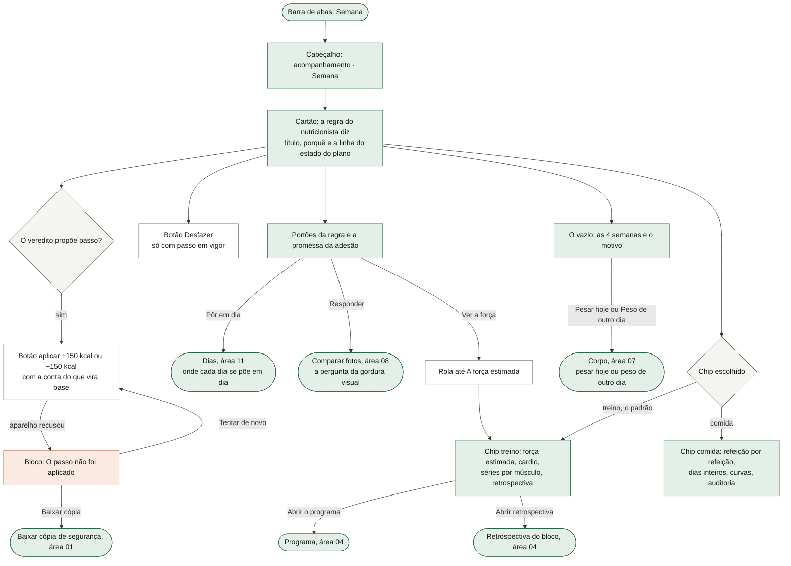

A Semana é uma das cinco abas (Agora, Dias, Corpo, Semana, Prescrição — a barra é da área 01). Não tem sub-telas próprias: as saídas levam a outras áreas, e a volta é pela barra de abas ou pelo Voltar do sistema (área 01). O chip escolhido não é guardado: sair e voltar à Semana volta ao chip "treino", e é de propósito ("voltar à Semana é voltar ao veredito").

## 3. Fluxos, um por funcionalidade

### 3.1 O veredito, como árvore de decisão

A regra é uma função pura: recebe todas as pesagens da manhã e quatro sinais (força subindo, dias conhecidos de comida, avaliação visual vigente, quando foi o passo em vigor) e devolve um veredito. É recalculada a cada desenho da tela, sem nada guardado. A árvore está em quatro partes.

**3.1 A — as semanas que a regra lê e o ramo**

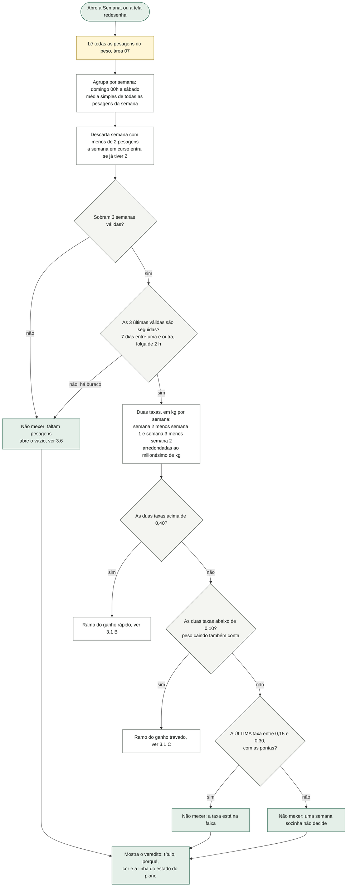

O que o diagrama não mostra: os limites são **estritos e exatos** — 0,40 exato não é "acima de 0,40", 0,10 exato não é "abaixo de 0,10", e o arredondamento ao milionésimo existe para 70,2 − 70,1 não dar 0,0999… e mandar comer mais. "Por 2 semanas" é **persistência**: são duas taxas semana a semana, e não a média das duas (+0,10 seguido de +0,75 não corta). Por isso a regra pede **três** semanas válidas. As cores do título: "Comer mais 150 kcal", "a taxa está na faixa" e "as fotos não mostram piora" em verde-ácido; "Comer menos 150 kcal" e os demais "Não mexer" em âmbar; "faltam pesagens" em cinza. A cintura **não entra** mais na regra (decisão do nutricionista: medir não estava acontecendo e as fotos cobrem a mesma pergunta). A seleção pega as **três últimas semanas válidas**, sem olhar se a mais nova é recente — ver §9, R1. A semana em curso entra assim que tem duas pesagens, e o veredito pode mudar no meio da semana (§9, R3).

**3.1 B — o ramo do ganho rápido (duas semanas acima de 0,40)**

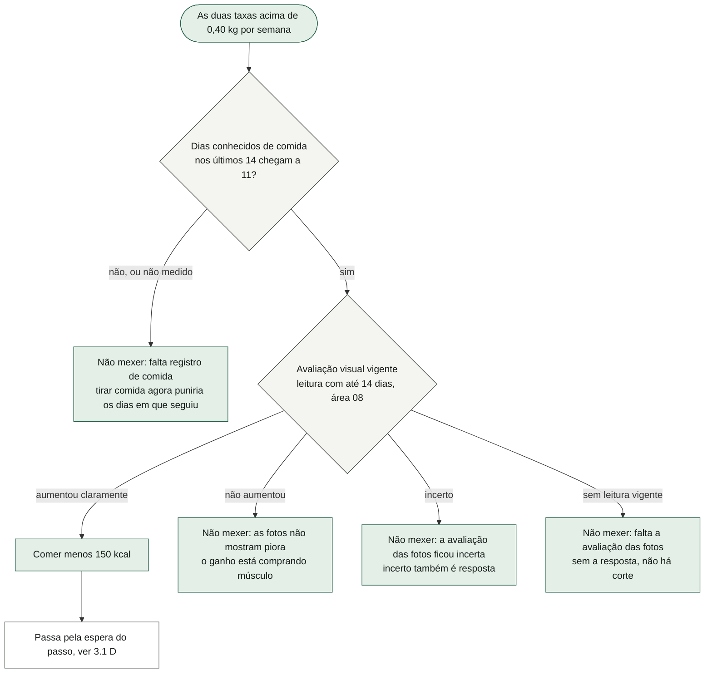

O que o diagrama não mostra: **a força não entra no corte**. **Peso sozinho nunca corta**: acima de 0,40 por duas semanas abre revisão; o corte só sai com adesão registrada E gordura visual "claramente maior". A adesão é conferida antes das fotos: mesmo com "aumentou claramente", sem 11 dias o título é "falta registro de comida". "As fotos não mostram piora" é o único "manter" fora da faixa-alvo: a taxa está acima, e o porquê é das fotos. A prosa começa por "A média subiu 0,50 e depois 0,50 kg — duas semanas seguidas acima de 0,4." A leitura vigente é a mais recente cuja sessão mais nova do par tem até 14 dias; uma resposta velha some sozinha e o corte volta a travar (a pergunta e o par são da área 08).

**3.1 C — o ramo do ganho travado (duas semanas abaixo de 0,10)**

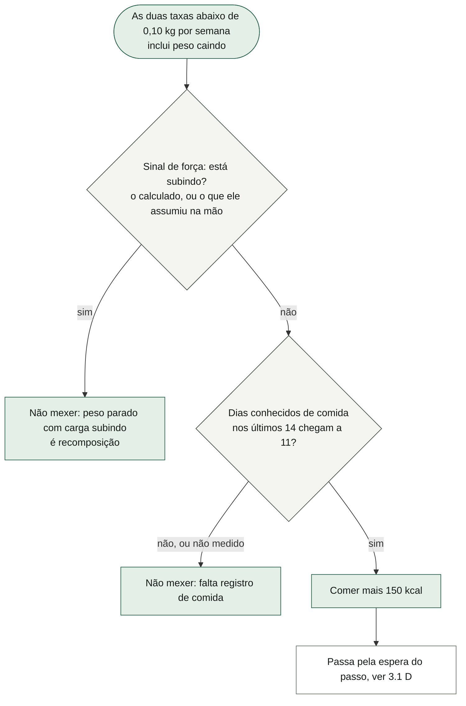

O que o diagrama não mostra: aqui a ordem é **força primeiro**, adesão depois — com a carga subindo, a regra não mexe nem com adesão perfeita. A prosa é "A média ficou em 0,05 e 0,03 kg por semana — duas seguidas abaixo de 0,1." Com peso **caindo**, a prosa perde o sinal ("0,30 e 0,20 kg por semana — duas seguidas abaixo de 0,1"), ver §9, R2.

**3.1 D — um passo por evidência (a espera)**

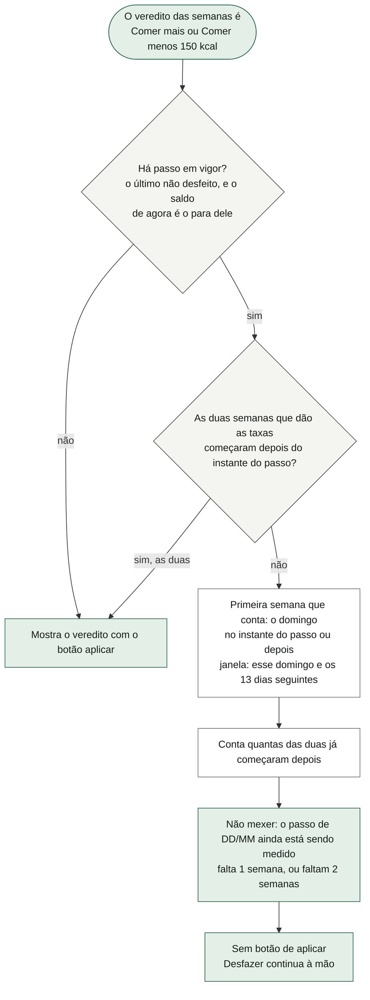

O que o diagrama não mostra: é decisão do dono (14/10). Sem ela, as mesmas duas semanas continuariam pedindo o mesmo passo e um segundo toque transformaria um motivo em 300 kcal. A espera **só vale** para o que daria passo: se as semanas novas disserem "na faixa" ou "uma semana sozinha não decide", a regra fala normalmente mesmo com passo em vigor. A semana de base (a primeira das três) pode ser anterior ao passo; as duas que dão as taxas, não. A prosa diz "duas semanas de peso **inteiras** depois dele", mas a semana em curso conta assim que tem duas pesagens (§9, R3). Desfeito o passo, não há o que esperar: as mesmas semanas voltam a decidir na hora (teste "um passo por evidência").

### 3.2 Os portões da regra

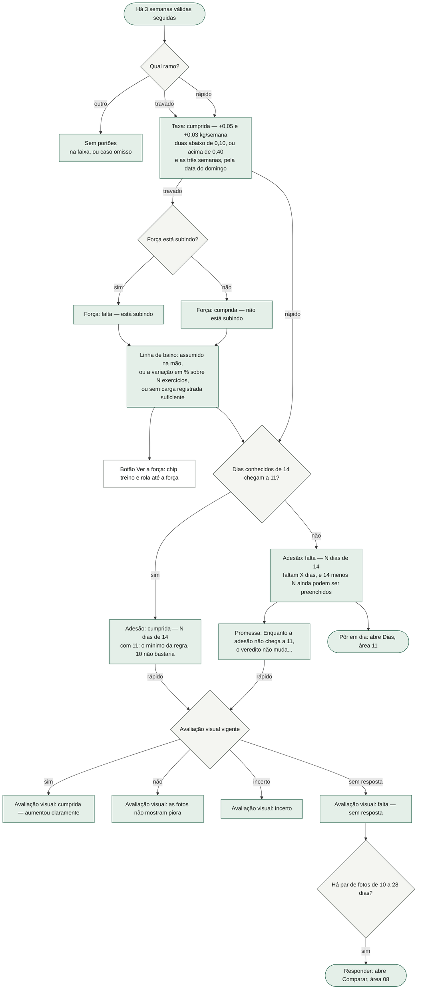

O que o diagrama não mostra: a ordem na tela é sempre **taxa, força, adesão** (peso parado) ou **taxa, adesão, avaliação visual** (peso subindo rápido). O estado está na **palavra** ("cumprida", "falta"), e a linha em falta ganha um realce. "Força: cumprida — não está subindo" é a linha mais estranha do produto e está certa: o portão se cumpre quando a força **não** sobe. A conta da força na linha de baixo é a mesma da seção "A força estimada" ("+0,4% em 2 semanas, sobre 5 exercícios — abaixo de 1%, que é ruído de anilha"). Sem par de fotos, a linha diz "ainda não há par de fotos de 10 a 28 dias — a pergunta precisa dele" e não há botão. Os portões **não sabem da espera**: durante "o passo ainda está sendo medido" eles continuam aparecendo, todos cumpridos (§9, R4). "Pôr em dia" leva à aba Dias, onde cada dia passado se põe em dia (o fluxo é da área 06/11).

### 3.3 A promessa da adesão

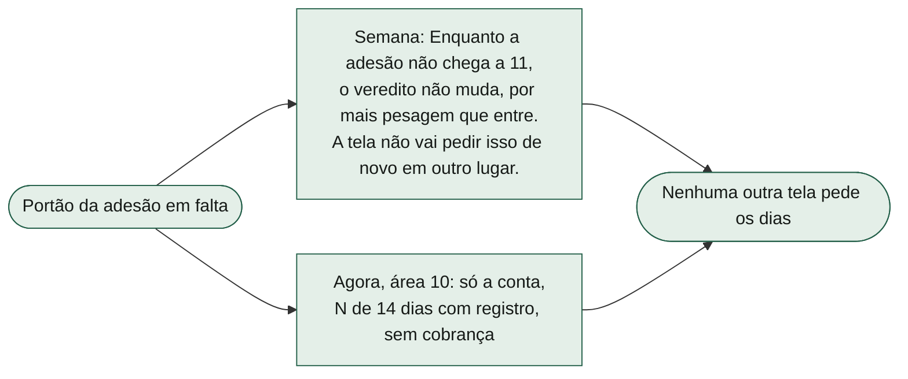

O que o diagrama não mostra: decisão do dono de 14/10 — a cobrança da adesão fica **só** na Semana, e a frase existe porque a promessa é cumprida (o teste confere que o texto do Agora não contém "adesão"). Com a adesão cumprida, a frase some.

### 3.4 Aplicar o passo de ±150 kcal

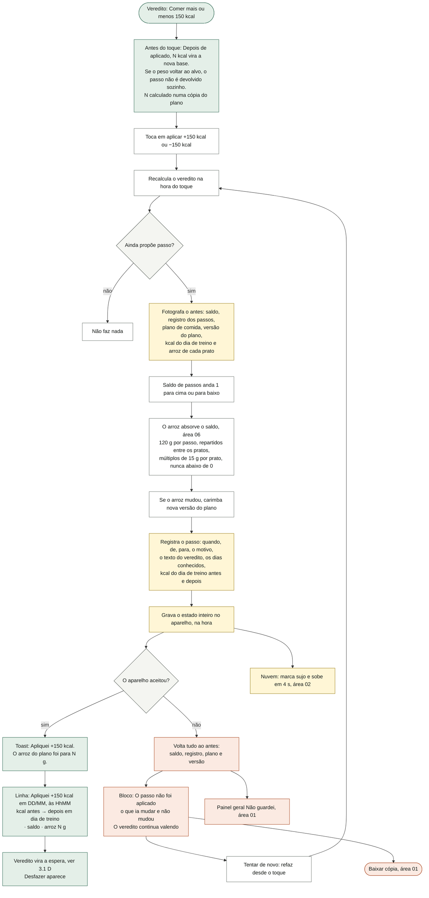

O que o diagrama não mostra: **não há confirmação** — um toque aplica; a confirmação é a conta escrita antes do toque (as kcal são as do dia de treino, sem alta demanda, calculadas numa cópia do plano com o novo saldo). O saldo é **acumulado** (dois cortes são −300 kcal e a linha diz "· 2 passos"), e não um estado "mais/base/menos": depois de um passo, a nova ingestão vira a base, e é essa assimetria que evita o efeito sanfona. O "Apliquei" só aparece depois de o aparelho aceitar; nada entra pela metade. Se o app fechar no meio da gravação, o estado é um registro só: ou o passo inteiro ficou, ou nada ficou. Um duplo toque não dá dois passos: o primeiro já põe o passo em vigor antes de gravar, e o segundo recalcula o veredito, que já é a espera. Com o plano base (dois pratos de 250 g), cada passo muda 60 g por prato: −2 = 130 g, −1 = 190 g, 0 = 250 g, +1 = 310 g, +2 = 370 g por prato (a mecânica do arroz é da área 06, §3.16 de lá). Sem nenhum prato marcado com arroz, o saldo anda e o plano não (§9, R7). O bloco de erro só some quando uma nova tentativa grava; não há botão de dispensar.

### 3.5 Desfazer o passo

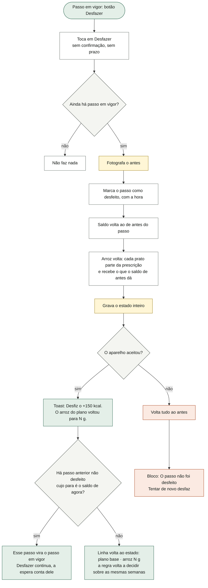

O que o diagrama não mostra: o desfazer não passa pelo painel de "pare" porque nada é destruído — o passo fica no registro, e aplicar de novo o refaz. O arroz volta **exatamente** ao que era, mesmo que ele tenha mexido no plano no meio: cada prato guarda quanto o ajuste lhe deu (área 06). O outro caminho para zerar o saldo é "Restaurar o plano do nutricionista", em Ajustes (área 06), que pergunta antes, volta o plano à prescrição e põe o saldo em 0 — mas **não** marca o passo como desfeito no registro (§9, R5). Com passos encadeados, um duplo toque rápido em "Desfazer" pode desfazer dois (§9, R6, a confirmar).

### 3.6 O vazio da régua (faltam pesagens)

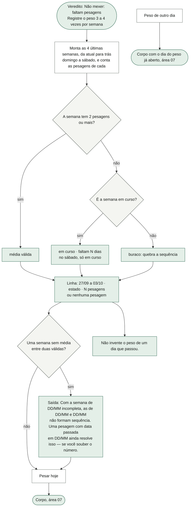

O que o diagrama não mostra: o vazio não é tela em branco: é a lista das semanas e o motivo de cada reprovação. A saída só é escrita quando o buraco está entre duas semanas válidas dentro das quatro listadas (a da semana passada entre esta e a retrasada, ou a retrasada entre a passada e a de três semanas atrás). Os dois botões aparecem sempre no vazio. "Não invente o peso de um dia que passou" é a regra de honestidade da área 07, repetida aqui porque a saída convida a pesagem com data passada.

### 3.7 A adesão dos 14 dias (o que conta como dia conhecido)

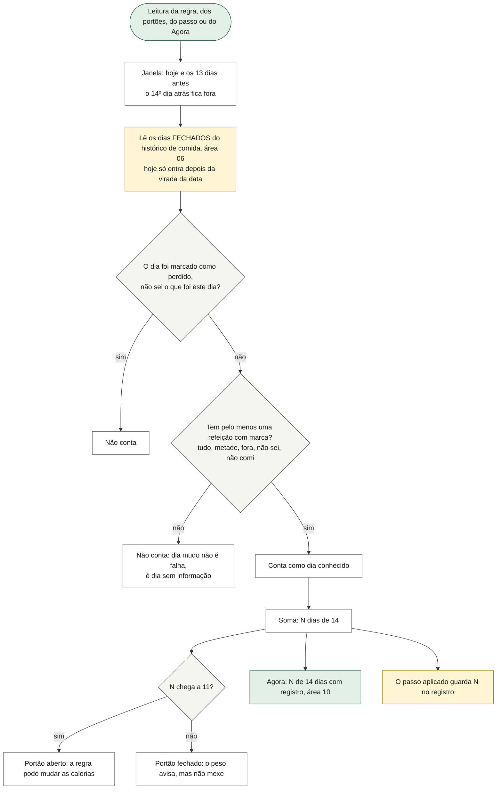

O que o diagrama não mostra: conta dia sobre o qual o app **sabe** algo, não aderência — quem seguiu o plano e quem saiu dele sabendo o que comeu contam igual ("sair do plano sabendo o que comeu não trava"). "Não comi" conta (é consumo conhecido, e conhecido é zero; posição do nutricionista). "Não sei" numa refeição também conta (a incerteza aparece na aderência baixa do dia, não tirando o dia da janela); só o "não sei" do **dia inteiro** ("perdido") derruba o dia. O denominador é a janela de 14, não os dias registrados. Na prática, a conta chega no máximo a **13** antes de hoje fechar (o teste "cada passo guarda de onde veio" grava `reg: 13` com 14 dias registrados) — e o portão diz "14 − N ainda podem ser preenchidos", contando hoje (§9, R8). O limiar 11 é do nutricionista (~80%) e não é negociável. O Agora usa a mesma conta para os 14 quadradinhos (área 10).

### 3.8 A força estimada e "o app está cego"

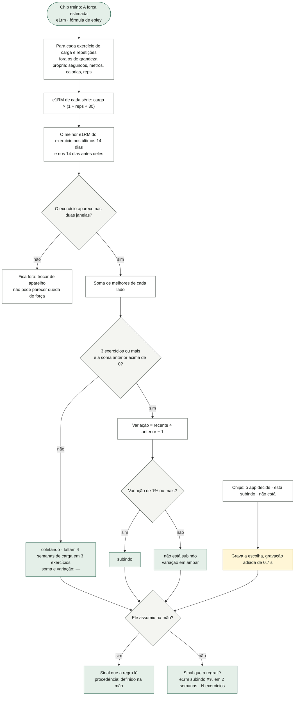

O que o diagrama não mostra: é a peça que faz o treino alimentar a nutrição — antes era um interruptor que ele ligava na mão; agora o app calcula e o interruptor vira **override**, porque o cálculo pode estar cego: "volta de pausa, troca de exercício, semana de deload" (o texto da tela). O manual **vence** sempre que existe, e fica até ele voltar a "o app decide". "Subindo" não ganha cor de comemoração; "não está subindo" fica âmbar. A sparkline acima soma, semana a semana (14 semanas de domingo a sábado), o melhor e1RM de **cada** exercício presente naquela semana — uma conta diferente da "soma das 2 semanas", que só usa exercícios presentes nas duas janelas de 14 dias corridos (§9, R11). Sem nenhum ponto na sparkline: "Ainda não há carga registrada suficiente para estimar." Exercício com grandeza própria vale zero de propósito: wall ball de 9 kg × 100 não pode virar e1RM de 39 kg e mentir na regra calórica.

### 3.9 As séries por músculo da semana

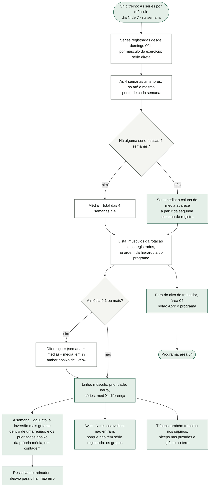

O que o diagrama não mostra: a comparação é "com o mesmo ponto das 4 semanas anteriores" — na quarta-feira, compara com o que as quatro semanas anteriores tinham até a quarta-feira. A barra é proporcional ao maior número entre a semana e a média. A diferença positiva **não** ganha cor ("volume acima do de antes não é feito, é melhor que antes"). A leitura conjunta **descreve e para** (regra 6 do produto: não inventar conselho de treino): "Peito levou 12 séries nesta semana, e peito superior, 6 — peito superior vem antes na hierarquia do programa." Não compara regiões diferentes; o delt anterior não é cobrado por volume. O alvo, a hierarquia e o bloco "Fora do alvo do treinador" vêm do programa (área 04). A média divide por 4 mesmo com uma semana só de histórico (§9, R14).

### 3.10 A comida da semana (o chip comida)

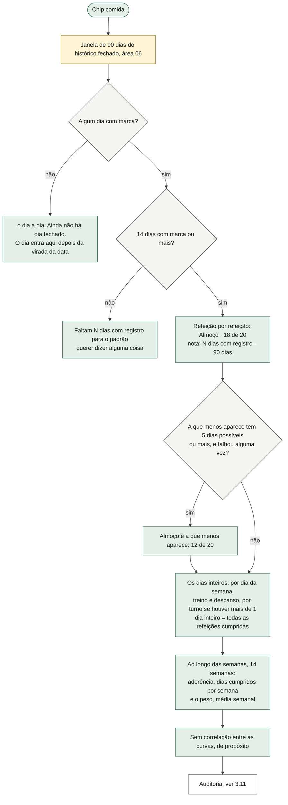

O que o diagrama não mostra: as contas são da área 06 (padrão por refeição, recortes, aderência por semana). A forma é desta tela: **contagem, nunca percentual**, e nenhuma cor avaliativa ("um número contra 100% implícito funciona como nota"). O piso de 14 dias não é estético: abaixo disso qualquer padrão é ruído. As curvas sem semana suficiente dizem "Sem semanas fechadas o bastante." (aderência) e "Registre o peso 3 a 4 vezes por semana." (peso). A curva da aderência lê o histórico inteiro, não só os 90 dias; a do peso conta semana com uma pesagem só (diferente da regra, que pede duas).

### 3.11 A auditoria das trocas ("A régua calórica")

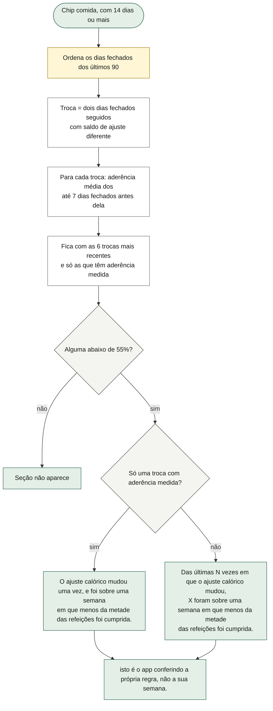

O que o diagrama não mostra: é a única devolutiva que não julga o usuário — aponta um limite do próprio app (o sinal que move o ajuste sai das cargas; se mudou sobre semanas mal executadas, pode estar lendo adesão ruim como resposta metabólica). Uma troca já basta para o aviso. O saldo de cada dia é o que ficou congelado no dia fechado (área 06); por isso aplicar e desfazer no mesmo dia não aparece como troca, e restaurar o plano aparece. A frase diz "menos da metade", mas o limiar é 55% (§9, R9).

### 3.12 O cardio da semana e a porta da retrospectiva

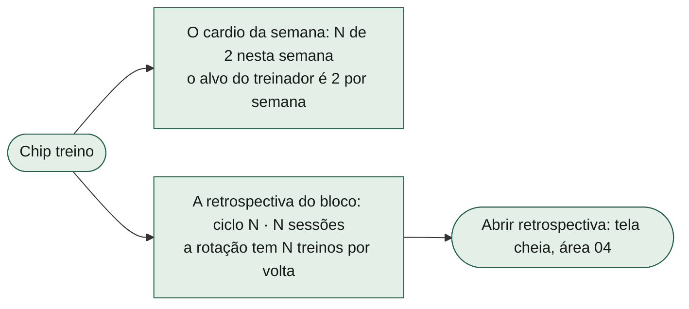

O que o diagrama não mostra: o cardio aqui é só o **placar** — registrar é no Agora (área 10) e a lista do que foi feito é de Dias (área 11); conta os cardios desde domingo 00h. O ciclo é "quantas voltas da rotação + 1", contando **todas** as sessões registradas, enquanto a nota da seção diz "o bloco de 48 sessões" (que, na área 04, conta só sessões de trabalho; §9, R16).

### 3.13 Marcos de adesão

Não há fluxo: a função que montaria "Sessão número N." (a cada 25 sessões) e "N semanas seguidas com 4 ou mais treinos." (3 ou mais semanas fechadas seguidas) existe no código e não é chamada por nenhuma tela nem teste. Fica registrada em §9 (R12) para decisão.

## 4. Estados da tela

| Estado | Quando acontece | O que a tela mostra |
|---|---|---|
| Sem pesagens suficientes | Menos de 3 semanas válidas, ou buraco entre as 3 últimas | "Não mexer: faltam pesagens" em cinza; as 4 semanas com o motivo; a saída, se houver; "Pesar hoje", "Peso de outro dia", "Não invente o peso de um dia que passou." |
| Peso parado, passo pronto | Duas taxas abaixo de 0,10, força parada, 11 dias ou mais | "Comer mais 150 kcal" em verde; botão "aplicar +150 kcal" e a conta do que vira base; os três portões cumpridos. |
| Peso parado, falta adesão | Idem, com menos de 11 dias | "Não mexer: falta registro de comida" em âmbar; portão da adesão em falta com "Pôr em dia"; a promessa. |
| Peso parado com carga subindo | Duas taxas abaixo de 0,10 e força subindo (calculada ou na mão) | "Não mexer: peso parado com carga subindo"; portão da força em falta com "Ver a força". |
| Ganho rápido, passo pronto | Duas taxas acima de 0,40, 11 dias, fotos "aumentou claramente" | "Comer menos 150 kcal" em âmbar; botão "aplicar −150 kcal"; portões taxa, adesão e visual cumpridos. |
| Ganho rápido, falta adesão | Duas acima de 0,40, menos de 11 dias | "Não mexer: falta registro de comida"; portão da adesão em falta; a promessa; portão visual no estado que estiver. |
| Ganho rápido, falta a avaliação | 11 dias, sem leitura vigente | "Não mexer: falta a avaliação das fotos"; portão visual "falta — sem resposta", com "Responder" se houver par de 10 a 28 dias. |
| Ganho rápido, fotos sem piora | Leitura "não" | "Não mexer: as fotos não mostram piora" em verde; portão visual não cumprido, "o certo é manter". |
| Ganho rápido, avaliação incerta | Leitura "incerto" | "Não mexer: a avaliação das fotos ficou incerta" em âmbar; portão "Avaliação visual: incerto". |
| Na faixa | Última taxa entre 0,15 e 0,30 (fora dos dois ramos) | "Não mexer: a taxa está na faixa" em verde; sem portões, sem botão. |
| Caso omisso | Qualquer outra combinação | "Não mexer: uma semana sozinha não decide" em âmbar; sem portões, sem botão. |
| Passo aplicado, em medição | Passo em vigor e as duas semanas lidas não são todas posteriores | "Não mexer: o passo de DD/MM ainda está sendo medido", com as datas e quantas semanas faltam; linha "Apliquei …"; "Desfazer"; os portões continuam visíveis. |
| Passo em vigor, regra falando de novo | Passo em vigor e as duas semanas lidas já são posteriores | O veredito novo, normal; "Desfazer" continua enquanto aquele passo for o em vigor. |
| Passo recusado pelo aparelho | A gravação do passo ou do desfazer falhou | Bloco de alerta "O passo não foi aplicado/desfeito", o que não mudou, "Tentar de novo", "Baixar cópia"; o painel geral "Não guardei" (área 01). |
| Chip treino, sem carga | Nenhuma série com carga nas 14 semanas | "Ainda não há carga registrada suficiente para estimar."; soma e variação "—"; procedência "coletando · …". |
| Chip treino, força assumida na mão | Chip "está subindo" ou "não está" ligado | Procedência "definido na mão"; o portão da força diz "assumido na mão, porque o app estava cego para as cargas". |
| Chip treino, primeira semana | Nada registrado nas 4 semanas anteriores | Sem coluna de média; "a coluna de média aparece a partir da segunda semana de registro." |
| Chip comida, sem dia fechado | Nenhum dia com marca nos 90 dias | "Ainda não há dia fechado. O dia entra aqui depois da virada da data — o de hoje ainda está aberto." |
| Chip comida, pouco dado | 1 a 13 dias com marca | "Faltam N dias com registro para o padrão querer dizer alguma coisa…" |
| Chip comida, com auditoria | 14 dias ou mais e alguma troca sobre aderência abaixo de 55% | Seção "A régua calórica" no fim. |

## 5. Dados

**O que esta área GUARDA**

| Campo | Formato | Quem mais lê |
|---|---|---|
| `S.ajuste` | Inteiro: o **saldo** de passos de ±150 kcal (−2 = −300 kcal). Normalizado no boot e na importação: não número vira 0, e é arredondado. | Comida (área 06): o resumo do plano ("Ajuste acumulado") e o fechamento do dia, que congela o saldo em cada dia fechado (`aj`); a procedência embaixo das refeições do Agora (área 10) mostra o rótulo ("plano base", "ajuste +150 kcal · 2 passos"); a migração 11→12 (área 01). |
| `S.ajusteHist` | Lista de passos: `{ t: instante, de, para: saldos em passos, k: 'mais' ou 'menos', p: texto do veredito, reg: dias conhecidos, kde, kpara: kcal do dia de treino antes e depois (só passos novos), desfeito?: instante }`. Sem teto. Nunca apagado pela tela. | Só esta área (o passo em vigor, a linha do passo, o desfazer, a espera). A cópia de segurança leva junto. |
| `S.perfManual` | `true` (está subindo), `false` (não está) ou `null` (o app decide). | Só a regra (sinal de força) e o portão da força. |
| Itens de arroz do plano: `q` e `ajq` | A quantidade do prato e quanto dela veio do ajuste. **O campo é da área 06**; esta área o escreve ao aplicar/desfazer, pela regra do arroz. | Comida (06) inteira. |
| `S.comida.v` | Carimbo da versão do plano, subido quando o passo muda o arroz. Campo da área 06. | Dias fechados (06) para dizer "calculado contra outro plano". |
| `view.passoFalhou` | `{ oQue: { verbo: 'aplicado' ou 'desfeito', passo }, kcal, arroz: [{ refeicao, q }], ajuste }`, só em memória. | Só a Semana. |
| O chip treino/comida | Estado local do componente, não guardado. | — |

**O que só LÊ**

- Pesagens do peso (`S.body.peso`, área 07). A cintura é passada à regra mas não é usada.
- O histórico de comida (`S.comidaHist`, área 06): dias conhecidos, padrões, curvas, saldo por dia para a auditoria. O plano e o catálogo de alimentos (área 06) para a conta das kcal e do arroz.
- As leituras de gordura visual (`S.gordura`) e as sessões de fotos (`S.protocolo.sessoes`) para o par de 10 a 28 dias (área 08).
- As séries (`S.logs`), o catálogo de exercícios (`S.ex`, para saber o grupo e se tem grandeza própria), o programa, a rotação e o alvo (áreas 03 e 04).
- As sessões (`S.done`) para o ciclo e os treinos avulsos; os cardios (`S.cardio`, área 10).

**Como atravessa a sincronia (área 02)**

- `S.ajuste`, `S.ajusteHist` e `S.perfManual` são **documentos**: vêm inteiros do lado cujo estado foi tocado por último (o carimbo do estado inteiro). O plano de comida também é documento e vem do mesmo lado, então saldo e arroz **ficam coerentes entre si**. O que pode se perder é um passo dado no outro aparelho (o registro, que é lista, funde como documento). Ver área 02, §9 item 6.
- `S.gordura` é coleção com chave (a data da sessão mais nova do par): responder nos dois aparelhos não faz uma resposta sumir.
- `S.comidaHist` funde dia a dia, campo a campo (área 02/06); o saldo congelado (`aj`) vem do lado com carimbo mais novo daquele dia.
- Nenhum dado desta área usa lápide: nada aqui se apaga.

## 6. Regras

1. **A semana** vai de domingo 00h a sábado, na hora do aparelho. (desenho)
2. **A média da semana** é a média simples de todas as pesagens daquela semana (várias no mesmo dia contam todas). (nutricionista: o peso do dia não decide nada)
3. **Semana válida** tem pelo menos **2** pesagens. A prosa pede "3 a 4 vezes por semana". (nutricionista)
4. A regra precisa de **3 semanas válidas seguidas** (duas taxas), tomadas entre as últimas válidas; "seguidas" é 7 dias de distância, com folga de **2 h** (horário de verão). (nutricionista: duas semanas consecutivas)
5. **Taxa** = média de uma semana menos a da anterior, em kg, arredondada a **0,000001 kg** antes de comparar. (correção do ponto flutuante)
6. **Ganho rápido**: as duas taxas **acima de 0,40** kg/semana (0,40 exato não conta). (nutricionista)
7. **Ganho travado**: as duas taxas **abaixo de 0,10** kg/semana (0,10 exato não conta); peso caindo entra aqui. (nutricionista)
8. **Faixa-alvo**: a última taxa entre **0,15 e 0,30**, com as pontas → não mexer. É alvo de eficiência, não limite de velocidade. (nutricionista)
9. **Caso omisso** (0,30 a 0,40, 0,10 a 0,15, uma alta e outra baixa…) → não mexer, continuar olhando. (nutricionista: "caso contrário")
10. No ganho rápido, a ordem é **adesão, depois avaliação visual**; a força não entra. Peso sozinho nunca corta. "Não aumentou" → manter; "incerto" → manter; sem leitura → falta a avaliação. (nutricionista)
11. No ganho travado, a ordem é **força, depois adesão**. Força subindo → não mexer (recomposição). (nutricionista)
12. **Adesão**: pelo menos **11 dos últimos 14** dias conhecidos (~80%). Não medido conta como falta. (nutricionista)
13. **Dia conhecido**: não foi marcado "perdido" e tem pelo menos uma refeição com marca (inclusive "fora", "não sei" e "não comi"). Hoje só conta depois de fechar; o 14º dia atrás fica fora da janela. (nutricionista; janela aberta no extremo antigo)
14. **Avaliação visual vigente**: a leitura mais recente com até **14 dias**, contados da sessão mais nova do par (ao meio-dia), sobre par de **10 a 28** dias. Responder de novo sobre o mesmo par substitui. (nutricionista; área 08)
15. **Força subindo**: a soma do melhor e1RM de cada exercício nos últimos **14 dias** contra os **14 dias** anteriores, só com exercício presente nos dois lados, com pelo menos **3** exercícios, sobe **1% ou mais**. Abaixo de 1% é ruído de anilha. (desenho)
16. **e1RM** pela fórmula de Epley: carga × (1 + repetições ÷ 30). Série sem carga ou sem repetição vale 0; exercício ou registro com grandeza própria (segundos, metros, calorias, repetições de box) vale 0. (desenho)
17. **O sinal manual vence** o calculado sempre que existe. (decisão do dono: o cálculo não sabe que ele voltou de duas semanas doente)
18. **O passo** é de **150 kcal** = **120 g** de arroz cozido por dia (128 kcal/100 g dão ~117 g, arredondado para 120), repartido igualmente entre os pratos marcados com arroz e arredondado a **15 g** por prato, nunca abaixo de 0 g. O arredondamento cai sobre o passo, não sobre o prato. (nutricionista; área 06)
19. **O saldo acumula**: depois de um passo, a nova ingestão vira a base; o passo não é devolvido sozinho quando o peso volta ao alvo. Só "Comer mais" e "Comer menos" oferecem ação; "não mexer" nunca oferece "voltar ao plano base". (nutricionista: evitar o efeito sanfona)
20. **Um passo por evidência**: com passo em vigor, "comer mais/menos" vira espera até as duas semanas que dão as taxas começarem no instante do passo ou depois (a primeira é o domingo seguinte ao passo, ou o próprio domingo se o passo foi à meia-noite). (decisão do dono, 14/10)
21. **Passo em vigor** = o último passo não desfeito, desde que mude o saldo e o saldo de agora seja o "para" dele.
22. **Nada entra pela metade**: o passo e o desfazer gravam na hora; se o aparelho recusa, saldo, registro, plano e versão voltam juntos, e a tela diz os números de antes. (desenho, estado 10 da `semana.html`)
23. **Desfazer** não tem prazo nem confirmação, e o passo fica no registro marcado como desfeito. (desenho, estado 4: corrigir no lugar)
24. **A promessa**: a cobrança da adesão só existe na Semana; o Agora mostra a conta sem cobrar. (decisão do dono, 14/10)
25. **Comida da Semana**: piso de **14** dias com marca nos últimos **90**; contagem, nunca percentual; nenhuma cor avaliativa; nenhuma correlação entre as curvas. "Dia inteiro cumprido" = aderência do dia de **0,999** ou mais. "A que menos aparece" só com **5** dias possíveis ou mais e alguma falha. Curvas de **14** semanas. (os três especialistas; área 06)
26. **Auditoria**: as **6** trocas mais recentes de saldo entre dias fechados seguidos (janela de 90 dias), com a aderência média dos até **7** dias fechados antes de cada troca; baixa é **abaixo de 55%**; uma basta. (os três especialistas)
27. **Séries por músculo**: série direta; comparação com o mesmo ponto das **4** semanas anteriores; média = total ÷ 4; diferença em % só com média de **1** ou mais; âmbar abaixo de **−25%**; "dia N de 7". Treino avulso não entra. (treinador; desenho)
28. **Cardio**: alvo de **2** por semana. (treinador)
29. **Cores do veredito**: comer menos e todo "não mexer" de observar em âmbar; "faltam pesagens" em cinza; comer mais e manter em verde-ácido. (desenho)
30. **A cintura saiu do algoritmo**: não veta nem dispara nada. (nutricionista)

## 7. Ligações com as outras áreas

| Área | O que esta recebe dela | O que esta entrega a ela |
|---|---|---|
| 01 · Fundação | A barra de abas, a gravação (`save`, que devolve se o aparelho aceitou), o painel "Não guardei", a cópia de segurança ("Baixar cópia"), a normalização do saldo no boot e as migrações 3→4 e 11→12. | Os campos `ajuste`, `ajusteHist`, `perfManual` para a cópia e a importação. |
| 02 · Sincronia | A fusão dos documentos pelo carimbo do estado e de `gordura` como coleção. | A gravação marca o estado como sujo, e ele sobe em 4 s. |
| 03 · Sessão de treino | As séries registradas (carga × repetições) e as sessões. | — |
| 04 · Programa | A rotação, os grupos dos exercícios, a hierarquia, o alvo e o bloco "Fora do alvo do treinador", a tela do programa e a retrospectiva. | A porta "Abrir o programa" e "Abrir retrospectiva". |
| 06 · Comida | O histórico de dias fechados (adesão, padrões, curvas, saldo por dia), o plano e o catálogo (kcal do dia de treino), a regra do arroz, "Restaurar o plano". | O saldo de passos que o arroz absorve; o carimbo da versão do plano quando o passo muda o arroz; o rótulo do ajuste para o resumo do plano. |
| 07 · Corpo | As pesagens do peso. | As saídas do vazio ("Pesar hoje", "Peso de outro dia" com o dia do peso já aberto). A Evolução (07) usa as mesmas constantes da régua (2 pesagens, 0,15 a 0,30). |
| 08 · Fotos | A leitura de gordura visual vigente e o par de fotos de 10 a 28 dias. | A porta "Responder" (abre a comparação). |
| 10 · Agora | O placar do cardio (os registros). | A conta dos dias conhecidos para os 14 quadradinhos; o rótulo do saldo na procedência das refeições de hoje. |
| 11 · Dias | — | A porta "Pôr em dia" (abre a aba Dias). |

## 8. Como serviço individual

**Nome:** Serviço da Regra Calórica (a regra do nutricionista), com um módulo de Leitura Semanal ao lado (força, séries por músculo, placar, devolutiva de comida), que é só leitura.

**O que possui (dados):** o saldo de passos, o registro dos passos (com a procedência de cada um), o sinal de força manual. Não possui o plano de comida: pede ao serviço de Comida que aplique o saldo no arroz.

**Operações (API):**

| Verbo | Recebe | Devolve |
|---|---|---|
| `avaliar` | pesagens (do Corpo), dias conhecidos (da Comida), leitura visual vigente (das Fotos), sinal de força, passo em vigor | o veredito: tipo, título, porquê, se espera, o que falta |
| `portoes` | as mesmas entradas e as fontes (tendência de força, se manual, o par de fotos) | a lista de portões ou nada |
| `semanasDoVazio` | pesagens, agora | as 4 semanas com estado e a saída |
| `aplicarPasso` | o veredito que o cliente viu (para conferir que ainda vale) | o passo registrado (de, para, kcal antes/depois) ou a recusa com os números de antes |
| `desfazerPasso` | o id do passo em vigor (para evitar desfazer dois) | o saldo novo, ou a recusa |
| `passoEmVigor` / `historicoDePassos` | — | o passo em vigor; a lista |
| `definirForcaManual` | sim, não, ou "o app decide" | o sinal efetivo |
| `tendenciaDeForca` | séries, catálogo (grandeza própria), agora | soma, variação, base, se sobe |
| `adesao14` | histórico de comida, hoje | dias conhecidos |
| `leituraSemanal` | séries, programa, histórico de comida, cardios | força, séries por músculo, padrões, curvas, auditoria |

**Eventos que emitiria:** `PassoAplicado { de, para, kde, kpara, motivo }`, `PassoDesfeito { passo }`, `ForcaManualDefinida { valor }`, `VereditoMudou` (para quem quiser avisar, hoje ninguém).

**Eventos que escutaria:** `PesagemRegistrada` / `PesagemApagada` (Corpo), `DiaDeComidaFechado` / `DiaPostoEmDia` (Comida), `LeituraDeGorduraRespondida` (Fotos), `SerieRegistrada` / `SessaoFinalizada` (Treino), `PlanoAlimentarEditado` e `PlanoRestaurado` (Comida — este último deveria marcar o passo como desfeito).

**O que hoje está acoplado e precisaria ser separado:**

- O passo mexe direto no plano de comida (`aplicaArroz` em `main.jsx`) e fotografa `S.comida` inteiro para o rollback; como serviço, seria uma chamada "aplique o saldo N" ao serviço de Comida, numa transação das duas partes.
- A conta "kcal do dia de treino com saldo N" clona o plano de comida; deveria ser uma pergunta ao serviço de Comida.
- A regra mora em `src/dominio/corpo.ts`, junto das medidas do Corpo (área 07); as constantes da régua (`MIN_PESAGENS`, `ALVO_MIN/MAX`) são usadas pela Evolução (07).
- `forca.ts` é partilhado com o histórico do exercício (área 04); a sparkline da Semana reimplementa a fórmula de Epley em linha, em vez de usar a do domínio.
- `CTX.dados` monta junto o veredito, a força e a devolutiva de comida (`dadosDeComida`, cujas contas são da 06); a Semana também chama `CTX.corpo()` só para pegar cardio e músculos.
- "Restaurar o plano" (área 06) zera o saldo por fora do serviço, sem registrar.
- O registro dos passos funde como documento na sincronia (área 02); como serviço, seria uma coleção com chave pelo instante.

## 9. Riscos e dívidas que apareceram na leitura

- **R1 · Semanas velhas ainda decidem (possível bug).** A regra pega as três últimas semanas válidas sem olhar se a mais nova é recente. Reproduzir (conferido rodando a função): três semanas com pesagens há 8, 7 e 6 semanas (médias 73,0 → 73,05 → 73,10), nada depois, 13 dias conhecidos → "Comer mais 150 kcal", com botão. Semanas recentes sem pesagem são ignoradas em vez de quebrar a sequência, o que contradiz o vazio ("a que passou sem isso quebra a sequência").
- **R2 · Peso caindo aparece sem sinal na prosa.** No ganho travado, a prosa usa o valor absoluto: com médias 73,5 → 73,2 → 73,0, diz "A média ficou em 0,30 e 0,20 kg por semana — duas seguidas abaixo de 0,1." (conferido rodando a função). Lê-se como ganho acima do limite. O portão da taxa mostra o sinal certo ("−0,30 e −0,20").
- **R3 · A semana em curso entra com duas pesagens.** O veredito pode mudar no meio da semana, e a espera termina quando a segunda semana nova tem duas pesagens, não quando ela acaba — a prosa diz "duas semanas de peso inteiras". **A confirmar** com o nutricionista se a semana em curso deveria contar.
- **R4 · Os portões aparecem durante a espera.** Com "o passo ainda está sendo medido", a lista continua mostrando taxa, força e adesão cumpridas, o que sugere uma decisão que a regra não vai tomar.
- **R5 · Restaurar o plano não fecha o registro e solta a espera.** "Restaurar o plano do nutricionista" (área 06) põe o saldo em 0 sem marcar o passo como desfeito; o registro fica com um passo que parece vigente e não está, e como não há mais passo em vigor, a Semana pode oferecer o mesmo passo de novo, sobre as mesmas semanas. Reproduzir: aplicar +150, restaurar o plano em Ajustes, voltar à Semana → "Comer mais 150 kcal" com botão.
- **R6 · Duplo toque em "Desfazer" com passos encadeados (a confirmar no aparelho).** A tela só redesenha depois da gravação; um segundo toque rápido encontra o passo anterior como "em vigor" e desfaz também. Reproduzir: dois passos (0→1, 1→2) e tocar duas vezes rápido em "Desfazer".
- **R7 · Passo sem prato de arroz.** Sem nenhum item marcado com arroz no plano, o saldo anda e o plano não muda; o toast diz "O arroz do plano foi para 0 g" e o passo registra kcal iguais antes e depois. Reproduzir: trocar o alimento dos dois pratos de arroz (área 06) e aplicar um passo.
- **R8 · "14 − N ainda podem ser preenchidos" exagera por um dia.** A conta só chega a 13 antes de hoje fechar (hoje não está no histórico; o 14º dia atrás fica fora). A frase conta hoje como preenchível.
- **R9 · A auditoria diz "menos da metade" com limiar de 55%.** E a "semana anterior" à troca são os até 7 **registros** fechados antes dela (com dias sem registro, cobre mais de 7 dias de calendário). Restaurar o plano conta como troca; aplicar e desfazer no mesmo dia não aparece.
- **R10 · O portão da força chama queda grande de "ruído de anilha".** Com força caindo (ex.: −5,0%), a linha diz "−5,0% em 2 semanas … — abaixo de 1%, que é ruído de anilha". E a procedência "coletando · faltam 4 semanas de carga em 3 exercícios" é texto fixo, não diz o que de fato falta.
- **R11 · Duas contas de força lado a lado que não se comparam.** "Soma das 2 semanas" usa 14 dias corridos e só exercícios presentes nas duas janelas; a sparkline soma por semana de domingo todos os exercícios daquela semana. O comentário de `tendenciaDeForca` fala em "média de e1RM", mas a conta é o **melhor** e1RM de cada exercício, somado. `e1rmPorSemana` é importado e não usado; a fórmula é copiada em linha.
- **R12 · `marcos()` é código morto.** "Sessão número N." e "N semanas seguidas com 4 ou mais treinos." não aparecem em lugar nenhum. Decidir: apagar ou pôr numa tela.
- **R13 · Comentário errado no tipo `Semana`** (`corpo.ts`): diz "segunda-feira 00:00", mas a semana começa no domingo.
- **R14 · A média por músculo divide por 4 desde a segunda semana.** Com uma semana só de histórico, a "méd" é um quarto do real e a diferença em % infla.
- **R15 · Passos em dois aparelhos.** O registro dos passos funde como documento: aplicar um passo em cada aparelho sem sincronizar perde um dos dois (saldo e arroz ficam coerentes com o lado que venceu). Já registrado na área 02.
- **R16 · O "ciclo" conta todas as sessões.** Inclui deload e avulsos, enquanto a nota "o bloco de 48 sessões" (área 04) conta só sessões de trabalho.
- **R17 · A janela dos 14 dias calcula o limite em UTC** (`janelaDoHistorico`, área 06): no fuso do Brasil dá a data certa; num fuso a leste de Greenwich, o limite andaria um dia. Só registro.
- **R18 · O bloco do passo recusado não se dispensa.** `CTX.dispensaPassoFalhou` existe e nenhuma tela o chama; o bloco só some com uma nova tentativa que grave.

## 10. Índice técnico

**Arquivos**

- `src/ui/telas/semana.jsx` — a tela Semana inteira (`Semana`, `Musculos`, `LinhaPadrao`).
- `src/ui/instrumento/primitivos.jsx` — `Veredito`, `Chips`, `GradeMetricas`, `Sparkline`, `Procedencia`, `Secao`, `Vazio`, `Cabecalho`.
- `src/dominio/corpo.ts` — a regra: taxas, veredito, espera, portões, semanas do vazio, leitura vigente da gordura.
- `src/dominio/forca.ts` — e1RM, tendência, sinal e texto da força.
- `src/dominio/nutricao/calculo.ts` — o arroz do passo (`PASSO_ARROZ`, `arrozDoAjuste`, `aplicaAjusteNoArroz`, `quantidadePrescrita`, `ajusteNoItem`), a adesão (`diaInterpretavel`, `diasInterpretaveis`, `janelaDoHistorico`) e as contas da devolutiva (`padraoPorRefeicao`, `recorteDoHistorico`, `aderenciaPorSemana`, `aderenciaDoDia`, `trocasDeAjuste`, `fechaDia` grava `aj`).
- `src/dominio/volume.ts` — `seriesPorMusculo`, `leituraDaSemana`, `impacto` (alvo da área 04).
- `src/dominio/formato.ts` — `weekStart` (domingo), `fmtDec`, `fmtDec2`, `fmtSig2`, `fmtDate`, `fmtHoraDita`.
- `src/main.jsx` — o contexto e as ações (abaixo).

**Funções de `src/main.jsx`** (linhas do commit `8ec19a4`)

| Função | Linha | Papel |
|---|---|---|
| `CARDIO_ALVO` | 138 | alvo de 2 cardios por semana |
| `marcos` | 1650 | marcos de adesão (não chamada) |
| `cardioSemana` | 3679 | cardios desde domingo |
| `impactoOficial` | 3276 | linha "Fora do alvo do treinador" (área 04) |
| `forcaSubindo` | 4049 | sinal de força com o manual |
| `diasRegistrados` | 4061 | dias conhecidos nos últimos 14 |
| `sinaisDaRegra` | 4069 | os quatro sinais da regra |
| `veredito` | 4082 | adaptador da regra |
| `parDaAvaliacao` | 4089 | o par de fotos de 10 a 28 dias |
| `rotuloDoAjuste` | 4106 | "plano base" / "ajuste +150 kcal · 2 passos" |
| `arrozAtual` | 4115 | soma do arroz do plano |
| `aplicaArroz` | 4139 | aplica o saldo no arroz e carimba o plano |
| `seriesPorMusculo` | 4152 | adaptador do volume |
| `dadosDeComida` | 7452 | a metade comida da Semana e a auditoria |
| `CTX.dados` | 7535 | view-model do veredito, portões, promessa, vazio, força |
| `semanasDoVazio` | 7621 | as 4 semanas e a saída |
| `CTX.setPerfManual` | 7641 | grava o sinal manual |
| `gravaOPasso` | 7648 | grava na hora e faz o rollback |
| `CTX.aplicaAjuste` | 7670 | aplicar o passo |
| `CTX.desfazAjuste` | 7698 | desfazer o passo |
| `CTX.passoFalhou` | 7712 | o bloco do passo recusado |
| `CTX.dispensaPassoFalhou` | 7728 | sem uso na tela |
| `sinalDoPasso` | 7731 | "+150" / "−300" |
| `kcalDeTreinoCom` | 7739 | kcal do dia de treino com um saldo, numa cópia do plano |
| `passoEmVigor` | 7753 | o passo que ainda vale |
| `linhaDoAjuste` | 7759 | a linha do estado / "Apliquei …" |
| `CTX.restauraPlano` | 7796 | (área 06) zera o saldo |
| `serieSemanal` | 7812 | curva do peso de 14 semanas |
| `CTX.corpo` | 7862 | (área 07) a Semana usa só `cardio` e `musculos` |
| `CTX.musculos` | 7968 | séries por músculo da semana |
| `CTX.abreComparar` | 10201 | (área 08) destino do "Responder" |
| `CTX.quatorzeDias` | 11285 | (área 10) usa `diasRegistrados` |
| `CTX.cicloDoBloco` | 11357 | o ciclo da retrospectiva |

Outros `CTX.*` usados pela tela: `vaiPara`, `abreDiaCorpo`, `abrePrograma`, `abreRetro`, `exportar`.

**Regras do domínio cobertas** (do inventário): `corpo.ts` — `Semana`, `Veredito`, `Ajuste`, `Sinais`, `LeituraDeGordura` (leitura), `VALIDADE_LEITURA`, `JANELA_MIN` (e `JANELA_MAX`, fora do inventário), `leituraVigente`, `ALTO`, `BAIXO`, `ALVO_MIN` (e `ALVO_MAX`, fora do inventário), `MIN_PESAGENS`, `MIN_REGISTRADOS`, `ajusteDoVeredito`, `TaxaSemanal`, `semRuido`, `taxasSemanais`, `veredito` (e a interna `vereditoDasSemanas`), `Portao`, `FontesDosPortoes`, `portoesDaRegra`, `SemanaDaRegra`, `semanasDaRegra`, `mediasSemanais` (partilhada com a 07). `forca.ts` — `e1rmDaSerie`, `e1rmDoLog`, `Tendencia`, `tendenciaDeForca`, `sinalDeForca`, `textoDaTendencia` (`melhorE1rm` e `e1rmPorSemana` existem e não são usados; ver área 04). `nutricao/calculo.ts` — `PASSO_ARROZ`, `arrozDoAjuste`, `ajusteNoItem`, `quantidadePrescrita`, `aplicaAjusteNoArroz` (a mecânica fina é da 06), `diaInterpretavel`, `diasInterpretaveis`, `janelaDoHistorico`, `TrocaDeAjuste`, `trocasDeAjuste`; leitura de `padraoPorRefeicao`, `recorteDoHistorico`, `aderenciaPorSemana`, `aderenciaDoDia`. `volume.ts` — `seriesPorMusculo`, `Leitura`, `Hierarquia`, `leituraDaSemana`. `tipos.ts` — `PassoDeAjuste`. `programa.ts` — leitura de `NIVEIS`, `PRIO`, `PRIORIDADES`, `nivelDe`, `ordemDe`, `regiaoDe`, `ehPriorizado`.

Ficam para outras áreas, de `corpo.ts`: `semanaEmCurso`, `leituraDaEvolucao`, `pesoRitmo`, `cinturaMes`, as tabelas de medidas (área 07).

**Componentes:** `Semana` (`semana.jsx`), `Veredito` (`primitivos.jsx`).

**Campos `S.*`:** donos desta área — `S.ajuste`, `S.ajusteHist`, `S.perfManual`. Escritos aqui, donos na 06 — itens de arroz do plano (`q`, `ajq`), `S.comida.v`. Lidos — `S.body`, `S.comidaHist`, `S.comida`, `S.gordura`, `S.protocolo`, `S.logs`, `S.ex`, `S.done`, `S.cardio`.

**`view.*`:** `view.passoFalhou`. (`view.aba` para a navegação, área 01.)

**Testes que cobrem a área**

- `tests/fluxo/ajuste.test.js` (31 casos): "dois passos no mesmo sentido somam…", "um passo por evidência…", "observar não oferece desfazer o corte", "cada passo guarda de onde veio" (`reg: 13`), "manter não mexe no saldo nem no ledger", "saldo de dois passos sobrevive ao boot", "o backup leva o saldo e o ledger", "restaurar o plano é o caminho documentado para zerar", "a leitura das fotos destrava o corte…", "fotos sem piora mandam manter…", "responder de novo substitui…", "num par de três meses a pergunta não aparece", "semana perdida trava o corte…", "sair do plano sabendo o que comeu não trava", os casos do arroz (área 06), "aplicar o passo carimba a versão do plano…", "o passo diz antes do toque o que vira base…", "com a adesão faltando, a Semana promete…", "peso parado mostra os três portões…", "peso subindo rápido mostra taxa, adesão e avaliação visual — sem força", "com uma semana sozinha fora da faixa, não há portão nenhum", "o vazio lista as semanas…", "o vazio diz a saída…", "Desfazer volta o plano ao saldo de antes…", "se o aparelho recusa, o passo não entra pela metade…".
- `tests/dominio/corpo.test.ts` (46 casos): os limites exatos (0,40, 0,10, ponto flutuante), "uma semana aberrante NÃO corta", "10 de 14 dias ainda é pouco; 11 já serve", "perdendo peso o texto não diz que subiu", "entre 0,30 e 0,40 o caso é omisso", "duas semanas não bastam…", "semana com uma pesagem só não é média", a leitura vigente da gordura, os portões, "o vazio lista as semanas…", e os quatro casos de "um passo por evidência".
- `tests/dominio/nutricao.test.ts` (36 casos): arroz do ajuste, dia interpretável, aderência.
- `tests/dominio/leitura.test.ts` (14 casos) e `tests/fluxo/leitura.test.js` (3 casos): "A semana, lida junto".
