# 10 · O Agora (a tela inicial)

> Em uma frase: é a tela que abre o app e responde primeiro "e agora?", com **um cartão só** no topo, e depois "como está o dia?", em linhas — comida, água, peso, fotos, cardio, a mudança que espera decisão e os 14 dias que a regra do nutricionista lê.

**Como ler os horários deste documento.** Os exemplos usam o plano alimentar de exemplo que vem no app (pré-treino 5h45, treino 6h15, café da manhã 8h00, almoço 12h30, lanche da tarde 16h00, jantar 19h30, ceia 21h30) e o turno da manhã. São ilustração: a regra vale para qualquer plano, qualquer turno e qualquer usuário — os horários saem sempre do plano e do turno declarados, nunca de uma rotina fixa.

**O que o Agora possui e o que só mostra.** O Agora é sobretudo uma **composição**: ele decide o que aparece, em que ordem e para onde cada toque leva. O comportamento de quase tudo o que ele mostra mora em outras áreas (comida 06, corpo 07, fotos 08, programa 04, sessão 03, dias 11, fundação 01, sincronia 02). O que é **dele** de verdade: a regra do cartão de cima, o cabeçalho, a faixa da sessão, a linha da decisão, os 14 dias como peça de tela, os avisos de perda no topo e o **registro do cardio de hoje** (o único dado que nasce aqui).

---

## 1. O que o usuário faz aqui

### A tela, de cima a baixo

Só existe na aba **Agora** (a primeira da barra; é também a aba do app quando nada mais foi escolhido). A ordem é fixa:

| # | Peça | Aparece quando |
|---|---|---|
| 1 | **Cabeçalho**: data ("quarta, 15 de outubro"), a hora andando ("9h05"), o botão ⚙ e, embaixo, o tipo do dia tocável ("dia de treino, pelo padrão semanal · Treino B") | Sempre, só na aba Agora |
| 2 | **Aviso "Este aparelho não está guardando"** | O armazenamento caiu para memória (aba privada, bloqueio) |
| 3 | **Aviso "Cópia de segurança atrasada"** | 30 dias ou mais sem exportar, e já existe ao menos um treino |
| 4 | **Aviso "A sua sessão de login expirou"** | A nuvem recusou a conta e não há sessão válida |
| 5 | **O cartão de cima** | Quando a regra encontra "a próxima coisa a fazer"; senão, não há cartão |
| 6 | **A leitura de volta** do último toque na comida | Depois de marcar uma refeição pela linha ou pelo cartão, enquanto a marca existir e for de hoje |
| 7 | **Linha "Peso da manhã"** | Com peso hoje (só mostra), ou sem peso antes da hora passar (com "Anotar") |
| 8 | **Linha "Fotos do corpo"** | Quando a última sessão de fotos fez 14 dias ou mais |
| 9 | **Linha da mudança que espera decisão**, com "Decidir" | Quando há mudança de programa esperando e ainda não vencida |
| 10 | **A comida de hoje** (as refeições e a linha do treino, em ordem de relógio) | Sempre (o conteúdo é da área 06) |
| 11 | **Água** | Sempre (o comportamento é da área 06) |
| 12 | **Cardio** | Dia de treino: a seção inteira. Dia de descanso: só o cardio feito hoje (ou a seção, se o registro foi aberto pela folha do tipo do dia) |
| 13 | **Os 14 dias** | Sempre |

Por cima de tudo, quando abertos: as folhas (tipo do dia, Decidir, refeição, pôr o dia em dia…), os painéis de gravação que falhou e de confirmação de apagar (área 01). Por baixo: a barra de abas. **A faixa da sessão não é desenhada no Agora** (o cartão de cima faz o papel dela); nas outras abas, sim.

### As funcionalidades

| Funcionalidade | O que faz | Onde fica | Quando aparece / some |
|---|---|---|---|
| **Ver data e hora** | Mostra o dia por extenso e a hora de parede, que anda sozinha e se corrige ao voltar do bloqueio. | Cabeçalho | Só na aba Agora. |
| **Abrir os Ajustes** | Botão ⚙ "Ajustes deste aparelho". O conteúdo dos Ajustes é da área 01 (conta: área 02). | Canto do cabeçalho | Sempre no Agora. |
| **Ver de onde vem o tipo do dia** | A linha sob a data diz se hoje é treino ou descanso **e por quê**: "pela sessão registrada", "com a sessão aberta", "você disse", "pelo padrão semanal". O palpite tem sublinhado pontilhado. | Cabeçalho | Sempre. |
| **Trocar o tipo do dia** | Tocar na linha abre a **folha do tipo do dia**: "Hoje é dia de treino?" com "Vou treinar hoje" e "É descanso", cada um com o efeito escrito antes do toque. | Folha | Os dois botões somem quando há sessão registrada ou aberta hoje (aí o fato manda). |
| **"Já fiz alguma coisa hoje"** | Na folha, em dia de descanso: **Cardio** (abre o registro de cardio no Agora), **Aula** e **Treino fora da prescrição** (abrem o lançamento de hoje, área 11). | Folha do tipo do dia | Só quando o tipo resolvido é descanso. |
| Turno, demanda alta, "Como foi o dia" | Ajustes de hoje na mesma folha. **Comportamento da área 06.** | Folha do tipo do dia | Turno só em dia de treino. |
| **O cartão de cima** | A próxima coisa a fazer, escolhida por uma regra de prioridade (§3.3). Sete formas: sessão aberta, pergunta de 1h30, o treino de antes (fim aproximado), aula, treino, refeição do momento, dia fechado. | Topo da tela | Pode não existir: "não há o que fazer agora" é resposta legítima. |
| **Voltar à sessão** | Tocar no cartão da sessão aberta entra no modo de sessão (área 03) no exercício onde ele parou. | Cartão | Com sessão aberta e sem a pergunta de 1h30. |
| **"continuo treinando" / "já parei"** | A pergunta de 1h30 no cartão: zera o relógio de inatividade, ou encerra com o fim na última série. | Cartão | Sessão aberta, não pausada, 1h30 sem série nova. |
| **"Está certo" / "Corrigir o fim"** | Sobre a sessão que fechou sozinha: declara o tempo aproximado como certo, ou abre a sessão passada para corrigir (área 11). | Cartão | A sessão mais recente fechou sozinha num dia anterior e o fim não foi confirmado. |
| **Abrir o treino / Fiz a aula** | Entra no modo de sessão no treino de hoje (área 03). Entrar não começa a sessão. | Cartão | Dia de treino, antes de acabar a janela do treino, e o treino de hoje ainda não registrado. |
| **Marcar a refeição do momento** | "Comi tudo", "Metade", "Não comi isso" (que vira "Sei o que comi", "Não sei", "Não comi nada"). Um toque grava. **A marca é da área 06.** | Cartão | Refeição sem marca que começa nos próximos 30 minutos. |
| **Corrigir o dia fechado** | Cartão "dia fechado" com "Corrigir →". | Cartão | Tudo marcado e o treino de hoje resolvido. |
| **Desfazer o último toque** | A leitura de volta: o que ficou marcado e quando, "Desfazer", o que passou sem marca antes, o próximo do plano. | Abaixo do cartão | Depois de marcar pela linha ou pelo cartão. |
| **Anotar o peso da manhã** | "Anotar" leva à aba Corpo (área 07). | Linha | Sem peso hoje e antes da hora da pesagem passar. |
| **Começar a sessão de fotos** | "Nova sessão" abre o protocolo de fotos (área 08). | Linha | 14 dias ou mais desde a última sessão de fotos. |
| **Decidir uma mudança de programa** | "Decidir" abre a **folha Decidir**: "Foi só naquele dia" ou "Fica no programa", cada uma grava no toque. **A fila é da área 04.** | Linha + folha | Enquanto houver mudança esperando e ainda não vencida; no dia em que vence, a linha diz "vence hoje". |
| **Marcar uma refeição pela linha, porção, água, "Pôr ontem em dia"** | **Área 06.** O Agora só posiciona as linhas e manda o toque. | Seções da comida, água, 14 dias | Ver área 06. |
| **Registrar cardio** | "Registrar" abre o registro rápido no lugar: modalidade, minutos, intensidade, botão "Registrar 25 min de bike". | Seção Cardio | Dia de treino; no descanso, só pelo "Já fiz → Cardio". |
| **Ver a semana de cardio** | "Cardio · 0 de 2 nesta semana" (ou o que foi feito hoje). | Seção Cardio | Junto com a seção. |
| **Apagar um cardio de hoje** | Cada cardio de hoje com "Apagar"; pergunta antes, com o que vai embora e o efeito no mês. | Seção Cardio | Quando há cardio hoje (também no descanso). |
| **Saber se o cardio cabe hoje** | O aviso de perna ("Você treinou B hoje…") e a regra do treinador sobre quando fazer. | Seção Cardio | Aviso: houve treino de perna hoje. Regra: sempre que a seção aparece. |
| **Ver os 14 dias** | Catorze casas (13 dias fechados e hoje), a contagem "Dias conhecidos nos últimos 14: N" e o limiar do nutricionista. | Fim da tela | Sempre. |
| **Pôr ontem em dia** | Diz como ontem ficou e abre a folha de pôr em dia (área 06). | Abaixo das casas | Ontem sem marca ou com marca só em parte. |
| **A faixa da sessão** (fora do Agora) | Atalho "treino A em andamento · Supino inclinado" de volta ao modo; depois de 1h30, a pergunta. | Tira acima da barra de abas, nas outras abas (e a pergunta também dentro do modo) | Só com sessão aberta. Nunca no Agora. |

---

## 2. Mapa da área

### 2.1 A composição

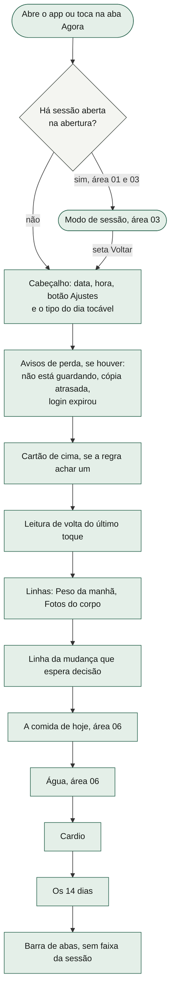

### 2.2 Para onde cada peça leva

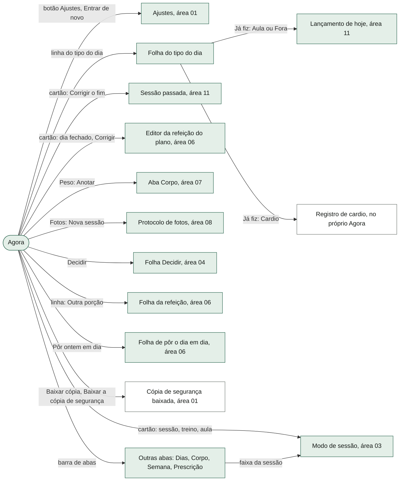

A linha do treino dentro da "comida de hoje" leva a um lugar que não existe mais (a antiga aba de treino); ver o risco 2 da §9.

---

## 3. Fluxos, um por funcionalidade

### 3.1 O cabeçalho: data, hora e o tipo do dia

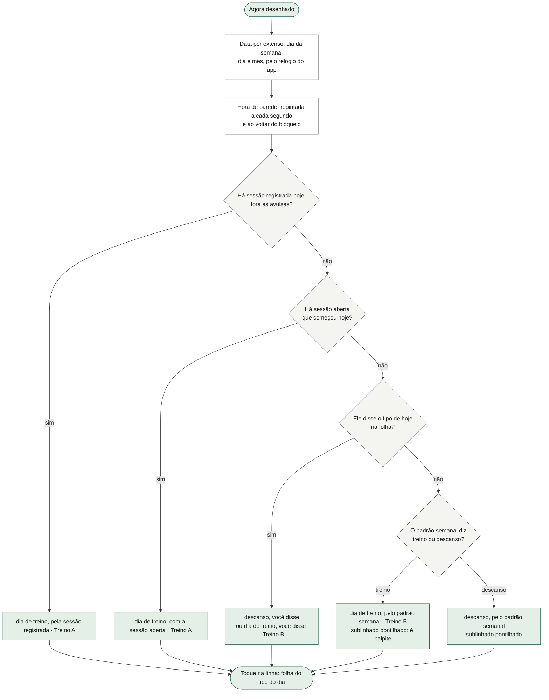

O que o diagrama não mostra:
- **A letra do treino.** Com sessão registrada ou aberta, a letra é a da sessão. Nos outros casos é sempre a da **sequência** (o próximo treino da rotação, área 04) — o padrão semanal só diz *se* hoje treina, nunca *qual* treino. Quando o próximo da sequência é o dia aberto do box, a linha diz "· aula" em vez de "· Treino X".
- **O padrão semanal** de fábrica é "descansa domingo, treina os outros seis"; o usuário pode ter outro (`S.cadencia`, área 06).
- **A hora** usa o relógio único do app; o cabeçalho é a única peça que mostra hora de parede no Agora. A batida é de 1 segundo e escuta a volta do bloqueio (o iOS congela temporizadores com a tela apagada).
- **Ajustes** (⚙) é destino de tela cheia, fechado pelo Voltar como qualquer camada (área 01).

### 3.2 A folha do tipo do dia e "Já fiz alguma coisa hoje"

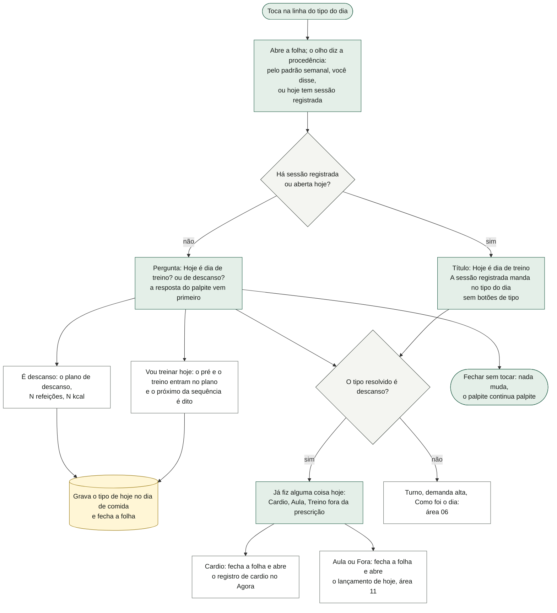

O que o diagrama não mostra: dizer o tipo do dia **só muda o plano da comida de hoje** e o cartão de cima (a janela do treino passa a existir ou não); não mexe na sequência. O que ele disse vale até a virada do dia (o dia de comida zera sozinho na data nova, área 06). A folha é uma camada: o Voltar do sistema a fecha. "Já fiz → Cardio" não grava nada: só abre o registro (§3.12). Com sessão só aberta, a folha abre normalmente, mas o olho diz "hoje tem sessão registrada" (risco 11).

### 3.3 O cartão de cima — o que ele mostra (a regra)

A regra é pura (`src/dominio/agora.ts`): recebe os fatos do dia já resolvidos (§3.4) e devolve um cartão ou nada. A ordem é de prioridade: o primeiro degrau que se aplica ganha.

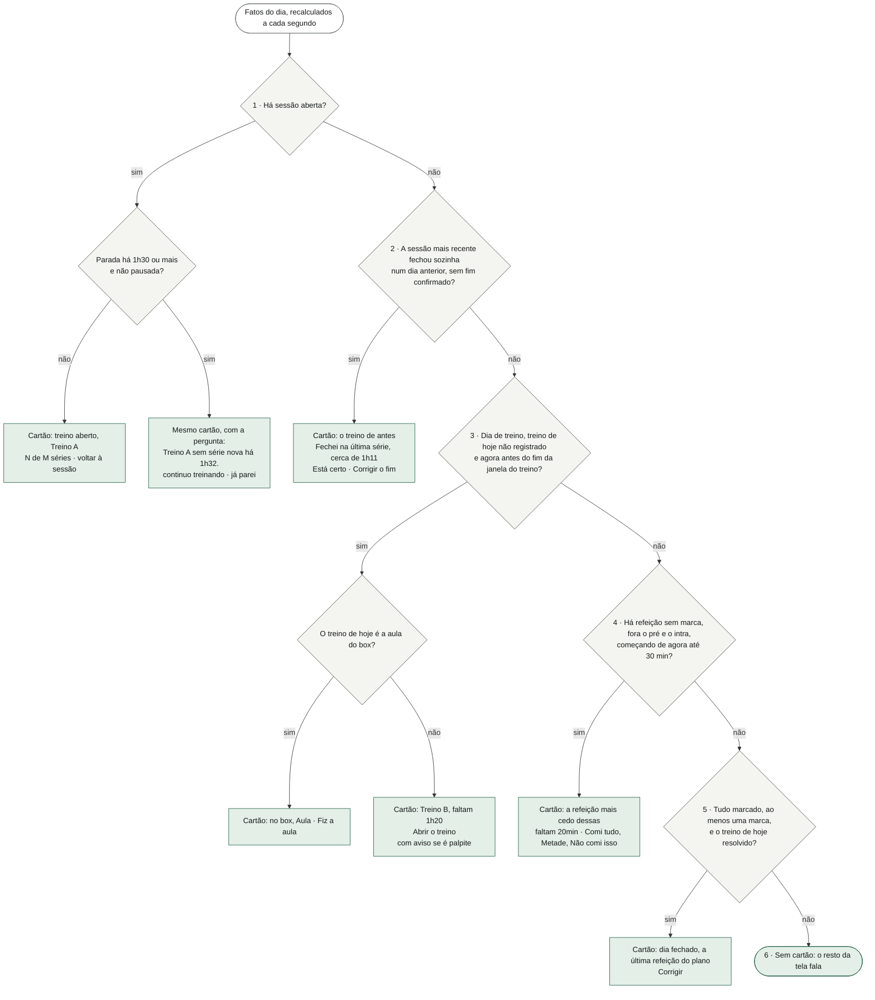

O que o diagrama não mostra:
- **Por que esta ordem.** A sessão aberta ganha de tudo (é o momento de esforço, e no Agora o cartão substitui a faixa). A confirmação do fim ganha do treino de hoje porque é sobre um registro **já escrito** que está aproximado. O treino ganha da refeição enquanto não aconteceu (decisão do dono, D4); em dia de descanso a refeição ganha **por ausência** de treino, não por regra. A refeição só olha **para frente**: o que passou sem marca nunca volta ao topo (corrige a regra antiga que jogava o almoço das 12h30 para o topo logo depois de marcar o lanche).
- **O pré-treino e o intra nunca recebem o cartão**: descem para a linha e reaparecem dentro do descanso do modo (área 03), que é onde são marcados.
- **Limites exatos.** A janela do treino inclui o minuto final ("agora ≤ fim"). A refeição da hora exata conta como à frente; a de 30 minutos à frente entra, a de 31 não.
- **"Sem cartão" é resposta certa**, não erro: às 10h40 com o almoço às 12h30, não há cartão. O que está à frente e o que passou sem marca são linhas.
- **A linha acesa** da comida de hoje é sempre o assunto do cartão (refeição do cartão, ou a linha do treino quando o cartão é treino, aula ou sessão) — uma regra só para as duas peças.
- O cartão é recalculado a cada segundo enquanto o Agora está na tela; a troca de degrau (ex.: 7h30 → 7h31) acontece sem reabrir o app.

### 3.4 De onde vêm os fatos que a regra lê

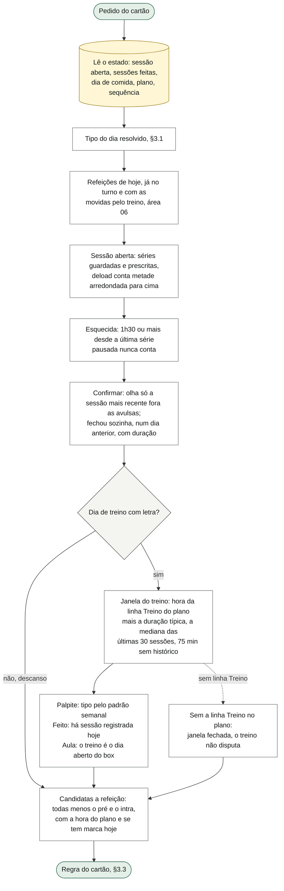

O que o diagrama não mostra: nada aqui é gravado — o cartão é sempre derivado, sem campo próprio. A hora usada para a refeição é a **do plano**, não a da marca (o lanche das 16h00 é previsto às 16h00 mesmo que ele coma às 15h30). A duração típica ignora sessões com menos de 20 ou mais de 180 minutos (a área 06 usa o mesmo número para empurrar refeições para depois do treino). Em turno da tarde ou da noite, a linha Treino anda junto com o pré (12h15, 18h15), e a janela anda com ela — treino à noite cai na mesma regra.

### 3.5 Cartão da sessão aberta e a pergunta de 1h30

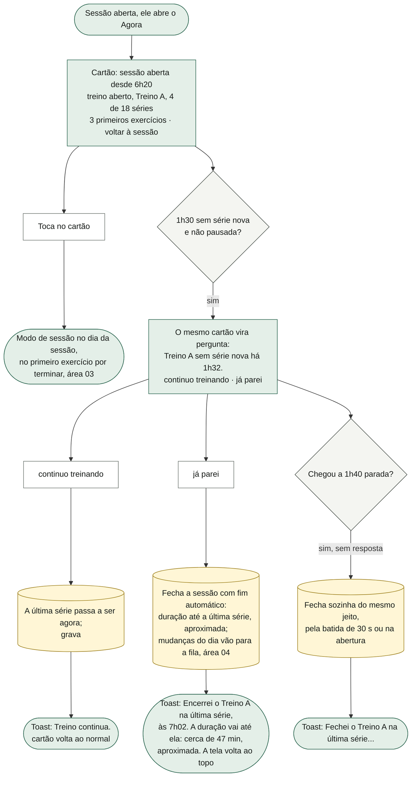

O que o diagrama não mostra: a pergunta **mantém o topo** (não vira outro cartão) e traz as **duas** respostas, com as mesmas palavras da faixa, porque no Agora a faixa não é desenhada — sem isso o Agora perderia o "já parei". O fecho em si (fim automático, a fila de mudanças, o quadro do box virando nota) é da área 03. Pausada, a sessão nunca pergunta; só a virada do dia a fecha, na próxima abertura. Depois de "já parei" ou do fecho sozinho, o tipo do dia passa a "pela sessão registrada", o treino de hoje conta como feito e o topo segue para as refeições (§3.3, degrau 4). No dia seguinte, essa sessão (com fim automático) aparece como "o treino de antes" (§3.6) — inclusive quando foi ele que tocou "já parei".

### 3.6 Cartão "o treino de antes": Está certo / Corrigir o fim

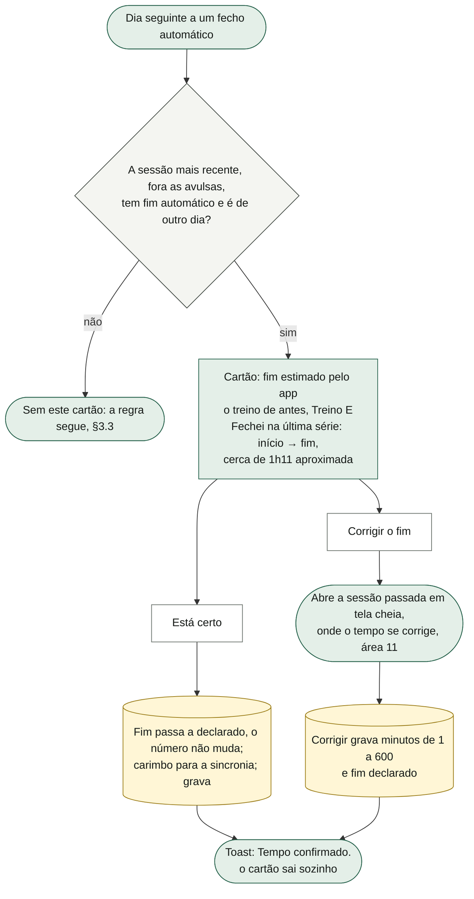

O que o diagrama não mostra: a pergunta é **derivada**, sem campo de "já respondi": é o próprio carimbo do fim que a faz sair. Só a mais recente pergunta — uma sessão automática antiga debaixo de uma confirmada nova não ressuscita. Sessão de treino passado (lançada depois, área 11) fecha calada e não pergunta. **Sem prazo**: enquanto não for respondida (e não houver sessão nova), ela ocupa o topo o dia inteiro, por cima de treino e refeições (risco 4). **O intervalo escrito no cartão está deslocado** (risco 1). Os dois botões funcionam porque acham a sessão pelo instante dela.

### 3.7 Cartão do treino e da aula

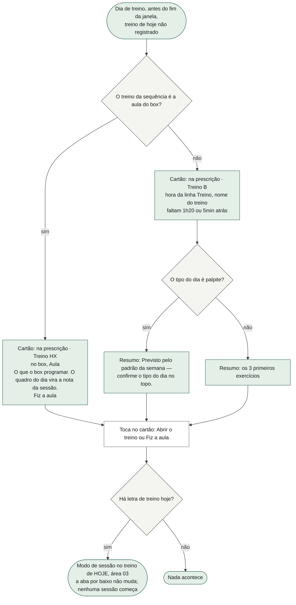

O que o diagrama não mostra: o cartão é a **porta 1** do modo (as outras são a faixa e a abertura do app, área 03). Entrar no modo é navegação: a sessão nasce na primeira série completa. O dia é sempre o resolvido de hoje, mesmo que o dedo tenha deixado outra letra aberta por outro caminho. O palpite diz que é palpite e aponta para o cabeçalho, onde se confirma. A contagem usa a hora da linha Treino do plano (no turno de hoje); passado o início, vira "Xmin atrás" até a janela fechar.

### 3.8 Cartão da refeição e a leitura de volta

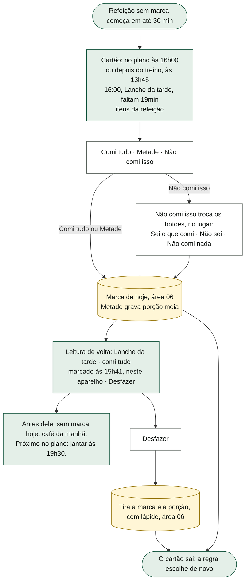

O que o diagrama não mostra: o que cada marca é no dado, a lápide e a sincronia são da **área 06** (§3.1 de lá). Aqui ficam as regras de composição: o cartão da refeição só existe dentro da janela de 30 min, então a contagem é sempre "faltam" (ou "faltam 0min" na hora exata); o rótulo junta "· pós-treino" quando aquela refeição carrega o papel de pós-treino hoje; a procedência diz "depois do treino, às 13h45" quando o treino empurrou a refeição (inventar "no plano às 13h45" seria mentir a origem). A pergunta "Não comi isso" no cartão não abre a mesma pergunta na linha da lista, e não grava nada até a resposta. A **leitura de volta** é estado de tela: some com "Desfazer", com a virada do dia, ou ao fechar o app (a marca fica); só o último toque feito pela linha ou pelo cartão gera leitura — marcar pela folha da refeição não gera.

### 3.9 Cartão do dia fechado

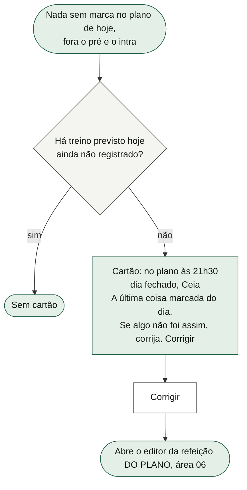

O que o diagrama não mostra: "a última" é a última **pelo relógio do plano**, não a marcada mais recentemente. É preciso pelo menos uma marca (um plano sem refeições não gera cartão). "Corrigir" abre o editor permanente do plano, e não a correção da marca de hoje — ver risco 3.

### 3.10 As linhas do corpo: peso da manhã e fotos

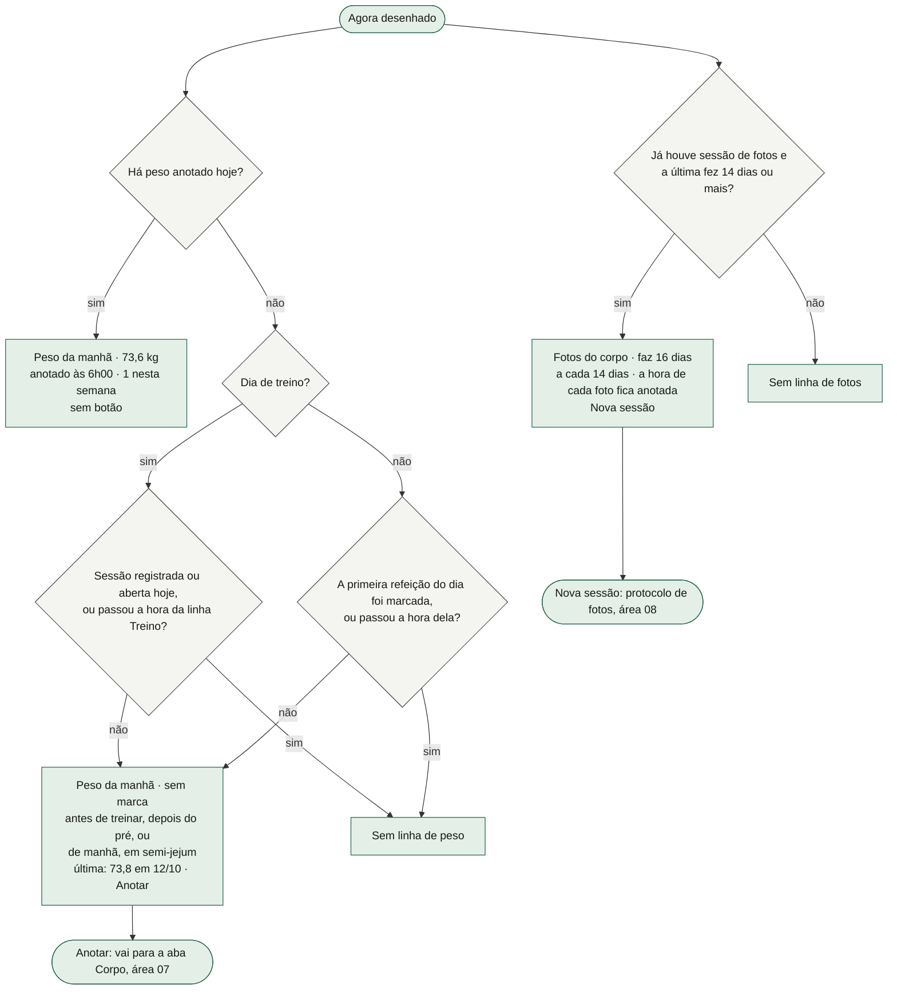

O que o diagrama não mostra: as duas são **linhas e não cartão** — cada uma tem o seu dia previsto e nenhuma é "a próxima coisa a fazer". A pesagem **segue a hora** (pesagem da tarde não se compara com a da manhã): em dia de treino some quando a sessão começa ou passa a hora da linha Treino; no descanso, quando a primeira refeição é marcada ou a hora dela passa. As fotos **não seguem a hora** (decisão do dono: ele fotografa à noite); a hora fica anotada em cada foto. Quem nunca fez sessão de fotos não recebe o convite aqui (o vazio é da área 08, no Corpo). O "N nesta semana" conta as pesagens desde domingo. **Fotos só neste aparelho não aparecem no Agora** — esse aviso mora no Corpo (área 08). Dentro do modo, no descanso, o peso tem atalho próprio (área 03).

### 3.11 A mudança que espera decisão, e a folha Decidir

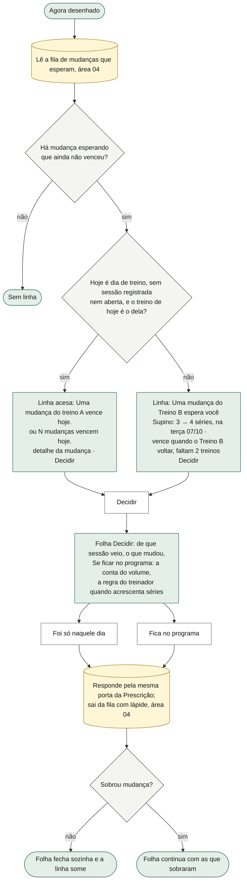

O que o diagrama não mostra: é **uma linha**, nunca a lista — a lista mora na Prescrição (área 04). A linha **persiste** enquanto houver algo esperando (encerrar o treino com mudança **informa** no Agora, em vez de guardar em silêncio) e muda de palavra no dia em que vence. Fica **abaixo** do cartão e das linhas do corpo: é para decidir com calma. O que **já venceu** não aparece no Agora (só na Prescrição, dito e desfazível) — e uma mudança conta como vencida assim que uma sessão daquele treino **começa** (área 04), então ao abrir a sessão do dia a linha sai. Com várias mudanças, o detalhe lista os treinos ("Treino A, Treino B") e a folha agrupa por sessão de origem. Em cada grupo a folha diz o que acontece se ninguém decidir: "quando o Treino A voltar ela fica como só daquele dia — dito na lista de Prescrição, e desfazível até a vez seguinte". Fechar a folha não decide nada.

### 3.12 Registrar cardio

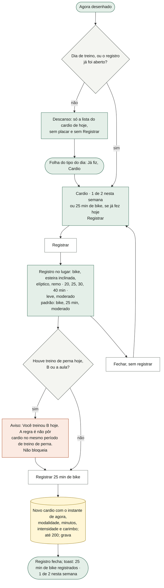

O que o diagrama não mostra: o cardio de hoje **nasce aqui** — o Agora é o dono desse registro, porque é onde se lança. A seção não tem rótulo: a primeira linha já diz "Cardio" e o placar. Abaixo do registro ficam, sempre que a seção aparece: a procedência de perna ("você salvou o treino B hoje. A regra é não pôr cardio no mesmo período de treino de perna — se ainda der, deixe para outro dia.") quando houve B ou aula, e **a regra do treinador** sobre quando fazer: "segunda, depois do A: 20 a 25 min · quinta, depois do D: 25 a 30 min. Leve a moderado: respirando mais forte, mas ainda dando para conversar. Evite antes de B ou do HYROX, e nunca antes do treino." A meta é **2 por semana**, semana de domingo a sábado. A última escolha do formulário fica lembrada enquanto o app está aberto. No descanso, registrado o cardio, a seção sai e fica só a lista de hoje (para poder desfazer). O cardio de dia passado entra pelo dia aberto em Dias (área 11), sem hora; hoje e o futuro não entram por lá. **Se o aparelho recusar a gravação**, o toast de sucesso aparece mesmo assim (risco 6); quem avisa é o painel geral de "não guardado" (área 01).

### 3.13 Apagar um cardio de hoje

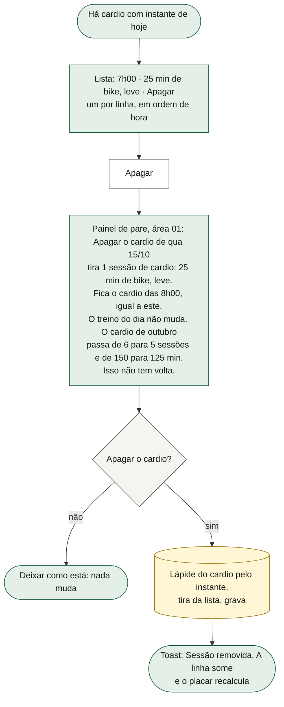

O que o diagrama não mostra: decisão do dono (14/10) — o lançado por engano se desfaz **onde foi lançado**; antes, só no dia seguinte, em Dias. A mesma ação de apagar serve ao dia aberto em Dias (área 11). A lápide impede que o outro aparelho devolva o cardio apagado (área 02). Não há desfazer depois de apagar.

### 3.14 Os 14 dias

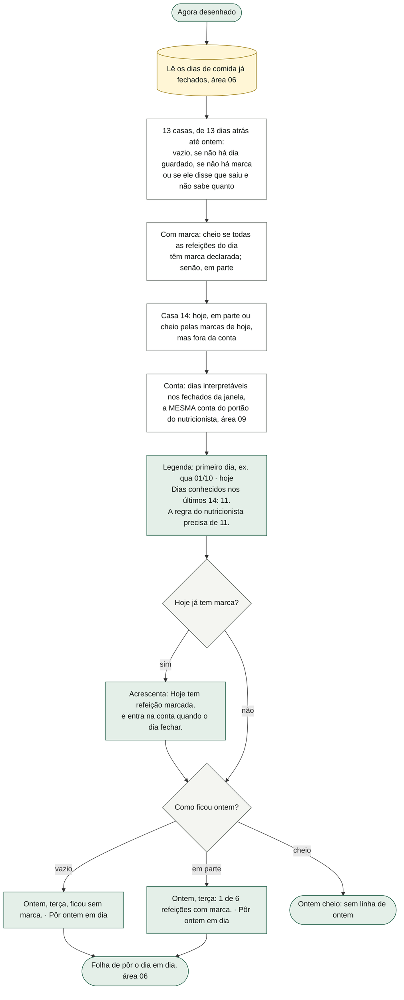

O que o diagrama não mostra: **contagem, nunca percentual** (um número contra 100% implícito funciona como nota). A casa de hoje aparece mas não conta: o dia só entra quando a data vira e ele fecha (área 06). Por isso, na prática, a contagem vai até **13** — a janela tem 14 casas, mas só 13 dias fechados (ver a regra 21 e o risco 5). "Em parte" e "cheio" usam a mesma classificação da folha de pôr o dia em dia; uma marca "sugerida" pela folha (não declarada) não enche a casa. É o estado mais mudo da tela: num dia de descanso fora de qualquer janela, sem cartão, ficam a comida, a água e os 14 dias.

### 3.15 Os avisos do topo

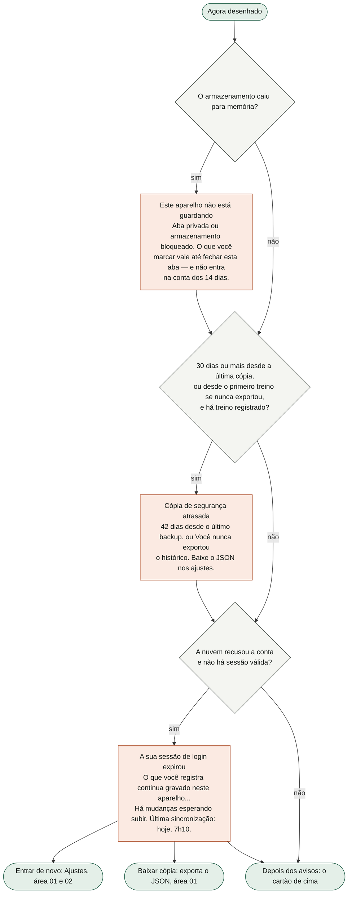

O que o diagrama não mostra: os avisos ficam **acima** do cartão e não disputam o topo — não são ação, são a condição de validade de tudo o que vem abaixo. Antes de a sonda do armazenamento responder, o app conta como "guardando" (alarme falso ensina a ignorar o verdadeiro). **Sem rede não é aviso**: a sincronia falha em silêncio de propósito; só o login expirado fala (área 02). O aviso da cópia não tem botão (manda aos Ajustes por texto). Outras falhas de gravação: o copo de água que não gravou aparece **dentro da linha da água** (área 06: "O 9º copo não foi gravado…", com "Tentar de novo" e "Baixar a cópia de segurança"); a gravação que falhou em geral abre o **painel global** por cima de qualquer tela (área 01). **Fotos só neste aparelho não aparecem no Agora** (Corpo, área 08).

### 3.16 A faixa da sessão (fora do Agora)

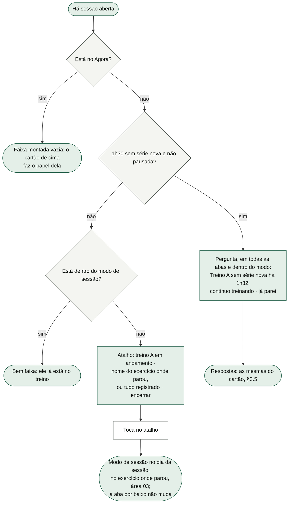

O que o diagrama não mostra: a faixa fica acima da barra de abas e acima do cronômetro de descanso; escreve a própria altura para o toast e o fim da página não ficarem por baixo dela — por isso no Agora ela é montada vazia, e não retirada (se saísse da árvore, a altura da aba anterior ficaria reservada). Quando a sessão não tem treino no programa (a letra sumiu), não há faixa. A pergunta aparece sozinha, sem reabrir o app, pela batida de 30 s (que repinta só na virada de atalho para pergunta).

### 3.17 O relógio da tela

O Agora tem um relógio próprio que bate de segundo em segundo e ao voltar do bloqueio. A cada batida a tela inteira do Agora se redesenha: a hora do cabeçalho, a escolha do cartão, a contagem "faltam/atrás", os estados das linhas da comida ("mais tarde" vira "sem marca") e a leitura de volta. Nada disso grava. A virada do dia acontece no primeiro desenho depois da meia-noite: o dia de comida fecha e zera (área 06), o cardio de hoje volta a ficar vazio, a linha do peso volta a pedir, e o cartão recomeça. O relógio do **modo de sessão** é outro (área 03).

---

## 4. Estados da tela

### 4.1 Estados das peças

| Estado | Quando acontece | O que a tela mostra |
|---|---|---|
| Sem cartão | Nada se aplica (§3.3, degrau 6) | Começa pelos avisos (se houver) e vai direto para as linhas |
| Cartão "treino aberto" | Sessão aberta | Procedência "sessão aberta desde 6h20", "N de M séries", "voltar à sessão →" |
| Cartão pergunta | Sessão aberta, 1h30 sem série, não pausada | Frase "Treino A sem série nova há 1h32." e os botões "continuo treinando" / "já parei" |
| Cartão "o treino de antes" | Última sessão fechou sozinha num dia anterior, sem fim confirmado | "fim estimado pelo app", "Fechei na última série… (aproximada).", "Está certo" / "Corrigir o fim" |
| Cartão "no box · Aula" | Dia de treino, a sequência caiu na aula, dentro da janela | "Fiz a aula →" |
| Cartão do treino, fato | Dia de treino declarado ou registrado/aberto, dentro da janela | "na prescrição · Treino B", hora, nome, contagem, 3 exercícios, "Abrir o treino →" |
| Cartão do treino, palpite | Mesmo, com o tipo do dia pelo padrão semanal | Resumo "Previsto pelo padrão da semana — confirme o tipo do dia no topo." e o cabeçalho com pontilhado |
| Cartão da refeição | Refeição sem marca em até 30 min | Três botões; com "Não comi isso", os três da pergunta |
| Cartão "dia fechado" | Tudo marcado, treino resolvido | "A última coisa marcada do dia…", "Corrigir →" |
| Leitura de volta | Último toque pela linha/cartão, marca ainda existe, mesmo dia | Nome · marca, hora, "neste aparelho", "Desfazer", antes sem marca, próximo |
| Peso, sem marca | Sem peso hoje, antes da hora | "Peso da manhã · sem marca", quando pesar, a última, "Anotar" |
| Peso, anotado | Peso hoje | "Peso da manhã · 73,6 kg", hora e quantas na semana, sem botão |
| Peso, ausente | Sem peso e a hora passou | Nenhuma linha de peso |
| Fotos vencidas | ≥ 14 dias desde a última sessão de fotos | "Fotos do corpo · faz N dias", "Nova sessão" |
| Decisão esperando | Mudança na fila, não vencida, não é o dia dela | "Uma mudança do Treino B espera você" + detalhe + "Decidir" |
| Decisão vencendo hoje | Dia de treino daquela letra, antes de abrir a sessão | Linha acesa: "Uma mudança do treino A vence hoje." |
| Cardio, dia de treino | Tipo do dia = treino | "Cardio · N de 2 nesta semana" (ou o de hoje), "Registrar", lista de hoje, procedências |
| Cardio aberto | "Registrar" ou "Já fiz → Cardio" | Os chips, o aviso de perna se houver, "Registrar N min de X"; o botão vira "Fechar" |
| Cardio, descanso | Tipo do dia = descanso, registro fechado | Só a lista do cardio de hoje com "Apagar" (nada se não houver) |
| 14 dias, ontem vazio / em parte | Ontem sem marca, ou só parte das refeições | A frase de ontem e "Pôr ontem em dia" |
| Aparelho sem guardar | Armazenamento em memória | O aviso de perda no topo |
| Cópia atrasada | ≥ 30 dias sem cópia, com treino | O aviso da cópia |
| Login expirado | Nuvem recusou a conta | O aviso, "Entrar de novo", "Baixar cópia" |
| Folha do tipo do dia aberta | Toque no tipo do dia | A folha por cima; Voltar fecha |
| Folha Decidir aberta | "Decidir" | A folha por cima; fecha sozinha quando não sobra mudança |
| Plano sem refeições | Plano de comida vazio | Sem linhas da comida, sem cartão de refeição nem de dia fechado; a regra não quebra |

### 4.2 O que aparece no Agora em cada momento do dia

Plano de exemplo, turno da manhã, duração típica do treino 75 min (janela do treino até 7h30). "Comida, água, cardio e 14 dias" aparecem sempre e não são repetidos em cada linha.

**Dia de treino (pelo padrão semanal, ainda sem sessão)**

| Momento | Cabeçalho | Cartão de cima | Linhas acima da comida | Cardio |
|---|---|---|---|---|
| 5h00 | "dia de treino, pelo padrão semanal · Treino B" (pontilhado) | Treino B, "faltam 1h15", com o aviso de palpite | Peso: "antes de treinar, depois do pré · Anotar"; decisão "vence hoje" se a mudança for do B | Seção inteira |
| 5h30 (o pré é às 5h45) | igual | **Treino** (o pré nunca é cartão) | igual | igual |
| 6h20, sem ter aberto a sessão | igual | Treino B, "5min atrás" | Peso some (passou a hora da linha Treino) | igual |
| 6h20, sessão aberta | "dia de treino, com a sessão aberta · Treino B" | "treino aberto", "N de M séries" | Peso some; decisão da mudança do B sai (venceu ao abrir a sessão, área 04) | Aviso de perna se o treino é B ou aula |
| 8h00, sessão parada desde 6h28 | igual | **Pergunta** "sem série nova há 1h32" | igual | igual |
| 8h10, sem resposta (100 min parada) | "pela sessão registrada" | A sessão fechou sozinha (toast "Fechei o Treino B na última série…"); sem cartão, porque o café das 8h00 já passou, até a janela do almoço | igual | igual |
| 7h31, treino encerrado às 7h25 | "pela sessão registrada · Treino B" | Café da manhã (8h00 está a 29 min) | — | igual |
| 7h31, **sem** ter treinado | "pelo padrão semanal" | Café da manhã (a janela do treino fechou às 7h30) | — | igual |
| 10h40 | igual | **Nenhum** (almoço longe, café passou) | Leitura de volta, se marcou algo | igual |
| 12h00 – 12h30 | igual | Almoço | — | igual |
| 15h30 – 16h00 | igual | Lanche da tarde | — | igual |
| 19h00 – 19h30 | igual | Jantar | — | igual |
| 21h00 – 21h30 | igual | Ceia | — | igual |
| 23h00, tudo marcado e treino feito | igual | "dia fechado · Ceia", "Corrigir →" | — | igual |
| 23h00, faltou marcar algo | igual | Nenhum (o que faltou é linha; "Pôr hoje em dia" é a folha da área 06) | — | igual |

**Dia de descanso (pelo padrão semanal)**

| Momento | Cabeçalho | Cartão de cima | Linhas acima da comida | Cardio |
|---|---|---|---|---|
| 7h05 | "descanso, pelo padrão semanal" (pontilhado) | Nenhum (café às 8h00 está a 55 min) | Peso: "de manhã, em semi-jejum · Anotar"; Fotos se vencidas | **Sem seção** (só a lista de hoje, se houver) |
| 7h30 – 8h00 | igual | Café da manhã | Peso até marcar o café ou passar das 8h00 | igual |
| 10h40 | igual | Nenhum | Fotos continuam se vencidas | igual |
| 12h00 – 12h30, 15h30 – 16h00, 19h00 – 19h30, 21h00 – 21h30 | igual | A refeição da janela | — | igual |
| Qualquer hora, "Já fiz → Cardio" | igual | (não muda) | — | Seção aberta com o registro; depois de registrar, só a lista |
| Noite, tudo marcado | igual | "dia fechado" | — | igual |

**Situações que atravessam o dia**

| Situação | O que muda no Agora |
|---|---|
| Dia seguinte a um fecho automático (ou a "já parei") | O cartão é "o treino de antes" **até ser respondido**, por cima de treino e refeições (só a sessão aberta ganha dele) |
| Sessão pausada | Cartão "treino aberto" sem pergunta, a qualquer hora; fecha só na abertura de outro dia |
| Sessão aberta de ontem, app aberto atravessando a meia-noite | Cartão "treino aberto" continua; o cabeçalho deixa de dizer "com a sessão aberta" (risco 14) |
| Segundo treino no mesmo dia | Depois do primeiro registrado, o treino não disputa mais (degrau 3); o segundo volta ao topo como sessão aberta |
| Dia dito "É descanso" e depois treinou | A sessão registrada manda: cabeçalho "pela sessão registrada"; a folha esconde os botões |
| Mudança vence hoje | A linha acende de manhã e sai ao abrir a sessão daquele treino |
| Aparelho sem guardar | Tudo funciona, com o aviso no topo; nada sobrevive ao fechar a aba |

---

## 5. Dados

### O que esta área GUARDA

| Dado | Formato | Quem mais lê |
|---|---|---|
| `S.cardio[]` (cria o de hoje; apaga) | `{ t: instante (chave), m: modalidade (bike, esteira inclinada, elíptico, remo), min: 1–300, i: leve ou moderado, alt: carimbo da última mudança, semHora?: 1 }`; até 200, os mais antigos saem | Dias (mês, dia aberto, cardio esquecido e correção, área 11), Semana (placar, área 09), Corpo (lista da semana) |
| `S.done[].fim` e `.m` (só pelos botões do cartão) | "Está certo" passa `fim` de `auto` para `manual` e sobe o carimbo `m`; "já parei" fecha com `fim: auto` | Área 03 (dona da sessão), 11 |
| `S.sessao.ultima` (só por "continuo treinando") | instante | Área 03 |
| Lápide `cardio:<instante>` em `S.apagados` | instante do apagamento | Sincronia (área 02) |

O Agora **não tem chave local própria** nem cache. Estado de tela (não guardado): `view.aba` (qual aba; o Agora é o padrão), `view.cardioRapido` (registro de cardio aberto), `view.cardioForm` (a última escolha do formulário), `view.pilha` (folhas `dia` e `decidir`), e, ao entrar no modo, `view.modoSessao`, `view.day`, `view.open`, `view.swapOpen`. Da área 06, mas lidos para desenhar aqui: `view.linhaComida`, `view.perguntaDe`, `view.ultimaMarca`, `view.aguaCorrige`, `view.aguaFalhou`. Variáveis do módulo: `faixaPerguntando` e a batida de 30 s (compartilhadas com a área 03).

### O que só LÊ de outras áreas

- **Sessão (03):** `S.sessao` (dia, início, última série, pausa), `S.done` (sessões, fim, duração, avulsa), `S.logs` (séries guardadas na sessão aberta e séries de hoje), deload por entrada.
- **Programa (04):** `S.prog` (dias, o dia aberto do box), `S.rot` (a sequência), a fila `S.promoPendente` já resolvida pela leitura da Prescrição (vencimento, vence hoje, venceu, conta de volume).
- **Comida (06):** `S.dia` (marcas, porções, água, tipo dito, turno, alta), `S.comida` (plano, alimentos), `S.cadencia` (padrão semanal), `S.comidaHist` (dias fechados, para os 14 dias), `S.ajuste` (o rótulo "plano base"/"ajuste +150 kcal" na procedência da comida, área 09).
- **Corpo (07):** `S.body.peso`.
- **Fotos (08):** `S.protocolo.sessoes`.
- **Fundação (01):** o modo do armazenamento (memória ou não), `S.export` (data da última cópia).
- **Sincronia (02):** `sync.expirou`, `sync.sujo`, `sync.em` e se há sessão da nuvem.

### Como atravessa a sincronia

- `S.cardio` é **coleção com chave** (`cardio:<instante>`), carimbo `alt` (porque `m` já é a modalidade), lápide ao apagar, teto 200 (área 02). Dois aparelhos que registram cardio no mesmo milissegundo colidiriam na chave (improvável; o cardio esquecido de Dias anda 1 ms para evitar).
- A confirmação do fim viaja dentro da sessão (`S.done`, coleção com chave da sessão e carimbo `m`): confirmar num aparelho tira a pergunta do outro na próxima junção.
- Tudo o mais que o Agora mostra é derivado na hora; não viaja.

---

## 6. Regras

**O cartão de cima** (`src/dominio/agora.ts`; desenho da frente 1 §5, decisões do dono)

1. **Um cartão só**, ou nenhum. "Nenhum" é resposta legítima.
2. **Ordem:** sessão aberta → sessão que fechou sozinha → treino (ou aula) dentro da janela → refeição em até 30 min → dia fechado → nada.
3. **Sessão aberta ganha de tudo**, inclusive quando vira pergunta: a pergunta de 1h30 mantém o topo e traz as duas respostas.
4. **Pergunta de 1h30:** 90 minutos desde a última série (ou desde o início, se nenhuma). Pausada nunca pergunta. Aos **100 minutos** (90 + 10 de graça) a sessão fecha sozinha — pela batida de 30 s com o app aberto, ou na abertura (área 03).
5. **Confirmar o fim:** só a sessão mais recente (fora as avulsas), com fim automático, com duração, e de **um dia anterior a hoje**. Sai quando o fim passa a declarado (por "Está certo" ou pela correção do tempo, que aceita 1 a 600 minutos).
6. **Treino ganha da refeição enquanto não aconteceu** (decisão do dono, D4): dia de treino, treino de hoje não registrado, e agora ≤ fim da janela.
7. **Janela do treino** = hora da linha Treino do plano no turno de hoje + duração típica (mediana das últimas 30 sessões entre 20 e 180 minutos; 75 sem histórico). Sem a linha Treino no plano, a janela não existe e o treino não disputa.
8. **Aula:** quando o treino da sequência é o dia aberto do box, o cartão é "Aula · Fiz a aula", pelo mesmo degrau e a mesma janela.
9. **Palpite:** o tipo do dia pelo padrão semanal é dito como palpite no cartão e no cabeçalho — a regra nunca trata palpite como fato.
10. **Refeição só para frente:** a primeira refeição sem marca com hora do plano entre agora e agora + 30 min (as duas pontas incluídas). O que passou sem marca nunca volta ao topo.
11. **O pré-treino e o intra nunca são cartão** (são as refeições presas ao treino).
12. **Em dia de descanso a refeição ganha por ausência de treino**, não por regra.
13. **Dia fechado:** todas as refeições do dia (fora o pré e o intra) marcadas, ao menos uma marca, e treino de hoje inexistente ou registrado. Mostra a última pelo relógio do plano.
14. **A linha acesa da comida é o assunto do cartão** (refeição do cartão; ou a linha do treino para treino, aula e sessão).

**Cabeçalho e tipo do dia** (`src/dominio/dia.ts`)

15. Precedência do tipo do dia: sessão registrada hoje → sessão aberta que começou hoje → o que ele disse para hoje → padrão semanal (palpite). Avulsas não contam.
16. A letra vem da sessão (quando há) ou da sequência; o padrão semanal nunca escolhe a letra. Padrão de fábrica: descansa domingo.
17. Com sessão registrada ou aberta, a folha não oferece trocar o tipo.
18. "Já fiz alguma coisa hoje" só existe em dia de descanso: cardio abre o registro no Agora; aula e "fora" abrem o lançamento de hoje (área 11). Cardio em dia de descanso fica no descanso (não vira dia de treino).

**Linhas do corpo e decisão**

19. **Peso da manhã:** aparece sem marca até a hora passar — em dia de treino, até a sessão começar/registrar ou passar a hora da linha Treino; no descanso, até a primeira refeição ser marcada ou passar a hora dela (desenho F42: semi-jejum, antes de treinar). Com peso hoje, só mostra.
20. **Fotos:** aparece com 14 dias ou mais desde a última sessão de fotos, a qualquer hora (decisão do dono, 14/10).
21. **Decisão:** uma linha (nunca a lista) enquanto houver mudança não vencida; "vence hoje" quando hoje é dia de treino daquela letra, antes de abrir a sessão. O que venceu não aparece aqui.

**Os 14 dias**

22. 14 casas: 13 dias fechados (de 13 dias atrás até ontem) e hoje. Hoje não conta até a data virar; a conta é a do portão do nutricionista (área 09): **11 dias interpretáveis** (`MIN_REGISTRADOS`). Dia interpretável = tem ao menos uma marca e não foi dito "saí e não sei quanto". Contagem, nunca percentual.
23. Casa cheia = todas as refeições do dia com marca declarada; em parte = alguma; vazia = sem dia guardado, sem marca, ou perdido. Ontem vazio ou em parte ganha a frase e "Pôr ontem em dia".

**Cardio** (regras do treinador; decisão do dono)

24. Meta: **2 sessões por semana** (domingo a sábado). Recomendação do treinador: segunda depois do A, 20–25 min; quinta depois do D, 25–30 min; leve a moderado; evitar antes de B ou do HYROX, nunca antes do treino.
25. **Dias de perna:** B e a aula (HYROX cobra da perna). Treino de perna hoje gera aviso, **nunca bloqueia**.
26. Opções do registro: bike, esteira inclinada, elíptico, remo; 20, 25, 30, 40 min; leve, moderado. Padrão bike, 25, moderado.
27. A seção completa só em dia de treino; no descanso, só a lista do que foi feito hoje (desenho: "não há outro cartão, faixa ou convite"), a menos que o registro tenha sido aberto pela folha.
28. Apagar sempre pergunta antes, com o que sai, o que fica no dia e o efeito no mês, e deixa lápide.

**Avisos e faixa**

29. Cópia atrasada: 30 dias ou mais desde a última exportação (sem exportação: desde o primeiro treino registrado), só se houver ao menos um treino.
30. Login expirado aparece; sem rede, não.
31. A faixa da sessão nunca aparece no Agora; nas outras abas, atalho ou pergunta; dentro do modo, só a pergunta.

---

## 7. Ligações com as outras áreas

| Área | O que o Agora recebe dela | O que o Agora entrega a ela |
|---|---|---|
| 01 · Fundação | O modo do armazenamento, a data da última cópia, o painel de pare (apagar cardio), o painel de gravação que falhou, a casca e a barra de abas, o Voltar que fecha as folhas, os Ajustes, a exportação | O botão ⚙ e o "Entrar de novo"; o "Baixar cópia"; o aviso de perda que a fundação não desenha |
| 02 · Sincronia | `sync.expirou`, se há mudança esperando subir, a última sincronização; a fusão do cardio | Novos cardios e lápides para subir; a confirmação do fim dentro da sessão |
| 03 · Sessão | A sessão aberta, a contagem de séries, "esquecida", o fecho automático e as frases do fecho, o modo de sessão | As portas 1 (cartão do treino/aula) e 2 (faixa), "voltar à sessão", "continuo treinando", "já parei", "Está certo" |
| 04 · Programa | A sequência (qual treino, a aula), a fila de mudanças com vencimento e conta de volume, a resposta da mudança | A linha da decisão e a folha Decidir (mesmo item e mesmo verbo da Prescrição) |
| 05 · Aula | O dia aberto do box (é a aula) | O cartão "Aula · Fiz a aula" que leva ao modo |
| 06 · Comida | As refeições de hoje (turno, movidas, pós-treino), as marcas, a água, o tipo dito, o plano, os dias fechados, a folha de pôr o dia em dia, a folha da refeição, o editor do plano | O lugar das linhas, o cartão da refeição (que chama a marca dela), a folha do tipo do dia como porta, "Pôr ontem em dia" |
| 07 · Corpo | As pesagens | A linha do peso da manhã que leva à aba Corpo |
| 08 · Fotos | As sessões de fotos e a cadência de 14 dias | A linha "Fotos do corpo" que abre o protocolo |
| 09 · Semana | O limiar de 11 dias e a contagem do portão; o rótulo do ajuste calórico | A mesma contagem, em tela, sem percentual; o cardio que a Semana conta |
| 11 · Dias | A sessão passada (onde se corrige o tempo), o lançamento de hoje, o apagar do cardio no dia aberto | "Corrigir o fim", "Já fiz → Aula / Fora", o cardio de hoje que o mês de Dias marca |

---

## 8. Como serviço individual

**Nome:** `agora` — o painel do dia. Na prática são duas coisas, e a proposta é separá-las:

1. **`agora` (leitura composta, sem dado próprio)** — um agregador que pergunta aos outros serviços os fatos do dia e devolve a tela pronta. Possui só **regras**: a do cartão de cima, a do tipo do dia como procedência, a de quando cada linha aparece e a da faixa.
2. **`cardio` (com dado)** — o único dado que nasce no Agora. Possui `S.cardio` (coleção com chave pelo instante, carimbo `alt`, lápides, teto 200).

**Operações do `agora`**

| Operação | Recebe | Devolve |
|---|---|---|
| `GET /agora` | instante, aparelho | cabeçalho (data, procedência, palpite), avisos, cartão (tipo e campos), leitura de volta, linhas do corpo, linha da decisão, seção da comida (do serviço `comida`), água, cardio, 14 dias |
| `GET /agora/cartao` | fatos do dia (sessão, confirmar, treino com janela/palpite/feito/aula, refeições com hora e marca, minuto atual) | um cartão ou nada — é a função pura de hoje |
| `GET /agora/faixa` | sessão aberta, se está no modo | atalho, pergunta ou nada |
| `POST /agora/sessao/continua` | — | repassa ao serviço `sessao` (última série = agora) |
| `POST /agora/sessao/ja-parei` | — | repassa ao `sessao` (fecho automático) |
| `POST /agora/fim/confirma` | instante da sessão | repassa ao `sessao` (fim declarado) |

**Operações do `cardio`**

| Operação | Recebe | Devolve |
|---|---|---|
| `POST /cardio` | modalidade, minutos, intensidade, instante (padrão agora), `semHora` | o registro, ou a recusa do armazenamento |
| `GET /cardio?de=&ate=` | intervalo | lista (hoje, semana, mês) |
| `GET /cardio/semana` | instante | feitas, meta (2), lista |
| `PATCH /cardio/:t` | campo (m, min, i) e valor | o registro com `alt` novo (usado por Dias) |
| `DELETE /cardio/:t` | — | o efeito no mês para a pergunta; depois, a lápide |
| `GET /cardio/aviso-perna` | instante | os treinos de perna do dia (lidos do `sessao`) |

**Eventos**

- Emite (`cardio`): `cardio.registrado`, `cardio.corrigido`, `cardio.apagado`.
- Emite (`agora`): nenhum de dado; no máximo `agora.cartao.mudou` para quem quiser notificar.
- Escuta (`agora`): `sessao.aberta`, `sessao.serie.guardada`, `sessao.fechada` (com o modo do fim), `sessao.fim.confirmado`, `comida.marca.mudou`, `comida.dia.fechou`, `comida.tipo-do-dia.mudou`, `programa.mudanca.enfileirada` / `respondida` / `venceu`, `corpo.peso.registrado`, `fotos.sessao.feita`, `nuvem.login.expirou`, `fundacao.armazenamento.modo`, `fundacao.copia.exportada`, `cardio.*`.

**O que hoje está acoplado e precisaria ser separado**

- **A regra já está separada** (`dominio/agora.ts` é pura e recebe fatos). O invólucro que monta os fatos (`CTX.fatosDoDia`) lê `S` direto: sessão, sessões, plano, dia de comida, sequência — viraria chamadas aos serviços `sessao`, `programa` e `comida`.
- **O tipo do dia** (`diaDeHoje`) é usado por treino e comida e pelo Agora; deveria morar num serviço único (`dia` ou dentro de `programa`), com o Agora como leitor. O que ele disse para hoje está guardado no dia de comida (`S.dia.cadencia`, área 06), o que amarra o tipo do dia ao serviço `comida`.
- **A leitura de volta e a linha aberta** são estado de tela da comida; o cartão da refeição chama a marca da comida. No serviço, o cartão só devolveria o id da refeição e os verbos seriam do `comida`.
- **A contagem dos 14 dias** chama a folha de pôr o dia em dia (área 06) para classificar cada casa; deveria ser uma leitura do `comida` ("como ficou o dia D") e o limiar do `semana`.
- **A faixa** escreve uma variável de layout lida pelo toast — acoplamento de casca (área 01), não de domínio.
- **O cardio** mora junto do corpo na tela (`CTX.corpo().cardio`) e usa o pare, o toast e o `save` globais; a regra do treinador sobre cardio está como texto fixo no código, e os dias de perna (`B`, `HX`) são letras fixas — no serviço, seriam configuração do programa do treinador.
- **Os rótulos com letra crua** ("Treino HX") vêm de o Agora montar texto com a letra; com o serviço `programa` devolvendo o nome de exibição, isso some.

---

## 9. Riscos e dívidas que apareceram na leitura

1. **"O treino de antes" mostra o intervalo deslocado (parece bug).** Os fatos montam `início = t − duração` e `fim = t`, mas o `t` da sessão é o **início**. Para uma sessão 6h20–7h31 o cartão diz "Fechei na última série: 05:09 → 06:20, cerca de 1h11". O teste só confere a diferença. Os botões funcionam porque acham a sessão por `t`. Reproduzir: abrir uma sessão, registrar uma série, deixar fechar sozinha, abrir o app no dia seguinte. (Mesmo achado da área 03, risco 2; a tela é daqui.) A pausa também não entra no intervalo.
2. **Tocar na linha do treino leva a uma aba que não existe (parece bug).** Na "comida de hoje", a linha do treino chama `vaiPara('treino')`, mas não há mais aba de treino. A tela cai no Agora por padrão, **sem o cabeçalho** (data, tipo do dia, ⚙), **sem aba acesa** na barra, e com a **faixa da sessão desenhada** (a regra "no Agora não há faixa" olha a aba). Reproduzir: num dia de treino, tocar na linha "Treino B" da lista. **A confirmar:** o destino pretendido (provavelmente o modo, como no cartão).
3. **"Corrigir →" do dia fechado abre o editor permanente do plano**, não a correção da marca de hoje (contraria "editar é permanente, ajustar é de hoje"). Reproduzir: marcar todas as refeições e tocar "Corrigir →". (Registrado também pela área 06, B8.)
4. **A pergunta do fim aproximado não tem prazo** e, pela ordem, cobre o dia inteiro: enquanto ele não responde (e não abre sessão nova), não aparece cartão de treino, de aula nem de refeição. Também nunca aparece no mesmo dia do fecho (só "de um dia anterior"), e aparece mesmo depois de ele ter tocado "já parei" (que grava fim automático). Por desenho, mas vale confirmar com o dono.
5. **"Dias conhecidos nos últimos 14" vai no máximo a 13** enquanto o dia não vira: a janela conta os dias fechados de 13 dias atrás até ontem, e hoje nunca está fechado. O limiar de 11 é alcançável com 11 de 13. É a mesma conta do portão (área 09), então tela e regra concordam; a palavra "14" é que promete uma casa a mais. **A confirmar** se é a intenção. Na mesma leitura: a contagem usa `new Date()` em vez do relógio único do app (`Date.now`), fugindo da porta que os testes usam para viajar no tempo; e o limite da janela é calculado em UTC (`toISOString`), que em fusos a leste de Greenwich desloca um dia (área 06/09).
6. **Registrar e apagar cardio não conferem a gravação.** `addCardio` mostra "25 min de bike registrados · …" e `delCardio` mostra "Sessão removida." mesmo quando o aparelho recusou; o registro fica só na memória até fechar. Quem avisa é o painel geral de "não guardado" (área 01). O cardio esquecido de Dias (área 11) desfaz e diz que não gravou — os dois caminhos divergem.
7. **O aviso de perna conta o treino já ao ABRIR a sessão** (a marca de presença nasce no início) e diz "você salvou o treino B hoje" enquanto ele ainda treina; com duas sessões B diz "B e B"; com o formulário aberto, o mesmo aviso aparece duas vezes (no formulário e na procedência).
8. **Letra crua "HX" na tela**: o cartão da aula diz "na prescrição · Treino HX", e o cartão da sessão, a faixa ("treino HX em andamento", "Treino HX sem série nova…") e o aviso de perna ("Você treinou HX hoje") usam a letra; o cabeçalho e a folha dizem "aula". Também "vence hoje" escreve "treino A" em minúscula e o resto escreve "Treino A".
9. **Comentário órfão** em `agora.jsx`: o bloco "Para decidir com calma… fica ABAIXO do cartão" está antes do cartão, mas a linha da decisão é desenhada depois das linhas do corpo. Só documentação.
10. **Botões "opostos" desenhados com peso diferente**: o comentário do cartão "o treino de antes" diz que nenhuma resposta é a padrão, mas o cartão pinta a primeira ("Está certo") como primária; o mesmo com "continuo treinando".
11. **A folha do tipo do dia com sessão só aberta** diz "hoje tem sessão registrada" e "A sessão registrada manda no tipo do dia".
12. **A casa de hoje nunca fica "cheia" em dia de treino**: ela compara as marcas de hoje com todas as linhas da comida, incluindo a linha do treino, que não se marca no Agora. **A confirmar** se a linha do treino deveria ficar fora dessa conta.
13. **Peso da manhã o dia inteiro** em dia de treino quando o plano não tem a linha Treino (a hora "nunca passa" até abrir uma sessão).
14. **Sessão aberta atravessando a meia-noite com o app aberto**: o cartão continua "treino aberto" (a batida não olha a virada), mas o cabeçalho deixa de dizer "com a sessão aberta" e volta ao padrão semanal; só fecha ao reabrir o app (área 03 registra a batida).
15. **Campos que nenhuma tela usa**: os 14 dias devolvem `fatias`, `txt`, `nota` e `aberto` só lidos pelos testes; a folha do tipo do dia devolve `procedencia`, `titulo`, `treino` e `posNome` sem uso.
16. **Meta de água duplicada** (14 copos aqui e no "enquanto descansa" da área 03, risco 12 de lá).
17. **Sessão aberta cujo treino sumiu do programa**: o cartão diz "0 de 0 séries", e com a pergunta de 1h30 o texto fica vazio (a faixa não existe sem treino), embora os botões continuem.

---

## 10. Índice técnico

### Arquivos

| Arquivo | Papel |
|---|---|
| `src/ui/telas/agora.jsx` | A tela: avisos, cartão (monta os campos de cada tipo), leitura de volta, linhas do corpo, linha da decisão, comida de hoje, água, cardio (`CardioDeHoje`), 14 dias |
| `src/ui/app.jsx` | A casca: o cabeçalho do Agora (`HoraDoCabecalho`, ⚙, tipo do dia), a faixa (vazia no Agora), as folhas, a barra de abas, os painéis |
| `src/ui/folhas/decidir.jsx` | `FolhaDecidir` |
| `src/ui/folhas/refeicao.jsx` | `FolhaDia` (tipo do dia, "Já fiz", turno, alta, como foi o dia); `FolhaRefeicao` é da área 06 |
| `src/ui/instrumento/faixasessao.jsx` | `FaixaDaSessao` (atalho e pergunta; escreve `--ins-faixa-h`) |
| `src/ui/instrumento/primitivos.jsx` | `CartaoFoco`, `Secao`, `Procedencia`, `Stepper`, `useAgora` (relógio de 1 s com `visibilitychange`) |
| `src/dominio/agora.ts` | A regra pura do cartão de cima |
| `src/dominio/dia.ts` | `diaDeHoje`, `proximoTreino`, `cadenciaPrevista`, `CADENCIA_PADRAO` |
| `src/main.jsx` | Os fatos do dia e todas as leituras/ações `CTX.*` do Agora; o cardio |

### Funções de `src/main.jsx` (linhas do commit `8ec19a4`)

Do cardio: `abrirCardioRapido` 1832, `cardioDoDia` 3678, `cardioSemana` 3679, `pernaHoje` 3684, `cardioSet` 3688, `addCardio` 3693, `delCardio` 3765 (e `horaDoCardio` 3723, da área 11). Da sessão, lidas aqui: `paradaDaSessao` 669, `sessaoEsquecida` 675, `ligaBatida` 688, `fraseDoFechoNaUltima` 762, `fechaSessao` 772 (área 03), `confirmaDuracao` 5892 e `corrigeDuracao` 5868 (área 11), `abrirSessao` 6161, `abreModo` 11167. Do dia: `hojeISO` 2172, `diaResolvido` 2278, `ehLinhaDeTreino` 2283, `seriesFeitasHoje` 2286, `duracaoDoTreino` 2229 (área 06). Avisos: `diasSemBackup` 1644. 14 dias: `diasRegistrados` 4061. Procedência da comida: `rotuloDoAjuste` 4106 (área 09). Constantes: `CARDIO_ALVO` 138 (2), `DIAS_PERNA` 142 (`B`, `HX`), `SESSAO_LIMITE` 571 (90 min), `GRACA_ENCERRAMENTO` 579 (10 min), `REGRA_DAS_SERIES` 10866. Relacionadas e de outra área: `fotosSoAqui` 11102 (não aparece no Agora; área 08), `alternaDescanso` 1718 (área 11).

### `CTX.*` cobertos

Rota: `abaAtual` 2299, `vaiPara` 2303 (compartilhado com 01). Cabeçalho: `cabecalhoDeHoje` 2339, `abreSeletorDeDia` 2547, `setCadenciaDeHoje` 2548, `jaFizHoje` 2559, `seletorDeDia` 6984. Composição: `hoje` 2362 (compartilhado com 06), `fatosDoDia` 10510, `cartaoDeCima` 10948, `guardando` 10588, `dadosDoApp` 8556 (só `cobraBackup`/`backupTxt`), `loginExpirou` 8520, `abreAjustes` 11183, `exportar` 8592. Sessão: `faixaDaSessao` 10950, `continuaSessao` 10980, `encerraSessaoEsquecida` 10990, `voltaAoTreino` 11001, `abreTreinoDeHoje` 11378, `abreModoDeSessao` 11174, `abreSessaoDoDia` 8636, `confirmaDuracao` 9101, `horaDeParede` 10477 (usada pelo modo). Corpo e fotos: `linhasDoCorpo` 11023, `abreProtocolo` 9945. Decisão: `decisaoNoAgora` 10875, `abreDecisao` 10909, `decideNoAgora` 10911, `esperandoDecisao` 10916 (lê `mudancasQueEsperam` 9336 e chama `respondeMudanca` 9300, área 04). Cardio: `cromoDoTreino` 8604 (a parte `cardio`; a parte `sessao` é da área 03), `cardioDeHoje` 7960, `cardioSet` 8642, `addCardio` 8643, `abreCardio` 8184, `apagaCardio` 8182, `corpo` 7862 (só `cardio.perna` e `cardio.regra`). 14 dias: `quatorzeDias` 11285, `abrePoeODia` 10692, `poeODiaEmDia` 10694 (área 06). Comida usada pela tela (comportamento da área 06): `linhaDaComida`, `abreLinhaDaComida`, `marcaLinhaDaComida`, `editaRefeicao`, `abreRefeicao`, `agua`, `maisUmCopo`, `abreCorrecaoDaAgua`, `setAgua`, `setTurno`, `setAlta`, `setAderencia`. Folhas: `abreFolha` 8200, `fechaFolha` 8210, `folhas` 2582.

### Regras do domínio

`src/dominio/agora.ts`: `SessaoNoTopo`, `FechamentoAConfirmar`, `TreinoDoDia`, `RefeicaoDoDia`, `FatosDoDia`, `Cartao`, `JANELA_REFEICAO` (30), `cartaoDeCima` — todos. `src/dominio/dia.ts`: `diaDeHoje`, `proximoTreino`, `cadenciaPrevista`, `CADENCIA_PADRAO`, `Origem`, `DiaDeHoje` (compartilhados com 04 e 06). Lidas: `MIN_REGISTRADOS` (11, `corpo.ts`), `diaInterpretavel`, `diasInterpretaveis`, `janelaDoHistorico`, `minutosDe`, `duracaoDaSessao`, `DURACAO_PADRAO`, `refeicoesDeHoje`, `resumoDaRefeicao`, `totalDaRefeicao` (`nutricao/calculo.ts`), `CADENCIA_DIAS` (14, `protocolo.ts`), `venceuPorPosicao` (`prescricao.ts`), `MODAIS` (`programa.ts`), `chaveDeCardio` (`sincronia.ts`), `fmtHora`, `fmtHoraDita`, `fmtDur`, `weekStart`, `DIAS_LONGOS`, `DIAS_CURTOS`, `MESES` (`formato.ts`).

### Campos `S.*` e `view.*`

Guardados por esta área: `S.cardio`; toques em `S.done` (`fim`, `m`) e `S.sessao` (`ultima`); lápides em `S.apagados`. Lidos: `S.sessao`, `S.done`, `S.logs`, `S.prog`, `S.rot`, `S.promoPendente`, `S.dia`, `S.comida`, `S.cadencia`, `S.comidaHist`, `S.ajuste`, `S.body`, `S.protocolo`, `S.export`, `S.deload`. Tela: `view.aba`, `view.cardioRapido`, `view.cardioForm`, `view.pilha`, `view.modoSessao`, `view.day`, `view.open`, `view.swapOpen`, `view.ajustes`; lidos da área 06: `view.linhaComida`, `view.perguntaDe`, `view.ultimaMarca`, `view.aguaCorrige`, `view.aguaFalhou`. Fora de `view`: `faixaPerguntando`, `sync.expirou`, `sync.sujo`, `sync.em`, `DB.mode`.

### Testes que cobrem a área

- `tests/dominio/agora.test.ts` (21 casos): cada degrau e cada colisão da regra — sessão ganha de tudo; parada de 1h30 mantém o topo; confirmar ganha do treino; treino à noite; janela fecha no minuto; palpite; aula; treino feito encerra o degrau 3; descanso por ausência; janela de 30 min inclui o 30º minuto e exclui o seguinte; hora exata conta como à frente; o que passou não volta; nada na janela não tem cartão; dia resolvido exige treino resolvido; sem plano não quebra.
- `tests/fluxo/agora.test.js` (77 casos): os fatos (sessão aberta conta séries; 1h30 vira pergunta; "a sessão que fechou sozinha ontem ganha do treino de hoje"; "só a sessão MAIS RECENTE pede confirmação"; janela do treino; pré e intra nunca recebem o cartão; aula); a vista ("no Agora a tira de baixo não é desenhada; em outra aba, é"; "a pergunta de 1h30 mantém o topo COM as duas respostas"; "está certo fecha o assunto"; "o cartão do treino abre o MODO no dia de hoje"; "a linha acesa da timeline é o assunto do cartão"; "com o dia fechado o topo confirma"); avisos ("aparelho que não está guardando avisa ACIMA do cartão"); decisão ("o Agora avisa UMA LINHA na manhã em que a mudança vence"; "encerrar o treino com mudança INFORMA no Agora"; "\"Decidir\" mostra a conta do volume e a regra do treinador"); 14 dias ("a janela é a MESMA que o portão lê"; "as casas dos 14 dias…"); corpo ("a pesagem da manhã é linha com Anotar…"; "a sessão de fotos vira linha quando faz 14 dias"; "a pesagem segue a hora e some depois do café"); folha do tipo do dia ("diz o efeito antes do toque, e Já fiz leva ao registro"); cartão da refeição e leitura de volta. Os casos de pôr o dia em dia e de linha da comida desse arquivo são da área 06; os da fila na Prescrição, da área 04.
- `tests/fluxo/cardio.test.js` (16 casos; os do Agora): "placar da semana aparece no AGORA", "registro rápido sem sair do AGORA", "feito hoje muda o estado da linha", "aviso de dia de perna aparece no momento em que importa", "no descanso não há seção de cardio; ele entra pela folha do tipo do dia", "o cardio de hoje aparece no Agora e se apaga ali, com a pergunta antes". Os do mês e do cardio esquecido são da área 11.
- `tests/fluxo/esquecido.test.js` (11 casos): a faixa (atalho antes de 1h30, pergunta depois, também dentro do modo; pausado não conta; "continuo treinando"; "já parei" grava até a última série; graça na abertura) e `voltaAoTreino` (modo, dia da sessão, exercício onde parou; sem sessão não mexe na tela).
- Também tocam o Agora: `tests/fluxo/fusao.test.js` (marcar linhas da comida no Agora), `tests/fluxo/navegacao.test.js` (folhas e Voltar, área 01).
