# 11 · Dias (o histórico por dia)

> Em uma frase: é a aba que responde "o que aconteceu em cada dia". Mostra o mês em células, três leituras do mês com a conta à vista, e o dia aberto, onde se vê, corrige, apaga ou acrescenta o que ficou registrado: sessões, cardio, a marca de descanso e um treino ou um cardio que ficaram sem registro.

Base da leitura: commit `8ec19a4` (as linhas citadas no índice técnico são desse commit). Onde o comportamento não pôde ser afirmado pelo código ou pelos testes, está escrito **a confirmar**.

Fronteiras, para não duplicar:
- **qual treino é o "previsto"** e como a sequência anda (a aula fora da ordem, o treino fora da prescrição que não conta) são da **área 04**; aqui só se usa a resposta.
- **a aula como dia aberto** (os movimentos, o quadro, a lousa) é da **área 05**; aqui ela aparece como presença ("Aula") e a foto da lousa no detalhe.
- **a comida do dia** e a folha "Pôr este dia em dia" são da **área 06**; aqui só o resumo que o dia mostra e a porta.
- **o modo de sessão** que abre ao "Detalhar exercícios e séries" é da **área 03**; aqui só a entrada e a saída.
- **o cardio de hoje** (registrar e apagar no Agora) é da **área 10**; aqui o cardio de dias passados.
- **a fusão entre aparelhos** é da **área 02**; aqui as chaves e carimbos que os dados desta área levam.

---

## 1. O que o usuário faz aqui

**O mês**

| funcionalidade | o que faz | onde fica | quando aparece / some |
|---|---|---|---|
| Ver o mês | Grade de domingo a sábado ("dom seg ter qua qui sex sáb") com uma célula por dia. Cada célula diz o que o dia teve por forma e palavra: a **letra** do treino ("A", "B D" se houve dois), **"aula"**, **"fora"** (treino fora da prescrição; "+fora" ao lado de uma letra), **"desc."** (descanso marcado), o **coração** do cardio ("♥", "♥2" com dois) e uma **barra** da comida (com marca / sem marca). | Aba **Dias**, cabeçalho "o que aconteceu · Dias". | Sempre. Dia futuro fica apagado e não abre. Hoje tem destaque. |
| Andar entre meses | Setas "‹" e "›" com o nome do mês anterior/seguinte como rótulo acessível ("Setembro", "Novembro"). Trocar de mês **não** sobe a página. | Linha do título, no topo da grade. | "›" fica desligada no mês corrente (não há mês futuro). "‹" não tem limite. Sair da aba e voltar devolve o mês corrente. |
| O título do mês | "outubro de 2026 · até ontem, 14/10" no mês corrente; só "setembro de 2026" nos passados. | Entre as setas. | O "até ontem" some no primeiro dia do mês (ainda não há dia passado no mês). |
| Abrir um dia | Toque na célula abre o **dia aberto** daquele dia. | Célula. | Dias passados. **Hoje abre o Agora** (área 10), não o dia. |
| O vazio do primeiro mês | "Ainda não há dias para ler", explicação e o botão **"Registrar um treino passado"** (abre o lançamento para **ontem**). | Abaixo da grade. | Só enquanto não existe nenhum treino, nenhum cardio e nenhum dia de comida com marca. |

**As três leituras do mês** (abaixo da grade, e só estas três)

| funcionalidade | o que faz | onde fica | quando aparece / some |
|---|---|---|---|
| Dias com treino por semana | Número grande em média móvel de 4 semanas ("4,75"), a linha da média dia a dia no mês com a linha tracejada da prescrição ("6 na prescrição") e a conta por extenso: "19 dias com treino nos últimos 28, divididos por 4. Dois treinos no mesmo dia contam um dia. Descanso não conta." | Seção "Dias com treino por semana". | Antes de completar 28 dias desde o primeiro treino, só a conta: "3 dias com treino em 9. A média usa as últimas 4 semanas, e ainda não há 4." Sem treino nenhum: "Aparece com o primeiro treino…". |
| O cardio do mês | Três números: quantas sessões, quantos minutos no total, quantas "em dia sem musculação". | Seção "Cardio em outubro". | Sem cardio no mês: "Nenhum cardio registrado." |
| Horário de início | Mediana, o mais cedo (com o dia, "qua 08/10") e o mais tarde; um eixo de 5h a 22h com um ponto por sessão e um triângulo na mediana; a nota com quantas sessões têm hora e **o que ficou de fora** ("Não entram as 2 aulas, sem hora de início, nem o treino registrado sem hora."). | Seção "Horário de início". | Sem nenhuma sessão com hora medida: "Aparece com a primeira sessão que tiver hora." |

**O dia aberto** (tela cheia, título "quarta, 8 de outubro")

| funcionalidade | o que faz | onde fica | quando aparece / some |
|---|---|---|---|
| A procedência do dia | Linha pequena acima do título: "dia de treino, pela sessão registrada", "descanso, marcado por você" ou "nada registrado". | Topo. | Sempre. |
| As sessões do dia | Uma linha por sessão, na ordem do horário: letra ("B", "aula", "•" para fora da prescrição), título ("Treino B", "Aula", o nome dado ou "Treino fora da prescrição") e detalhe ("6h22 → 7h31 · 14 de 22 séries", "sem hora", "fechou sem você", ou grupos e duração no fora da prescrição). Toque abre a **sessão passada**. | Lista de registros. | Quando o dia tem sessão. |
| O cardio do dia | Linha com coração, "Cardio · 25 min de bike" e "moderado · 7h35, depois do treino" ou "lançado depois, sem hora". Um segundo cardio igual a um anterior fica em âmbar com "· igual ao das 7h35" (ou "· igual a outro deste dia"). Toque **abre no lugar**: Modalidade, Minutos e Intensidade como botões, cada toque corrige; e "Apagar este cardio". | Mesma lista, intercalado com as sessões pela hora. | Quando o dia tem cardio. Um aberto por vez; tocar de novo fecha. |
| O descanso marcado | Linha "desc. · Descanso" com "marcado em 08/10, às 21h22 · não conta como treino em nenhuma conta" e o botão **"Tirar a marca"**. | Fim da lista. | Só quando o dia foi marcado e não tem sessão. |
| O dia vazio | "Nenhum treino, nenhum descanso" e o palpite: "Pelo padrão semanal, domingo é dia de descanso — é palpite." | No lugar da lista. | Dia sem sessão, sem descanso e sem cardio. |
| Registrar treino / Outro treino | Abre o **lançamento de um treino passado** naquele dia. | Linha de ações. | Sempre. O texto vira "Outro treino" quando o dia já tem sessão. |
| Foi descanso | Marca o dia como descanso, sem passar por folha. | Linha de ações. | Só em dia sem sessão e ainda sem a marca. Com sessão, aparece a nota "Este dia tem treino, então não aceita a marca de descanso." |
| Registrar cardio (o cardio esquecido) | Abre no lugar a escolha de modalidade, minutos (20, 25, 30, 40) e intensidade, e **"Gravar o cardio neste dia"**, com a nota "Entra sem hora: o dia é este, a hora não foi anotada." O botão vira "Fechar o cardio". | Linha de ações e logo abaixo. | Só em dia passado (hoje é pelo Agora). |
| A comida do dia | Os momentos do plano daquele dia, cada um com a **forma** da sua marca, nome e hora ("almoço 12h30"); "3 de 6 com marca"; "Água: 6 copos." ou "não contei"; se o dia conta para a regra dos 14 dias; e de que plano é a referência. Botão **"Pôr este dia em dia"** abre a folha da área 06. | Seção "a comida do dia". | Só em dia passado. |

**A sessão passada** (tela cheia, aberta de uma linha do dia, ou do cartão do Agora que pergunta pelo fim — área 10)

| funcionalidade | o que faz | onde fica | quando aparece / some |
|---|---|---|---|
| O cabeçalho | "Treino B" ou "Aula", com "da sequência · quarta, 08/10 · Superior" (a etiqueta do treino) ou "aula · sábado, 11/10". | Topo. | Sempre. |
| Começo e fim | "Começo 6h22" (com "marcado antes do aquecimento" quando ele tocou Iniciar), ou "sem hora · registrado depois, sem a hora de início". "Fim 7h31" com "declarado por você · 1h09" ou, em âmbar de aproximado, "aproximado: fechou sem você, na última série · 1h09". Sem hora de início: a duração no lugar do fim, ou "não medido". | Bloco do tempo. | O fim some com a sessão ainda em andamento. |
| Corrigir o tempo | "Corrigir" abre botões 30, 45, 60, 75, 90 min e a nota "Hoje está 1h09. Corrigir torna o tempo declarado, e o "aproximado" some." Um toque grava. | Ao lado do fim. | Não aparece na sessão em andamento. |
| As séries por exercício | Cada exercício com nome, a prescrição ("3 × 8-12 · RIR 2", ou "fora do treino") e uma célula por série: "40 × 8" com "RIR 2" embaixo, ou **"não feito"**. Dor e anotação do exercício aparecem embaixo ("dor em ombro · pegada aberta"). | Lista. | "Nenhuma série registrada neste dia. Só a presença." quando não há série. |
| Os não feitos | O que estava prescrito e não tem registro aparece como "não feito", na posição dele, sem cor de alarme. Tocar lança a série, "se você fez". | Na lista, na posição do programa. | Não aparece na sessão em andamento. Em movimento com grandeza própria (metros, segundos…) o "não feito" é só texto. |
| Corrigir uma série no lugar | Toque na série abre ali mesmo: "Série 3 · guardada: 40 × 8", a carga (abre o teclado do app, com vírgula), a **régua de repetições** (o valor guardado marcado como "era"), "RIR: 2 · mudar" e "Apagar esta série". **Cada toque grava** e diz "Gravado às 9h12: 40 × 9. Nada mais na sessão muda." | Abaixo do exercício. | Só para série de repetições (não para grandeza de aula). Uma série aberta por vez. |
| Lançar a série que faltou | Toque num "não feito" abre "Série 2 · não registrada · a carga vem da série de referência" (ou "sem referência"), a carga proposta e a régua sem valor. Um toque na régua lança: "Lançada às 9h12: 40 × 9. Entra no volume e no histórico deste dia." | Abaixo do exercício. | Só fora da sessão em andamento e fora do treino fora da prescrição. |
| Quando o aparelho recusa | A série volta ao que estava guardado; o toque fica marcado como "tocado" na régua e a linha diz "Não foi gravado: o aparelho recusou. A série continua 40 × 8, que é o que está guardado." com **"Tentar de novo"**. | No editor da série. | Só depois de uma gravação recusada. |
| As notas, a lousa e as mudanças | "25 min de pausa, fora da conta."; a foto da lousa da aula (ou "A foto da lousa não está neste aparelho.") com "foto da lousa · 11/10 9h40"; "As 2 mudanças do dia" com o texto de cada uma. | Abaixo da lista. | Cada uma só quando existe. |
| Apagar este treino | Painel de pare com o que vai, o que fica e o que acontece com a sequência. | Último botão. | Recusado com aviso se for o treino em andamento. |
| O treino fora da prescrição | Outra tela: "treino avulso", data, o nome ou os grupos como título, "tempo de treino" e "grupos musculares", os grupos como etiquetas, a nota "Fora do plano. Conta como dia treinado no calendário e na média semanal, mas não tem carga nem série registrada e não move a rotação." e **"Apagar este registro"**. | Mesma tela cheia. | Quando a sessão é fora da prescrição. Não há correção aqui (ver §9). |

**Registrar um treino passado** (tela cheia, título "quarta, 8 de outubro")

| funcionalidade | o que faz | onde fica | quando aparece / some |
|---|---|---|---|
| A pergunta | "Que treino foi na quarta, 08/10?" ("no" sábado/domingo). Em destaque, do tamanho do polegar, **o próximo da sequência naquele dia** (letra, "Treino C", "Superior · 6 exercícios, 20 séries"). Abaixo, "Outro da sequência" com um botão por letra (e "Aula"). À parte, **"Fora da prescrição"** ("presença, grupos trabalhados e duração · não mexe na sequência"). | Toda a tela. | Antes do toque. A procedência diz se o dia "já tem treino B" ou "nada registrado". |
| Um toque grava | Tocar qualquer opção já grava a presença. A tela passa a dizer "Treino C · quarta, 08/10" e "gravado às 21h04 · dias com treino nas últimas 4 semanas: 19, eram 18". | Topo. | Depois do toque. |
| A hora de início (opcional) | "Sem hora" / "Pôr a hora"; o campo aceita "06:15" (os dois-pontos entram sozinhos). A nota diz o efeito: "Começou às 19h30, e entra no horário de início do mês." ou "Sem hora, este treino conta como dia com treino, mas não entra no horário de início do mês. Nenhuma hora é inventada." | Bloco "A hora de início". | Só para treino da sequência. |
| Detalhar exercícios e séries | Abre o modo de sessão (área 03) daquele treino, na data dele, para preencher série a série. | Bloco "As séries". | Só para treino da sequência. |
| O que muda na sequência | "A sequência anda: este é o último registrado, e o próximo passa a ser o D." ou "A sequência não muda: o Treino B de hoje continua sendo o último registrado, e o próximo continua sendo o C." | Rodapé. | Treino da sequência, depois do toque. |
| Fora da prescrição: o que trabalhou | Botões das regiões do corpo: peito, ombro, costas, perna, panturrilha, braço, abdômen. Cada toque liga/desliga e grava. | Bloco "O que trabalhou". | Só no fora da prescrição, depois do toque. |
| Fora da prescrição: quanto tempo | 30 min, 45 min, 60 min, "outro" (abre campo em minutos). Tocar a que já está tira. | Bloco "Quanto tempo". | Idem. |
| Fora da prescrição: um nome | Texto livre ("futevôlei, academia do hotel…"), o único campo com o teclado do sistema. | Bloco "Um nome, se quiser". | Idem. Nota: "Sem séries. Não mexe na sequência — o próximo continua o C — e não entra no horário de início do mês." |

**Outras portas desta área**

- **Correção pelo histórico do exercício** (área 04): o histórico de um exercício mostra as 6 últimas sessões, cada uma corrigível e apagável. É outra porta para os mesmos registros de séries que a sessão passada corrige no lugar (§3.17).
- **"Já fiz alguma coisa hoje"** (folha do tipo do dia, área 06): "Aula" e "Treino fora da prescrição" abrem **este mesmo lançamento**, com a data de **hoje**.
- **O cartão do Agora que pergunta pelo fim** (área 10): abre a sessão passada direto.

---

## 2. Mapa da área

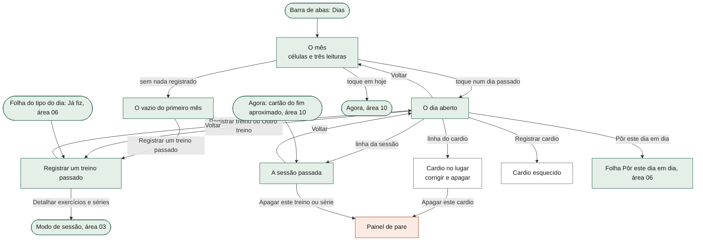

Cada tela cheia empilha sobre a anterior: o mês fica por baixo do dia, e a sessão passada e o lançamento ficam por cima do dia, porque abrem de dentro dele. O Voltar do sistema (e o Esc) fecha uma camada de cada vez e devolve a posição de leitura de onde se entrou (área 01). Quando a sessão passada ou o lançamento são abertos do Agora, da folha "Já fiz" ou do vazio do mês, não há dia por baixo e o Voltar devolve ao lugar de origem.

---

## 3. Fluxos, um por funcionalidade

### 3.1 Navegar no mês e tocar numa célula

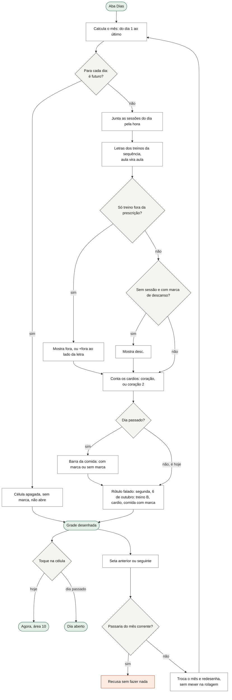

O que o diagrama não mostra: **dia sem registro fica sem nada** — o domingo não vira descanso sozinho, e a segunda sem registro não vira treino (é decisão de desenho). A célula de hoje não mostra a barra da comida (hoje ainda está acontecendo). A barra "sem marca" aparece em **todo** dia passado que não tem dia de comida interpretável, inclusive dias de antes de o app ser usado (§9, R16). A marca de descanso só aparece se o dia não tem sessão: se um treino entrar depois num dia marcado, a marca fica escondida, não apagada (§9, R7). A grade começa no domingo. Trocar de mês não sobe a página, de propósito: as setas ficam no meio da tela e quem compara três meses perderia o lugar a cada toque. Sair da aba e voltar devolve sempre o mês corrente.

### 3.2 As três leituras do mês

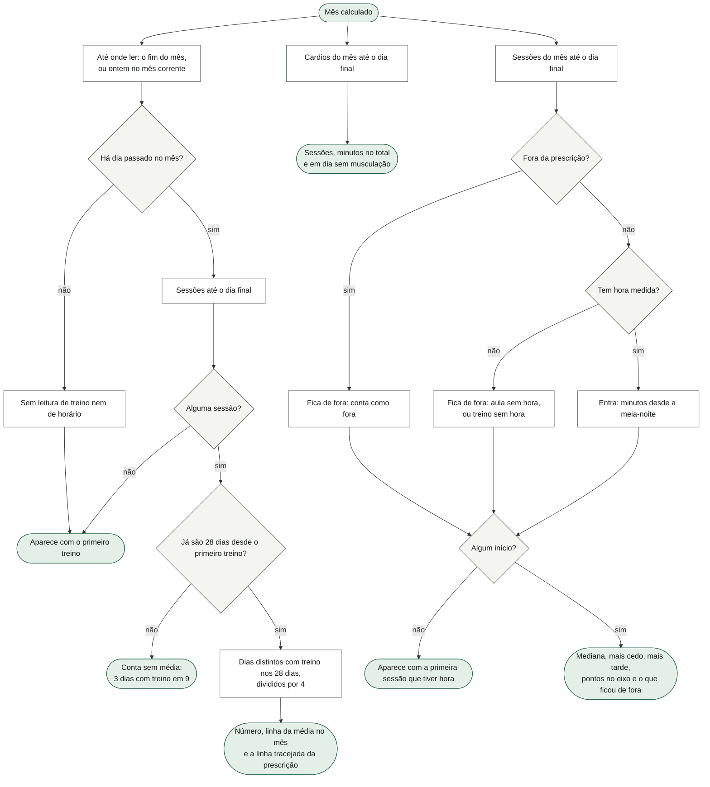

O que o diagrama não mostra:
- **Hoje nunca entra** nas leituras do mês corrente: hoje é do Agora. Por isso, no dia 1 do mês, as leituras de treino e de horário mostram o texto de "ainda não há" mesmo com histórico (§9, R4).
- A leitura de **dias com treino** não é do mês de calendário: são os 28 dias que terminam no último dia lido, e podem entrar dias do mês anterior. A unidade é o **dia**, não a sessão: dois treinos no mesmo dia contam um. Aula e treino fora da prescrição contam; descanso não. É média semanal de propósito, **nunca sequência de dias** — quem treina 5 a 6 vezes por semana quebraria a sequência todo domingo (o teste cobra que nenhuma palavra de "sequência"/"streak" apareça).
- A linha da média é desenhada com um ponto por dia do mês até o dia lido (só a partir de dois pontos); a linha tracejada é o número de treinos da sequência do programa ("6 na prescrição"), que vem da área 04. O número aparece em quartos sem casa vazia ("4,75", "4,5", "5").
- O **horário de início** usa a **mediana** (decisão do dono, 14/10): a média de outubro dava 7h56, hora em que ele nunca começou, puxada pelos treinos à tarde. Com número par de inícios, o meio entre os dois do centro. Só entra sessão com hora **medida**: o treino passado lançado sem hora não tem horário, e um 07:00 inventado já sujou esta média uma vez. O eixo vai de 5h a 22h (o que cai fora encosta na ponta) com marcas em 6h, 9h, 12h, 15h, 18h e 21h.
- O cardio "em dia sem musculação" conta o cardio em dia **sem nenhuma sessão** — aula e fora da prescrição também tiram o cardio dessa conta (§9, R20).
- Volume, séries por músculo e força **não** estão aqui de propósito: são leituras de Semana (área 09), e repetir seria dois lugares para o mesmo número.

### 3.3 Abrir um dia

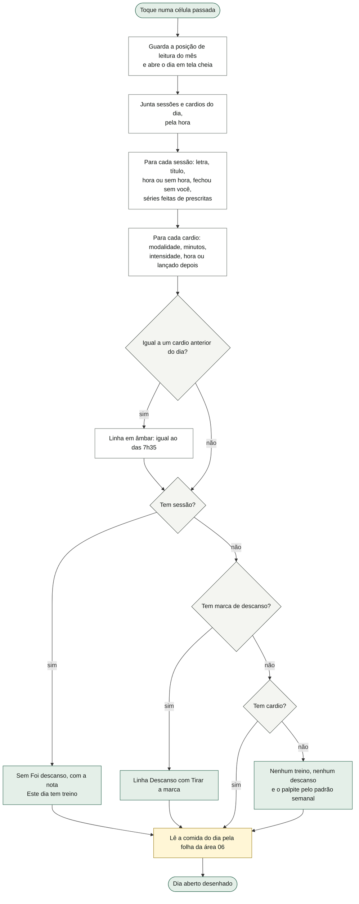

O que o diagrama não mostra: o app **aponta e não corrige** — dois cardios iguais ficam lado a lado, o segundo em âmbar, e nada sai sem ele pedir. "fechou sem você" aparece quando a sessão tem duração e o fim não foi declarado. "14 de 22 séries" conta as séries registradas da sessão contra as séries do treino **como ele está hoje no programa** (§9, R3). "depois do treino" aparece quando o cardio tem hora e alguma sessão da sequência com hora começou antes dele. O palpite diz o tipo do dia pelo padrão semanal guardado (domingo descanso e o resto treino, se ele nunca mudou; a cadência é da área 06) e sempre se diz palpite. Um dia com só cardio mostra a procedência "nada registrado" (§9, R15). Dois treinos no mesmo dia aparecem os dois, e cada linha abre a sua sessão — o app não escolhe por ele.

### 3.4 Corrigir e apagar um cardio do dia

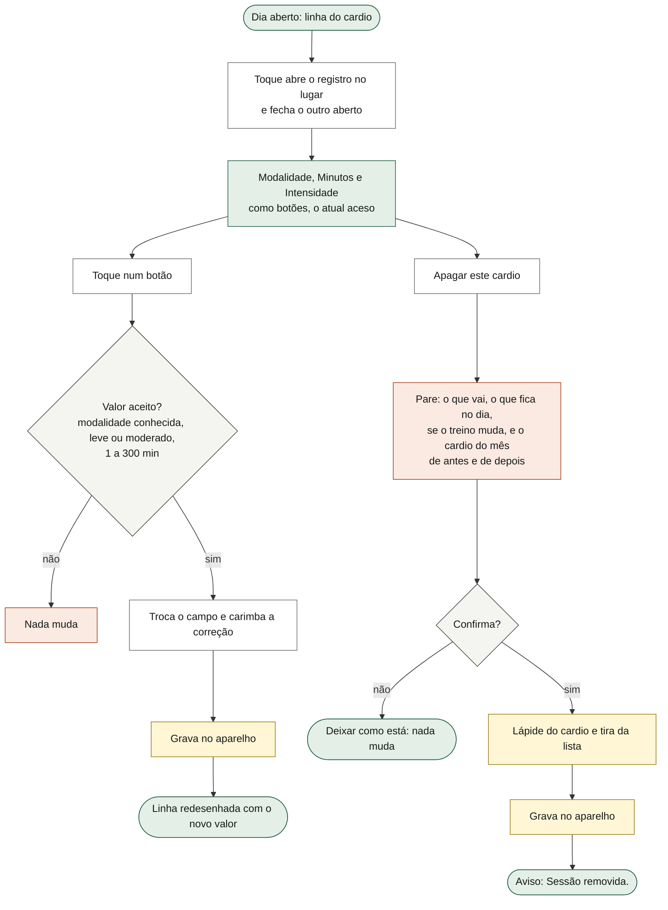

O que o diagrama não mostra: o **instante do cardio não muda** ao corrigir — é a chave dele entre aparelhos. Os minutos oferecem 20, 25, 30 e 40, e mais o valor atual se for outro (um cardio de 35 min mostra 20, 25, 30, 35, 40). O texto do pare é inteiro, por exemplo: "Apagar o cardio de qua 08/10 tira 1 sessão de cardio: 25 min de bike, moderado. Fica o cardio das 7h35, igual a este. O treino do dia não muda. O cardio de outubro passa de 3 para 2 sessões e de 75 para 50 min. Isso não tem volta." — a conta do mês nesse texto inclui o mês inteiro, e a leitura da tela vai só até ontem (§9, R5). O mesmo apagar serve ao cardio de hoje no Agora (área 10). Se a gravação falhar, a mudança fica na memória e o aviso geral de que uma gravação falhou aparece (área 01); esta tela não diz nada próprio. Não há desfazer depois do pare.

### 3.5 O cardio esquecido (registrar cardio num dia passado)

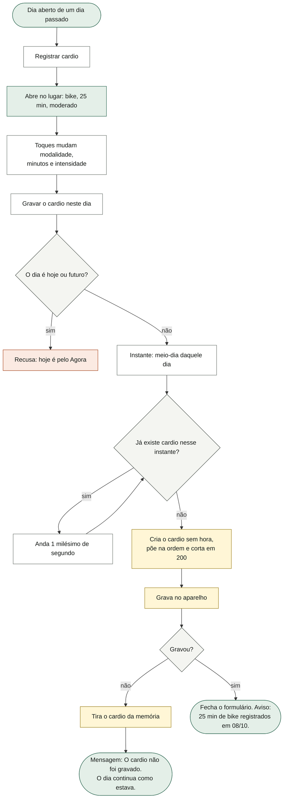

O que o diagrama não mostra: decisão do dono, 14/10. O meio-dia serve para a semana e o mês contarem o cardio no dia em que aconteceu; a hora **não foi medida**, então o cardio leva a marca "sem hora" e nenhuma tela mostra "12h00" — o dia diz "lançado depois, sem hora". Dois cardios esquecidos no mesmo dia não colidem (o segundo anda um milésimo) e o segundo diz "igual a outro deste dia". Fechar o formulário ("Fechar o cardio") ou abrir outro dia descarta a escolha, sem gravar. Só existem 20, 25, 30 e 40 min aqui; outro valor só depois, corrigindo. O teto de 200 cardios guarda os 200 mais recentes pela data: um cardio esquecido mais antigo que todos os 200 entra e sai no mesmo passo, com o aviso de sucesso (§9, R8). Hoje e o futuro não têm o botão.

### 3.6 A marca de descanso

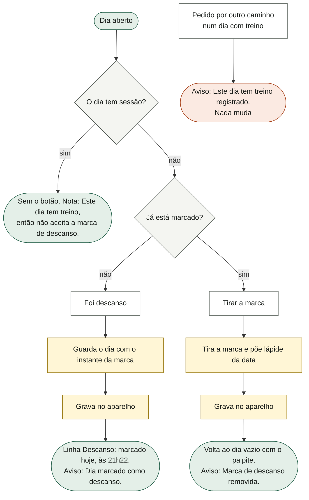

O que o diagrama não mostra: a regra é que **o fato vence** — se há treino registrado, o dia já respondeu, e as duas marcas juntas seriam o app afirmando duas coisas contrárias. Tirar a marca não passa por pare (é reversível com um toque). A marca é **só histórico**: não muda o tipo do dia da comida, a cadência, os 14 dias nem nenhuma conta ("não conta como treino em nenhuma conta"); nenhuma outra área a lê. Marcar ou desmarcar leva a página ao topo (§9, R6). Se a gravação falhar, a marca fica na memória, o aviso de sucesso aparece mesmo assim, e o aviso geral de gravação falhada (área 01) é quem diz. Entre aparelhos, desmarcar viaja como lápide e não é desfeito pelo outro aparelho que ainda tinha a marca (teste "dia marcado como descanso viaja e some quando desmarcado"). Marcas antigas sem instante (valor 1) aparecem sem o "marcado em…".

### 3.7 A comida do dia (ligação com a área 06)

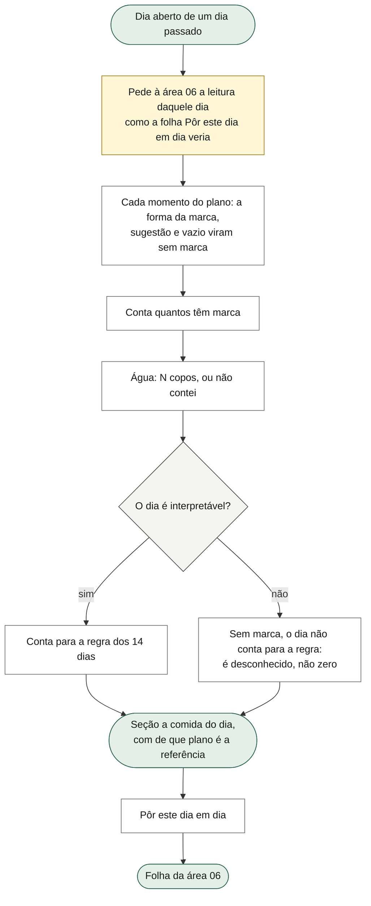

O que o diagrama não mostra: o dia mostra **a verdade do registro, nunca a sugestão da folha** — um momento que a folha pré-marcaria como sugestão aparece "sem marca". A frase do plano é "Plano de dia de treino, … É referência — o plano mora em Prescrição." O comportamento da folha, das marcas, do "dia interpretável" e da regra dos 14 dias é da área 06; a célula do mês usa o mesmo "interpretável" para a barra.

### 3.8 Abrir uma sessão passada

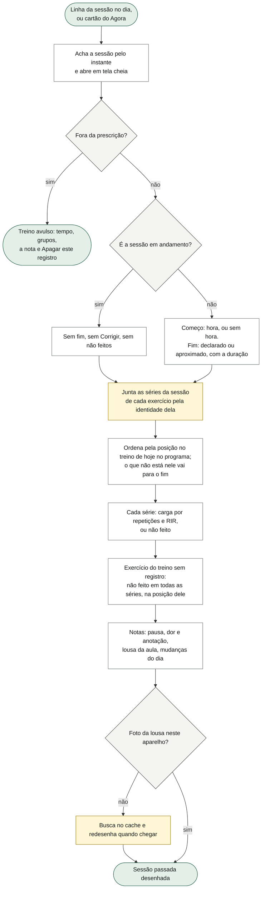

O que o diagrama não mostra: a sessão abre **como foi** — o começo e o fim, cada série na ordem em que aconteceu, com o RIR quando houve. "Não feito" **não é falha nem pendência**: não tem cor de alarme. Registros antigos sem identidade de sessão entram pela data e pelo treino. A duração descontada as pausas aparece no fim ("1h09"); o fim é o começo mais a duração mais as pausas. Saíram daqui, pelo desenho: a grade de tempo, volume e recordes, e a variação de cada exercício contra a vez anterior (são leitura de Semana e do histórico do exercício) — o app ainda os calcula e não os mostra (§9, R14) — e o cardio do dia (mora no dia aberto). A nota da aula (o quadro colado) não aparece aqui (§9, R13). Se a foto da lousa não está neste aparelho e também não vem do cache, a linha diz "A foto da lousa não está neste aparelho."

### 3.9 Corrigir o tempo da sessão passada

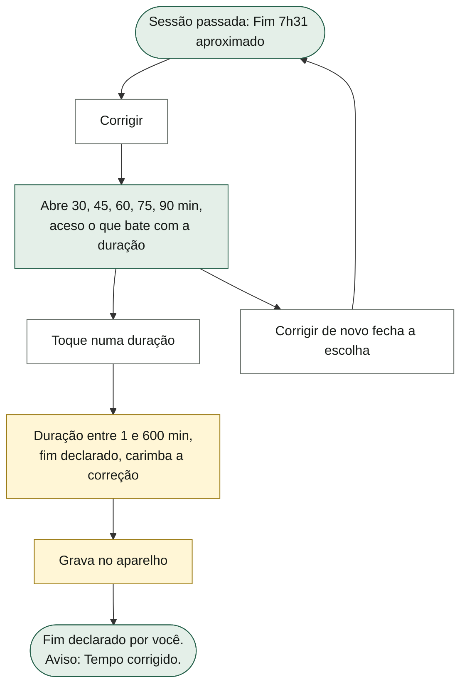

O que o diagrama não mostra: o caso é esquecer de encerrar — o app fecha sozinho e o tempo vai até a última série (área 03). Corrigir torna o tempo **declarado**, e o "aproximado" some. A outra metade da resposta, **"Está certo"** (tornar declarado sem mudar o número), mora no cartão do Agora (área 10) e usa a mesma marca de "declarado". Na sessão em andamento não há correção: o tempo ainda está correndo. Só cinco durações são oferecidas (§9, R10). Não há correção da **hora de início** aqui (§9, R9). Corrigir também vale para treino passado sem duração ("não medido").

### 3.10 Corrigir uma série no lugar

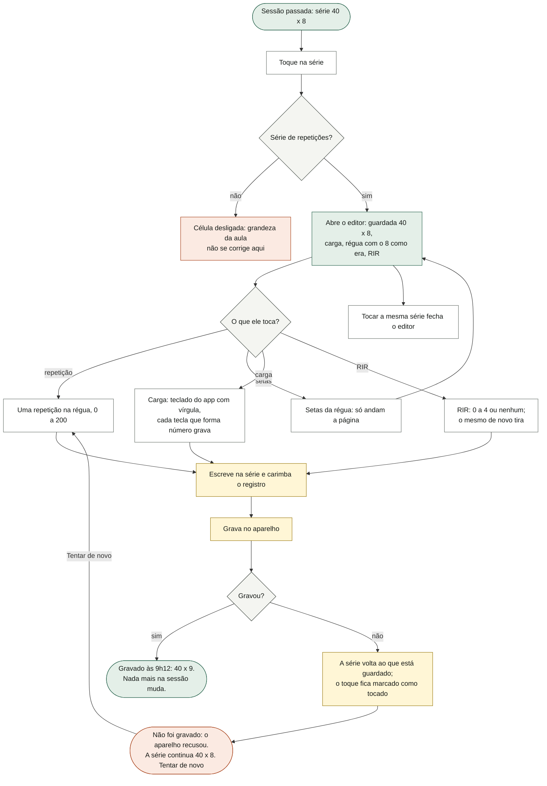

O que o diagrama não mostra: a régua é **a mesma da academia** (área 03), porque o dado é o mesmo; abre na vizinhança do valor guardado, com a faixa do treinador ("repetições · faixa 8-12"). **Cada toque grava** (decisão de desenho), e a tela nunca finge que gravou: na recusa, o número guardado continua o da tela e o valor tocado fica à parte, marcado como "tocado". O registro é achado **pela identidade da sincronia** (exercício, sessão e posição), não pela posição na lista — a lista do exercício pode ganhar uma entrada vinda do outro aparelho entre abrir e gravar (há teste). O teclado escreve a cada tecla: "42," não grava (é digitação no meio), "42,5" grava; carga zero ou vazia não grava (§9, R11). "Tentar de novo" repete a repetição tocada — depois de uma falha de RIR ou de carga, ele grava **0 repetições** (§9, R2). Abrir a carga fecha o RIR e vice-versa. Só uma série aberta por vez em toda a sessão.

### 3.11 Lançar a série que não foi registrada

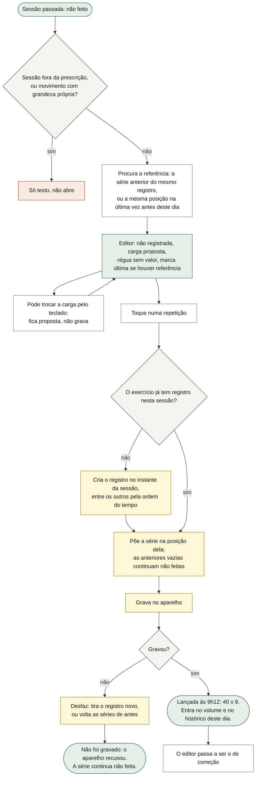

O que o diagrama não mostra: o registro novo entra **na ordem do tempo** e não no fim da lista, porque o fim é a "última vez" que a próxima sessão usa como referência — uma entrada antiga no fim viraria a referência de amanhã. Sem referência nenhuma, a régua abre na base da faixa do treinador (ou em 10), a carga proposta é 0 e o editor diz "sem referência". Lançar a série 3 com a 2 vazia deixa a 2 "não feita" (há teste). Na série não registrada não há RIR nem apagar: só depois de lançada.

### 3.12 Apagar uma série, apagar o treino

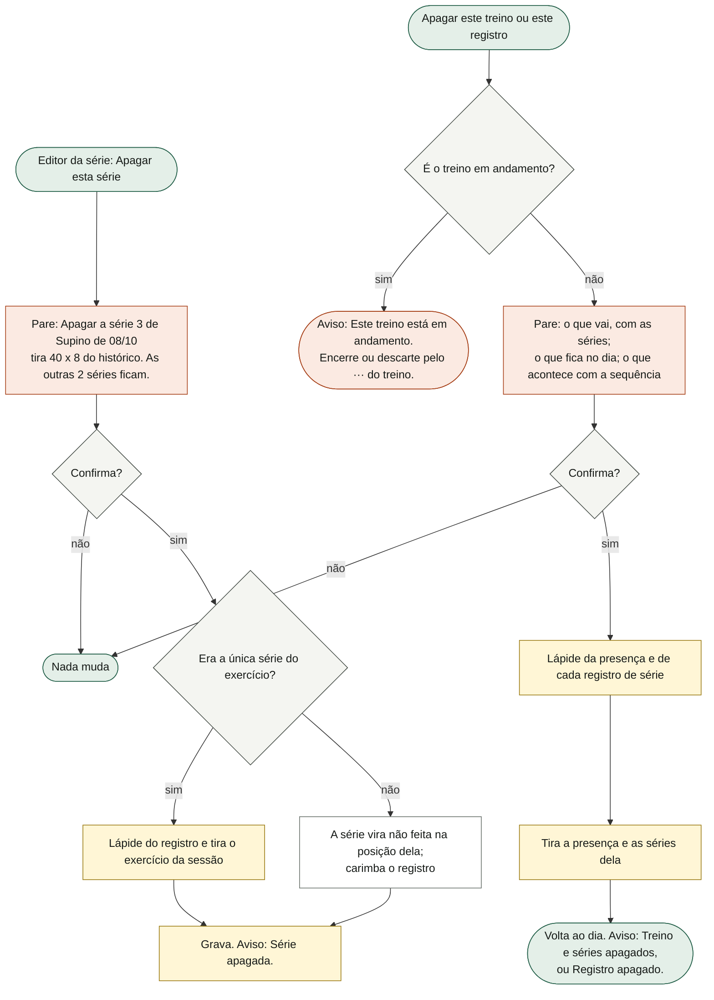

O que o diagrama não mostra: todo apagar passa pelo pare (decisão de desenho), e o pare diz **o que fica**, com número, para ele conferir que está apagando o de cima e não o de baixo. O texto do treino é inteiro, por exemplo: "Apagar o Treino B de quarta, 08/10 tira 1 sessão, aberta às 6h22, com 14 séries. Fica a aula das 9h00, com 8 séries. A sequência volta um passo: o último registrado passa a ser o Treino A de 07/10. Isso não tem volta, e vale para os outros aparelhos." As variantes da sequência: "A sequência não muda: treino fora da prescrição não conta nela."; "A sequência não muda: o último registrado continua sendo…"; "…não sobra treino registrado, e o próximo volta a ser o primeiro." A **presença e as séries vão juntas**: apagar só a presença deixaria séries órfãs contando volume e puxando progressão. As lápides impedem que o outro aparelho traga de volta (área 02). As fotos da lousa daquela aula não são apagadas do aparelho (área 05). Não há desfazer.

### 3.13 Registrar um treino passado: o toque que grava

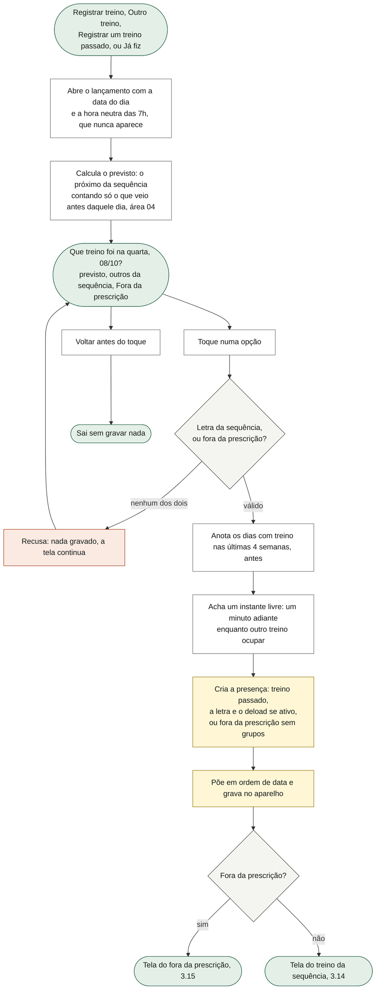

O que o diagrama não mostra: a folha pergunta **uma coisa só** — que treino foi — e o toque **já é o registro** (decisão 1: cada toque grava); hora, séries, grupos e duração vêm depois, se ele quiser, e cada um corrige o registro que já existe. A data é a do dia de onde abriu (o mês escolhe o dia); não há escolha de data aqui. "Foi descanso" não mora nesta folha: mora no próprio dia, com o mesmo peso de "Registrar treino" (e o verbo recusa "descanso" como letra; há teste). O previsto é calculado "naquele dia", não hoje: lançar a quarta passada propõe o que vinha depois do último treino antes da quarta (há teste). Dois treinos sem hora no mesmo dia não colidem: o segundo anda um minuto (o instante é a identidade do registro entre aparelhos). Pela porta "Já fiz" (área 06) a data é hoje, e o lançamento é o mesmo. Se a gravação falhar, a presença fica na memória e o aviso geral de gravação (área 01) aparece; esta tela não tem frase própria de falha.

### 3.14 Depois do toque: a hora, as séries e a sequência

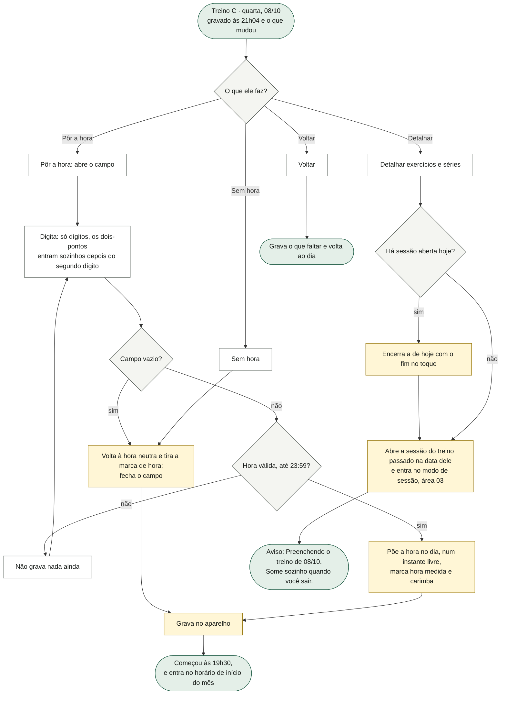

O que o diagrama não mostra:
- **Nenhuma hora é inventada** (F270): sem hora, o treino conta como dia com treino e não entra no horário de início. A hora neutra das 7h só ordena e nunca é mostrada ("sem hora" no dia, nada de "7h00 fantasma"; há teste).
- A frase do que mudou só aparece quando o número das últimas 4 semanas mudou ("dias com treino nas últimas 4 semanas: 19, eram 18"); um treino lançado num dia que já tinha treino, ou há mais de 28 dias, ou hoje, não muda o número.
- "A sequência anda" quando este registro é o último treino da sequência registrado; senão "A sequência não muda" e diz qual continua o último. A regra é da área 04.
- **Detalhar** abre o modo de sessão (área 03) com uma sessão de treino passado: as séries entram na data dele, não hoje; o Agora e o modo mostram o aviso âmbar "preenchendo treino passado · As séries que você digitar entram em quarta, 08 de outubro, não em hoje." com **"Concluir"**. Concluir fecha a sessão sem inventar duração ("Treino de 08/10 concluído."). Sem Concluir, ela fecha sozinha depois de 90 minutos sem toque ou na virada do dia de uso, e o que foi preenchido fica. Só pode existir uma sessão aberta: a de hoje é encerrada antes, com o tempo gravado (há teste), e o aviso diz "Treino A de hoje encerrado. Agora preenchendo 08/10."
- Aberto a partir do dia aberto, o "Detalhar" deixa o dia por cima do modo de sessão (provável bug, §9, R1).
- A hora só se corrige aqui, logo depois do toque: a sessão passada não oferece correção da hora de início (§9, R9). Uma hora já ocupada por outro treino anda um minuto em silêncio.

### 3.15 Fora da prescrição: grupos, duração e nome

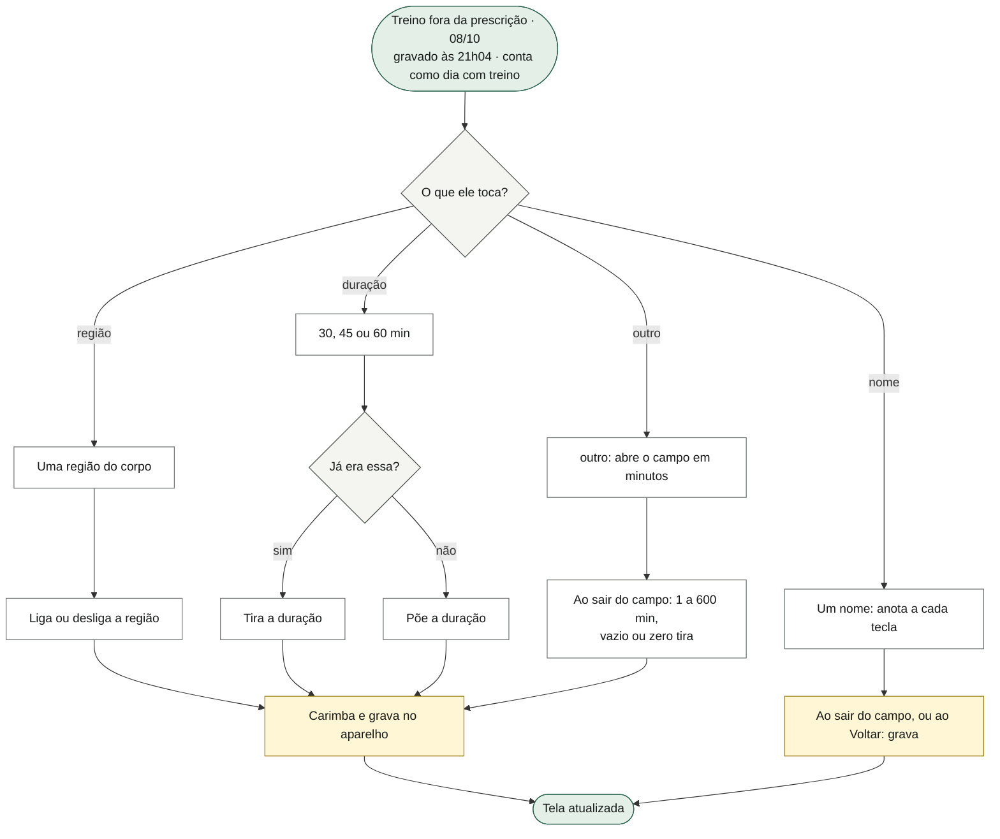

O que o diagrama não mostra: as regiões são as do corpo que o produto já conhece (peito, ombro, costas, perna, panturrilha, braço, abdômen) e **não** os músculos finos do plano — de um treino fora dele ninguém sabe o "delt lateral". O fora da prescrição é **presença**: sem séries, não mexe na sequência, não entra na conta das 48 sessões do bloco e não entra no horário de início; conta como dia com treino na média e no calendário. Depois que a folha fecha, nada disso se corrige: a tela da sessão só oferece "Apagar este registro" (§9, R9).

### 3.16 O vazio do primeiro mês

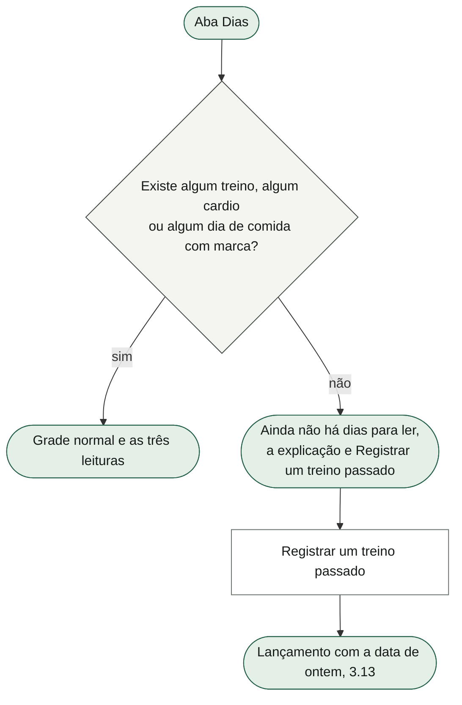

O que o diagrama não mostra: no vazio, **nada vira zero** — cada leitura diz quando aparece em vez de mostrar 0. A única oferta é a que o primeiro dia pede, e ela abre sempre ontem; para outra data, ele toca no dia na grade. Um descanso marcado sozinho não tira do vazio (não entra na pergunta).

### 3.17 A correção pelo histórico do exercício (ligação com a área 04)

O histórico de um exercício (área 04, §3.19 de lá) mostra as últimas 6 sessões e corrige uma delas inteira num formulário: carga e repetições de cada série, as dores e a observação, com "Salvar correção" (recusa deixar sem série: "Uma sessão sem nenhuma série. Use apagar se foi engano.") e "Apagar esta sessão" (pare "Apagar o registro de DD/MM tira N séries do histórico de X. Isso não tem volta."). É **o mesmo dado** que a sessão passada corrige no lugar — o registro daquele exercício naquela sessão —, com o mesmo carimbo e a mesma lápide. As diferenças: o histórico corrige por formulário e alcança só 6 sessões; a sessão passada corrige série a série, sem limite de data, e lança o que não foi registrado. Apagar pelo histórico tira só o exercício daquele dia; a presença continua (e o dia continua com treino). O fluxo completo está na área 04.

---

## 4. Estados da tela

**O mês**

| estado | quando acontece | o que a tela mostra |
|---|---|---|
| Vazio do primeiro mês | Nenhum treino, nenhum cardio, nenhum dia de comida com marca. | "Ainda não há dias para ler", a explicação, "Registrar um treino passado"; as leituras com o texto de quando aparecem. |
| Mês corrente | Mês de hoje. | Título "· até ontem, DD/MM"; "›" desligada; leituras até ontem; hoje com destaque, abre o Agora; futuro apagado. |
| Dia 1 do mês corrente | Ainda não há dia passado no mês. | Título sem "até ontem"; leituras de treino e horário com o texto de "ainda não há"; cardio "Nenhum cardio registrado." |
| Mês passado | Depois de "‹". | Título só com mês e ano; leituras até o último dia do mês; "›" ligada. |
| Menos de 4 semanas de histórico | Primeiro treino há menos de 28 dias do dia lido. | "3 dias com treino em 9. A média usa as últimas 4 semanas, e ainda não há 4." sem número grande nem linha. |
| Com média | 28 dias ou mais. | Número em quartos, linha da média com a da prescrição tracejada, a conta. |
| Sem cardio no mês | — | "Nenhum cardio registrado." |
| Sem sessão com hora | Só treinos sem hora, fora da prescrição, ou nenhum. | "Aparece com a primeira sessão que tiver hora." |
| Célula com dois treinos | Dois registros da sequência no dia. | "B D". |
| Célula com treino e fora | — | "B" e "+fora". |
| Célula com descanso | Marca e nenhuma sessão. | "desc." com o estilo do descanso. |

**O dia aberto**

| estado | quando acontece | o que a tela mostra |
|---|---|---|
| Dia de treino | Uma ou mais sessões. | Procedência "dia de treino, pela sessão registrada"; linhas das sessões; "Outro treino"; a nota de que não aceita descanso. |
| Dia de descanso | Marca e nenhuma sessão. | "descanso, marcado por você"; linha Descanso com "Tirar a marca"; "Registrar treino". |
| Dia vazio | Nada. | "nada registrado"; "Nenhum treino, nenhum descanso" e o palpite; "Registrar treino", "Foi descanso", "Registrar cardio". |
| Dia só com cardio | Cardio e nada mais. | "nada registrado" na procedência; a linha do cardio; sem o vazio. |
| Cardio aberto | Toque na linha. | Os três grupos de botões e "Apagar este cardio". |
| Cardio igual | Segundo cardio com mesma modalidade, minutos e intensidade. | Linha em âmbar com "igual ao das 7h35". |
| Cardio esquecido aberto | "Registrar cardio". | Os botões, "Gravar o cardio neste dia", a nota "Entra sem hora…"; botão vira "Fechar o cardio". |
| Cardio esquecido recusado | O aparelho recusou a gravação. | "O cardio não foi gravado: o armazenamento deste aparelho recusou. O dia continua como estava." |
| Comida do dia | Dia passado. | Os momentos com as formas, "N de M com marca" ou "nenhuma com marca", água, a regra, o plano de referência, "Pôr este dia em dia". |

**A sessão passada**

| estado | quando acontece | o que a tela mostra |
|---|---|---|
| Fim declarado | Encerrada no toque, ou já corrigida/confirmada. | "Fim 7h31 · declarado por você · 1h09". |
| Fim aproximado | O app fechou sozinho. | Fim em estilo de aproximado, "aproximado: fechou sem você, na última série · 1h09", "Corrigir". |
| Sem hora de início | Treino passado lançado sem hora. | "Começo sem hora · registrado depois, sem a hora de início"; fim com a duração ou "não medido · a duração não foi medida". |
| Em andamento | A sessão aberta agora. | Só o começo; sem Corrigir; sem os não feitos; apagar recusado. |
| Corrigindo o tempo | "Corrigir". | Botões 30 a 90 min e a nota "Hoje está…". |
| Sem séries | Presença sem registro de série. | "Nenhuma série registrada neste dia. Só a presença." e os não feitos do programa. |
| Série aberta | Toque numa série. | Editor com guardada, carga, faixa, régua, RIR, apagar. |
| Gravado | Toque gravou. | "Gravado às 9h12: 40 × 9. Nada mais na sessão muda." |
| Não feito aberto | Toque num não feito. | "não registrada · a carga vem da série de referência" ou "sem referência", régua sem valor, "um toque lança". |
| Lançado | Toque na régua do não feito gravou. | "Lançada às 9h12: 40 × 9. Entra no volume e no histórico deste dia." |
| Recusado | O aparelho recusou. | "tocado" na régua, "Não foi gravado: o aparelho recusou…", "Tentar de novo". |
| Teclado da carga | Toque na carga. | Teclado do app com vírgula, por baixo do cabeçalho do editor. |
| Lousa sem bytes | Foto da lousa de outro aparelho. | "A foto da lousa não está neste aparelho." |
| Treino avulso | Fora da prescrição. | Tempo, grupos, nota "Fora do plano…", "Apagar este registro". |

**Registrar um treino passado**

| estado | quando acontece | o que a tela mostra |
|---|---|---|
| Antes do toque | Ao abrir. | A pergunta, o previsto, "Outro da sequência", "Fora da prescrição", "Um toque grava a presença…"; procedência "já tem treino B" ou "nada registrado". |
| Treino da sequência gravado, sem hora | Depois do toque. | "gravado às…", "Sem hora" aceso, "Sem hora, este treino conta como dia com treino…", "Detalhar…", a frase da sequência. |
| Com hora | Hora válida digitada. | "Pôr a hora" aceso, o campo com "19:30", "Começou às 19h30, e entra no horário de início do mês." |
| Fora da prescrição gravado | Depois do toque em "Fora da prescrição". | Regiões, durações, nome, a nota de que não mexe na sequência. |
| Duração "outro" | Toque em "outro", ou duração fora de 30/45/60. | "outro" aceso e o campo em minutos. |

---

## 5. Dados

### O que esta área GUARDA

| campo | formato | quem mais lê |
|---|---|---|
| `S.descanso` | Mapa de data local para o instante da marca: `{ '2026-10-08': 1760000000000 }`. Valor `1` em marcas antigas (sem instante). | Ninguém além de Dias (mês e dia aberto). Sincronia (área 02) funde. |

### O que esta área ESCREVE em dados de outras

| campo | o que escreve aqui | dono e outros leitores |
|---|---|---|
| `S.done[]` (a presença) | Lançamento: `{ t, sid: t, retro: 1, m, day, dl?: 1 }` ou `{ t, sid: t, retro: 1, m, livre: 1, grupos: [região], dur?, nome? }`; `hora: 1` quando a hora foi medida (então `t` é a hora real); correção do tempo: `dur` (ms, 1 a 600 min), `fim: 'manual'`, `m`; apagar: remove e põe lápide. | Dono: área 03 (sessão). Leem: 04 (sequência, 48 sessões), 09, 10, 06 (duração do treino). |
| `S.logs[exercício][]` (as séries) | Correção no lugar: a série `[carga, reps, rir?]` e `m`; série apagada vira `null`; a última série leva o registro (lápide); série lançada cria `{ t: início da sessão, sid, sets, dl?, m }` na ordem do tempo. Apagar o treino remove todos os registros daquela sessão (lápides). | Dono: área 03. Leem: 04 (histórico, progressão), 09 (força, volume), 05 (aula). |
| `S.cardio[]` | Cardio esquecido: `{ t: meio-dia do dia (+1 ms se ocupado), m: modalidade, min, i: intensidade, alt: carimbo, semHora: 1 }`; correção: `m`, `min` ou `i` e `alt`; apagar: remove e lápide. Teto de 200 (os mais recentes pela data). | Dono comum com a área 10 (cardio de hoje). Leem: 09 (semana), 10. |
| `S.apagados` | Lápides: `done:<sid>`, `log:<exercício>:<sid>:<posição>`, `cardio:<t>`, `descanso:<data>`. | Área 02. |
| `S.sessao` | "Detalhar exercícios e séries" cria `{ day, inicio: t do registro, ultima, sid, retro: 1, tocado, pausas: [], pulados: [] }` e zera `S.draft`. | Dono: área 03. |

### O que esta área só LÊ

| dado | para quê | dono |
|---|---|---|
| `S.prog`, `S.rot`, `S.mods`, catálogo (`S.ex`) | Letra e nome do treino, se é aula, a prescrição de cada exercício, a ordem, os não feitos, "X de Y séries", o número de treinos da sequência (linha tracejada), as faixas da régua. | 04 (e `S.mods` da 03) |
| `proximoTreino`, `ultimaDoPlano` | O previsto naquele dia; se a sequência anda ou volta. | 04 |
| `S.comidaHist`, a leitura da folha "pôr em dia", "dia interpretável" | A barra da célula e a comida do dia. | 06 |
| `S.cadencia` | O palpite do dia vazio. | 06 |
| `S.deload` | Marca o treino lançado como deload. | 03 |
| `S.carga` | A unidade da carga no editor ("kg"). | 03 |
| `S.done[].lousa`, cache da lousa | A foto no detalhe. | 05 |
| `S.done[].mods`, `pausado`, `ini`, `fim`, `dur` | Notas, começo e fim. | 03 |

### Estado de tela (não guardado)

`view.mes` (0 = mês corrente, negativo = meses atrás; volta a 0 ao trocar de aba), `view.diaAberto` (instante do meio-dia do dia aberto), `view.cardioAberto` (instante do cardio aberto no lugar), `view.cardioNoDia` (`{ m, min, i }` do cardio esquecido em escolha), `view.cardioNoDiaFalhou` (frase da recusa), `view.sessao` (a presença aberta no detalhe), `view.corrigeTempo` (instante da sessão com a correção do tempo aberta), `view.passada` (a série aberta: `{ idEx, chave, k, foco, era, novo?, carga?, ref?, gravado, tocado, rir }`), `view.teclado` com alvo `passada`, `view.add` (o lançamento: `{ t, sid, antes, horaAberta, hora, durAberta, gravadoEm }`). Da ligação com a 04: `view.hist`, `view.edit`.

Nada disso sobrevive a fechar o app: reabrir cai no lugar inicial (área 01). O que já foi tocado já está gravado — cada toque grava —, então fechar no meio de um lançamento ou de uma correção não perde o registro; perde só a escolha ainda não tocada (o cardio esquecido em escolha, a hora digitada pela metade). O nome do fora da prescrição é gravado ao sair do campo e, por garantia, ao fechar a folha.

### Como cada dado atravessa a sincronia (área 02)

| dado | forma | chave | carimbo | apagar |
|---|---|---|---|---|
| Presença `S.done` | Coleção com chave; vence o carimbo maior; teto 3000. | `done:<sid>` (o `sid` não muda quando a hora é corrigida). | `m` | Lápide `done:<sid>`. |
| Séries `S.logs` | Coleção por exercício; vence o registro inteiro com carimbo maior; teto 500 por exercício. | `log:<exercício>:<sid>:<posição de origem>` | `m` | Lápide. |
| Cardio `S.cardio` | Coleção com chave; teto 200. | `cardio:<t>` (o instante nunca muda na correção). | `alt` (porque `m` é a modalidade) | Lápide `cardio:<t>`. |
| Descanso `S.descanso` | Mapa de data; vence o instante maior. | `descanso:<data>` | o próprio instante da marca | Lápide `descanso:<data>`; marcar de novo depois da lápide vence. |

Lápides valem 90 dias (área 02): um aparelho que ficar mais tempo sem sincronizar pode trazer de volta o que foi apagado. Corrigir duas séries diferentes do mesmo exercício na mesma sessão em dois aparelhos: vence o registro com carimbo maior, inteiro, e a outra correção se perde (§9, R19). Sem rede, tudo funciona igual: grava no aparelho e a nuvem recebe depois.

---

## 6. Regras

1. **O dia é a unidade, não a sessão.** "Dias com treino" conta dias distintos; dois treinos no mesmo dia contam um (o caso comum de abrir um treino por engano e depois o certo). Aula conta (é o sexto treino); fora da prescrição conta (é presença); descanso não conta. *Desenho, F21/F35/F157.*
2. **Média móvel de 4 semanas, nunca sequência de dias.** Dias com treino nos últimos 28 dias (o dia final incluso) divididos por 4. Quem treina 5 a 6 vezes por semana quebraria sequência todo domingo, e o número puniria o descanso que o programa manda. *Desenho, F22.*
3. **Sem média antes de 4 semanas.** Até 28 dias desde o primeiro treino, a conta vem sem média ("3 dias com treino em 9"), porque dividir 9 dias por 4 semanas diria que ele treinou menos. Sem treino, nenhuma leitura vira zero. *Desenho, estado 15.*
4. **As leituras do mês corrente vão até ontem.** Hoje ainda está acontecendo, e é do Agora. *Desenho.*
5. **Horário de início pela mediana.** Com número par, o meio entre os dois do centro. *Decisão do dono, 14/10.*
6. **Só hora medida entra no horário.** Treino passado sem hora, aula sem hora e fora da prescrição ficam de fora, e a tela diz quantos. Nenhuma hora é inventada (o 07:00 inventado já sujou a média). *Desenho, F270.*
7. **Tem hora** = não é fora da prescrição e (foi aberto ao vivo, ou foi lançado com a hora posta).
8. **Dia sem registro fica vazio.** Nada de presumir descanso no domingo ou treino na segunda. O tipo do dia pelo padrão semanal só aparece como **palpite** e se diz palpite. *Desenho.*
9. **O fato vence a marca.** Dia com treino não aceita marca de descanso, e diz por quê. *Desenho, F156.*
10. **O descanso não conta em nenhuma conta.** É histórico, não muda tipo do dia, cadência, 14 dias nem leitura. *Desenho.*
11. **Hoje abre o Agora; o futuro não abre.** O cardio esquecido e o lançamento pela grade são para dias passados (o lançamento de hoje vem do "Já fiz", área 06). *Desenho; decisão do dono 14/10 para o cardio.*
12. **Cardio esquecido: meio-dia, sem hora.** Instante ao meio-dia (a semana e o mês contam no dia certo), marca "sem hora", +1 ms se ocupado. Opções: modalidade bike, esteira inclinada, elíptico, remo; 20, 25, 30, 40 min; leve ou moderado; começa em bike, 25, moderado. *Decisão do dono, 14/10.*
13. **Correção do cardio no lugar**: modalidade da lista, intensidade leve ou moderado, minutos inteiros de 1 a 300. O instante não muda. *Desenho, estado 12.*
14. **O app aponta e não corrige.** Cardio igual a outro do mesmo dia (mesma modalidade, minutos e intensidade) fica marcado em âmbar; nada sai sem ele. *Desenho.*
15. **Todo apagar passa pelo pare** e diz o que vai, o que fica (com número) e o efeito (no mês, na sequência). Não tem volta e vale para os outros aparelhos. *Decisão 8 do desenho.*
16. **Apagar o treino leva a presença e as séries juntas.** Séries órfãs contariam volume e puxariam progressão. *F295.*
17. **O treino em andamento não se apaga nem se corrige o tempo** pelo detalhe. *Desenho.*
18. **Corrigir o tempo**: 30, 45, 60, 75 ou 90 min na tela; a função aceita 1 a 600 min; o fim passa a declarado. *F152, F295.*
19. **Cada toque grava** — na série passada, no lançamento, no cardio. A tela diz o que foi gravado, com a hora. *Decisão 1 do desenho.*
20. **Na recusa do aparelho, a tela não finge.** A série volta ao guardado e o toque fica dito como "tocado"; o cardio esquecido sai da memória. *Desenho, estado 14.*
21. **Régua da série passada**: repetições inteiras de 0 a 200; RIR de 0 a 4 (o mesmo de novo, ou "nenhum", tira); carga pelo teclado do app com uma casa decimal, maior que zero.
22. **Não feito não é falha nem pendência**: fica na posição, sem cor de alarme, e pode ser lançado "se você fez". Referência da carga: a série anterior do mesmo registro, ou a mesma posição na última vez antes daquele dia, ou a última série dela. *Desenho, P2.*
23. **A série que nasce entra na ordem do tempo**, para não virar a "última vez" de amanhã.
24. **Apagar uma série deixa as outras na posição**; a única leva o registro do exercício (com lápide).
25. **Lançamento: um toque grava a presença.** O previsto é o próximo da sequência **naquele dia** (contando só o que veio antes dele). Só letras da sequência ou "fora da prescrição" são aceitas. *Desenho, estados 6 a 8.*
26. **Hora neutra das 7h**, nunca mostrada, para ordenar o treino sem hora; dois registros no mesmo instante andam um minuto.
27. **Hora do lançamento**: "HH:MM" de 00:00 a 23:59; vazio volta a sem hora; inválida não grava.
28. **Fora da prescrição** grava presença, regiões do corpo, duração (30/45/60 ou outro, 1 a 600 min) e um nome; não mexe na sequência, não entra nas 48 e não entra no horário. *F155, F178.*
29. **Treino lançado em deload** ganha a marca de deload (fica fora da conta das 48, área 04).
30. **Sessão de treino passado** (Detalhar) fecha por "Concluir", por 90 minutos sem toque ou na virada do dia de uso, sem gravar duração. Abrir uma encerra a de hoje antes, com o tempo. *Área 03 para o ciclo; aqui a entrada.*

---

## 7. Ligações com as outras áreas

| área | o que esta recebe dela | o que esta entrega a ela |
|---|---|---|
| 01 · Fundação | Gravar (`save`), o aviso de gravação falhada, o painel de pare, o aviso curto, a tela cheia, a pilha de camadas e o Voltar, a posição de leitura. | Os destinos "dia", "sessão" e "lançamento" na pilha; os textos de pare de apagar treino, série e cardio. |
| 02 · Sincronia | A fusão das coleções e das lápides; o cardio e as presenças vindos do outro aparelho. | Lápides `done`, `log`, `cardio`, `descanso`; carimbos `m` e `alt` das correções; o mapa de descanso. |
| 03 · Sessão de treino | A presença e as séries que a sessão grava; o fim aproximado ou declarado; a régua e o teclado; o modo de sessão. | A sessão de treino passado aberta por "Detalhar"; a correção do tempo depois do fecho automático; as correções das séries passadas. |
| 04 · Programa | O treino de cada letra (nome, etiqueta, exercícios, faixas, se é aula), o tamanho da sequência, o próximo treino e o último da sequência; o histórico do exercício (a outra porta de correção). | Treinos passados lançados (que movem ou não a sequência), séries corrigidas e lançadas que entram no histórico e na progressão. |
| 05 · Aula do box | A presença da aula, a foto da lousa e o cache dela. | O detalhe mostra "Aula" e a lousa; a aula pode ser lançada num dia passado. |
| 06 · Comida | A leitura de um dia passado (a folha de pôr em dia), o histórico de comida, "dia interpretável", a cadência para o palpite, a porta "Já fiz" que abre o lançamento de hoje. | A porta "Pôr este dia em dia" no dia aberto; a barra da comida na célula. |
| 09 · Semana | — | Presenças, séries e cardios corrigidos ou acrescentados (entram no volume, na força e no cardio da semana). |
| 10 · Agora | A porta da célula de hoje; o cartão do fim aproximado que abre a sessão passada; o cardio de hoje (mesma lista). | O detalhe da sessão para corrigir o fim; o apagar de cardio com pare (usado também no Agora); "Está certo" (confirmar a duração) é verbo comum. |

---

## 8. Como serviço individual

**Nome:** Diário (o histórico por dia).

**O que ele possui (dados):**
- O mapa de descanso (`S.descanso`) e as lápides dele.
- As leituras do mês (projeções calculadas, sem dado próprio): dias com treino, cardio do mês, horário de início.

**O que ele não possui, mas é o único escritor de correções de passado:** presenças passadas, séries passadas e cardio de dias passados pertencem aos serviços de Sessão (03) e de Cardio (hoje dividido entre 10 e 11). O Diário pede as escritas a eles; hoje escreve direto no estado.

**Operações (como uma API):**

| verbo | recebe | devolve |
|---|---|---|
| `lerMes` | mês (ano, mês), "hoje" | células (dia, letras, fora, descanso, cardios, comida, rótulo, abre) e as três leituras com as contas em texto |
| `lerDia` | data | registros (sessões e cardios pela hora, com "igual a"), descanso, palpite, permissões (pode descanso, pode cardio), comida do dia |
| `lerSessaoPassada` | id da sessão | começo, fim (declarado/aproximado), exercícios com séries e não feitos, notas, lousa, mudanças |
| `marcarDescanso` / `tirarDescanso` | data | o dia atualizado, ou recusa "dia com treino" |
| `lancarTreinoPassado` | data, letra ou "fora" | a presença criada, o efeito na conta das 4 semanas e na sequência |
| `corrigirLancamento` | id, hora / regiões / duração / nome | a presença corrigida |
| `abrirPreenchimento` | id da presença | a sessão de treino passado aberta (delegado à Sessão) |
| `corrigirDuracao` / `confirmarDuracao` | id, minutos | a presença com fim declarado |
| `corrigirSerie` | id do registro, posição, carga / reps / RIR | a série gravada, ou "recusado" com o valor guardado |
| `lancarSerie` | sessão, exercício, posição, carga, reps | o registro criado ou estendido |
| `apagarSerie` | id do registro, posição | o efeito (as que ficam, ou o exercício que sai) |
| `apagarTreino` | id da presença | o efeito (séries que vão, o que fica, a sequência) |
| `lancarCardioPassado` | data, modalidade, minutos, intensidade | o cardio criado, ou recusa |
| `corrigirCardio` / `apagarCardio` | id do cardio, campo, valor | o cardio corrigido / o efeito no mês |
| `textoDoApagar` | o que se quer apagar | a frase do pare (para a interface pedir confirmação antes) |

**Eventos que emitiria:** `DescansoMarcado`, `DescansoDesmarcado`, `TreinoPassadoLancado`, `LancamentoCorrigido`, `DuracaoDeclarada`, `SeriePassadaCorrigida`, `SeriePassadaLancada`, `SeriePassadaApagada`, `TreinoApagado`, `CardioPassadoLancado`, `CardioCorrigido`, `CardioApagado`.

**Eventos que escutaria:** `SessaoEncerrada` e `SerieRegistrada` (03), `ProgramaMudou` e `SequenciaMudou` (04), `DiaDeComidaGravado` (06), `CardioRegistrado` (10), `FusaoConcluida` (02) — para refazer as leituras.

**O que hoje está acoplado e precisaria ser separado:**
- O dia aberto pede à área 06 **o modelo de tela de uma folha** (`poeODiaEmDia`) para saber a comida do dia; precisaria de uma leitura própria "comida de um dia passado".
- O detalhe e o dia leem o **programa atual** (com as mudanças de hoje da mesma letra) para prescrição, ordem e não feitos; um serviço precisaria da prescrição **daquele dia** (versão do programa na data).
- O previsto naquele dia chama `proximoTreino` com um estado falso (as presenças cortadas na data); a área 04 deveria oferecer "próximo treino na data X".
- O cardio está dividido entre o Agora (hoje) e Dias (passado), com o mesmo apagar e listas separadas de opções; um serviço de Cardio único resolveria.
- A correção da série passada reusa a régua e o teclado do modo de sessão pelo mesmo `view.teclado` (alvo "passada"); a interface de entrada numérica deveria ser componente sem estado global.
- A ordem de desenho das telas cheias e a pilha de camadas estão em `main.jsx` e `navegacao.js` (área 01), e é por isso que "Detalhar" a partir do dia deixa o dia por cima (§9, R1).
- O detalhe calcula campos que a tela não usa (estatísticas, recordes, itens, pendências): um contrato de leitura enxuto separaria o que é do Diário do que é da Semana e do histórico.
- Gravar é o estado inteiro de uma vez (`save`); cada operação acima viraria uma escrita da coleção do dono.

---

## 9. Riscos e dívidas que apareceram na leitura

- **R1 · "Detalhar exercícios e séries" a partir do dia aberto mostra o dia, não o modo de sessão (provável bug; a confirmar no aparelho).** O lançamento fecha e o modo abre, mas o dia aberto continua aberto e é desenhado por cima do modo (na ordem das telas cheias e na pilha de camadas, o dia fica acima do modo). Caminho: Dias → tocar num dia passado → "Registrar treino" → tocar no previsto → "Detalhar exercícios e séries". Esperado: o modo de sessão do treino passado. Pelo código: volta ao dia (com o aviso "Preenchendo o treino de…"), e o modo só aparece depois do Voltar. Os testes chamam "Detalhar" sem dia aberto, por isso não pegam.
- **R2 · "Tentar de novo" depois de falhar o RIR ou a carga grava 0 repetições (bug).** O botão repete a repetição tocada; quando o toque recusado foi o RIR ou a carga, não há repetição tocada e o valor vira 0. Caminho: sessão passada → tocar numa série → marcar um RIR com o armazenamento recusando → "Tentar de novo" com o armazenamento de volta: a série fica "40 × 0".
- **R3 · O detalhe usa o programa de hoje, não o daquele dia.** Prescrição ("3 × 8-12"), ordem dos exercícios, os não feitos e o "14 de 22 séries" do dia vêm do treino da letra como ele está agora — inclusive com as mudanças só de hoje, se a sessão aberta hoje é da mesma letra. Uma sessão antiga mostra "não feito" de exercícios que entraram depois. **A confirmar** quando as mudanças de hoje são limpas (área 03).
- **R4 · No dia 1 do mês corrente, as leituras somem.** Sem dia passado no mês, a tela diz "Aparece com o primeiro treino" e "Aparece com a primeira sessão que tiver hora" mesmo com meses de histórico.
- **R5 · O pare do cardio e a leitura do mês contam períodos diferentes.** O pare conta o mês inteiro (inclui hoje); a leitura vai até ontem. Com cardio hoje, "passa de 3 para 2" convive com "2 sessões" na tela.
- **R6 · "Foi descanso" e "Tirar a marca" levam a página ao topo.** O verbo ainda fecha o lançamento (resto de quando o descanso morava na folha), e fechar um destino que não estava aberto devolve a posição zero.
- **R7 · A marca de descanso fica escondida, não apagada.** Marcar descanso e depois lançar um treino no mesmo dia (ou receber um do outro aparelho) esconde a marca; apagar o treino faz o descanso reaparecer.
- **R8 · Cardio esquecido muito antigo some no teto.** Com 200 cardios guardados, um esquecido mais antigo que todos entra e sai no mesmo passo, e o aviso diz que foi registrado.
- **R9 · Algumas correções não existem depois que a folha fecha.** A hora de início de um treino (passado ou ao vivo) não se corrige na sessão passada; o fora da prescrição não corrige grupos, duração nem nome — só apagar e lançar de novo.
- **R10 · A duração só tem 30, 45, 60, 75 e 90 min.** Uma sessão de 2h não pode ser declarada exata pela tela (a função aceita 1 a 600).
- **R11 · A carga da série passada não volta a zero nem a vazio** pelo teclado (zero é recusado), e cada tecla grava um valor intermediário ("1", "10", "100").
- **R12 · Movimentos de aula com grandeza (metros, segundos, calorias) não se corrigem no lugar** e o "não feito" deles não lança; o caminho é o histórico do exercício (área 04).
- **R13 · A nota da aula (o quadro colado) é gravada na presença e não aparece no detalhe** — confirma o R5 da área 05.
- **R14 · O detalhe calcula e não mostra**: estatísticas de tempo, volume e recordes, itens com variação, pendências, cardio, dores, o título "N séries registradas". O escopo pedia "stats e recordes": para a sessão da sequência eles **não** aparecem na tela (só o treino avulso mostra tempo e grupos). Custo e confusão para quem evoluir.
- **R15 · Dia só com cardio diz "nada registrado"** na procedência.
- **R16 · A barra "sem marca" aparece em todo dia passado**, inclusive antes de o app existir para ele; ela não distingue "não usava o app" de "não marcou".
- **R17 · A hora do lançamento colide em silêncio** (anda um minuto) e aceita hora futura quando o lançamento é de hoje (pela porta "Já fiz").
- **R18 · Falhas de gravação tratadas de dois jeitos.** O cardio esquecido e a série passada desfazem na memória e dizem; marcar descanso, corrigir e apagar cardio, lançar treino, apagar série e corrigir a duração deixam a mudança na memória, mostram o aviso de sucesso e dependem só do aviso geral (área 01).
- **R19 · Duas correções no mesmo exercício em dois aparelhos**: vence o registro inteiro com carimbo maior; a correção de outra série feita no outro aparelho se perde (regra da área 02).
- **R20 · "em dia sem musculação"** conta cardio em dia sem nenhuma sessão: aula e fora da prescrição também contam como "musculação" nessa conta.
- **R21 · Lápides de 90 dias** (área 02): aparelho parado mais tempo pode ressuscitar treino, série, cardio ou descanso apagado.
- **R22 · Apagar uma aula não apaga a foto da lousa** do aparelho (área 05, R14).
- **R23 · Código morto ou só para testes:** `gruposDoPlano` (ninguém chama), o campo `volta` do dia aberto (a tela não usa), `periodoDe` (o marcador de período saiu das células; só os testes o chamam).
- **R24 · O dia aberto aceita data futura** se chamado por código (a célula futura está desligada, mas o verbo não recusa), e então ofereceria "Registrar treino" e "Foi descanso" no futuro. O cardio esquecido, sim, recusa.

---

## 10. Índice técnico

### Arquivos

| arquivo | papel |
|---|---|
| `src/ui/telas/dias.jsx` | A aba: `Mes` (grade, setas, células), `Dias` (vazio, as três leituras), `Celula`, `LinhaDaMedia` (a linha da média e a tracejada), `EixoDosInicios` (eixo 5h a 22h). |
| `src/ui/telas/dia.jsx` | `Dia`: o dia aberto (sessões, cardio no lugar, descanso, vazio, ações, cardio esquecido, comida). |
| `src/ui/telas/sessao.jsx` | `Sessao`: a sessão passada e o treino avulso; `Editor` da série (carga, régua, RIR, apagar). |
| `src/ui/telas/retroativo.jsx` | `Retroativo`: o lançamento (`Antes`, `Gravado`, `DoPlano`, `Fora`). |
| `src/dominio/mes.ts` | Regras das leituras: `inicioDoDia`, `diasComTreino`, `mediaMovel`, `leituraDosDias`, `serieDaMediaMovel`, `medianaDosInicios`, `iniciosDoPeriodo`, tipos `SessaoDoMes`, `Inicio`. |
| `src/main.jsx` | Os modelos de tela e os verbos (abaixo). |
| `src/ui/navegacao.js` | `camadasAbertas`: a ordem "dia" abaixo de "sessão" e "add" (área 01). |
| `src/dominio/sincronia.ts` | `chaveDeSessao`, `chaveDeLog`, `chaveDeCardio`, `chaveDeDescanso`; a fusão do descanso (área 02). |
| `src/ui/instrumento/regua.jsx`, `teclado.jsx`, `forma.jsx`, `telacheia.jsx`, `primitivos.jsx` | Peças reusadas (régua, teclado, forma da marca de comida, tela cheia, `Stats`, `Procedencia`, `Vazio`, `Secao`, `Cabecalho`). |

### `CTX.*` (linhas do inventário)

O mês: `mes` 8669, `mudaMes` 8880, `abreDia` 8769, `abreSessaoDoDia` 8636.
O dia: `diaAberto` 8777, `fechaDia` 8773, `abreCardioDoDia` 8774, `alternaDescansoDoDia` 8775, `corrigeCardio` 8183, `apagaCardio` 8182 (também do Agora, área 10), `abreCardioNoDia` 3732, `cardioNoDiaSet` 3737, `gravaCardioNoDia` 3742; ligação: `abrePoeODia` 10692 e `poeODiaEmDia` 10694 (área 06).
A sessão passada: `detalheDaSessao` 8883, `fechaSessao` 9087, `abreSerieDaPassada` 9088, `repsDaPassada` 9089, `andaReguaDaPassada` 9090, `rirDaPassada` 9091, `abreCargaDaPassada` 9092, `apagaSerieDaPassada` 9093, `abreCorrecaoDoTempo` 9094, `editaSessao` 9095 (apaga o treino), `corrigeDuracao` 9096, `confirmaDuracao` 9101 (usado pelo Agora, área 10); compartilhados: `tecla` 8051, `fechaTeclado` 8052.
O lançamento: `retroativo` 9467, `fechaAdicionar` 9544, `lancaTreino` 9545, `abreHoraDoLancamento` 9546, `semHoraNoLancamento` 9547, `horaDoLancamento` 9548, `grupoDoLancamento` 9549, `duracaoDoLancamento` 9550, `nomeDoLancamento` 9551, `guardaLancamento` 9552, `detalhaLancamento` 9553; ligação: `jaFizHoje` 2559 (área 06).
Ligação com a 04 (correção pelo histórico): `historico` 9106, `editaLinha` 9251, `cancelaEdicao` 9252, `salvaEdicao` 9253, `apagaLinha` 9254, `editDor` 9255, `histKey` 9250, `fechaHist` 9249.

### Funções de `main.jsx`

- Dia e descanso: `temHora` 1702, `horaDaSessao` 1703, `fimDaSessao` 1704, `sessoesDoDia` 1706, `ehDescanso` 1709, `alternaDescanso` 1718.
- Cardio: `cardioDoDia` 3678, `cardioSemana` 3679, `corrigeCardio` 3709, `horaDoCardio` 3723, `delCardio` 3765.
- Mês: `mesRef` 3797, `mudaMes` 3818, `maiuscula` 8660, `horaDeMinutos` 8662, `numeroCurto` 8664, `letraDoRegistro` 8667.
- Lançamento: `gruposDoPlano` 3829 (morto), `regioesDoCorpo` 3840, `horaNeutra` 3854, `instanteLivre` 3864, `abrirAdicionar` 3870, `fecharAdicionar` 3876, `registroDoLancamento` 3883, `previstoNoDia` 3889, `diasNasQuatroSemanas` 3895, `lancaTreino` 3901, `corrigeLancamento` 3919, `abreHoraDoLancamento` 3929, `horaDoLancamento` 3935, `horaDoLancamentoNoCampo` 3948, `grupoDoLancamento` 3955, `duracaoDoLancamento` 3965, `anotaNomeDoLancamento` 3975, `detalhaLancamento` 3989, `concluirRetro` 4005, `mascaraDeHora` 4022, `aplicaHora` 4027.
- Detalhe e apagar: `itensDaSessao` 5714, `resumoDaSessao` 5765, `apagaRegistroDeTreino` 5789, `corrigeDuracao` 5868, `confirmaDuracao` 5892, `abreCorrecaoDoTempo` 6159, `abrirSessao` 6161, `fecharSessao` 6162.
- Corrigir no lugar: `registroPorChave` 5914, `serieDaPassada` 5918, `abreSerieDaPassada` 5926, `unidadeDoPrescrito` 5947, `referenciaDaSerie` 5958, `lancaSerieDaPassada` 5977, `gravaNaPassada` 6015, `textoDaSerieDaPassada` 6036, `repsDaPassada` 6041, `andaReguaDaPassada` 6047, `rirDaPassada` 6065, `abreCargaDaPassada` 6074, `cargaDaPassada` 6091, `apagaSerieDaPassada` 6104, `exDoRegistro` 6130, `editorDoNovo` 6137; compartilhadas: `teclaDoTeclado` 5464, `fechaTeclado` 5497, `numeroDoCampo` 5157.
- Correção pelo histórico (ligação, área 04): `editarSessao` 3591, `cancelarEdicao` 3592, `editDor` 3594, `guardaEdicaoCom` 3613, `guardaCamposEdicao` 3632, `salvarEdicao` 3642, `apagarSessao` 3656, `histKey` 3675, `closeHist` 3676, `openHist` 3586.
- Usadas daqui, de outras áreas: `save` 1493 e `lapide` 130 (01/02), `pare` 4452 (01), `toast` 4691 (01), `treino` 302, `diaAberto` 205, `rot` 134, `ultimaDoPlano` 1506, `nextDay` 1512, `exDe` 249, `nomeEx` 250 (04), `cadenciaDaSemana` 2274 (06), `fechaSessao` 772, `encerraSePreciso` 637, `abreModo` 11167 (03), `entraNoDestino` 11448, `saiDoDestino` 11456, `telaCheia` 2591 (01).
- Constantes: `RIR_ESCALA` 5342 (0 a 4), `CARDIO_ALVO` 138 (2, área 10), `SESSAO_LIMITE` 571 (90 min, área 03), `DIA_MS` (bloco do mês).

### Regras do domínio

- `src/dominio/mes.ts`: todas as exportações (`SessaoDoMes`, `inicioDoDia`, `diasComTreino`, `mediaMovel`, `leituraDosDias`, `serieDaMediaMovel`, `medianaDosInicios`, `Inicio`, `iniciosDoPeriodo`).
- Usadas: `proximoTreino`, `ROT_BASE`, `CADENCIA_PADRAO` (`dia.ts`, área 04/06); `regua`, `pagina`, `anda`, `faixaDoTexto` (`regua.ts`, área 03); `MODAIS`, `REGIOES`, `CARGAS`, `PRIO` (`programa.ts`); `chaveDeSessao`, `chaveDeLog`, `chaveDeCardio`, `chaveDeDescanso` (`sincronia.ts`); `diaInterpretavel` (`nutricao/calculo.ts`, área 06); `fmtDate`, `fmtHoraDita`, `fmtHora`, `fmtDur`, `diaExtenso`, `sameDay`, `DIAS_CURTOS`, `DIAS_LONGOS`, `MESES`, `periodoDe` (só testes) (`formato.ts`); `cronometrado`, `ritmoDe`, `tutOf`, `volOf`, `maxLoad` (`carga.ts`, para o resumo calculado e não mostrado).

### Campos `S.*` e `view.*`

- `S.descanso` (dono), e escreve em `S.done`, `S.logs`, `S.cardio`, `S.apagados`, `S.sessao`, `S.draft`; lê `S.prog`, `S.rot`, `S.mods`, `S.ex`, `S.comidaHist`, `S.cadencia`, `S.deload`, `S.carga`, `S.mtime` (via `save`).
- `view.mes`, `view.diaAberto`, `view.cardioAberto`, `view.cardioNoDia`, `view.cardioNoDiaFalhou`, `view.sessao`, `view.corrigeTempo`, `view.passada`, `view.teclado` (alvo `passada`), `view.add`; ligação: `view.hist`, `view.edit`, `view.modoSessao`, `view.day`, `view.open`.

### Testes que cobrem a área

- `tests/dominio/mes.test.ts` (7): conta dias e não sessões; janela de 28 dias com o dia final; aula e fora contam; a série tem um valor por dia; o horário só lê sessão com hora e diz o que ficou de fora; sem média antes de quatro semanas; a mediana.
- `tests/fluxo/horario.test.js`: detalhe mostra início e fim; sessão em andamento mostra só o começo; o dia aberto mostra a hora; horário típico com mais cedo e mais tarde; retroativo sem horário não inventa hora; com horário registra; horário inválido ignorado; avulso fora do horário; o período saiu das células; sem horário medido não há ponto; trocar de mês não mexe na posição; recorde não pintado; a mediana contra o treino à tarde.
- `tests/fluxo/retro.test.js`: um toque grava; dois sem hora não colidem; o previsto naquele dia; ordem por data lançando para trás; fora da prescrição grava no toque; avulso é presença; preencher grava na data do treino; abrir retroativo encerra o de hoje; sessão retroativa esquecida fecha na virada; dia vazio é atalho para lançar; descanso pelo dedo e o mês mostra; apagar registro avulso; `ctx.retroativo` antes e depois; hora por valor corrige o mesmo registro; `fechaAdicionar` sai sem gravar.
- `tests/fluxo/sessao.test.js`: o detalhe oferece corrigir e apagar; corrigir o tempo torna declarado; limites da correção; apagar o treino leva as séries com lápide; o aviso conta as séries; o treino em andamento não se apaga; tocar a série abre a régua e grava; a carga abre o teclado com vírgula; o RIR marca e desmarca; apagar uma série pelo painel; a única leva o registro; a falha deixa a guardada e o "tocado"; acha pela chave com a lista mudando; o não feito entra pela régua; exercício inteiro não feito entra na ordem do tempo; falha ao lançar continua não feita; lançar a 3 com a 2 vazia. Ligação com a 04: a correção pelo histórico (`editaLinha`, `salvaEdicao`, `apagaLinha`, outro dia).
- `tests/fluxo/cardio.test.js` (parte do dia): o mês marca os dias com cardio; sem competir com a letra; dia só de cardio; o dia mostra o cardio junto do treino e o mês soma; o cardio mora no dia; o cardio esquecido sem hora no dia certo; dois esquecidos não colidem; a recusa não finge; hoje e o futuro não ganham o lançamento.
- `tests/fluxo/corpo.test.js`: cardio apagado por engano; o cardio se corrige no lugar campo a campo (e recusa valor fora); preencher treino passado avisa para onde vão as séries; `apagaCardio` sai da semana e não mexe no treino.
- `tests/fluxo/sincronia.test.js`: descanso viaja e some quando desmarcado; descanso não conta como treino; dia com treino recusa o descanso; a folha não grava "descanso" como treino; o descanso no mês e no dia do mesmo jeito.
- `tests/fluxo/telas.test.js`: o mês marca e o dia vazio abre com "Registrar treino"; as leituras contam dias (tempo e volume saíram); média semanal, não sequência; correção de sessão passada pelo histórico; dois treinos no dia abrem o dia com os dois; um treino abre o dia e a linha abre a sessão; `abreSessaoDoDia` despacha os dois tipos e não abre sem célula.
- `tests/fluxo/ciclo.test.js`: o dia aberto diz qual sessão fechou sozinha; dois treinos no mesmo dia.
- `tests/fluxo/navegacao.test.js`: a pilha de camadas derivada de `view` (dia abaixo de sessão e lançamento); Voltar e Esc saem de destino; posição de leitura ao voltar.
